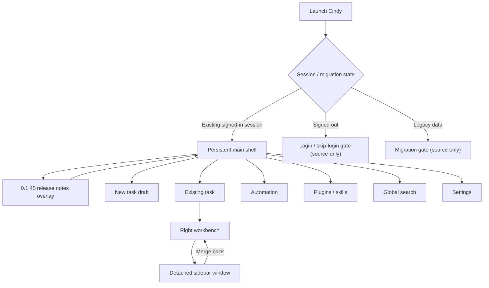
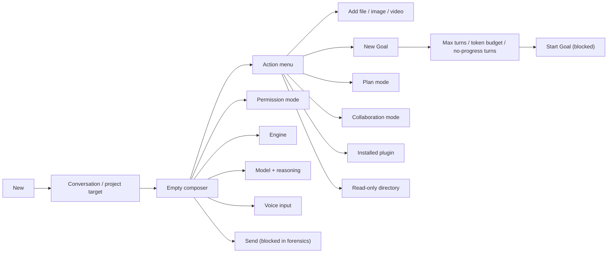
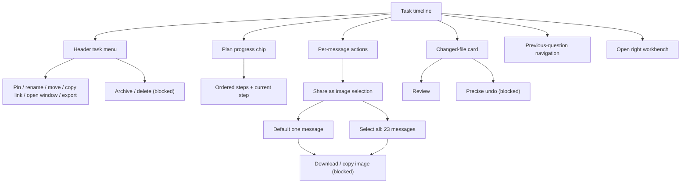
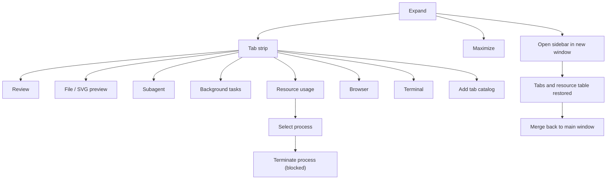
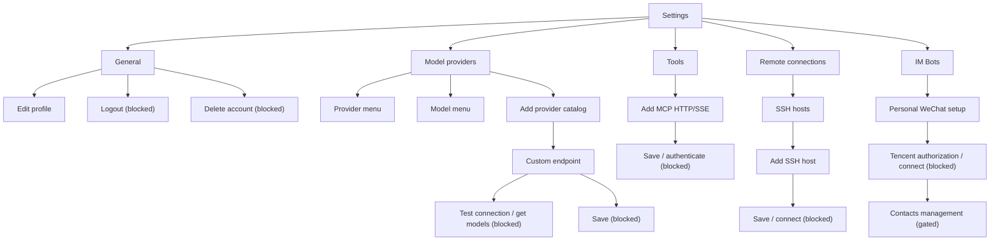
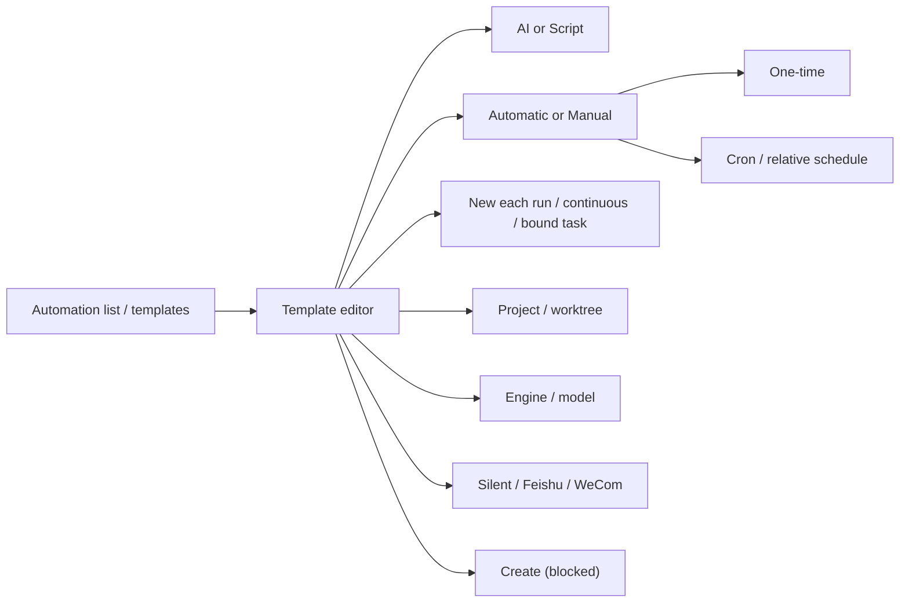

# Cindy 0.1.45 Flow Map

## Global application flow

Login, skip-login, and migration branches exist in the packaged application but were not entered because the live account is already authenticated and logging out or mutating migration state would violate the read-only boundary.

## New task flow

Business conditions:

- Send is disabled while the composer is empty.
- Goal Start is disabled until a description exists.
- Goal advanced limits are scoped to the current goal.
- The target picker can remove a project or open a system folder picker; neither branch was taken.
- The 0.1.45 new-task target list contained Conversation and local Projects, not a phone device.

## Existing task flow

0.1.45 task-menu delta: “Open in split” is absent; “Open in new window” remains. Dragging a task out to create a window was not performed because it changes window/session layout, but the packaged app contains a session-drag-release helper and the equivalent explicit menu path is visible.

## Workbench flow

Current-context constraints:

- Subagent showed its persistent empty state because this task has no Subagent.
- Orca Workers and iOS Simulator strings/assets exist in the app package, but neither appeared in the current Add Tab catalog.
- Terminal and Browser were not interacted with beyond catalog inspection.
- Maximize was visible but not needed; detach/merge was fully verified.

## Settings flows

## Automation flow

## Runtime-only and error flows

These states need runtime prerequisites and were not synthetically forced:

- AskUserQuestion, permission confirmation, plan review, queue panel.
- Plan running breathing dot and plan failure reconciliation.
- Streaming text animation and suppression of replay when switching tasks.
- Interruption, credential switching, rollback preview, generated files, media/Mermaid/model lightboxes.
- Database fatal page, crash recovery page, provider/network errors.
- Signed-out login/skip flow and data migration flow.

They remain documented in coverage.md as source-only or context-gated branches rather than being mislabeled as live-captured UI.
