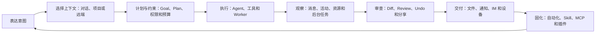
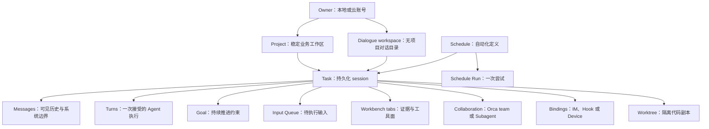
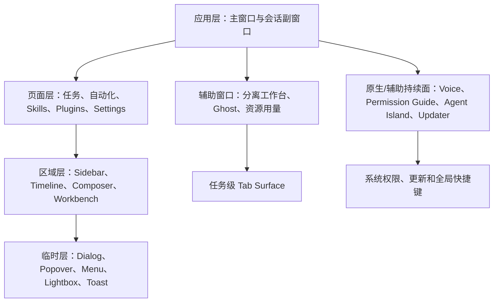

# 01｜Cindy 产品战略与信息架构蓝图

> 评审用途：产品战略、PRD、信息架构、交互设计、研发边界对齐。
> 源码基线：`makecindy/cindy@240247e52e938710f409c921a7a393097dcef52b`。
> 运行态样本：macOS Cindy 0.1.45，43 个只读安全遍历状态。
> 本文不把战略建议伪装成已实现功能。

## 0. 文档契约

### 0.1 三类陈述

| 标记 | 含义 | 评审用法 |
|---|---|---|
| **【事实】** | 源码、schema、测试或只读 UI 观察可以证明 | 可直接作为现状基线；仍可能受版本、账号、平台或 feature gate 影响 |
| **【建议】** | 面向产品演进的目标、原则、指标或 IA 调整 | 需要产品/设计/研发共同决策后才能进入 roadmap |
| **【缺口】** | 静态源码不能证明、运行态未覆盖、现状存在歧义或能力尚未完成 | 需要补动态验证、设计裁决、埋点或实现 |

### 0.2 证据入口

- [UI 源码清单](/Users/smallraw/.cache/cindy-deep-dive/source-analysis/ui-source-inventory.md)（下称 **UI-SRC**）
- [桌面 UI 架构](/Users/smallraw/.cache/cindy-deep-dive/source-analysis/architecture.md)（下称 **ARCH**）
- [业务逻辑源码审计](/Users/smallraw/.cache/cindy-deep-dive/source-analysis/business-logic.md)（下称 **BIZ**）
- [数据模型](/Users/smallraw/.cache/cindy-deep-dive/source-analysis/data-model.md)（下称 **DATA**）
- [IPC/API/Event](/Users/smallraw/.cache/cindy-deep-dive/source-analysis/ipc-api-events.md)（下称 **IPC**）
- [状态机](/Users/smallraw/.cache/cindy-deep-dive/source-analysis/state-machines.md)（下称 **STATE**）
- [UI 0.1.45 覆盖报告](/Users/smallraw/.cache/cindy-deep-dive/ui/coverage.md) 与 [UI Inventory](/Users/smallraw/.cache/cindy-deep-dive/ui/ui-inventory.md)（下称 **UI-LIVE**）
- [GitHub 项目蓝图](/Users/smallraw/docs/github-article/makecindy-cindy-blueprint.md)（下称 **GH-BP**）
- [中文 README](/Users/smallraw/.cache/cindy-deep-dive/source/cindy/README.zh-CN.md)（下称 **README**）

## 1. 执行摘要

### 1.1 愿景

**【建议】** Cindy 的愿景应定义为：

> 让人把一个模糊意图交给 Cindy，并在同一工作空间里完成规划、执行、观察、干预、审查、交付和自动化；模型、工具、设备与协作者是可替换能力，不是用户必须管理的产品中心。

这不是凭空提出。**【事实】** 当前产品已经把 Claude Code、Codex、Pi、多 Provider、项目/对话工作区、文件、终端、浏览器、Git 审查、Scheduler、Skill/MCP、Ghost 插件、Orca、多设备和 IM 接入同一个客户端；仓库产品原则明确要求“完成真实工作”“隐藏复杂度”“连接而非重造智能”。证据：[README](/Users/smallraw/.cache/cindy-deep-dive/source/cindy/README.zh-CN.md)、[核心产品原则](/Users/smallraw/.cache/cindy-deep-dive/source/cindy/docs/product-rules/core-product-principles.md)、[BIZ](/Users/smallraw/.cache/cindy-deep-dive/source-analysis/business-logic.md)。

### 1.2 产品承诺

**【建议】** 对用户的产品承诺应分为四层：

1. **结果承诺**：从“告诉我怎么做”升级为“把事情做完并留下可复核结果”。
2. **控制承诺**：用户始终能看到任务状态、权限请求、计划、改动、资源与外部交付，并可暂停、纠正、撤回或接管。
3. **连续性承诺**：任务不被单一窗口、模型、设备或即时网络状态绑定；可恢复、可排队、可自动化、可跨端接续。
4. **可组合承诺**：Agent、Provider、Skill、MCP、Ghost、IM 与设备都是明确边界下的组合件，用户不因扩展而失去安全与可解释性。

**【事实】** delayed-create、持久输入队列、Git Review/Undo、右侧工作台、Scheduler heartbeat、Device Link ack/replay、owner-scoped 数据与 fail-closed 权限已提供这些承诺的技术基础。证据：[BIZ §4–§15](/Users/smallraw/.cache/cindy-deep-dive/source-analysis/business-logic.md)、[UI-LIVE](/Users/smallraw/.cache/cindy-deep-dive/ui/ui-inventory.md)。

### 1.3 核心战略判断

| 判断 | 分类 | 含义 |
|---|---|---|
| Cindy 的主对象应是“可持续任务”，不是“聊天记录” | 【建议，已有事实支撑】 | DB 中 `sessions` 是产品任务，runtime session 只是执行句柄；UI 已有计划、目标、队列、自动化、改动与成本 |
| 模型/Agent 是任务属性，不应占据一级 IA | 【建议】 | 用户关心结果、工作区和控制；模型切换应留在 composer/任务设置，而非变成产品频道 |
| 右侧工作台是观察/操作面，不是第二导航栏 | 【建议，现状基本符合】 | 文件、Review、Subagent、后台任务、浏览器、终端服务于当前任务上下文 |
| 自动化是任务生命周期的第一等入口 | 【建议】 | Scheduler 已具备独立状态、运行历史、通知、脚本/Agent 两种 runner，应与“新建任务”并列被理解 |
| 本地模式不是“未登录残缺版” | 【事实 + 建议】 | local 是独立 owner/mode，无 token/user，但允许进入主应用；IA 和文案应表达为隐私/自管路径 |
| 扩展要统一成“能力来源”，实现层仍保持多协议 | 【建议】 | Skill、MCP、Ghost、内置工具用户心智重叠，但安全、生命周期、UI surface 不同，不应技术上强行合并 |

## 2. 产品定位与边界

### 2.1 产品定义

**【事实】** Cindy 是本地优先的桌面/移动 AI 工作客户端，客户端开源，官方托管服务可选；用户也可接自有 API key、本地模型或第三方 Provider。证据：[README lines 35–52](/Users/smallraw/.cache/cindy-deep-dive/source/cindy/README.zh-CN.md)、[GH-BP](/Users/smallraw/docs/github-article/makecindy-cindy-blueprint.md)。

**【建议】** 市场定位用语：

> “跨 Agent 的任务操作系统（Task Operating Workspace）”：面向需要让 AI 在真实项目、工具和外部通道中持续工作的个人与团队。

“操作系统”在这里是产品隐喻，不意味着 Cindy 是 OS 或通用 agent SDK。

### 2.2 竞争维度

| 维度 | Cindy 当前基础 | 应强化的差异 |
|---|---|---|
| 从回答到执行 | Agent turn、工具、文件、终端、浏览器 | 用“任务成果/交付物”而非 token/消息数呈现价值 |
| 从单 Agent 到可替换 Harness | Claude Code/Codex/Pi，deferred handoff | 让切换对用户更像“换执行引擎”，并清楚解释边界与恢复 |
| 从单轮到持续任务 | 队列、Goal、Plan、后台任务、Scheduler | 统一长期任务状态与“下一步由谁负责” |
| 从单机到跨端 | Device Link、remote/SSH/device workspaces、IM/Hook | 明确主控端、被控端、数据真值和离线语义 |
| 从封闭到生态 | Skills、MCP、Ghost、市场 | 统一发现/权限/信任叙事，保留实现差异 |
| 从黑箱到可控 | Permission/Ask/Plan、Review/Undo、usage | 建立“可观察、可干预、可恢复”的用户信任指标 |

### 2.3 非目标

以下应明确写入产品边界，防止路线漂移：

1. **【建议】不是另一个基础模型或模型训练平台。** Cindy 编排外部/本地智能。
2. **【建议】不是纯聊天机器人。** 对话是任务控制面，成果、文件、运行和外部交付同等重要。
3. **【建议】不是无边界 RPA。** 高风险动作仍须权限、provenance、路径与 owner gate；“Full Access”不等于 OS 沙箱豁免。证据：[BIZ §6–§7](/Users/smallraw/.cache/cindy-deep-dive/source-analysis/business-logic.md)。
4. **【建议】不是完整 IDE 替代品。** 文件编辑、终端、Review、浏览器是任务工具面；不以复制所有 IDE 功能为目标。
5. **【建议】不是把所有集成都做成同一种插件。** Skill/MCP/Ghost/IM 的运行与信任模型不同。
6. **【建议】不是承诺所有任务都可跨引擎无损切换。** 远程与 Orca 当前不支持 harness handoff，vendor session 可恢复性也不同。证据：[BIZ §5](/Users/smallraw/.cache/cindy-deep-dive/source-analysis/business-logic.md)。
7. **【建议】不是默认云同步一切。** local mode、owner 隔离、内容寻址媒体与安全存储边界优先。

## 3. 目标用户与 JTBD

### 3.1 用户分层

| 用户 | 核心场景 | 主要 JTBD | 当前证据 | 关键缺口 |
|---|---|---|---|---|
| 软件工程师/技术 Maker | 在真实 repo 中开发、调试、审查 | “把需求交给 Agent，同时能看改动、跑终端、查文件、撤回错误” | 项目/worktree、Review、文件、终端、浏览器、模型/权限选择；[UI-LIVE](/Users/smallraw/.cache/cindy-deep-dive/ui/ui-inventory.md) | 动态错误、媒体、rollback 全链路覆盖不足 |
| AI 高级用户 | 多 Provider、多模型、多 Agent 日常工作 | “按任务切换最合适的引擎，不丢上下文，不泄露凭据” | provider route、deferred harness switch、safeStorage；[BIZ §5](/Users/smallraw/.cache/cindy-deep-dive/source-analysis/business-logic.md) | 切换可解释性、兼容性预检、重启后 intent 丢失提示 |
| 项目负责人/Tech Lead | 分派并观察并行工作 | “让我把复杂工作拆给多个 Worker，知道谁卡住、改了什么、何时接管” | Orca team/worker、Subagent、后台任务、计划；[BIZ §8](/Users/smallraw/.cache/cindy-deep-dive/source-analysis/business-logic.md) | side activity 未实现；真实批量运行/桥断线待验 |
| 运营/自动化用户 | 定时生成、同步、检查、通知 | “把重复工作变成可靠自动化，失败时能追踪并恢复” | Scheduler agent/script、cron/interval、run history、IM notify；[BIZ §9](/Users/smallraw/.cache/cindy-deep-dive/source-analysis/business-logic.md) | 跨休眠/时区、真实通知、脚本能力教育待验 |
| 跨设备/远程用户 | 手机下发、本机执行、SSH/device 项目 | “离开桌面也能安全发起或继续任务，知道哪台设备是真值” | Device Link、remote/SSH/device file routing、Hook/IM；[BIZ §11–§13](/Users/smallraw/.cache/cindy-deep-dive/source-analysis/business-logic.md) | 新建页 0.1.45 未显示移动入口；relay 长时可靠性待验 |
| 生态作者 | 构建 Skill/MCP/Ghost 集成 | “让能力可被发现、授权、安装、升级、审查，并获得合适 UI surface” | SkillHub、plugin market、Ghost slots、MCP；[BIZ §10](/Users/smallraw/.cache/cindy-deep-dive/source-analysis/business-logic.md) | 多扩展概念学习成本；真实市场签名链待验 |
| 非技术知识工作者 | 文档、调研、协作与通知 | “用自然语言完成任务，不理解 CLI/模型路由也能安全交付” | 快速开始、对话工作区、浏览器、附件、Goal、IM | 当前信息密度与技术名词高，需更强渐进披露 |

### 3.2 核心 JTBD 句式

1. 当我只有一个模糊目标时，帮我把它转为可执行计划，并持续推进到完成或明确阻塞。
2. 当 AI 在我的项目中工作时，让我不用盯每个 token，但随时知道它在做什么、需要什么、改了什么。
3. 当一个 Agent/模型不合适时，让我换执行引擎或凭据路线，而不用手动重述全部上下文。
4. 当任务复杂到需要并行时，让我建立 Lead/Worker 协作，限制资源并聚合结果。
5. 当工作重复发生时，让我把已验证流程固化为自动化，并对跳过、失败、重试、通知负责。
6. 当我离开桌面时，让可信设备/IM 成为受限控制入口，不把本机全部能力暴露到远端。
7. 当第三方能力被加入时，让我知道它来自哪里、需要什么权限、怎样停用、更新或撤回。

### 3.3 用户信任任务

**【建议】** 除功能 JTBD 外，所有目标用户都共享三项信任任务：

- “告诉我这一步越过了哪一层边界。”产品必须区分输入快照已持久化的 `durableQueued`、Agent handle 已接受 Turn 的 `dispatchAccepted`、具体工具的 `sideEffectCommitted/Unknown`，以及最终 `terminal/delivered`；`accepted` 不能被解释为外部副作用已经发生。证据：[STATE §4](/Users/smallraw/.cache/cindy-deep-dive/source-analysis/state-machines.md)。
- “告诉我数据、凭据和执行到底在哪台机器/哪个 owner。”当前实现有 owner generation、remote/device workspace 与 safeStorage，但用户心智尚未完全统一。
- “如果失败，告诉我是可重试、需要人处理，还是存在不确定 in-flight。”Device Link 已保留 `inFlight` 不确定性；产品语言应复用此严谨性。

## 4. 产品原则

| 原则 | 分类 | 产品约束 | 证据/落点 |
|---|---|---|---|
| 结果优先于对话长度 | 【建议；现有原则】 | 首页、任务和指标优先呈现成果、状态、改动与下一步 | [核心产品原则](/Users/smallraw/.cache/cindy-deep-dive/source/cindy/docs/product-rules/core-product-principles.md) |
| 任务是第一等对象 | 【建议；实现支撑】 | 任务可有消息、目标、运行、队列、工作区、成本、tab、协作与外部 binding | [DATA `sessions`](/Users/smallraw/.cache/cindy-deep-dive/source-analysis/data-model.md) |
| 先意图、后实体 | 【事实】 | new route 在首发前不创建 session | [NewMakerDraftRoute](/Users/smallraw/.cache/cindy-deep-dive/source/cindy/apps/desktop/src/renderer/features/cc-agent/NewMakerDraftRoute.tsx) |
| 渐进披露技术复杂度 | 【建议】 | 默认呈现任务选择；Provider、effort、route、MCP provenance 在需要时展开 | [UI-LIVE 新建/模型/设置](/Users/smallraw/.cache/cindy-deep-dive/ui/ui-inventory.md) |
| 人可观察、可干预、可恢复 | 【事实 + 建议】 | Plan、permission、queue、Review、Undo、stop/retry 不得被隐藏成日志 | [IPC AgentEvent](/Users/smallraw/.cache/cindy-deep-dive/source-analysis/ipc-api-events.md) |
| 危险时 fail closed | 【事实】 | 无 resolver 拒绝；auto review 异常拒绝；身份/provenance 不足拒绝 | [BIZ §7/§10](/Users/smallraw/.cache/cindy-deep-dive/source-analysis/business-logic.md) |
| 运行态与持久真值分开 | 【事实】 | runtime close 不等于 archive；queue snapshot 不等于活队列；socket 不等于 device owner | [DATA §12](/Users/smallraw/.cache/cindy-deep-dive/source-analysis/data-model.md) |
| Owner 是全局隔离边界 | 【事实/推断】 | DB、ledger、credential、integration generation 随 owner 切换 | [BIZ §2](/Users/smallraw/.cache/cindy-deep-dive/source-analysis/business-logic.md) |
| 远端能力是真子集 | 【事实】 | Device Link allowlist 不透传本地设置与 secret 修改 | [device allowlist](/Users/smallraw/.cache/cindy-deep-dive/source/cindy/packages/device-link/src/allowlist.ts) |
| 扩展必须可撤销 | 【建议；部分事实】 | 安装、权限 review、禁用、卸载、fuse、来源都可见 | [BIZ §10](/Users/smallraw/.cache/cindy-deep-dive/source-analysis/business-logic.md) |
| 平台原生但语义一致 | 【事实 + 建议】 | macOS/Windows/Linux surface 可不同，任务/权限/错误语义一致 | [UI-SRC 平台差异](/Users/smallraw/.cache/cindy-deep-dive/source-analysis/ui-source-inventory.md) |
| 不把静默失败当简洁 | 【建议】 | sandbox、网络、provider、自动化、更新失败必须给原因和恢复动作 | open issues 与 [UI-LIVE 残余缺口](/Users/smallraw/.cache/cindy-deep-dive/ui/coverage.md) |

## 5. 核心价值链



**【事实】** 每一环都有实现，但成熟度不均：表达/执行/观察/设置已有 live 证据；真实 permission request、AskUserQuestion、队列、Orca populated state、错误恢复和破坏性确认仍是 UI coverage 的 gated gaps。证据：[UI coverage matrix](/Users/smallraw/.cache/cindy-deep-dive/ui/coverage.md)。

**【建议】** 产品 roadmap 不应按“再加一个工具”排序，而应按价值链断点排序。最优先的是让用户能从意图稳定走到可复核交付，其次才是扩展能力数量。

## 6. 能力地图

### 6.1 L0–L5 能力层

| 层 | 用户能力 | 已实现事实 | 目标建议 | 当前缺口 |
|---|---|---|---|---|
| L0 身份与模式 | 登录、本地使用、区域选择 | signed-out/local/cloud；cn/global/dev 构建语义；local 独立 owner | 把本地模式定位为自管路径；进入前明确云能力差异 | 真实 realm/SSO/删号动态待验 |
| L1 上下文 | 对话、项目、工作目录、worktree、远端 | project/dialogue、项目知识、local/SSH/device、worktree | 在新建页用“工作发生在哪里”统一描述 | 0.1.45 live 新建未出现手机入口；远端/源码可达性差异 |
| L2 执行 | Agent、model、provider、effort、fast、权限 | Claude/Codex/Pi、路由与切换、三权限模式、plan 正交 | 默认只问意图与风险；高级执行参数按需展开 | 跨 Agent 切换边界/不支持范围教育不足 |
| L3 协作 | Subagent、Orca、后台任务 | Lead/Worker 完整 session、worker limits、background projection | 统一“协作者”概念，区分系统派生 Subagent 与用户编排 Worker | side activity 未实现；live Orca 未覆盖 |
| L4 工具面 | Files、Review、Browser、Terminal、Simulator | 会话级 RSB plugin、detach、局部 error boundary | 把 workbench 作为当前任务证据与操作面 | tab 菜单受 context gate；resource usage 新旧入口并存 |
| L5 延伸 | Scheduler、Skill、MCP、Ghost、IM、Device Link | 自动化、市场、能力协议、跨端/通道 | 统一“连接与扩展”入口和信任说明 | 多概念 IA 复杂；真实服务/市场/relay 待验 |

### 6.2 能力组合原则

**【建议】** 用户配置应该围绕以下顺序，而不是暴露内部模块顺序：

1. **目的**：Conversation / Project / Goal / Automation；
2. **地点**：Local / SSH / Device / Dialogue workspace；
3. **执行者**：单 Agent / Collaboration；
4. **边界**：Permission、Plan、Budget、Worktree；
5. **能力**：Tools、Skills、MCP、Ghost；
6. **交付**：Desktop、IM、Device、File/Share；
7. **运行策略**：Now / Queue / Schedule / Silent。

## 7. 核心对象模型与信息架构

### 7.1 产品对象关系



**关键约束：**

- **【事实】** Task 对应 DB `sessions`；runtime session 的 active/closed/error 与任务 active/archived/deleted 是两层生命周期。[DATA](/Users/smallraw/.cache/cindy-deep-dive/source-analysis/data-model.md)
- **【事实】** Project identity 与 `workingDir` 解耦，稳定 key 可来自 local、remote 或 device。[BIZ §3](/Users/smallraw/.cache/cindy-deep-dive/source-analysis/business-logic.md)
- **【事实】** Turn 只有在 Agent handle 返回 `accepted` 后才越过派发边界。[BIZ §4](/Users/smallraw/.cache/cindy-deep-dive/source-analysis/business-logic.md)
- **【事实】** Schedule Run 是 attempt，不等于 Task；可绑定持久任务、临时任务或每次新建。[DATA §4](/Users/smallraw/.cache/cindy-deep-dive/source-analysis/data-model.md)

### 7.2 一级 IA

**【事实】** 0.1.45 live shell 的稳定入口为 New、Automation、Plugins、Search、Projects、Conversations、Account/Settings、Mobile Download、Release Notes；源码 router 还包括 SkillHub、Issue migration guide 和诊断页。证据：[UI-LIVE Product shell](/Users/smallraw/.cache/cindy-deep-dive/ui/ui-inventory.md)、[router.tsx](/Users/smallraw/.cache/cindy-deep-dive/source/cindy/apps/desktop/src/renderer/router.tsx)。

**【建议】** 一级 IA 归为五个用户意图，而不是按实现模块平铺：

```text
工作
├─ 新建任务
├─ 任务 / 项目 / 对话
└─ 搜索

持续运行
├─ 自动化
└─ 运行历史 / 失败待处理（建议补统一入口）

能力
├─ Skills
├─ Plugins / Ghosts
├─ Tools / MCP
└─ Connections（Provider、IM、Remote、Devices）

治理
├─ Review / Usage / Resource（任务上下文优先）
└─ Settings / Account / Privacy / Update

帮助
├─ Help Assistant
├─ Release Notes
└─ Issues / Feedback
```

“能力”和“Connections”是否作为一级入口需用使用频率验证；当前实现主要放在 Plugins、SkillHub 和 Settings，不建议在无证据时直接重构导航。

### 7.3 当前路由 IA

| 用户心智 | 源码 route | 页面 | 说明 |
|---|---|---|---|
| 登录 | `/login` | `LoginPage` | Guest only；本地模式入口同页 |
| 任务首页 | `/cc-agent` | redirect | 最近 new/session → 最新 session → new |
| 新建任务 | `/cc-agent/new` | `NewMakerDraftRoute` | transient draft |
| 当前任务 | `/cc-agent/:sessionId` | `CCAgentSessionView` | 消息、composer、status |
| 协作任务 | `/cc-agent/orca/:sessionId` | `OrcaWorkflowRoute` | Lead/Worker |
| 项目文件 | `/cc-agent/files/:sessionId` | `WorkdirBrowseRoute` | 任务上下文文档页 |
| 自动化 | `/cc-agent/scheduled` | `SchedulerPage` | source commit 真值 |
| Skills | `/skillhub/local`、`/skillhub/market` | Local/Market | 详情/管理部分走 modal |
| Plugins | `/plugins` | `GhostPluginPage` | Ghost/市场 |
| 设置 | `/settings?tab=...` | `SettingsView` | 14 tabs |
| 账单 | `/billing` → settings | redirect | 避免双入口真值 |
| Issues | `/issues` | Guide | 已迁 GitHub |

**【缺口】** UI 0.1.45 实机记录到 `#/automations`，源码 commit 为 `/cc-agent/scheduled`。可能是构建版本、路由别名或记录口径差异；PRD 应引用用户可见“自动化”，不要依赖内部 URL，研发需补版本映射验证。证据：[UI coverage](/Users/smallraw/.cache/cindy-deep-dive/ui/coverage.md)、[router.tsx](/Users/smallraw/.cache/cindy-deep-dive/source/cindy/apps/desktop/src/renderer/router.tsx)。

### 7.4 设置 IA

当前 14 个 tab 可重组为以下概念组，先作为文案/分组建议，不立即改变 route key：

| 建议分组 | 当前 tab | 用户问题 |
|---|---|---|
| 我的 Cindy | General、Personalization、Shortcuts、Voice Input、Agent Island | “Cindy 怎样为我工作和呈现？” |
| 智能与成本 | Providers、Billing | “用哪个智能、凭据与计费路线？” |
| 工具与执行 | Builtin Tools + MCP、Computer Use | “Agent 能做什么、需要哪些系统能力？” |
| 连接 | Remote Control、IM Bot | “哪些设备、主机和通道可触达任务？” |
| 数据与支持 | Import、Help、About | “如何迁移、学习、诊断和更新？” |

**【事实】** Billing 和 Agent Island 有 capability/platform gate；Windows close behavior、Linux voice shortcut 等在 section 内再做 platform gate。[SettingsView](/Users/smallraw/.cache/cindy-deep-dive/source/cindy/apps/desktop/src/renderer/components/settings/SettingsView.tsx)、[UI-SRC §7/§13](/Users/smallraw/.cache/cindy-deep-dive/source-analysis/ui-source-inventory.md)。

## 8. 窗口与 Surface 架构

### 8.1 Surface 层级



### 8.2 Surface 清单与产品规则

| Surface | 已实现事实 | 产品角色 | 关键规则 |
|---|---|---|---|
| 主窗口 | 1280×800 default，min 800×600 | 全产品导航与默认任务控制台 | 唯一常驻 chrome；状态持久化 |
| 会话副窗口 | 继承主窗，min 800×600 | 并行查看/执行另一个任务或 Worker | 不是主窗 clone 状态；通过 boot gate 定位 |
| 分离 Workbench | 520×860，min 360×480 | 在另一屏持续观察当前任务工具 | 可 merge back；使用轻量 preload/module graph |
| 分离 Ghost | 480×720，min 320×400 | 插件独立 surface | 每 Ghost 状态文件；webview 仍受安全闸 |
| Resource Usage | 580×520 | 跨任务/进程观察 | 新入口独立窗；旧 persisted tab 兼容 |
| Voice overlay | 透明全局窗口 | 跨应用听写进行态 | 不应抢焦点；Windows 有重建策略 |
| Voice dictionary toast | 透明短时窗口 | 词典/听写短反馈 | 与持续 overlay 分开管理生命周期 |
| 电脑权限引导 | 原生引导 Surface | 系统权限教学 | 背景不可交互，guide 可操作，always-on-top |
| 会话拖动预览 | 轻量预览窗口 | 跨窗口拖放任务时表达目标 | 拖动结束或取消必须销毁，不持有任务真值 |
| Agent Island | macOS SwiftUI | 任务状态的 glanceable surface | 仅 macOS、JSONL helper、四角色状态 |
| Windows updater | Windows Tauri 480×220 | 独立更新/回滚反馈 | 终态才可关闭；失败可开日志 |
| 隐藏插件逻辑沙箱 | 不直接展示的受控窗口/运行面 | 承载插件逻辑而非用户页面 | 不进入普通窗口导航；必须保持权限与来源边界 |

证据：[UI-SRC §3](/Users/smallraw/.cache/cindy-deep-dive/source-analysis/ui-source-inventory.md)、[ARCH §11](/Users/smallraw/.cache/cindy-deep-dive/source-analysis/architecture.md)。

### 8.3 主任务 Surface

```text
┌──────────────────────────────── Main Window ────────────────────────────────┐
│ Sidebar：New / Search / Projects / Tasks / Automation / Plugins / Account  │
├──────────────────────────────┬──────────────────────────────────────────────┤
│                              │ Header：标题 / 状态 / 任务操作               │
│ Sidebar                      ├──────────────────────────────────────────────┤
│（树外全高）                  │ Timeline：消息 / 活动 / 工具 / 改动卡        │
│                              ├──────────────────────┬───────────────────────┤
│                              │ Composer / Status    │ Workbench（可选）     │
│                              │ Goal/Plan/Permission │ Tabs / detach         │
└──────────────────────────────┴──────────────────────┴───────────────────────┘
```

**【事实】** 布局实现不是固定图：sidebar 在 tree 外，content 是全局递归 split，`chat-main` 恰好一个且 minWidth 400；右栏 tab/折叠状态再按 session 分桶，Ghost 可作为 `ghost:<id>` panelKind。[layoutTree.ts](/Users/smallraw/.cache/cindy-deep-dive/source/cindy/apps/desktop/src/shared/layoutTree.ts)。

**【建议】** Surface 选择规则：

- 跟随当前任务、需要频繁并排比较 → Workbench tab；
- 需要跨任务或跨窗口持续观察 → 独立辅助窗口；
- 需要阻塞决策/权限 → Dialog/interaction card；
- 仅短时反馈 → Toast/banner；
- 需要 OS 级持续可见或权限 → 原生辅助 surface。

## 9. 端、平台、区域与账号模式

### 9.1 模式矩阵

| 维度 | 模式 | 已实现语义 | 产品表达建议 |
|---|---|---|---|
| App session | signed-out | 不能进主应用；可登录/进入 local | “选择云账号或本地使用”而非“错误状态” |
| App session | local | 保留 local owner；无云 token/user；数据保留 | 明确哪些云/同步/市场能力不可用 |
| App session | cloud | membership 验证后进入；owner-scoped DB/integration | 显示当前数据 owner 与同步边界 |
| Region | cn | 单独构建；登录 badge `CN` | 不将 region 误写成语言 |
| Region | global | 默认国际构建；不显示 badge | 与 locale 解耦 |
| Region | dev | 单独构建；badge `Dev` | 明显标识非生产能力/数据边界 |
| Platform | macOS | application menu、vibrancy、Agent Island、Look Up | 遵守原生 menu/permission 习惯 |
| Platform | Windows | 自绘 title controls、tray、Tauri updater | 关窗/退出必须明示 |
| Platform | Linux | 无 application menu；global voice/mute 有限制 | 不展示不可用控制；给替代路径 |
| Endpoint | Desktop | 执行与数据主宿主 | 默认被控端/权威端 |
| Endpoint | Mobile/remote | Device Link/IM/Hook 发起与观察 | 明确能力子集、在线/离线和主控设备 |

证据：[BIZ §2/§12](/Users/smallraw/.cache/cindy-deep-dive/source-analysis/business-logic.md)、[UI-SRC §13](/Users/smallraw/.cache/cindy-deep-dive/source-analysis/ui-source-inventory.md)、[DESIGN region rule](/Users/smallraw/.cache/cindy-deep-dive/source/cindy/docs/design-rules/DESIGN.md)。

### 9.2 Owner 切换规则

**【事实 + 动态待验】** owner/mode 切换会递增 generation，关闭/重开 owner DB；多个关键异步模块会复验 scope，凭据、ledger、integration 也按 owner 隔离。该机制已实现，但“所有窗口推送和异步回调均无遗漏”仍需多窗口故障注入证明。[appSessionState.ts](/Users/smallraw/.cache/cindy-deep-dive/source/cindy/apps/desktop/src/main/appSessionState.ts)、[DATA §1](/Users/smallraw/.cache/cindy-deep-dive/source-analysis/data-model.md)。

**【建议】** 所有跨账号 UI 应具备四个可见属性：

1. 当前 owner；
2. 数据存储位置/同步状态；
3. 能力可用性变化；
4. 切换时在跑任务、外部连接和未保存状态的处理。

### 9.3 跨端规则

**【事实】** Device Link 远程 IPC 是本地 preload 能力的严格真子集；连接有 stopped/connecting/online、ack/replay/backpressure、单 owner lease，离线 push 仅内存且有界。[BIZ §12](/Users/smallraw/.cache/cindy-deep-dive/source-analysis/business-logic.md)。

**【建议】** UI 必须区分：

- “请求已送达设备”与“任务已被 Agent 接受”；
- “设备在线”与“本机为当前 owner”；
- “传输超时可恢复”与“任务是否已执行不确定”；
- “状态投影”与“持久化真值”。

## 10. 术语表

| 术语 | 产品定义 | 不要混用 |
|---|---|---|
| **任务 Task** | 用户可持续管理的工作记录；源码/DB 名为 `session` | 不等于临时 Agent runtime session |
| **运行时会话 Runtime Session** | 某 Agent/Harness 当前内存执行句柄 | close 不等于 archive/delete 任务 |
| **Turn** | 一次被 Agent 接受的输入与其结果边界 | 不等于一条 message；可含多事件/工具 |
| **Message** | 持久历史中的用户、assistant、工具、交互或系统边界记录 | `agent_switch/context_rebuild/tombstone` 不一定是可见正文 |
| **Project** | 稳定业务工作区身份，可映射 local/remote/device path | 不等于当前 cwd |
| **Dialogue Workspace** | 无项目对话的 owner/date/session 独立目录 | 不等于“无文件能力” |
| **Worktree** | 与任务绑定的隔离 Git 工作副本 | runtime close 不回收；archive/delete 才进入回收语义 |
| **Goal** | 要持续推进到 achieved/blocked/stopped 的任务目标及轮数/token/无进展限制 | 不等于 Plan |
| **Plan** | 当前执行步骤与 plan mode 状态 | 与 Permission Mode 正交 |
| **Permission Mode** | ask/auto/bypass 的 Agent 动作决策策略 | Full Access 不等于 OS sandbox 解除 |
| **Agent / Harness** | Claude Code、Codex、Pi 等执行引擎 | 不等于 Model 或 Provider |
| **Model** | Harness 调用的模型能力标识 | 同名模型可能属于不同 Provider route |
| **Provider Route** | 凭据、base URL、协议与模型的权威路由；`provider_id` 优先 | 不应只靠 model name 推断 |
| **Subagent** | runtime 创建并投影的逻辑子任务/子 Agent | 不等于用户显式编排的 Orca Worker |
| **Orca Lead / Worker** | 多 Agent team 中的完整 Maker session | Worker 不是轻量 thread，也不继承 Lead 权限默认 |
| **后台任务** | turn 结束后仍可继续的 Agent task/workflow activity | 不等于 Scheduler Run |
| **Automation / Schedule** | 可重复或手动运行的持久定义 | 不等于一次 Run |
| **Schedule Run** | 某 Schedule 的一次 attempt，带独立终态与 heartbeat | queued 尚未占 Agent/MCP/token |
| **Tool** | Agent 可调用的原子动作 | 不等于 MCP server/Skill/Ghost |
| **Skill** | 对 Agent 可发现/注入的指导或能力包，按 global/project/engine 扫描 | bundled link 可对所有 session 生效，不是 UI plugin |
| **MCP** | 工具服务协议；自定义项为 HTTP/SSE，secret 在 safeStorage | 配置更新对不同 Harness 生效时机不同 |
| **Ghost / Plugin** | 有 manifest、能力 slots、runtime、panel/card/tool 的扩展 | Node worker 不是 OS 沙箱 |
| **Workbench / RSB** | 当前任务的右侧工具工作台及 tab store | 不应作为第二个全局导航 |
| **Panel** | 递归主布局中的 pane kind | 不等于 Workbench tab；Ghost 可同时有 panel/window |
| **Binding** | IM channel/user/thread 到任务的持久路由 | 不等于凭据/connection 本身 |
| **Hook** | 经 WebSocket 接收外部任务与回传进度/终态的控制通道 | ack accepted/queued/rejected 不等于 turn done |
| **Device Link** | 可信设备间受限 IPC/事件传输 | 远端能力不是完整 preload |
| **Owner** | local 或云账号的数据、凭据、ledger 与 integration 隔离主键 | 不等于 OS user |
| **Region** | cn/global/dev 的构建/服务域 | 不等于 locale/language |

## 11. 产品缺口与建议优先级

### 11.1 S0：建立统一任务控制语义

**【建议】** 将以下状态收口到可解释的任务状态模型：Draft、Ready、Queued、Running、Waiting for You、Background Active、Completed、Failed、Interrupted、Archived。

**原因：** 当前 session status、Maker runtime status、input queue、background task、interaction、Goal/Plan 和 Scheduler run 各有独立状态机；技术上合理，但用户可能看到多个彼此不一致的 badge。证据：[STATE](/Users/smallraw/.cache/cindy-deep-dive/source-analysis/state-machines.md)。

**验收建议：** 任一任务 surface 能回答“当前谁负责下一步、是否已发生外部副作用、用户可做什么”。

### 11.2 S0：补足安全关键 UI 的动态覆盖

**【缺口】** 现有 43 状态没有触发 permission confirmation、AskUserQuestion、queue、真正 plan review、interrupt、rollback、provider/network error、DB fatal/crash recovery、Orca populated、iOS populated。原因是安全遍历不发送任务、不改权限、不诱发故障。[UI coverage 残余缺口](/Users/smallraw/.cache/cindy-deep-dive/ui/coverage.md)。

**【建议】** 建立 fixture/debug event lab，而不是在真实账号上制造故障；这些状态应成为 PRD/设计验收基线。

### 11.3 S1：统一扩展与连接的用户心智

**【建议】** 用“能力来源”总览解释：

- Built-in Tools：随客户端；
- Skills：给 Agent 的可发现指导/能力；
- MCP：远程/本地工具服务；
- Ghost：带 UI/runtime/权限的应用扩展；
- Connections：Provider、IM、Remote、Device。

管理页可统一发现/搜索/状态/信任提示，但不要抹平安装、运行和 secret 模型差异。

### 11.4 S1：强化跨端与自动化可观察性

**【建议】** 建立统一的阶段语言与关联 ID，但保留四条真实执行链：Scheduler Agent 为 Run/Attempt → Task/Turn；Scheduler Script 为 Run/Attempt → capability 协议；Hook/WeChat 为 durable ledger/inbox → Task/Turn → outbox；Device Link 为 owner lease/allowlist → 有界内存离线队列。界面分别显示 retry、TTL、lease、ack 和不确定 in-flight，不能把四者伪装成同一种 durable timeline。

### 11.5 S2：收敛版本迁移与入口歧义

**【缺口】** 自动化 URL/source 与 runtime coverage 不一致；Resource Usage 独立窗与隐藏 legacy tab 并存；市场旧详情 URL redirect；tab/route 兼容增加了隐藏复杂度。

**【建议】** 建立 route/surface migration registry 与版本化帮助链接，避免文档、遥测和 deep link 口径漂移。

## 12. 成功指标建议

以下均为 **【建议】**，不是现有埋点事实；隐私同意/analyticsEnabled/local opt-out 必须先满足现有遥测门。[BIZ §15](/Users/smallraw/.cache/cindy-deep-dive/source-analysis/business-logic.md)。

| 目标 | 指标 | 防作弊/解释 |
|---|---|---|
| 真实完成 | 任务达成率、用户确认完成率、产出文件/Review/交付比例 | 不用消息数或 token 数替代价值 |
| 可控 | 等待人处理时长、permission/ask 解决率、用户接管后恢复率 | 不能把自动拒绝算作“无人打扰”成功 |
| 可恢复 | crash/interrupted 后恢复率、重复副作用率、queue replay 成功率 | 分别统计 `durableQueued`、`dispatchAccepted`、副作用 ledger 和终态 |
| 自动化可靠 | scheduled → claimed → terminal 完整率、stale/interrupted 比率、通知交付率 | queued 不计资源运行成功 |
| 跨端可靠 | online handshake、ack 延迟、replay、unknown in-flight、owner takeover | 网络在线不等于 owner ready |
| 生态安全 | 安装成功、权限 review 放弃率、crash fuse、卸载/回滚率 | 不用安装量掩盖危险权限 |
| IA 清晰 | 首次任务 time-to-first-send、设置搜索成功、连接配置完成率 | local/cloud、Provider/Model 概念分别测 |

## 13. PRD / 设计 / 研发评审清单

### PRD 必答

- 主对象是 Task、Run、Extension 还是 Connection？是否与术语表一致？
- 哪个状态是持久真值，哪个只是 projection？
- 是否跨 owner、设备、窗口或 runtime？切换/销毁如何处理？
- 是否可能产生外部副作用？`durableQueued`、`dispatchAccepted`、副作用提交/不确定和终态怎样分别表达？
- 失败是可重试、终态还是不确定 in-flight？
- local/cloud、cn/global/dev、mac/win/linux 的差异是什么？

### 设计必答

- Surface 应是 page、workbench tab、dialog、toast 还是 native helper？
- 用户能否在不理解 Agent/Provider/MCP 的情况下完成主路径？
- 权限、计划、队列、错误、恢复是否有明确下一动作？
- 空态是否解释“为什么为空”和“怎样产生内容”？
- reduced motion、light/dark、最小窗口与 detached window 是否覆盖？

### 研发必答

- renderer 是否只通过最小 preload；main 是否校验 sender/owner/generation/path/provenance？
- route 静态段是否在 `:sessionId` 前；旧 deep link 如何迁移？
- 新 panel/tab/state 是否有 schema 限额、hydrate fallback、unknown preservation？
- secret 是否只在 safeStorage/main；是否可能回传 renderer/remote？
- crash、timeout、cancel、retry 是否有单一状态转移权威与幂等边界？
- 运行态与持久真值是否被误合并？

## 14. 结论

Cindy 已经不是“带工具的聊天应用”，而是一个任务、运行、工作区、协作、扩展和连接共同构成的工作客户端。它最有价值的不是功能数量，而是已经形成的三条主线：

1. 以任务为中心的持续执行；
2. 以权限、证据与恢复为中心的可控性；
3. 以 Agent/Provider/Skill/MCP/Ghost/Device 为中心的可组合性。

下一阶段的战略重点应是统一用户可见的任务控制语义、补齐安全关键动态状态、降低扩展/跨端概念成本，而不是继续横向堆叠入口。所有 IA 演进都必须保留 owner 隔离、fail-closed、持久真值分离和远端能力子集这四条系统底线。
