# Cindy Desktop 0.1.45 — 用户流程与状态矩阵

> 规格版本：1.0；审计日期：2026-08-13。Surface 的布局、控件和视觉要求见 [02-ux-and-ui-spec.md](/Users/smallraw/.cache/cindy-deep-dive/product-docs/02-ux-and-ui-spec.md)。本文把实机、旧基线、源码和门控分支拆开，供产品、开发与 QA 逐条验收。

## 1. 证据合同

| 标签 | 含义 | 可作何种结论 | 禁止推断 |
|---|---|---|---|
| `LIVE` | Cindy 0.1.45 实机只读观察，状态已保存于 43 行 manifest。 | 当前账号/平台/上下文下，该静态状态确实可达。 | 不能证明未触发的动画、提交结果或其他平台。 |
| `BASELINE` | Cindy 0.1.44 的 67 图参考集。 | 结构/历史行为参考，可发现 0.1.45 delta。 | 不能覆盖当前实现；15、31、32 有已知资产缺陷。 |
| `SOURCE` | 当前源码、应用包字符串或 0.1.44→0.1.45 diff。 | 分支/状态机/约束在代码层存在。 | 不等于发行包当前用户可见，也不证明真实服务成功。 |
| `GATED` | 需 signed-out/迁移数据/凭据/运行事件/外部传输/危险动作/故障注入。 | 必须用 mock、fixture 或 disposable 环境验证。 | 不得在生产账号或真实用户数据上强制制造。 |
| `ABSENT` | 在明确的 LIVE 菜单/上下文中检查且未出现。 | 仅证明该上下文不展示。 | 不等于源码不存在或其他能力/平台永远不可达。 |

### 1.1 证据来源

- [0.1.45 实机 manifest](/Users/smallraw/.cache/cindy-deep-dive/ui/manifest.jsonl)
- [UI inventory](/Users/smallraw/.cache/cindy-deep-dive/ui/ui-inventory.md)
- [Coverage 与资产 QA](/Users/smallraw/.cache/cindy-deep-dive/ui/coverage.md)
- [源码 UI 清单](/Users/smallraw/.cache/cindy-deep-dive/source-analysis/ui-source-inventory.md)
- [业务逻辑审计](/Users/smallraw/.cache/cindy-deep-dive/source-analysis/business-logic.md)
- [0.1.44 参考说明](/Users/smallraw/Development/QuincyWork/alva-agent/.scratch/cindy-ui-reference/README.md)
- [0.1.44 线稿索引](/Users/smallraw/Development/QuincyWork/alva-agent/.scratch/cindy-ui-reference/LINEWORK-INDEX.md)

### 1.2 事件来源词典

| 来源 | 例子 | 真值边界 |
|---|---|---|
| `USER` | 点击、键盘、输入、拖放、确认。 | UI intent；敏感动作仍须 main 复验。 |
| `ROUTER` | 路由、owner 变化、辅助窗 boot query。 | 页面装配，不拥有业务数据。 |
| `MAIN/DB` | 会话、设置、SQLite、PTY、窗口、文件、更新。 | 本地持久化与高权限操作真值。 |
| `AGENT` | text/thinking/tool/interaction/plan/status/done/error。 | 当前 session instance 的运行事件；需按顺序归并。 |
| `SCHEDULER` | due、runNow、claim、heartbeat、finalize。 | schedule/run 生命周期真值。 |
| `PLUGIN` | 安装、运行时、面板、权限 diff。 | 受 manifest、owner、provenance 和 host 约束。 |
| `REMOTE/OS` | SSH/device/IM/auth/browser handoff/OS permission/updater。 | 外部不可靠边界；必须超时、重试、拒绝与恢复。 |

## 2. 全局启动、认证与数据库旅程

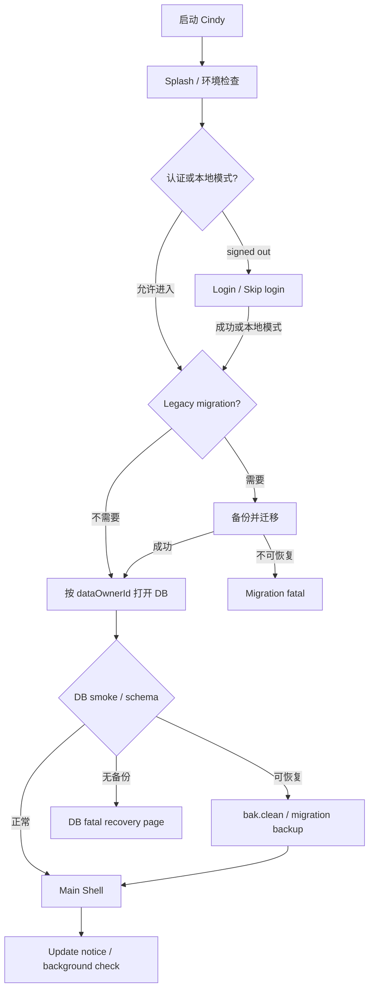

| 项 | 规格 |
|---|---|
| 前置条件 | 安装可启动；认证状态可能为空、本地或账号；DB 可能是新建、旧 schema、损坏或被另一进程占用。 |
| 权限 | 登录/条款/浏览器 handoff 由用户明确同意；skip login 不伪造 token；DB 迁移只用当前 owner 路径。 |
| 事件来源 | `REMOTE/OS` auth，`MAIN/DB` migration/lock/smoke，`ROUTER` owner-scoped router。 |
| 成功结果 | 进入 Main Shell，最近合法路由恢复；无合法会话则去 transient `/new`。 |
| 异常与恢复 | 登录返回/重试；迁移先备份；DB corrupt 优先 `.bak.clean`、再最新 migration backup；无备份进入 fatal，不循环自动重试。 |
| 证据 | Login/Migration/DB fatal 为 `SOURCE+GATED`；0.1.45 更新公告为 `LIVE`；Shell 为 `LIVE+BASELINE`。 |
| 截图 | [001 更新公告](/Users/smallraw/.cache/cindy-deep-dive/screenshots/original/001-更新公告-v0-1-45.png)、[002 主任务壳](/Users/smallraw/.cache/cindy-deep-dive/screenshots/original/002-任务对话-主视图.png)。 |

## 3. 新任务与 delayed-create

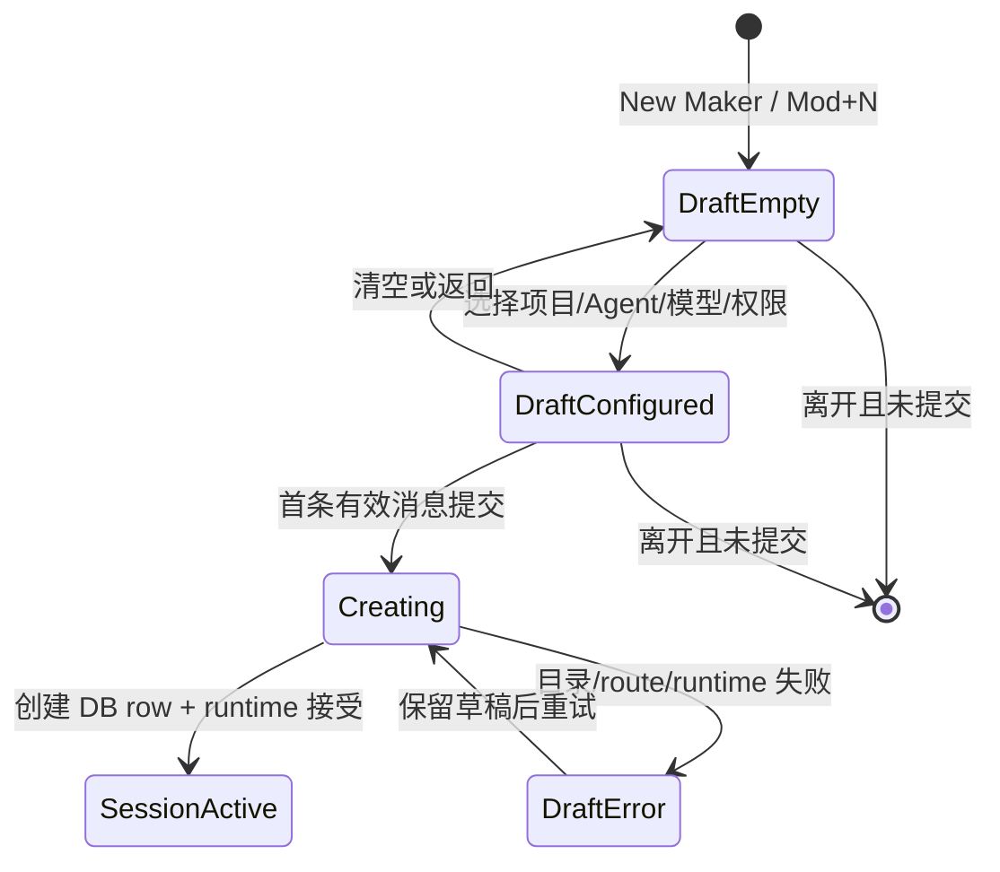

| 项 | 规格 |
|---|---|
| 前置条件 | 已过路由/DB gate；至少一个可用 Agent route；项目/远程/worktree 目标如选择必须通过校验。 |
| 用户步骤 | New Maker → Conversation/项目 → 可选附件/Goal/Plan/Collaboration → Agent/model/effort/Fast/permission → 输入 → Send。 |
| 权限 | 项目只授予所选工作区；额外目录默认只读；Full Access 需明确选择；远程连接另有凭据与 host key gate。 |
| 事件来源 | `USER` 草稿变更；`MAIN/DB` 第一次提交创建；`AGENT` 接受 dispatch。 |
| 成功结果 | 同一草稿原子转为一个 session 并进入时间线；首条消息只发送一次。 |
| 异常与恢复 | 路径失效、runtime 创建/dispatch 失败时保留文本和配置；可修改目标后重试；不得留下重复/空 session。 |
| 证据 | delayed-create 为 `SOURCE`；草稿/目标/Composer 为 `LIVE`；0.1.45 当前目标无手机设备为 `LIVE+ABSENT`。 |
| 截图 | [036 空白草稿](/Users/smallraw/.cache/cindy-deep-dive/screenshots/original/036-新建任务-空白草稿-0-1-45.png)、[037 目标选择](/Users/smallraw/.cache/cindy-deep-dive/screenshots/original/037-新建任务-对话或项目选择器-0-1-45.png)、[025 权限](/Users/smallraw/.cache/cindy-deep-dive/screenshots/original/025-任务-权限模式菜单.png)、[026 模型](/Users/smallraw/.cache/cindy-deep-dive/screenshots/original/026-任务-模型选择器-0-1-45.png)、[027 操作菜单](/Users/smallraw/.cache/cindy-deep-dive/screenshots/original/027-任务-composer操作菜单.png)。 |

## 4. 单次 Turn、队列与中断恢复

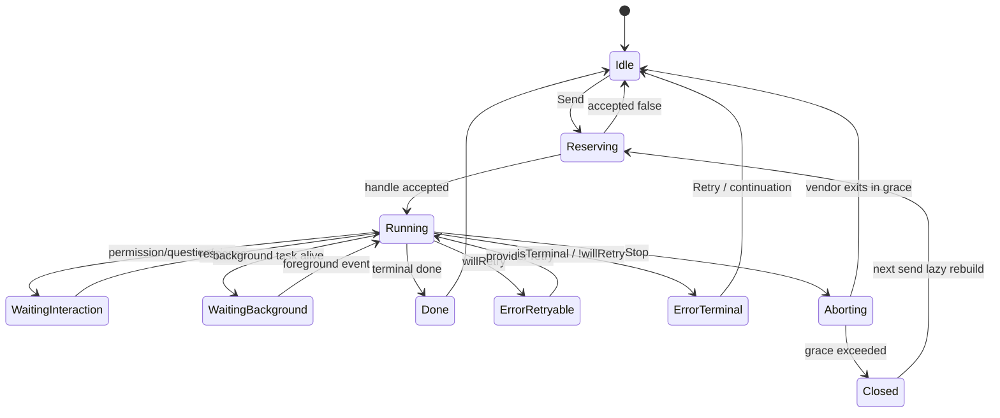

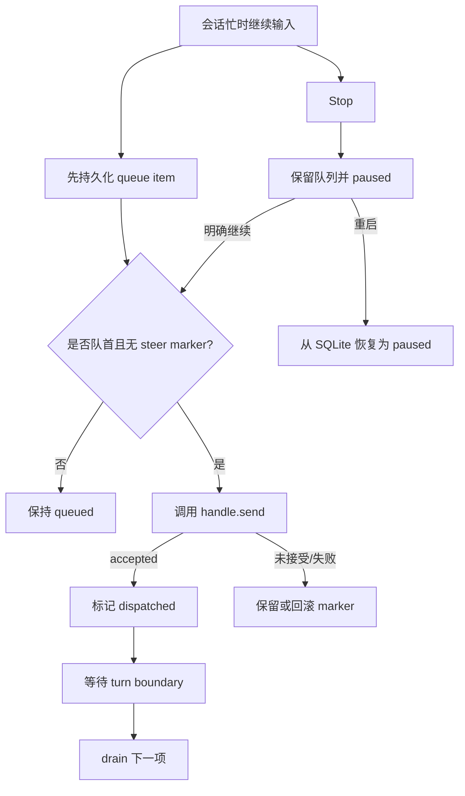

| 项 | 规格 |
|---|---|
| 前置条件 | Session active；每次仅一个 host turn lease/reservation。 |
| 权限 | Stop 不需额外权限；排队输入沿用提交时的 session route/权限，不能借队列绕过后续权限 gate。 |
| 事件来源 | `USER` Send/Stop；`MAIN/DB` queue snapshot；`AGENT` accepted/events/done/error。 |
| 成功结果 | 事件按序进入时间线；队列只从队首派发；accepted 才标记 dispatched。 |
| 超时 | 无事件 45 分钟 stall watchdog，但等待 interaction 或存在后台任务时暂停；provider 调用 30 分钟 watchdog。 |
| 异常与恢复 | Stop 保留 pending；重启恢复 paused 并需明确继续；abort grace 超时关闭 runtime，下次 send 惰性重建；无输出 retry 可克隆，已有部分输出用 continuation。 |
| 证据 | 生命周期与队列为 `SOURCE`；LIVE 当前未启动新 turn，queue/stop/watchdog 为 `GATED`。 |
| 截图 | [002 时间线](/Users/smallraw/.cache/cindy-deep-dive/screenshots/original/002-任务对话-主视图.png)；0.1.44 baseline 的 activity/typed states 仅作 `BASELINE`。 |

## 5. Permission、AskUserQuestion 与 Plan 共用交互通道

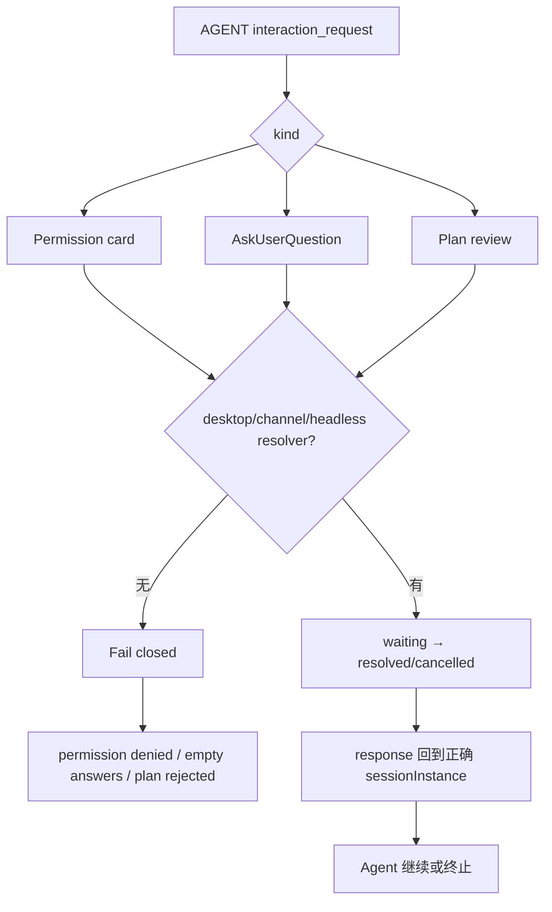

| Interaction | 前置条件 | 用户控件 | 权限/默认 | 结果 | 异常恢复 | 证据/截图 |
|---|---|---|---|---|---|---|
| Permission | 工具请求超出当前策略。 | Allow once、策略允许、Deny；显示工具/路径/命令/scope。 | 无 resolver 拒绝；Auto 评审异常拒绝；Full Access 仍不等于 OS sandbox。 | resolved 后执行或 denied 返回 Agent。 | 卡片过期/窗口关闭变 cancelled；不得投递到复用后的错误 instance。 | `SOURCE+GATED`；[025 模式菜单](/Users/smallraw/.cache/cindy-deep-dive/screenshots/original/025-任务-权限模式菜单.png) 仅证明策略选择。 |
| AskUserQuestion | Agent 主动请求结构化回答。 | 选项/文本、提交、取消、问题导航。 | 无 resolver 返回空答案，不自选默认。 | 回答进入当前 turn；上一问题可导航。 | 提交失败保留选择；取消给 Agent 明确空/拒绝结果。 | `SOURCE+GATED`；默认问题导航为 `LIVE`，见 [002](/Users/smallraw/.cache/cindy-deep-dive/screenshots/original/002-任务对话-主视图.png)。 |
| Plan review | Agent 交付待审计划。 | 审阅、接受、要求修改、拒绝。 | Plan boolean 与 permission mode 正交；无 resolver 拒绝。 | 接受后继续 execution；修改/拒绝回 Agent。 | 失联保持 waiting 或明确 cancelled，不自动批准。 | `SOURCE+GATED`；[024 计划浮层](/Users/smallraw/.cache/cindy-deep-dive/screenshots/original/024-任务-计划浮层-0-1-45.png) 是 progress，不是完整 review。 |

## 6. 计划进度与失败对账

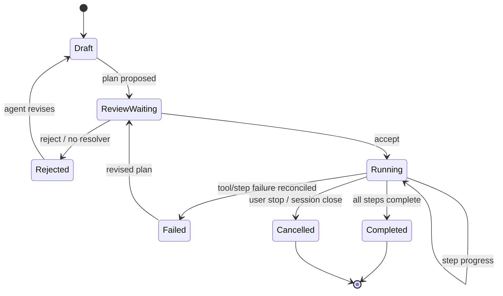

| 项 | 规格 |
|---|---|
| 前置条件 | Agent emits plan/plan progress，或用户显式进入 Plan mode。 |
| UI | 时间线 chip + pinned plan/popover；步骤保持顺序，当前 step 唯一；running step 用呼吸点，终态停止动效。 |
| 规则 | progress 数量、步骤状态与最终 Agent 事件对账；tool failure 不能让计划永久显示 running；切任务不重播动效。 |
| 结果 | completed/failed/cancelled 都是稳定可恢复终态；修改计划产生新版本而非篡改历史结果。 |
| 异常恢复 | 事件乱序/断线时以 terminal status 和 reconciliation 归并；无法对账显示“状态未知/刷新”，不伪报完成。 |
| 证据 | 2/6 popover 为 `LIVE`；呼吸点和失败 reconciliation 为 `SOURCE+GATED`，因当前任务 idle 未强制制造。 |
| 截图 | [024 计划 2/6](/Users/smallraw/.cache/cindy-deep-dive/screenshots/original/024-任务-计划浮层-0-1-45.png)。 |

## 7. Goal 长程任务

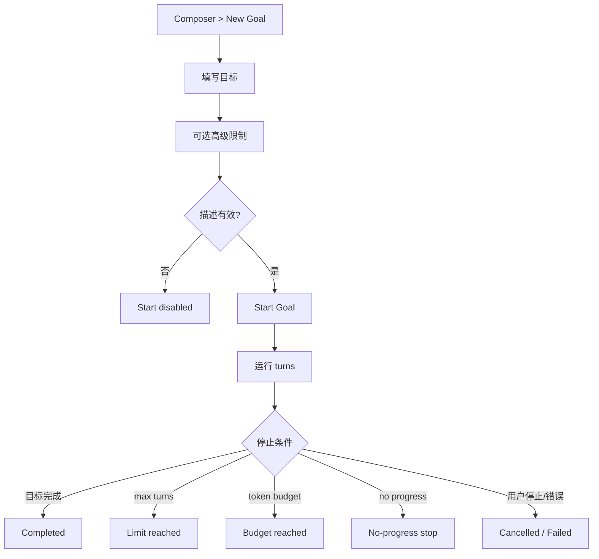

| 项 | 规格 |
|---|---|
| 前置条件 | 有可用 route；目标描述非空；限制值在合法范围。 |
| 权限 | Goal 不自动升级 permission；工具请求继续进入统一交互通道。 |
| 事件来源 | `USER` 配置/Start/Stop，`AGENT` turns/progress，`MAIN/DB` 限额与持久状态。 |
| 成功结果 | 目标完成或因明确停止条件稳定结束，报告已使用 turns/tokens 与结果。 |
| 异常恢复 | 启动失败保留草稿；恢复时不可重置已用预算；无进展计数应可解释。 |
| 证据 | 创建/高级限制为 `LIVE`；真实运行与停止条件为 `SOURCE+GATED`。 |
| 截图 | [038 Goal 草稿](/Users/smallraw/.cache/cindy-deep-dive/screenshots/original/038-goal-新建目标草稿.png)、[039 高级限制](/Users/smallraw/.cache/cindy-deep-dive/screenshots/original/039-goal-高级限制.png)。 |

## 8. 项目、任务、分享与回退

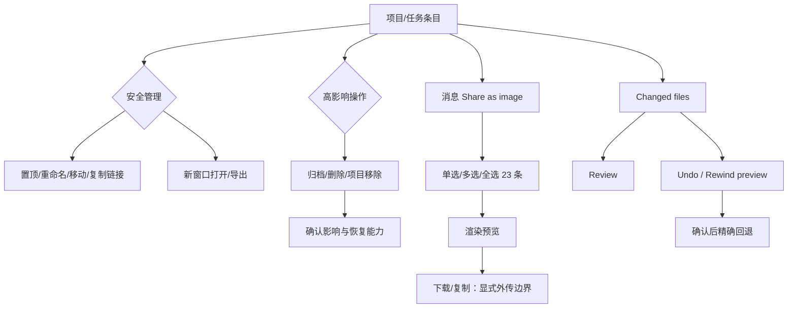

| 流程 | 前置条件 | 权限/危险性 | 成功结果 | 失败/恢复 | 证据/截图 |
|---|---|---|---|---|---|
| 项目菜单 | 项目存在且 owner 匹配。 | 移除/归档需确认；同步可能外部传输。 | 元数据或归属更新，列表选择稳定。 | 失败回滚 UI optimistic state；保留原项目。 | `LIVE+BASELINE`：[003 整理](/Users/smallraw/.cache/cindy-deep-dive/screenshots/original/003-侧边栏整理弹层.png)、[004 项目菜单](/Users/smallraw/.cache/cindy-deep-dive/screenshots/original/004-项目更多操作菜单.png)。 |
| 任务菜单 | 任务存在。 | archive/delete/export/share 分级。 | 0.1.45 有新窗口、无 split-open。 | 取消零副作用；窗口创建失败仍留主窗。 | `LIVE`：[005 选中态](/Users/smallraw/.cache/cindy-deep-dive/screenshots/original/005-侧栏任务条目-选中态.png)、[028 标题菜单](/Users/smallraw/.cache/cindy-deep-dive/screenshots/original/028-任务标题-更多操作菜单-0-1-45.png)。 |
| Share image | 至少一条可分享消息。 | Download/Copy 是明确输出边界；敏感内容由用户选择。 | 选择数与输出一致，长聊天可全选。 | render 失败保留选择；取消不生成文件。 | `LIVE`：[029 选择](/Users/smallraw/.cache/cindy-deep-dive/screenshots/original/029-任务-分享选区-0-1-45.png)、[030 全选 23](/Users/smallraw/.cache/cindy-deep-dive/screenshots/original/030-任务-长对话分享全选-0-1-45.png)；最终输出未执行。 |
| Review/Undo/Rewind | 存在 turn diff；回退还要求 Git savepoint。 | 会写工作树；必须预览路径与变化。 | 精确回到目标 checkpoint。 | 无 savepoint 时禁止承诺；失败保留现状并给诊断。 | file card 为 `LIVE`；Rewind dialog 为 `SOURCE+GATED`。 |

## 9. 右侧工作台与多窗口

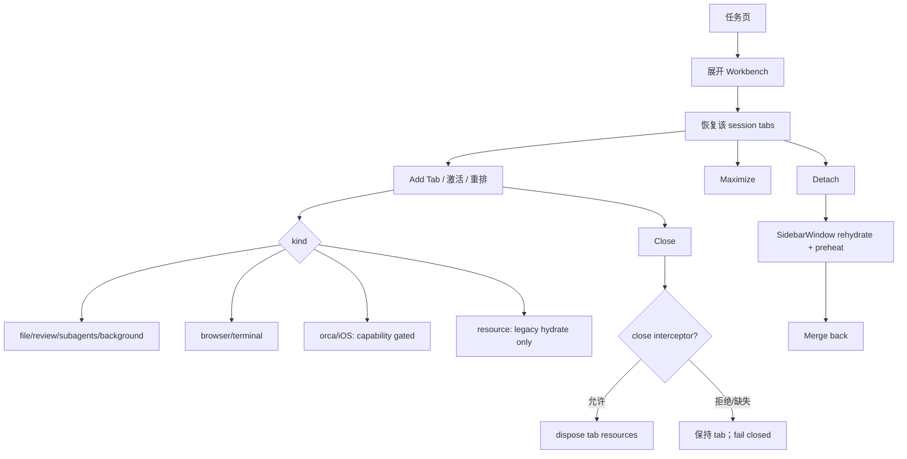

| Tab/动作 | 前置条件 | 事件/权限 | 结果 | 异常恢复 | 证据/截图 |
|---|---|---|---|---|---|
| Add/restore | 有 active session；kind 可用。 | `USER/MAIN`，按 session serialize/hydrate。 | 打开/聚焦单例或新 file tab。 | 未知 kind 隐藏槽位；单 tab boundary 提供 retry。 | `LIVE+SOURCE`：[031 多标签](/Users/smallraw/.cache/cindy-deep-dive/screenshots/original/031-右栏-多标签工作台-0-1-45.png)、[035 Add Tab](/Users/smallraw/.cache/cindy-deep-dive/screenshots/original/035-右栏-添加标签菜单-0-1-45.png)。 |
| Subagents | runtime 有或没有子 Agent。 | `AGENT` updates；按 session instance 隔离。 | 空态或列表/详情。 | 恢复后重建；终态留历史。 | 空态 `LIVE`：[034](/Users/smallraw/.cache/cindy-deep-dive/screenshots/original/034-右栏-subagent空态-0-1-45.png)；populated 为 `GATED`。 |
| Resource | 旧 tab 恢复或独立窗口入口。 | `MAIN` process snapshot；Terminate 高危。 | 表格定期刷新。 | stale/error 清楚；进程消失安全收敛。 | `LIVE`：[032 表](/Users/smallraw/.cache/cindy-deep-dive/screenshots/original/032-右栏-资源用量表-0-1-45.png)、[033 独立窗](/Users/smallraw/.cache/cindy-deep-dive/screenshots/original/033-资源用量-独立窗口-0-1-45.png)。 |
| Detach/Merge | Workbench open。 | `USER/MAIN window`；不复制业务真值。 | 分离窗恢复 tab/active/data；merge 回主窗。 | boot 失败可关闭/重试；主窗不丢状态。 | 0.1.45 preheated window `LIVE`：[033](/Users/smallraw/.cache/cindy-deep-dive/screenshots/original/033-资源用量-独立窗口-0-1-45.png)。 |
| Orca/iOS | Orca team 或 macOS tooling/capability。 | 程序创建/typed IPC；菜单可隐藏。 | 对应管理面。 | 缺 capability 隐藏或 unavailable。 | app strings/source 为 `SOURCE`；当前 Add Tab 为 `ABSENT CURRENT CONTEXT`。 |

## 10. 文件、Review、Browser 与 Terminal 生命周期

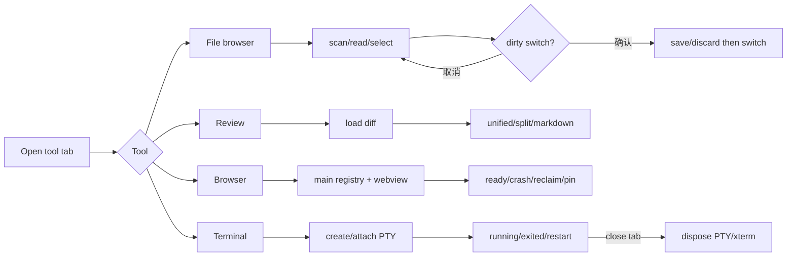

| 工具 | 前置/权限 | 状态 | 结果 | 异常/恢复 | 证据 |
|---|---|---|---|---|---|
| File | 有工作目录；local/SSH/device path 经主进程校验。写/删需权限。 | scan/loading/selected/dirty/unsupported/binary/large/error。 | 浏览/编辑/保存合法文件。 | traversal/symlink escape 拒绝；远程可回 stale cache；dirty switch 确认。 | `SOURCE+BASELINE`；当前 0.1.45 未做写操作。 |
| Review | Git/diff 可用。 | no changes/loading/diff/image/markdown/error。 | 只读审查；切 display mode 不改数据。 | Git unavailable 显式空/错态，仍可回聊天。 | `SOURCE+BASELINE`，LIVE 时间线有 Review affordance。 |
| Browser | tab registry 建立；外站网络可用。 | about:blank/loading/ready/crash/reclaimed/pinned/error。 | 页面与自动化共享受控 tab。 | crash 自清理；后台内存/CPU watchdog 回收；pinned 免回收。 | `SOURCE+BASELINE`；没有在取证中导航外站。 |
| Terminal | 有工作目录和 shell。 | creating/ready/running/exited/restarting/error。 | PTY I/O；exit 记录可重启。 | owner 窗销毁先迁 fallback；无 fallback dispose；secret-like env 剥离。 | `SOURCE+BASELINE`；没有执行命令。 |

## 11. 自动化创建、触发与运行

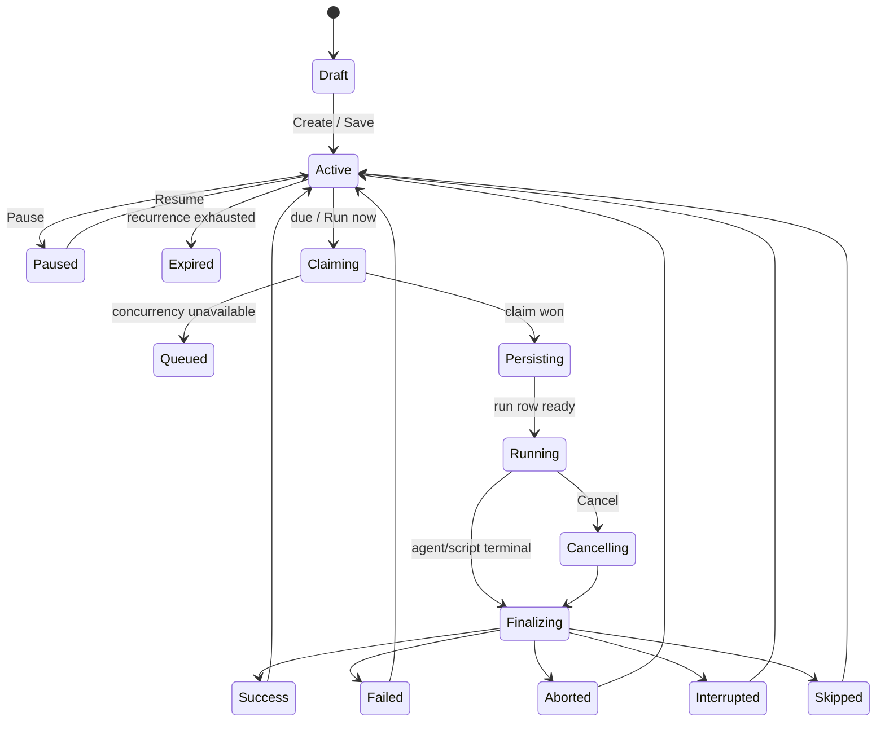

| 项 | 规格 |
|---|---|
| 前置条件 | 表单有效；cron/interval/timezone 可解析；target session 合法且非 review；script 只声明允许 capability。 |
| 权限 | Agent route/permission 固化；script 默认拒绝，仅显式 jira.read/jira.comment/sessions.dispatch/feishu.read 等能力；通知是外传。 |
| 事件来源 | `USER` create/run/pause/cancel；`SCHEDULER` due/CAS/heartbeat；`AGENT` 或 script JSONL terminal。 |
| 成功结果 | Schedule active；run 历史准确落 success/failed/aborted/interrupted/skipped。queued 不占 token/Agent。 |
| 异常恢复 | pre-hook exit 2=skipped 且零 token；其他异常 fail closed；启动 sweep 把旧 running 收敛为 interrupted；同 schedule 加锁串行。 |
| 目标恢复 | persistent target archived 后清绑重建；non-persistent target 暂停；目标忙 defer 且不造 run row。 |
| 证据 | 列表/模板/Cron 为 `LIVE`；真实 create/run 未执行，为 `SOURCE+GATED`。 |
| 截图 | [006 列表](/Users/smallraw/.cache/cindy-deep-dive/screenshots/original/006-自动化-列表页.png)、[007 模板编辑](/Users/smallraw/.cache/cindy-deep-dive/screenshots/original/007-自动化-模板编辑器.png)、[008 Cron](/Users/smallraw/.cache/cindy-deep-dive/screenshots/original/008-自动化-cron选择器.png)。 |

## 12. 插件、SkillHub 与 MCP

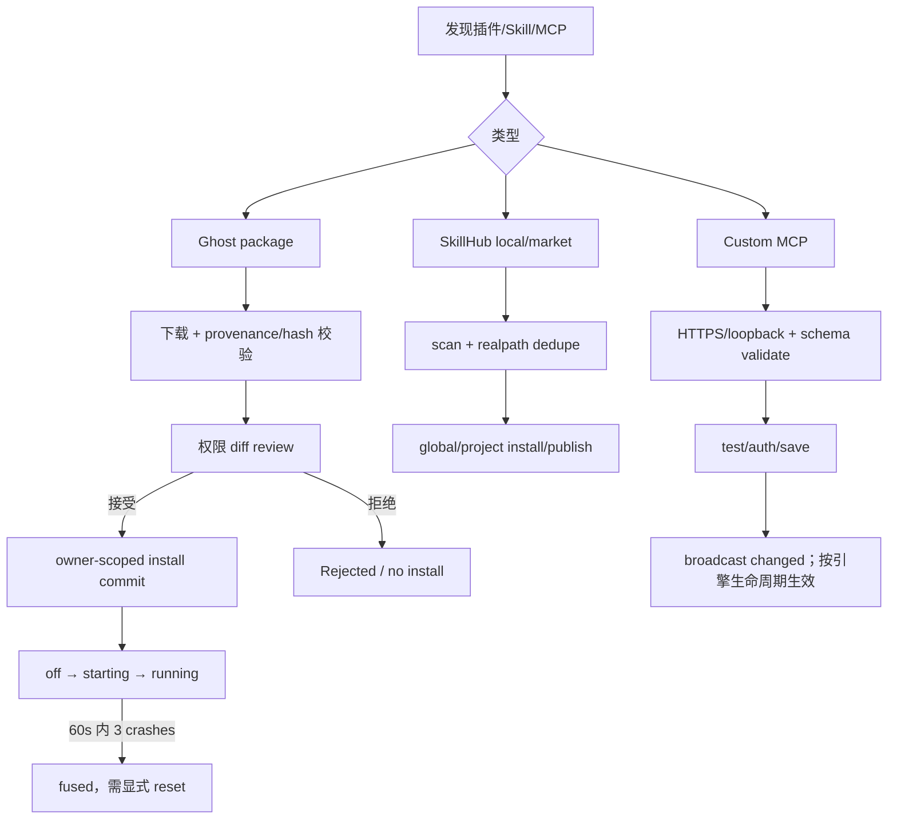

| 流程 | 前置条件 | 权限/事件 | 结果 | 异常恢复 | 证据 |
|---|---|---|---|---|---|
| Plugin install/update | 有可信市场源/包，owner 稳定。 | `PLUGIN+MAIN`；新增权限必须用户 review。 | ledger 原子提交，默认插件/opt-out 规则生效。 | hash/source/owner 变化则中止；crash fuse 防重启风暴。 | 页面为 `BASELINE+SOURCE`；本次未安装，`GATED`。 |
| Skill scan/install | global/project scope 可访问。 | 文件写入/链接；发布需网络与可见性确认。 | realpath 去重并安装到明确 scope。 | 冲突/ignore 不覆盖；取消清理持久重试。 | `BASELINE+SOURCE`。 |
| MCP add/edit | URL/ID/header 合法；凭据由用户提供。 | HTTPS/loopback；token safeStorage；`MCP_CHANGED`。 | 保存后 provider 刷新；Claude next session、Pi session snapshot。 | Test 失败不保存；删除需确认；不可信 caller provenance 拒绝。 | Add form `LIVE`：[019 工具/MCP](/Users/smallraw/.cache/cindy-deep-dive/screenshots/original/019-设置-工具与mcp.png)、[020 表单](/Users/smallraw/.cache/cindy-deep-dive/screenshots/original/020-设置-添加mcp服务器表单.png)；Save 未执行。 |

## 13. 供应商、SSH、IM/联系人设置旅程

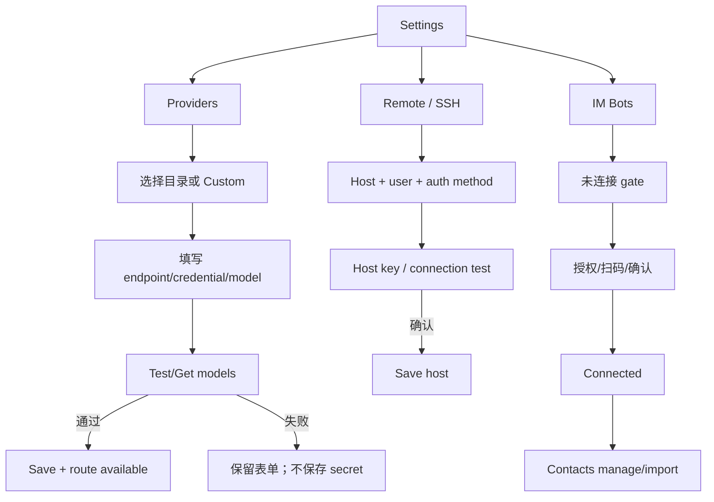

| 流程 | 前置/权限 | 成功 | 失败/恢复 | 证据/截图 |
|---|---|---|---|---|
| Provider | 目录或自定义 endpoint；API key/订阅；测试为外部网络。 | Provider/model 可选，余额/价格与 route 一致。 | auth/network/schema 错误保留非秘密字段；不泄露 key；busy credential-family switch 延迟到 turn boundary。 | `LIVE` 静态：[012 列表](/Users/smallraw/.cache/cindy-deep-dive/screenshots/original/012-设置-模型供应商-0-1-45.png)、[013 provider 菜单](/Users/smallraw/.cache/cindy-deep-dive/screenshots/original/013-设置-供应商更多操作菜单.png)、[014 model 菜单](/Users/smallraw/.cache/cindy-deep-dive/screenshots/original/014-设置-模型更多操作菜单.png)、[015 余额](/Users/smallraw/.cache/cindy-deep-dive/screenshots/original/015-设置-模型供应商-余额加载完成.png)、[016 添加](/Users/smallraw/.cache/cindy-deep-dive/screenshots/original/016-设置-添加供应商弹层.png)、[017 Custom](/Users/smallraw/.cache/cindy-deep-dive/screenshots/original/017-设置-自定义供应商连接表单.png)、[018 模板](/Users/smallraw/.cache/cindy-deep-dive/screenshots/original/018-设置-自定义供应商模板菜单.png)。 |
| SSH | Host/user/port/auth；private key/agent；host pinning。 | 保存可用 remoteHost 并可作为任务目标。 | host key mismatch 不自动接受；测试失败不保存 secret；断网显示 offline/retry。 | `LIVE` 表单：[021 远程](/Users/smallraw/.cache/cindy-deep-dive/screenshots/original/021-设置-远程连接.png)、[022 主机列表](/Users/smallraw/.cache/cindy-deep-dive/screenshots/original/022-设置-ssh主机列表.png)、[023 添加](/Users/smallraw/.cache/cindy-deep-dive/screenshots/original/023-设置-添加ssh主机表单.png)；连接为 `GATED`。 |
| IM/Contacts | Channel 能力、账号授权；联系人需 connected。 | channel connected，联系人管理可达。 | policy disabled/reauth/conflict/error 有明确状态；generation 使登出前任务失效。 | 微信 gate `LIVE`：[041](/Users/smallraw/.cache/cindy-deep-dive/screenshots/original/041-设置-im个人微信连接门.png)；授权/联系人为 `SOURCE+GATED`。 |
| Profile | 已登录或本地 profile 可编辑。 | 昵称/头像等保存到正确 owner。 | 校验失败保留表单；owner 切换关闭旧 dialog。 | Edit dialog `LIVE`：[040](/Users/smallraw/.cache/cindy-deep-dive/screenshots/original/040-设置-编辑个人资料.png)；Save 未执行。 |

## 14. 登录、迁移与更新细流

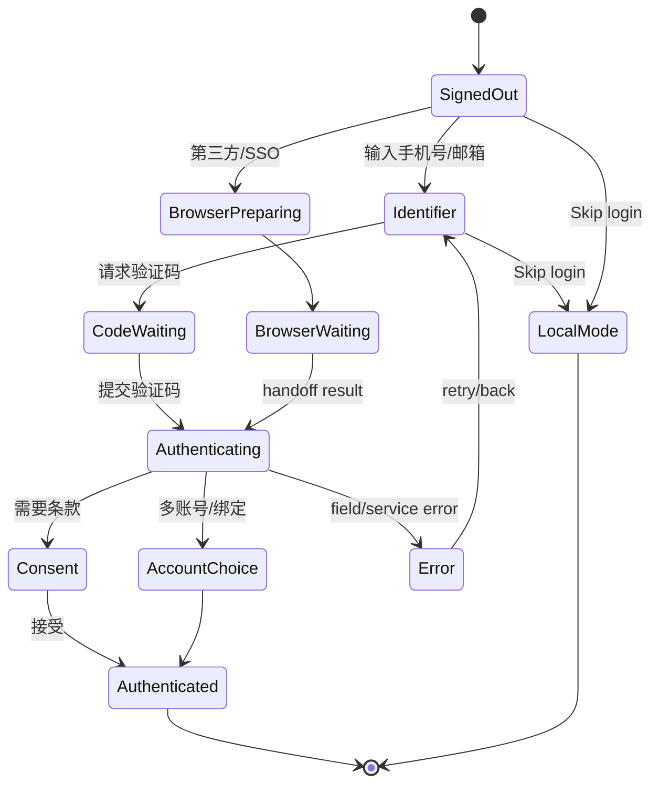

```mermaid
stateDiagram-v2
  [*] --> Idle
  Idle --> Checking: manual / timer
  Checking --> Idle: up to date
  Checking --> Downloading: newer manifest
  Checking --> Error: timeout/signature/network
  Downloading --> Ready: patch verified
  Downloading --> Error: failed; keep old ready
  Ready --> Superseding: newer version found
  Superseding --> Ready: new patch replaces old
  Ready --> Applying: packaged + safe boundary
  Applying --> Restarted: success
  Applying --> Ready: failed under 3 attempts
  Applying --> Abandoned: attempts >= 3
  Error --> Checking: retry
```

| 流程 | 前置条件 | 权限/事件 | 成功 | 异常恢复 | 证据 |
|---|---|---|---|---|---|
| Login/Skip | signed-out；realm/region 决定 identifier。 | 用户 consent；票据主进程；browser handoff 外部。 | 账号或无 token 的 LocalMode。 | resend cooldown、返回、取消、service error；不泄露账号枚举。 | `SOURCE+GATED`，实机已登录未退出。 |
| Migration | 有 legacy 数据/版本。 | 本地文件/DB 写入；备份先行。 | owner-scoped 新 DB 可打开。 | partial/fatal 给日志与备份恢复；不原地破坏唯一副本。 | `SOURCE+GATED`，未修改迁移状态。 |
| Update notice | 新版本首次或手动 Release Notes。 | 仅展示/外链。 | dismiss 并恢复原焦点。 | 资源失败仍可关闭。 | 0.1.45 `LIVE`：[001](/Users/smallraw/.cache/cindy-deep-dive/screenshots/original/001-更新公告-v0-1-45.png)。 |
| Auto update | packaged、非 translocation、版本非 0.0.0；Linux 自动受限。 | 网络下载；应用替换/重启。 | verified patch 应用。 | 保留旧 ready；busy/DB query failure 不自动重启；3 次失败放弃。 | `SOURCE+GATED`；未制造 pending update。 |

## 15. Orca Lead/Worker 协作

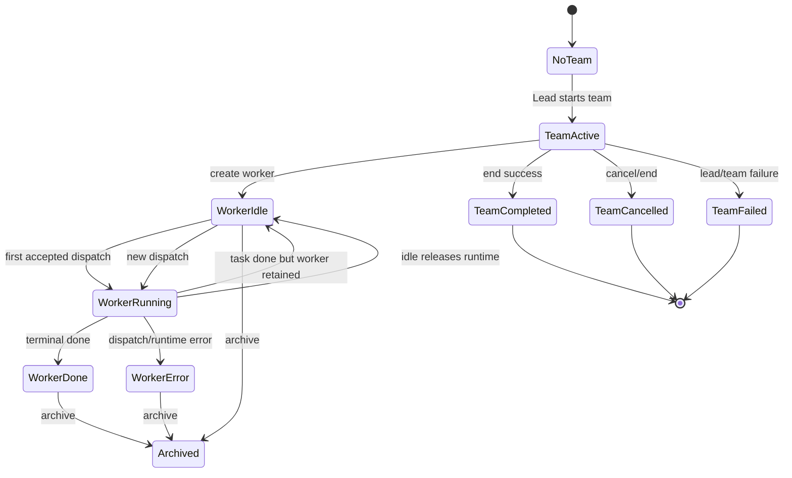

| 项 | 规格 |
|---|---|
| 前置条件 | Lead 是完整 Maker session；本地 Claude/Codex/Pi，SSH 只 Claude/Codex；每 Lead 至多一个 active team。 |
| 权限 | Worker 不继承 Lead 默认权限；从 auto 提升 bypass 要确认；caller 用可证明 `_meta.threadId`/session instance provenance，不能信业务参数自报。 |
| 事件来源 | `AGENT/PLUGIN` 的 `cindy_orca` MCP，`MAIN/DB` team/worker 唯一索引与 bridge。 |
| 成功结果 | Worker 创建、聚焦、收发信、终态回桥 Lead；每 team 仅一个 focused worker。 |
| 异常恢复 | reservation 防并发超限；派发失败回滚 running；idle 释放 runtime 不删逻辑 worker；archive 关闭 session；end team 终止并 archive。 |
| 证据 | `SOURCE+GATED`；当前 Add Tab 未显示 Orca Workers，属于 `ABSENT CURRENT CONTEXT`，不能当成产品删除。 |

## 16. 搜索与查找

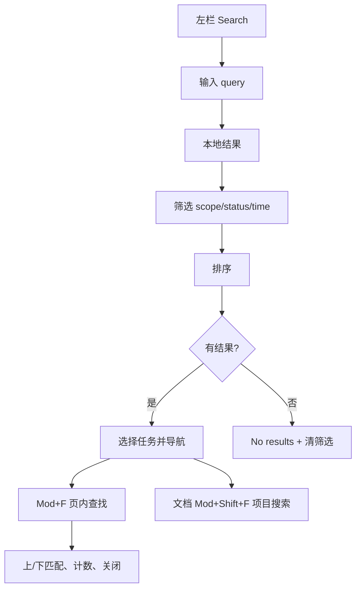

| 项 | 规格 |
|---|---|
| 前置条件 | owner DB 可用；项目搜索另需工作目录/ripgrep。 |
| 权限 | 查询正文保持本地；项目搜索只在授权根内，遵守 `.gitignore` 与路径边界。 |
| 事件来源 | `USER` query/filter；`MAIN/DB` history/file search；`ROUTER` result navigation。 |
| 成功结果 | 不改变原数据地定位 task/match；清空恢复完整列表。 |
| 异常恢复 | DB/file error 显示 retry；取消文件搜索终止进程；无匹配不是 error。 |
| 证据 | 全局搜索与筛选为 `LIVE`；专用 in-task find bar 为 `SOURCE/NOT REACHED`。 |
| 截图 | [042 搜索输入](/Users/smallraw/.cache/cindy-deep-dive/screenshots/original/042-侧栏-全局搜索输入.png)、[043 筛选排序](/Users/smallraw/.cache/cindy-deep-dive/screenshots/original/043-侧栏-搜索筛选排序菜单.png)。 |

## 17. 故障隔离与恢复旅程

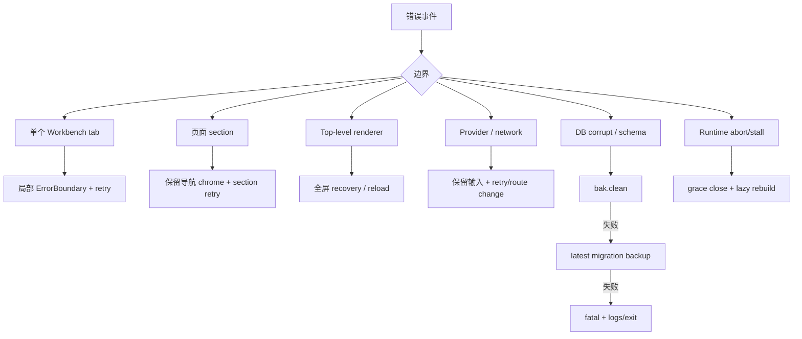

### 17.1 异常矩阵

| 异常 | 检测 | 用户可见状态 | 自动动作 | 用户恢复 | 证据 |
|---|---|---|---|---|---|
| Tab render crash | React boundary。 | 当前 tab 错误，不清聊天。 | 清理该 tab 可释放资源。 | Retry/Close。 | `SOURCE+GATED`。 |
| Route section error | route boundary。 | 保留主导航的 section fallback。 | 记录诊断。 | Retry/Home。 | `SOURCE+GATED`。 |
| Top-level crash | top boundary/process。 | 全屏恢复页。 | 最多受控重载，不循环。 | Reload/Logs/Quit。 | `SOURCE+GATED`，未诱发。 |
| Provider/network | error event，`isTerminal/willRetry`。 | toast/banner/message card，明确 retry。 | 非终态可 provider retry。 | Retry、换 route、复制输入。 | `SOURCE+GATED`。 |
| Turn stall | 45 分钟无事件且非 interaction/background。 | 运行异常/恢复提示。 | 中止或关闭 runtime。 | Retry/continuation。 | `SOURCE+GATED`。 |
| Abort grace exceeded | vendor 未退出。 | session closed，但任务保留。 | 删除内存 runtime。 | 下一次 send 惰性重建。 | `SOURCE+GATED`。 |
| Queue snapshot invalid | 启动校验失败。 | 可解释的队列恢复提示；不得伪派发。 | 丢弃损坏快照。 | 重新输入。 | `SOURCE+GATED`。 |
| DB corrupt | SQLite error/smoke。 | 恢复 toast 或 fatal。 | `.bak.clean`→migration backup。 | 重启/日志/支持。 | `SOURCE+GATED`。 |
| Plugin crash loop | 60s 内 3 crashes。 | fused，说明未运行。 | 停止自动重启。 | 显式 reset/disable/update。 | `SOURCE+GATED`。 |
| Browser resource excess | 30s watchdog。 | 背景回收或前台警告/kill。 | 按 CPU/memory 阈值处置，pinned/audible 例外。 | 重新打开/导航。 | `SOURCE+GATED`。 |
| Scheduler stale run | heartbeat/start sweep。 | interrupted 历史。 | 收敛旧 running。 | Run again。 | `SOURCE+GATED`。 |
| SSH/device/IM offline | transport/heartbeat。 | offline/reconnecting/standby/error。 | 指数退避、generation/lease。 | Reconnect/Reauth。 | `SOURCE+GATED`。 |

## 18. 关键状态总矩阵

### 18.1 会话与输入

| 对象 | 状态 | 进入事件 | 允许动作 | 离开事件 | 持久化/恢复 | 证据 |
|---|---|---|---|---|---|---|
| Draft | empty/configured/error | New Maker/配置/失败。 | 编辑、切配置、离开、Send。 | first submit 或离开。 | 未提交不建 session；草稿失败保留。 | `LIVE+SOURCE`。 |
| Session | active | create/resume。 | send/queue/stop/switch/view。 | aborting/closed/error。 | DB meta + vendor session CAS。 | `SOURCE`。 |
| Session | aborting | Stop。 | 等待；不重复 stop。 | idle/closed。 | grace 超时关闭 runtime。 | `SOURCE+GATED`。 |
| Session | closed | close/grace exceeded。 | next send。 | lazy active。 | 下次 send 重建。 | `SOURCE+GATED`。 |
| Queue | queued | busy send。 | reorder 若产品允许、remove、stop。 | dispatched/cancelled。 | SQLite snapshot。 | `SOURCE+GATED`。 |
| Queue | paused | Stop/restart recovery。 | explicit continue/remove。 | queued/dispatched。 | 重启默认 paused。 | `SOURCE+GATED`。 |
| Interaction | waiting | request event。 | resolve/cancel。 | resolved/cancelled。 | Router 状态，绑定 instance。 | `SOURCE+GATED`。 |
| Turn | retryable error | `willRetry`。 | 等待/Stop。 | running/terminal。 | 自动 retry 不重复计费。 | `SOURCE+GATED`。 |
| Turn | terminal error | `isTerminal` 或 `!willRetry`。 | Retry/continuation/copy。 | new turn。 | 历史保留。 | `SOURCE+GATED`。 |

### 18.2 工作台与窗口

| 对象 | 状态 | 进入 | 规则 | 恢复 | 证据 |
|---|---|---|---|---|---|
| Right shell | collapsed/open/maximized | 用户按钮/布局 restore。 | chat ≥400；按 session 记忆。 | 切回 session hydrate。 | `LIVE+SOURCE`。 |
| Tab | loading/active/error | add/restore/event。 | 单例 kind 去重；file 可多开。 | tab-local retry/close。 | `LIVE+SOURCE`。 |
| Detached | booting/ready/merge/error | detach。 | 只初始化精简 module graph。 | merge 或关闭，不丢主窗。 | `LIVE+SOURCE`。 |
| Resource | loading/populated/stale | snapshot/window open。 | 新入口独立窗，旧 tab 兼容。 | refresh/reopen。 | `LIVE`。 |
| Orca | unavailable/active | capability/team。 | 关闭拦截 fail closed。 | 回 lead/task。 | `SOURCE+GATED`。 |
| iOS | unavailable/booting/ready/error | mac tooling。 | typed IPC，平台 gate。 | retry/open setup。 | `SOURCE+GATED`。 |

### 18.3 设置与外部连接

| 对象 | 初始 | 进行中 | 成功 | 错误/门控 | 恢复 |
|---|---|---|---|---|---|
| Provider | unconfigured/configured | testing/loading balance | saved/available | auth/network/schema | 保留非 secret 字段、重试/编辑。 |
| MCP | empty/disabled | testing/saving | enabled | URL/auth/provider refresh | 重试；说明下 session 生效。 |
| SSH | disconnected | testing/connecting | connected/saved | auth/host key/offline | 拒绝 pin、编辑、重连。 |
| IM | disconnected | authorizing/waiting | connected | reauth/policy/conflict/error | retry/reauth/disconnect。 |
| Plugin | off | starting/stopping/installing | running/installed | crashed/fused/quarantine/rejected | reset/update/disable。 |
| Update | idle | checking/downloading/applying | ready/restarted | error/abandoned | retry、旧 patch、rollback。 |

### 18.4 Agent、模型、effort 与凭据切换

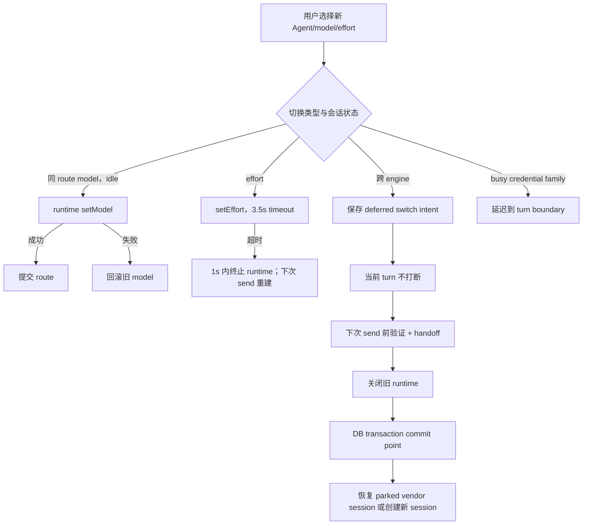

| 项 | 规格 |
|---|---|
| 前置条件 | 目标 route/provider/model 有效；跨 engine 只支持普通本地会话，远程与 Orca 不走此流程。 |
| 权限 | 切换本身不提升 tool permission；新 credential family 仍要求已配置且 owner 匹配。 |
| 事件来源 | `USER` selector，`MAIN/DB` deferred intent/handoff/transaction，`AGENT` turn boundary。 |
| 成功结果 | 当前 turn 保持完整；下一 send 使用新 route；可恢复 parked vendor session 时复用，否则用确定性 handoff 新建。 |
| 异常恢复 | `setModel` 失败回滚；effort 超时终止并 lazy rebuild；DB 是 commit point，边界写失败保留内存 handoff；创建失败下次重试。deferred intent 重启丢失是显式限制。 |
| 证据 | 选择器为 `LIVE`：[026](/Users/smallraw/.cache/cindy-deep-dive/screenshots/original/026-任务-模型选择器-0-1-45.png)；执行切换为 `SOURCE+GATED`。 |

### 18.5 Remote、Device Link、Hook 与 IM 入站任务

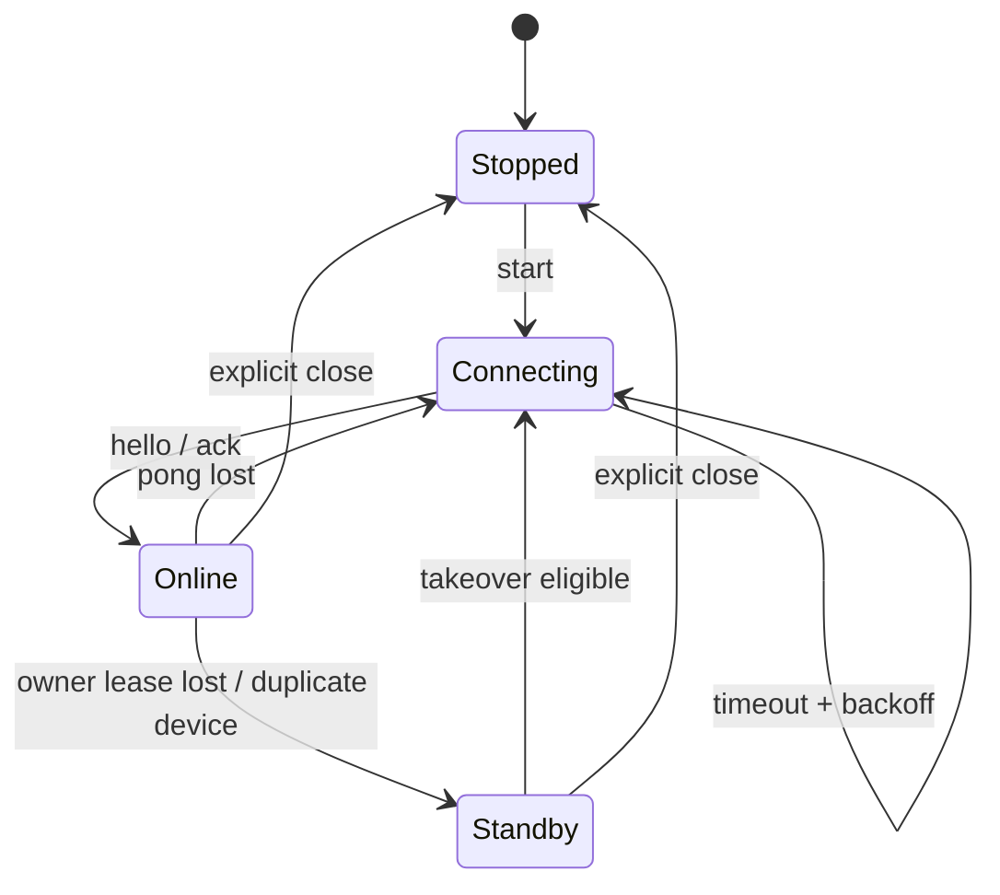

```mermaid
flowchart TD
  A["Hook/IM 收到任务"] --> B["认证 owner/device/channel"]
  B --> C["校验 workspace alias / session / policy"]
  C -->|"非法"| D["ack rejected + reason"]
  C -->|"合法且空闲"| E["ack accepted"]
  C -->|"合法但忙"| F["ack queued + FIFO"]
  E --> G["dispatch 到 session"]
  F --> G
  G --> H["progress 只保最新快照"]
  H --> I["turn.end / delivery outbox"]
  I -->|"离线"| J["持久化并重放"]
  I -->|"送达"| K["completed"]
  J --> K
```

| 流程 | 前置条件 | 权限/事件 | 结果 | 异常恢复 | 证据 |
|---|---|---|---|---|---|
| Device Link | owner 已配对；relay 可达；本地控制开启。 | 远程 IPC 是本地 preload 能力的严格真子集；单主 lease 5s heartbeat/15s stale。 | online owner 可靠传输并 ack/replay。 | 1–30s 指数退避；duplicate device standby；store 不可用时 owner 自降级；离线队列仅内存、128 项/512KiB/5min。 | `SOURCE+GATED`。 |
| Hook inbound | hello→welcome；workspace alias 白名单；session live。 | ack accepted/queued/rejected；路径每次重验；request ledger 去重。 | 空闲 dispatch，忙 FIFO；相同 requestId 重放 ack 不重跑。 | 401 只强制 refresh 一次；65s idle watchdog；路径移动/删除清绑定并重建。 | `SOURCE+GATED`。 |
| Personal WeChat | channel connected 且 policy 允许。 | 任务 TTL 30min、lease 60s；outbox pending→sending→delivered。 | 全部送达后 completed。 | 过载 rejected、过期 expired；失败可回 pending 重试或 terminal；未连接先停在 gate。 | Gate `LIVE`：[041](/Users/smallraw/.cache/cindy-deep-dive/screenshots/original/041-设置-im个人微信连接门.png)；运行 `SOURCE+GATED`。 |
| SSH/device task | 已保存且验证 remote host/device；工作区授权。 | SSH 大文件 chunk cache；device export→OSS→download 是外部传输；deadline 30min。 | 远程会话/文件可读写于授权范围。 | 短暂错误轮询、stale cache；超 working dir 的 SSH chat 文件拒绝；device 用 media fetch。 | 表单 `LIVE` 021–023；真实连接 `GATED`。 |

### 18.6 用量、计费与隐私同意

| 流程 | 输入/规则 | UI 结果 | 异常与验收 | 证据 |
|---|---|---|---|---|
| Model usage delta | 按 turn 取累计计数 delta；计数回退视为 reset，负值 clamp；已知 output 可晚一 turn 结算。 | 日/模型/session/run 用量；延迟结算不制造负数。 | timing 噪声可抑制，账务不能抑制；归因显示 exact/direct/mixed/zero/unavailable/legacy。 | `SOURCE+BASELINE`。 |
| Cost | 先按权威 route 区分 gateway/provider API/subscription/unknown；actual 与 estimate 分离。 | 币种、actual、estimated value 清晰。 | subscription 不计 actual money；不可归因不伪装精确。 | `SOURCE+BASELINE`。 |
| Analytics | `privacyConsentAccepted` 与 `analyticsEnabled` 两个独立开关；仅 packaged/严格 dev opt-in + consent + enabled + non-local。 | 设置显示当前 consent/开关，不采集消息正文。 | local 只 runtime opt-out，不篡改持久同意；设置损坏 fail closed；含糊凭据不误迁移同意。 | `SOURCE`；未改变设置。 |

## 19. 0.1.45 差异验收矩阵

| Delta | 期望 | 当前证据 | 仍需动态验收 |
|---|---|---|---|
| Plan 呼吸点/失败对账 | 仅 running step 呼吸；失败收敛稳定。 | `LIVE` 2/6 静态 + `SOURCE`。 | 注入 running→failed 事件序列，验证 reduced motion/切任务。 |
| Subagent 聊天流恢复 | inline/tab 恢复并按会话隔离。 | `LIVE` 空态 + `SOURCE`。 | seeded active Subagent、断线恢复、终态。 |
| Stream fade 默认开 | 新流文字淡入，reduced motion 可关。 | `SOURCE`。 | 新 turn 录像与设置默认值。 |
| 任务拖出窗口 | drop 创建同一 task 副窗。 | `SOURCE` + `LIVE` 等价菜单。 | 合法/非法 drop、取消、跨屏。 |
| Share selection/长图 | 单/多/全选 23 条正确渲染。 | `LIVE` selection。 | disposable 内容下 Download/Copy 与超长图。 |
| 移除 split-open | 菜单无分栏，只保留新窗口。 | `LIVE`。 | 左栏/标题/右键全部菜单回归。 |
| Resource window 预热 | 打开/分离后表格快速恢复。 | `LIVE`。 | 冷启动、stale/error、进程消失。 |
| 新任务无手机 | 当前目标只 Conversation/Projects。 | `LIVE+ABSENT`。 | device capability 打开时确认产品预期。 |
| 切任务不重播 stream | 历史消息静止。 | `SOURCE`。 | 刚完成流式内容来回切任务录像。 |
| 默认问题导航 | 时间线有上一问题入口。 | `LIVE`。 | 多问题、无问题、删除/branch 后定位。 |

## 20. 实机未强制触发的状态

以下不是“缺功能”，而是本次只读安全边界内没有构造：

- signed-out 登录、skip login、SSO/browser handoff、账号绑定、迁移 gate。
- 退出、删号、保存 profile、provider/MCP/SSH 凭据、测试连接、联系人授权。
- slash/mention palette、文件系统 picker 的最终选择、额外目录、Fast 实际执行。
- permission confirm、AskUserQuestion、plan review、queue、active interruption、credential switch。
- 计划运行呼吸点/失败 reconciliation、stream fade、切任务不重播。
- populated Subagent、Orca Workers、iOS Simulator、后台 workflow。
- media/model/Mermaid/tool payload lightbox、生成文件新事件、rollback/rewind preview。
- share 图片最终 Download/Copy、自动化 Create/Run、插件安装/更新/运行。
- provider/network error、tab crash、route/top-level crash、DB fatal/corrupt、更新 apply/rollback。

这些状态必须使用 mocked `AGENT` event、fixture DB、fake provider、disposable OS account/workspace 或专用 debug build，禁止用生产数据故障注入。

## 21. 截图映射：0.1.45 LIVE 43/43

所有链接对应同名稳定 PNG；同名确定性线稿位于 `/Users/smallraw/.cache/cindy-deep-dive/screenshots/linework/` 与 `lineart/`。

| ID | Surface/状态 | 原图 |
|---:|---|---|
| 001 | 更新公告 0.1.45 | [001](/Users/smallraw/.cache/cindy-deep-dive/screenshots/original/001-更新公告-v0-1-45.png) |
| 002 | 任务对话主视图 | [002](/Users/smallraw/.cache/cindy-deep-dive/screenshots/original/002-任务对话-主视图.png) |
| 003 | 侧边栏整理弹层 | [003](/Users/smallraw/.cache/cindy-deep-dive/screenshots/original/003-侧边栏整理弹层.png) |
| 004 | 项目更多操作 | [004](/Users/smallraw/.cache/cindy-deep-dive/screenshots/original/004-项目更多操作菜单.png) |
| 005 | 任务条目选中 | [005](/Users/smallraw/.cache/cindy-deep-dive/screenshots/original/005-侧栏任务条目-选中态.png) |
| 006 | 自动化列表 | [006](/Users/smallraw/.cache/cindy-deep-dive/screenshots/original/006-自动化-列表页.png) |
| 007 | 自动化模板编辑 | [007](/Users/smallraw/.cache/cindy-deep-dive/screenshots/original/007-自动化-模板编辑器.png) |
| 008 | 自动化 Cron | [008](/Users/smallraw/.cache/cindy-deep-dive/screenshots/original/008-自动化-cron选择器.png) |
| 009 | 设置总览 | [009](/Users/smallraw/.cache/cindy-deep-dive/screenshots/original/009-设置-0-1-45总览.png) |
| 010 | 通用中段 | [010](/Users/smallraw/.cache/cindy-deep-dive/screenshots/original/010-设置-通用中段-0-1-45增量.png) |
| 011 | 通用底部 | [011](/Users/smallraw/.cache/cindy-deep-dive/screenshots/original/011-设置-通用底部-0-1-45增量.png) |
| 012 | 模型供应商 | [012](/Users/smallraw/.cache/cindy-deep-dive/screenshots/original/012-设置-模型供应商-0-1-45.png) |
| 013 | 供应商菜单 | [013](/Users/smallraw/.cache/cindy-deep-dive/screenshots/original/013-设置-供应商更多操作菜单.png) |
| 014 | 模型菜单 | [014](/Users/smallraw/.cache/cindy-deep-dive/screenshots/original/014-设置-模型更多操作菜单.png) |
| 015 | 余额加载完成 | [015](/Users/smallraw/.cache/cindy-deep-dive/screenshots/original/015-设置-模型供应商-余额加载完成.png) |
| 016 | 添加供应商 | [016](/Users/smallraw/.cache/cindy-deep-dive/screenshots/original/016-设置-添加供应商弹层.png) |
| 017 | 自定义供应商 | [017](/Users/smallraw/.cache/cindy-deep-dive/screenshots/original/017-设置-自定义供应商连接表单.png) |
| 018 | 供应商模板 | [018](/Users/smallraw/.cache/cindy-deep-dive/screenshots/original/018-设置-自定义供应商模板菜单.png) |
| 019 | 工具与 MCP | [019](/Users/smallraw/.cache/cindy-deep-dive/screenshots/original/019-设置-工具与mcp.png) |
| 020 | 添加 MCP | [020](/Users/smallraw/.cache/cindy-deep-dive/screenshots/original/020-设置-添加mcp服务器表单.png) |
| 021 | 远程连接 | [021](/Users/smallraw/.cache/cindy-deep-dive/screenshots/original/021-设置-远程连接.png) |
| 022 | SSH 主机列表 | [022](/Users/smallraw/.cache/cindy-deep-dive/screenshots/original/022-设置-ssh主机列表.png) |
| 023 | 添加 SSH 主机 | [023](/Users/smallraw/.cache/cindy-deep-dive/screenshots/original/023-设置-添加ssh主机表单.png) |
| 024 | 计划 2/6 | [024](/Users/smallraw/.cache/cindy-deep-dive/screenshots/original/024-任务-计划浮层-0-1-45.png) |
| 025 | 权限模式 | [025](/Users/smallraw/.cache/cindy-deep-dive/screenshots/original/025-任务-权限模式菜单.png) |
| 026 | 模型选择器 | [026](/Users/smallraw/.cache/cindy-deep-dive/screenshots/original/026-任务-模型选择器-0-1-45.png) |
| 027 | Composer 操作 | [027](/Users/smallraw/.cache/cindy-deep-dive/screenshots/original/027-任务-composer操作菜单.png) |
| 028 | 任务标题菜单 | [028](/Users/smallraw/.cache/cindy-deep-dive/screenshots/original/028-任务标题-更多操作菜单-0-1-45.png) |
| 029 | 分享选区 | [029](/Users/smallraw/.cache/cindy-deep-dive/screenshots/original/029-任务-分享选区-0-1-45.png) |
| 030 | 长聊天全选 23 | [030](/Users/smallraw/.cache/cindy-deep-dive/screenshots/original/030-任务-长对话分享全选-0-1-45.png) |
| 031 | 工作台多标签 | [031](/Users/smallraw/.cache/cindy-deep-dive/screenshots/original/031-右栏-多标签工作台-0-1-45.png) |
| 032 | 资源用量表 | [032](/Users/smallraw/.cache/cindy-deep-dive/screenshots/original/032-右栏-资源用量表-0-1-45.png) |
| 033 | 资源独立窗 | [033](/Users/smallraw/.cache/cindy-deep-dive/screenshots/original/033-资源用量-独立窗口-0-1-45.png) |
| 034 | Subagent 空态 | [034](/Users/smallraw/.cache/cindy-deep-dive/screenshots/original/034-右栏-subagent空态-0-1-45.png) |
| 035 | Add Tab 菜单 | [035](/Users/smallraw/.cache/cindy-deep-dive/screenshots/original/035-右栏-添加标签菜单-0-1-45.png) |
| 036 | 新任务草稿 | [036](/Users/smallraw/.cache/cindy-deep-dive/screenshots/original/036-新建任务-空白草稿-0-1-45.png) |
| 037 | 对话/项目选择 | [037](/Users/smallraw/.cache/cindy-deep-dive/screenshots/original/037-新建任务-对话或项目选择器-0-1-45.png) |
| 038 | Goal 草稿 | [038](/Users/smallraw/.cache/cindy-deep-dive/screenshots/original/038-goal-新建目标草稿.png) |
| 039 | Goal 限制 | [039](/Users/smallraw/.cache/cindy-deep-dive/screenshots/original/039-goal-高级限制.png) |
| 040 | 编辑个人资料 | [040](/Users/smallraw/.cache/cindy-deep-dive/screenshots/original/040-设置-编辑个人资料.png) |
| 041 | 个人微信连接门 | [041](/Users/smallraw/.cache/cindy-deep-dive/screenshots/original/041-设置-im个人微信连接门.png) |
| 042 | 全局搜索输入 | [042](/Users/smallraw/.cache/cindy-deep-dive/screenshots/original/042-侧栏-全局搜索输入.png) |
| 043 | 搜索筛选排序 | [043](/Users/smallraw/.cache/cindy-deep-dive/screenshots/original/043-侧栏-搜索筛选排序菜单.png) |

## 22. 0.1.44 BASELINE 映射与质量缺口

| 家族 | 基线编号 | 用途 | 质量说明 |
|---|---|---|---|
| 聊天/主壳 | 00–07、29–34、49–52 | 主结构、模式/附件/权限/Agent/模型、活动、Composer。 | 31/32 原图字节完全相同，只能算一个唯一状态。 |
| 项目/任务 | 53–58 | 项目 picker/context、任务菜单。 | 旧任务菜单含 split-open，不能作为 0.1.45 现行验收。 |
| 工作台 | 35–48 | Files/Preview/Subagent/Background/Resource/Browser/Terminal。 | 可作结构基线；Orca/iOS 不在该组实机图。 |
| 自动化 | 08–10、62–64 | 首页、创建、schedule/template。 | 可作 0.1.45 LIVE 006–008 的历史对照。 |
| 插件/技能 | 11–13、59–61 | 插件首页/详情/设置、Skills、Add Plugin。 | 静态结构参考，不证明服务/安装链。 |
| 设置 | 15–28 | 14 设置页签。 | `cropped/linework` 的 15 被错误映射成与 31/32 相同资产。 |
| 搜索 | 14、65 | 搜索入口/展开。 | 用 0.1.45 LIVE 042/043 作为当前真值。 |

已确认的基线资产缺陷：

1. `screenshots/31-chat-shell-return.png` 与 `screenshots/32-chat-shell-return.png` SHA-256 相同：`ac871a749342ebb91d3207c255531a838007330e25bb96a84b26f875beca1732`。
2. `cropped/15-settings-home.png`、`cropped/31-chat-shell-return.png`、`cropped/32-chat-shell-return.png` SHA-256 相同：`06a7b11faa355f326a0b02347ca8a5223e91a075660268c3c0fc5778c5f67376`。
3. `linework/15-settings-home.png`、`linework/31-chat-shell-return.png`、`linework/32-chat-shell-return.png` SHA-256 相同：`478d865fefb584007fe15db7de2cb4f5ca466c6785a7dbc70704b91adb400e4`。

因此基线 15 的 cropped/linework 是错配；31/32 只保留一个唯一来源状态。旧资产保留原样以维护 provenance，验收时不得把三者当三个独立通过项。修复策略是从 15 原始 screenshot 重新裁切；31/32 保留一张并为缺失状态补拍。

## 23. 测试执行优先级

1. `P0`：delayed-create、不重复发送、权限 fail closed、Undo/删除/退出确认、owner/DB 隔离、secret 不泄露。
2. `P0`：turn/queue/abort/retry、interaction 路由到正确 session instance、Scheduler claim/heartbeat/恢复。
3. `P1`：0.1.45 十项 delta 动态补测、九类工作台及 detach/merge、14 设置页签 deep link。
4. `P1`：Login/Migration/Update/DB fatal 使用 fixture；provider/MCP/SSH/IM 使用 fake endpoint 和 disposable credential。
5. `P2`：所有媒体、超长聊天、极端 diff/文件、窗口/DPI/多屏、各主题和平台特性。
6. 横向必测：Light/Dark、reduced motion、200% zoom、键盘 only、screen reader、断网、窗口关闭、重启、owner 切换、重复点击。
