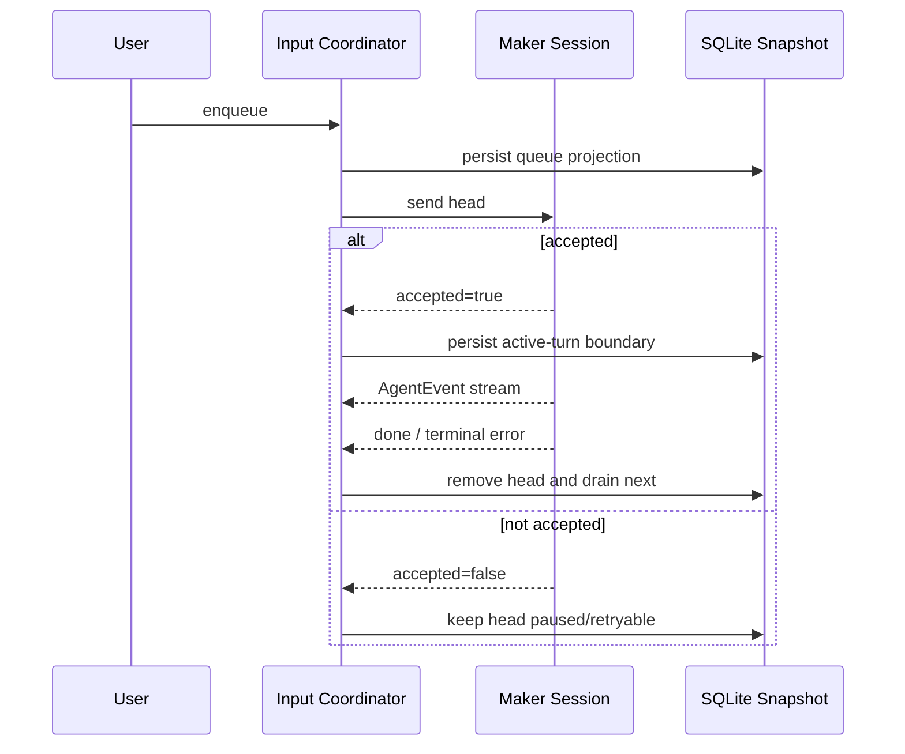
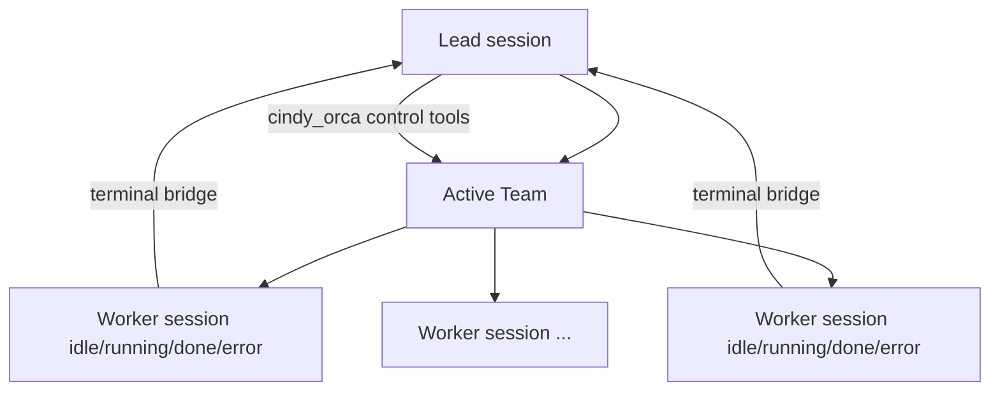

# Cindy 全功能产品需求

> 基线：`makecindy/cindy` @ `240247e52e938710f409c921a7a393097dcef52b`。本文由源码审计结果整理为可执行的产品需求，不代表新的服务端承诺。

## 0. 读法与产品总则

### 规格标记

- **[现状确认]**：源码、schema 或回归测试直接支持，是现有产品行为。
- **[建议规格]**：不改变当前业务真值的产品化补强，须单独排期/实现。
- **[动态待验]**：客户端实现存在，但依赖真实 API、三方 CLI、OS、网络或故障注入才能确认。

### 全局产品原则

1. **产品任务与 Agent runtime 分离**：任务可存续、归档、恢复；runtime 可被关闭并在下次发送重建。
2. **接受边界必须明确**：只有 Agent 返回 accepted 才能标记输入已派发；超时不自动等于未执行。
3. **真值与投影分离**：SQLite/ledger/safeStorage 是持久化真值；Renderer 和运行时是可重建投影。
4. **默认 fail closed**：缺少身份、provenance、权限 resolver、路径白名单或远程 allowlist 时拒绝副作用。
5. **账号是全局运行时边界**：换 owner 时，DB、凭据、插件 ledger、IM/Hook/Device Link 回调均必须受 generation/scope fence 约束。
6. **不将建议写成现状**：“side activity”、新服务端能力、更强同步协议不在本文伪装为已实现。

## 1. 账号、登录与本地模式

### 目标与用户故事

- 用户可登录云账号，也可“跳过登录”使用隔离的本地数据。
- 用户遇到短暂网络故障时，已保存凭据不应被误删；已确定失效时则应回到未登录。
- 用户删除账号后立即退出，即使已未登录，仍可查看删除进度。

### 功能规格

| 维度 | 需求 |
|---|---|
| 入口 | **[现状确认]** Splash/登录页、账号设置、“跳过登录”、退出、删除账号。 |
| 前置 | 云模式需验证 membership；本地模式无网络前置。Renderer 不得取得 token。 |
| 主流程 | 启动按 local 持久模式、云账号快路径、tombstone/更新重登/旧迁移、冷启 refresh 的顺序进入。登录 reducer 支持 identifier→realm→method→verification/browser/SSO→binding→completed。 |
| 业务规则 | 只有 local/cloud 进主应用；冷启 UI 超时可先 signed-out，refresh 不取消；晚到结果须通过 auth epoch；明确失效才清 token，429/网络错误保留。 |
| 状态 | signed-out/local/cloud；登录子状态见 reducer；删号有 challenge/receipt/status。 |
| 失败/恢复 | 冷启短暂失败从 signed-out 起动但保留 token；late success 可升级 cloud；进 local 取消 browser auth 并清 provider secret cache；退 local 保留本地数据。 |
| 数据 | AppSession 只持久 mode；owner 数据根隔离；token/sensitive receipt 由 main safeStorage/内存持有。 |
| 权限 | Renderer 只调 auth IPC；凭据不出 main；owner 集成只在 DB ready 后启动，回调复验 owner。 |
| 通知 | `auth:state-change`、`auth:session-expired`、删号恢复通知；Agent 认证另有 Maker push。 |
| 指标 | **[建议规格]** 登录步骤转化率、splash 超时率、late-success 率、凭据确定失效率、local/cloud 转换成功率；不上报 token/账号标识。 |
| 边界 | 本地模式不得启用遥测上报；临时无 owner 不得写共享根。 |

### 验收条件

1. 在冷启 refresh 慢于 UI gate 时，界面可进 signed-out，但请求继续；late success 仅在 epoch 未变时进 cloud。
2. 冷启网络失败/429 不删 token；服务明确拒绝凭据时清理。
3. 从 cloud 进 local 后，旧 owner 的延迟 DB/集成回调不得写入 local owner。
4. 删号确认后立即登出，未登录界面可依 receipt 查状态并清回执。
5. **[动态待验]** realm/SSO/账号绑定和删号最终状态需真服务验证。

证据：`apps/desktop/src/main/appSessionState.ts`、`authManager.ts`、`authStartupGate.ts`、`accountIntegrationStartup.ts`，`packages/auth-client/src/types.ts`。

## 2. 项目、对话工作区与 Worktree

### 目标与用户故事

- 用户可以项目目录组织任务，也可以在应用管理的对话目录中开始无项目任务。
- 用户可为并行任务创建 Git worktree，归档/删除时可安全回收且不丢脏改动。

| 维度 | 需求 |
|---|---|
| 入口 | New Maker 工作区选择、Projects 分组、对话任务、Worktree 开关/分支选择、任务归档/删除。 |
| 前置 | project 需可用工作目录；worktree 需 Git repo 且安全的 base repo；remote/device 须有对应连接上下文。 |
| 主流程 | 创建 session → 确立 project/dialogue → 可选创建 worktree → 注入 project knowledge 快照 → 运行任务 → archive/delete 时回收。 |
| 业务规则 | workspaceKind 与 cwd 解耦；dialogue cwd 为 `<owner>/dialogues/date/session`；project key 区分 local/remote/device；Windows local key case-fold；同 base repo 创建串行。 |
| 状态 | 任务 active/archived/deleted；worktree store 记录存在/缺失；数据库 path 只是快照。 |
| 失败/恢复 | dialogue 旧路径先 copy 再 rewrite，失败保留原值；dirty worktree 回收前 stash；startup 只回收 deleted/missing，不自动清 archived。 |
| 数据 | `sessions.workspace_kind/working_dir/worktree_path`，owner `worktrees.json`，`.cindy/project-knowledge`，project aliases/automation consents。 |
| 权限 | 路径必须在授权根；remote/device 操作不得用本地路径自报替代端侧身份。 |
| 通知 | worktree 创建/失败/回收，远程草稿分支变化，project automation 变更。 |
| 指标 | **[建议规格]** worktree 创建时延/失败率、stash 回收率、孤儿自愈数、dialogue 迁移失败数，不记完整路径。 |
| 边界 | runtime close 不触发 worktree 回收；remote dialogue 不参与本地旧路径自愈。 |

### 验收条件

1. project 和 dialogue 在侧边栏归属、cwd 生成上不混淆。
2. 原 dialogue 目录存在时，自愈须先完整复制；任一步失败不更新 DB 路径。
3. 删除 dirty worktree 不丢改动；stash/live-ref/安全检查任一失败则中止回收。
4. 仅 archive/delete 产品任务可进入回收策略，Agent runtime 意外关闭不删 worktree。

证据：`apps/desktop/src/main/localDb/dialogueWorkspace.ts`、`dialogueWorkdirSelfHeal.ts`、`apps/desktop/src/shared/projectKeys.ts`、`apps/desktop/src/main/worktree/*`，`packages/project-context/src/*`。

## 3. 任务、Turn、消息与输入队列

### 目标与用户故事

- 用户可连续发送、排队、编辑、重排、steer、停止和重试，不因 app crash 无声丢失未执行输入。
- 用户可关闭卡住的 runtime，下次发送自动重建，任务历史保留。

| 维度 | 需求 |
|---|---|
| 入口 | Composer 发送，队列卡片编辑/移动/删除，Steer，Stop/Resume/Retry，任务关闭/重开。 |
| 前置 | session 可恢复/创建，host turn lease 可获取，必要 interaction 已解决。 |
| 主流程 | enqueue→head drain→Maker send→accepted 落边界→事件持久化/呈现→done/error→出队。 |
| 业务规则 | 单 reservation；Maker busy 不并发新 turn；dispatch 前取消为 accepted=false；steer marker 阻塞 drain 且只在接受后持久化；Stop 保留待处理项并 paused。 |
| 状态 | runtime active/aborting/closed/error；queue active/paused/blocked-by-steer/interaction-lock/edit-lock/error；turn origin user/scheduler/goal。 |
| 失败/恢复 | 45m 无事件 stall 中断，interaction/后台 task 期间暂停计时；abort grace 不收敛则 close；崩溃快照恢复 paused；有部分输出用 continuation，零输出才 clone accepted turn。 |
| 数据 | `sessions`、`messages`、`agent_input_queue_snapshots`、active turn/recovery token；快照大小有上限且剥离 inline base64。 |
| 权限 | send/steer/stop 只对指定 session；远程调用还受 Device Link allowlist；交互未决定时不绕过锁。 |
| 通知 | `maker:event`、`maker:status-changed`、`maker:input:projection`、后台活动变化，终态错误。 |
| 指标 | **[建议规格]** enqueue→accepted 时延、accepted=false 比例、队列恢复数、continuation/clone 比例、stall/force-close 率。 |
| 边界 | Scheduler busy queue 不持久化，不与用户队列混淆；unknown error 为了兼容按终态。 |

### 验收条件

1. 只有 handle 返回 accepted 后才从“待处理”转“已派发”。
2. Stop 后待处理输入保留且不自动重放；用户明确 Resume 后才 drain。
3. 崩溃重开任务时，合法快照恢复为 paused，坏快照整体丢弃并给可诊断信号。
4. 等待权限/问答超过 45 分钟不得误判 stall；真正零事件 turn 应被中断并在 grace 后重建。

证据：`packages/maker-core/src/session.ts`、`maker.ts`、`types/events.ts`，`apps/desktop/src/main/maker-ipc/agent-input-coordinator.ts`。

## 4. Claude Code、Codex、Pi 与模型/路由切换

### 目标与用户故事

- 用户可在一个任务中使用 Claude Code、Codex 或 Pi，且在不打断当前 turn 的情况下切换 harness、模型、provider、effort 和 Fast。
- 切回原 harness 时尽量恢复原 vendor session，无法恢复时使用完整 handoff。

| 维度 | 需求 |
|---|---|
| 入口 | New Maker Agent/模型选择、任务头设置、provider/OAuth 设置、运行时 effort/Fast 切换。 |
| 前置 | 目标 harness/provider/model 可用且认证完成；跨 harness 切换仅本地普通任务，不支持 remote/Orca。 |
| 主流程 | 记 deferred intent→等 turn boundary→预检→生成 handoff→关旧 runtime→DB commit route/vendor ID→写 switch boundary→resume/spawn 目标→发原输入。 |
| 业务规则 | 当前 turn 不中断；intent 一次性且仅内存；DB 为 commit point；`provider_id` 非 null 权威；忙时 credential-family 切换延迟；Codex route 不中途切。 |
| 状态 | 当前 Agent/route/model/effort/Fast；pending switch/pending credential switch；parked vendor session ID；Pi plan/compaction/resume 状态。 |
| 失败/恢复 | boundary 写失败用内存 handoff 降级；spawn 失败下次 send 重建；切回 resume 失败原子清 vendor ID 并 full handoff；setModel 失败回滚 route；effort 3.5s 超时终止 runtime。 |
| 数据 | session agent/model/provider/effort/fast/sdkSessionId，`agent_switch` 边界消息，Pi 会话 models/resume 文件。 |
| 权限 | provider secret 不进 DB/renderer；Pi 密钥仅 env；切换不得绕过目标 provider 认证。 |
| 通知 | Agent switch boundary，credential switch applied，Codex/Claude route changed，provider upstream error/OAuth progress。 |
| 指标 | **[建议规格]** harness 切换成功率、incremental/full handoff 比例、resume 失败率、pending 等待时间、route rollback 率。 |
| 边界 | Full Access 不是 OS 沙箱；Pi MCP 和 tool 是 session-create 快照；remote Pi 不属于已支持范围。 |

### 验收条件

1. turn 运行中切 harness/credential family 只显示“任务结束后生效”，不重启当前 runtime。
2. DB commit 前任一预检失败保持旧 Agent；commit 后 spawn 失败不回写成旧路由，而是下次重建已提交目标。
3. 切回有效 parked ID 用增量 handoff；无效 ID 被清除且仅使用 full handoff。
4. **[动态待验]** 三家 CLI/API 在认证失效、工具执行中切换和 resume 不兼容时的实际事件序列。

证据：`apps/desktop/src/main/maker-ipc/sessionAgentSwitchHandler.ts`、`agentHandoff.ts`、`runtimeSetModel.ts`、`runtimeSetEffort.ts`，`packages/maker-core/src/agents/pi/index.ts`。

## 5. Interaction、权限、计划与 Goal

### 目标与用户故事

- 用户可在工具副作用前审批、回答 Agent 问题、审查计划，并明确知道当前 Ask/Auto/Full Access 与 Plan 状态。
- 用户可为任务设定 Goal，在前台/后台活动中看到可恢复的状态。

| 维度 | 需求 |
|---|---|
| 入口 | 任务权限模式、Plan 开关、interaction 卡片/渠道卡、`/goal`、Goal 指示器。 |
| 前置 | 请求必须绑定 live session/runtime；渠道 interaction 需可交付的 channel card；headless 无 resolver 则拒绝。 |
| 主流程 | Agent 发 `interaction_request`→Router waiting→desktop/channel/headless 决定→resolved/cancelled→回传 Agent。Plan 审批后 Agent 自动退出并回写。Goal 变更持久化并 push。 |
| 业务规则 | permission 与 plan 正交；无 listener 权限/计划拒绝，问答返空；auto reviewer 不可用时降 Ask；Full Access 豁免绑 runtime/session-instance/live-local 身份。 |
| 状态 | interaction waiting/resolved/cancelled；permission ask/default/acceptEdits/auto/bypass；plan boolean；Goal payload/null；background active boolean。 |
| 失败/恢复 | 超时/无 UI 不默认放行；turn abort/session close 取消 waiting；permission 中途变化可 dismiss 已不需交互。 |
| 数据 | `sessions.permission_mode/plan_mode_enabled`，messages ask_user/plan_review，`session_goals`，interaction 运行时不应持久明文 secret。 |
| 权限 | 只接受对应 session/runtime 的决定；不信任 tool arg 中自报 sessionId；渠道超时拒绝。 |
| 通知 | interaction request/dismissed，plan-mode-changed，auto-permission fallback，Goal changed，background activity changed。 |
| 指标 | **[建议规格]** 决策时延、允许/拒绝/超时比例、Auto→Ask 降级率、Plan 批准率、Goal 完成/取消率；不记问题/回答正文。 |
| 边界 | Full Access 不等于 OS sandbox bypass；Goal 不等于 Scheduler，两者 SendOrigin/持久化不同。 |

### 验收条件

1. 没有 listener/可验证 caller 的 permission/plan 绝不放行。
2. Plan 开关不修改 permission mode，permission mode 不隐式改 Plan。
3. 已取消/超时 interaction 的晚到响应不得解锁新 turn。
4. Goal 清除 push `goal=null`，多窗口均能收敛到隐藏状态。

证据：`packages/maker-core/src/session.ts`、`types/events.ts`，`apps/desktop/src/main/maker-ipc/interactionRouter.ts`、`maker-host/auto-permission-reviewer.ts`、`localDb/schema.ts`。

## 6. Orca 多 Agent 协作

### 目标与用户故事

- 用户可以一个 Lead 组织多个真实 Worker session，为 Worker 指定角色/模型/权限，发送、编辑或取消排队消息，聚焦、空闲、复用或归档 Worker。
- Worker 完成/失败后结果可被 Lead 看见，但 Worker 不默认继承 Lead 的权限。

| 维度 | 需求 |
|---|---|
| 入口 | New Maker collaboration，任务中途 enable/disable，Worker 列表/创建/聚焦/发信/idle/archive，Lead 内 `cindy_orca` MCP。 |
| 前置 | Lead 为本地 Claude/Codex/Pi 或 SSH Claude/Codex；每 Lead 最多一 active Team；未超过硬上限；label/route 有效。 |
| 主流程 | start team→预留 label/slot→创建 Worker session idle→发信排队→Maker accepted 后 running→done/error→bridge Lead→可 idle/reuse/archive→end team。 |
| 业务规则 | 每 team 一 focused Worker；team label 忽略大小写唯一；批量顺序创建；remote Worker 继承 host；Worker 不继承 Lead permission；初始 Full Access，明确 auto→bypass 需确认。 |
| 状态 | Team active/completed/cancelled/failed；Worker idle/running/done/error；creation reservation；focused boolean；message queue。 |
| 失败/恢复 | 创建失败释放 reservation；crash 残留由 expiresAt 回收；dispatch 未 accepted 回 idle；idle watcher 只释放 runtime，不删 Worker；startup 修复孤儿 Lead/索引。 |
| 数据 | `orca_teams`、`orca_workers`、`orca_worker_creation_reservations`，Worker `sessions/messages`，queue/bridge 投影。 |
| 权限 | handler 以 role/team/runtime provenance 二次验证；Codex 使用 `_meta.threadId`；`mcp-session-id`/工具参数不作身份；batch 缺元数据 fail closed。 |
| 通知 | Worker changed/focus/status，creation pref apply，terminal bridge 给 Lead，错误归因到指定 Worker。 |
| 指标 | **[建议规格]** Team 完成率，Worker 创建/接受/终态时延，reservation 冲突/过期，运行时空闲释放率，bridge 成功率。 |
| 边界 | Pi remote 不支持；Worker 不在 turn 中切模型；当前 side-chat 是普通 fork，不宣称 side activity 已实现。 |

### 验收条件

1. 并发创建同 label 或超 slot 时，只一方拿到 reservation，另一方得到结构化拒绝。
2. 只有 Maker accepted 才从 idle 转 running；派发失败不留伪 running。
3. 未知 caller、错 team、伪造 sessionId、缺 Codex thread metadata 的控制调用均拒绝。
4. end team 将 Team 转终态并归档/关闭 Worker runtime，不删审计历史。
5. **[动态待验]** 批量部分成功、远程断网和 bridge 离线恢复的用户可观测性。

证据：`apps/desktop/src/main/maker-ipc/orca*.ts`、`apps/desktop/src/main/localDb/schema.ts`，`packages/orca-workflow/src/orca-bridge-mcp.ts`。

## 7. Scheduler 与项目自动化

### 目标与用户故事

- 用户可定时、手动或周期执行 Agent/script，选择工作区、worktree、模型、持久任务与通知渠道。
- 在 app crash、target busy、项目归档、hook 失败或运行卡死后，自动化有可理解的最终状态，不重复触发。

| 维度 | 需求 |
|---|---|
| 入口 | Automation 列表/编辑、项目自动化 consent、Run now、暂停/恢复、历史/已读。 |
| 前置 | schedule active 且未过期；project automation 已授权；target 不是 review session；script capability 显式声明。 |
| 主流程 | due/manual→CAS claim→loading/claiming→pre-run hook→persist run→running/queued→finalizing→success/failed/aborted/interrupted/skipped→replan/notify。 |
| 业务规则 | 同 schedule 串行；queued 不占 Agent/MCP/token/并发槽；pre-hook exit 0 run、2 skip、其他 fail；script capability 默认 deny；silent success 不通知，失败仍通知。 |
| 状态 | schedule active/paused/expired；run running/success/failed/aborted/interrupted/skipped；runtime phase loading/claiming/persisting/running/queued/cancelling/finalizing。 |
| 失败/恢复 | busy target 可无 run row defer；heartbeat/stale sweep 将 crash 残留 running 转 interrupted；持久 target archived 重绑，非持久 target 暂停；stall 触发 abort/finalize/replan。 |
| 数据 | `schedules`、`schedule_runs`、`project_automation_consents`，临时 attempt phase 不入库。 |
| 权限 | 当前 script capabilities 仅显式 jira.read/jira.comment/sessions.dispatch/feishu.read；未声明能力拒绝。 |
| 通知 | desktop/Feishu/WeCom；`maker:schedule:event` 承载 fired/completed/failed/silenced/notified/deferred/skipped/session-bound/changed/runtime/read/ready。 |
| 指标 | **[建议规格]** due→start 偏差、claim 冲突、defer 时长、run 终态分布、stale interrupted 数、通知交付成功率，不记 prompt 正文。 |
| 边界 | dev passive 只禁自动 fire，CRUD/runNow 仍可用；Scheduler 临时 busy queue 不在 app restart 后恢复。 |

### 验收条件

1. 多进程/重复 tick 只有一方 CAS claim 同一 nextFireAt。
2. queued 期间并发额度和 Agent 资源已释放；重新入场时重做预检。
3. pre-hook exit 2 产生 skipped 且 token/cost 为零；丢失/超时不绕过 hook。
4. app crash 留下的 running row 在 stale threshold 后转 interrupted，不误收当前进程活 run。

证据：`packages/maker-scheduler/src/types.ts`、`engine/attemptLifecycle.ts`、`engine/scheduler.ts`，`apps/desktop/src/main/scheduler-host/*`。

## 8. Ghost 插件、Skill 与 MCP

### 目标与用户故事

- 用户可从可验证来源安装/升级/卸载 Ghost，审查新增权限，在面板或 Agent 中使用它声明的能力。
- 用户可扫描、安装、同步和分析 Skill，配置远程 MCP，而不向 Renderer/DB 暴露密钥。

| 维度 | 需求 |
|---|---|
| 入口 | Plugin Market/source 管理、Ghost 列表/面板、SkillHub/本地导入/发布、MCP 设置/测试。 |
| 前置 | manifest v2 合法，ID/路径安全，包/签名/provenance 可验，权限扩展已 review；远程 MCP 为 HTTPS/loopback http/sse。 |
| 主流程 | 插件：per-ID lock→staging download→verify→permission review→precommit recheck→atomic commit→ledger→runtime。Skill：scan/dedup→install/link→optional sync/usage index。MCP：validate→DB config + safeStorage token→refresh providers。 |
| 业务规则 | Agent tools 是 session-create 快照；Node 只跑包内声明 entry，无 shell/env 注入，但不是 OS sandbox；60s 3 crash fuse；default plugin opt-out 阻止重装；Skill 自动同步仅登录后每 owner 一次且白名单。 |
| 状态 | install not-installed/installed/update-available/conflict；Ghost off/starting/running/stopping/crashed/fused；Skill install/cancel-cleanup；MCP present=enabled。 |
| 失败/恢复 | 验证/权限 review 失败不 commit；卸载先清 runtime，ledger 最佳努力；Ghost fuse 需显式 re-enable/reset；Skill 取消清理持久重试；MCP CRUD 尽力失效 Codex cache。 |
| 数据 | owner plugin ledger/package，`ghost.json`，global/project skill links/registry/usage hashes，`custom_mcp_servers`，safeStorage token，Ghost cards/media refs。 |
| 权限 | Ghost pipe 按 slot/method/secret binding 授权；子窗口不获得主 preload；MCP control tools 用 attested runtime provenance；workspace v1 仅 local。 |
| 通知 | install/update/uninstall/review 结果，Ghost state/fused，MCP_CHANGED，provider/tool 在“下一 session 生效”的提示。 |
| 指标 | **[建议规格]** 验证/权限 review 通过率、安装回滚率、Ghost crash/fuse 率、Skill 冲突/取消清理、MCP 连通性/超时；不记 secret/tool 私密输入。 |
| 边界 | 当前 auto-sync 默认白名单为空；remote workspace plugin 不支持；市场源删除不自动删已安装包。 |

### 验收条件

1. 新包比已安装版增加权限时必须显式 review；拒绝后旧版保持可用。
2. precommit 时 owner/source/bytes 任一变化则中止，不用旧审批提交新包。
3. Ghost 在 60s 内第 3 次 crash 进 fused，后台不继续无限拉起；显式重启才 reset。
4. MCP token 不出现在 DB、Renderer 响应、日志或 catalog。
5. **[动态待验]** 真市场签名链/CDN 替换、MCP 超时与三 harness 工具快照一致性。

证据：`packages/plugin-protocol/src/manifest.ts`，`apps/desktop/src/main/cindy-brain/*`、`plugin-market/*`、`skillhub/*`、`maker-host/custom-mcp-store.ts`、`mcp-integrations/*`。

## 9. IM、Hook 与个人微信

### 目标与用户故事

- 用户可绑定 Feishu、Discord、Telegram、钉钉、企微或个人微信，从渠道启动/接管任务，收取进度与最终结果。
- 忙任务能 FIFO 排队，重连/重放不重复执行，权限交互不在没有界面时默认放行。

| 维度 | 需求 |
|---|---|
| 入口 | 各 IM 设置/绑定/启停，Hook path alias/状态，渠道控制卡，WeChat QR/确认/命令。 |
| 前置 | owner 账号边界有效，渠道凭据可用，Hook 路径 alias 允许，复用 session live cwd 仍匹配。 |
| 主流程 | 连接/hello→绑定 identity/scope→收 request→去重/校验→accepted/queued/rejected ack→Agent turn→progress 快照→turn.end 持久/交付。WeChat 额外用 inbox lease + outbox retry。 |
| 业务规则 | 连接启停/work queue 串行，logout generation 作废旧 work；binding 先 DB 后 Map；`connectionId+requestId` 重放 ack 不重跑；busy session FIFO；path alias 是唯一 cwd 白名单。 |
| 状态 | Hook connecting/connected/standby/error/stopped；request accepted/queued/rejected；turn ok/error/cancelled；WeChat phase 与 inbox/outbox 状态。 |
| 失败/恢复 | Hook 65s idle watchdog，1–30s jitter retry，401 只 forced refresh 一次，duplicate device 进 standby；terminal turn.end 离线重放；WeChat 30m TTL/60s lease，busy 回 pending，outbox 可重试/终态失败。 |
| 数据 | owner credentials，`im_bindings`，Hook request/delivery/group-context ledger，`wechat_sync_state/inbox/outbox/attachments`，加密上下文，media refs。 |
| 权限 | trusted renderer 设置凭据；渠道身份为 channel+bot+user+scope；新 session override 校验，复用 session 以 DB meta；non-bypass interaction 用 channel card，超时 deny。 |
| 通知 | 连接/绑定状态，ack/progress/turn.end，交互卡，WeChat QR/scanned/refresh，强制失败通知。 |
| 指标 | **[建议规格]** 连接成功/重连/待机率，ack 延迟，queued 时长，dedupe 命中，terminal delivery 成功，WeChat expired/overload/outbox retry；不记聊天正文。 |
| 边界 | progress 不是可靠全历史，只最新快照；turn.end 才是可重放终态；Hook server 不被本文假设为保存正文。 |

### 验收条件

1. 同 `connectionId+requestId` 重放原 ack，不创建第二个 turn。
2. 复用 session 每条消息重新检查 live cwd，alias 被删/移动后丢弃 binding。
3. 忙 session 回 queued 且 FIFO drain，不与前台用户输入越过 accepted 边界。
4. WeChat `/stop`/`/stop all` 不因 overload 被拒绝；关绑定取消 pending/dispatching，中断 active。
5. **[动态待验]** 真上游重连、媒体限制、终态离线交付和 duplicate-device 协议。

证据：`apps/desktop/src/main/im/*`、`hook-control/*`、`localDb/worker/opHandlers/wechatTx.ts`，`packages/slack-hook-protocol/src/*`。

## 10. 远程与 Device Link

### 目标与用户故事

- 用户可连接另一台自己的设备，查看任务镜像、订阅状态并调用一个严格白名单的远程能力子集。
- 同机多 Cindy 实例时，只有一个实例连 relay，其他待机，避免无限互踢。

| 维度 | 需求 |
|---|---|
| 入口 | Device Link 设备列表/连接/断开，远程任务/草稿/侧边栏，link-open，镜像缓存。 |
| 前置 | 当前进程获得本机 owner lease，token 可用，relay handshake 成功，目标设备在线/已链接。 |
| 主流程 | CAS acquire owner→relay connect→hello/ack→online→subscribe/invoke→可靠 stream ack/replay→push 按 topic forward→心跳续租。 |
| 业务规则 | owner heartbeat 5s/stale 15s；网络断不让 owner；store 失败先 self-demote；client 20s ping，丢 pong 重连；offline push 最多 128/512KiB/5min，state coalesce/event preserve order。 |
| 状态 | client stopped/connecting/online；local owner/standby；link close permanent/transient；transport timeout reopen attempt。 |
| 失败/恢复 | 1–30s reconnect；transport-timeout 仅 online owner + control enabled + outbound intent 时最多 5 次 reopen；user/toggle-off/shutdown/revoked 不重开；invoke timeout 保留 inFlight 不确定。 |
| 数据 | `device_link_ownership`，owner-scoped link/settings，镜像缓存，内存 push queue/可靠 stream 状态。 |
| 权限 | `REMOTE_INVOKE_ALLOWLIST` 与 `PUSH_FORWARD_ALLOWLIST` 是权威子集；本地 secret/settings/window-owner 操作不可透传；每 invoke 仍由被控 main 执行业务校验。 |
| 通知 | 连接/standby/错误，设备状态，远程 session/topic push，in-flight uncertain 提示。 |
| 指标 | **[建议规格]** owner takeover 时延、relay 上线率、reconnect/reopen 次数、invoke 超时/in-flight uncertain、offline queue drop/coalesce；不记远程 payload 正文。 |
| 边界 | 内存 offline queue 不是持久化真值；本地 preload 全能力面不等于远程能力面。 |

### 验收条件

1. 共享 DB 的两实例只有 owner 连 relay；owner DB 不可用时先停连接再等 takeover。
2. 网络断开不释放 owner；进程退出/登出释放或使 heartbeat stale。
3. 不在 remote allowlist 的 channel 一律拒绝，即使同名本地 IPC 存在。
4. invoke 超时时界面不显示“确定未执行”；有副作用动作不自动盲重试。
5. **[动态待验]** relay 协议版本不兼容、多设备弱网和大量 topic 订阅下的顺序/背压。

证据：`packages/device-link/src/client.ts`、`allowlist.ts`，`apps/desktop/src/main/device-link/*`、`localDb/schema.ts`。

## 11. 浏览器、终端、文件与 Review

### 目标与用户故事

- 用户可在任务侧边栏打开终端、文件、浏览器，对 Agent 改动做 diff/review/apply，并在本地、SSH 或 device 工作区上保持相同的路径边界。

| 维度 | 需求 |
|---|---|
| 入口 | Right Sidebar tabs/独立窗口，Terminal tab，File browser/search/watch，Web browser/tab，turn change sets/Git Review/PR context。 |
| 前置 | session 有可用 workspace context；remote/device 已连接；PTY shell 可用；browser guest 已完成 dom-ready report。 |
| 主流程 | 打开 tab→main 注册 owner/context→执行文件/PTY/browser 操作→流式数据/push→关闭或重启。Review 读 turn diff→审查→应用/拒绝。 |
| 业务规则 | PTY create/attach 幂等，exit 保留 record，dispose 才 kill；file read 默认≤2MiB；search fixed-string + 文本白名单；TabRegistry 在 main 是真值，pin 免 watchdog 回收。 |
| 状态 | PTY running/exited/disposed；file watch/search active/cancelled；browser tab registered/background/foreground/pinned/crashed；review change-set pending/applied（以实现投影为准）。 |
| 失败/恢复 | PTY owner window 销毁转 fallback，无 fallback dispose；search TERM 后 200ms KILL；remote 大文件可 stale cache fallback；browser crash 自清，resource watchdog 警告/回收。 |
| 数据 | right-sidebar tabs JSON，PTY 内存 record/shell pref，file cache/watch，media ledger，turn diff/change sets，session PR refs（不存易变 PR 状态）。 |
| 权限 | file scanner 拒绝 traversal/symlink 逸出；SSH 聊天文件超 cwd 拒绝；browser capture/kill 必须 sender-owned guest；PTY env 剥离 secret-like 变量。 |
| 通知 | terminal data/exit，file watch/search status，browser resource warning/kill，turn change set updated，review/apply 结果。 |
| 指标 | **[建议规格]** PTY 创建/重启失败，search 取消延迟，remote cache hit/stale fallback，browser watchdog 告警/回收，review apply 成功/冲突；不记文件内容/命令全文。 |
| 边界 | resource watchdog 聚合 shared PID 的 foreground/pin；pinned 不回收；audio 后台 tab 不因 CPU 策略误杀。 |

### 验收条件

1. PTY exit 后可以同 ID restart；dispose 后不得再写/复活。
2. 任何 `..`/符号链越界不达到工作区外；local/SSH/device 语义一致。
3. stale tab release 的 webContentsId 不匹配时不释放新 guest。
4. 前台 browser 超内存阈值有用户通知；后台 CPU/内存策略按连续样本执行，不用单点毛刺。
5. **[动态待验]** macOS/Windows/Linux PTY 信号、SSH 断网分片、Chromium shared PID 资源采样。

证据：`apps/desktop/src/main/terminal/ptyManager.ts`、`file-browser/*`、`rsb-browser-bridge/*`、`git-review/*`，`packages/file-browser-core/src/*`。

## 12. Usage 与计费

### 目标与用户故事

- 用户可看到任务、每日、每模型和账号配额，并区分实际付费、价值估算、近似价和无法归因。

| 维度 | 需求 |
|---|---|
| 入口 | 任务 usage/context，资源使用页，每日/模型报表，Agent 账号配额。 |
| 前置 | AgentEvent/route/usage delta 可用；gateway quote/汇率/参考价可用时才给对应金额类型。 |
| 主流程 | 收 cumulative usage→计算 turn delta→根据权威 route 定价→归因 session/run/day/model→提供 UI 聚合。 |
| 业务规则 | 计数器回退当 reset，负值 clamp；subscription 不计 actual，可 value estimate；gateway quote 含折扣/币种；BYOK USD 投影账本币种；归因 exact/direct/mixed/zero/unavailable/legacy。 |
| 状态 | 实际/近似，CNY/USD，route xd-gateway/provider-api/subscription/unknown，配额 snapshot freshness，归因类型。 |
| 失败/恢复 | Vertex output 晚一 turn 不丢账；无 quote/汇率标 unknown/unavailable，不伪造 exact；累计计数器 reset 从当前值重建 baseline。 |
| 数据 | session totals/context，`daily_spend`、`daily_model_usage`、`account_usage_snapshots`，schedule run cost/attribution。 |
| 权限 | 只展示当前 owner；配额 API 凭据不回传；用量遥测不附消息/prompt 正文。 |
| 通知 | account_usage AgentEvent，配额刷新/失败，异常路由定价诊断（开发/诊断面）。 |
| 指标 | **[建议规格]** usage delta reset/clamp、unknown route、unavailable quote、mixed attribution 比例，定价时延，不将费用数据与用户内容绑定上报。 |
| 边界 | 估算不能写成实际扣款；Codex/subscription 等无实报金额时应显示语义标签。 |

### 验收条件

1. 累计计数从 100 降到 20 时，本 turn delta 为 20 而不是 -80。
2. subscription 金额不进 actual spend；如展示价值，必须标记 estimated。
3. 每日模型金额按币种作联合键，账本换币种不覆盖已有行。
4. **[动态待验]** gateway quote/折扣、provider 累计用量和汇率晚到的真实结算对账。

证据：`apps/desktop/src/main/usage/modelUsageDelta.ts`、`turnCostCalculator.ts`，`apps/desktop/src/main/localDb/schema.ts`。

## 13. 更新与遥测

### 目标与用户故事

- 用户可检查/下载/应用更新，新 patch 失败时仍能用旧 ready patch，且不在活跃任务期间被自动重启。
- 用户可明示同意隐私政策并独立开关遥测；本地模式始终不上报，但不篡改已有同意选择。

| 维度 | 需求 |
|---|---|
| 入口 | About/Update 设置，手动检查/重启，自动更新设置，首次隐私同意，Analytics 开关/重置。 |
| 前置 | updater: packaged、非 0.0.0，macOS 非 translocation，Linux 自动应用不在范围；analytics: packaged/strict dev opt-in + consent + enabled + non-local。 |
| 主流程 | check manifest→download/verify→ready→auto/manual relaunch gate→stop ADB/iOS/Ghost→expected-exit→apply/relaunch。Analytics 为读持久同意→叠加 runtime local opt-out→report gate。 |
| 业务规则 | ready 下新版进 superseding，成功替换/失败保旧；applyAttempts≥3 放弃；进度单调；auto relaunch 需无 busy + quiet/resume 窗口 + idle/locked；忙查询失败 fail closed。 |
| 状态 | update idle/checking/downloading/ready/superseding/error；patch info version/file/hash/relogin/attempts；privacyConsentAccepted 与 analyticsEnabled 两项独立布尔量。 |
| 失败/恢复 | manifest 8s timeout，后续 tick 重试；new superseding 失败回 old ready；匹配当前版清 patch；settings 损坏使 analytics fail closed；legacy consent 含糊认证保留迁移窗口。 |
| 数据 | patch-info/auto update settings/expected-exit/relogin marker，analytics settings 与 customized keys。 |
| 权限 | Renderer 不直操 patch；local 模式 runtime opt-out；未明示同意不开采集；遥测不携用户正文/凭据。 |
| 通知 | 检查/下载/进度/ready/error，自动重启受阻的可解释原因（**[建议规格]**），隐私同意/开关投影。 |
| 指标 | **[建议规格]** check/download/verify/apply 成功率，superseding fallback，apply attempt 放弃，ready→relaunch 时长，consent/enabled 状态仅用聚合不与 owner 标识关联。 |
| 边界 | startup apply 的 gate 比 normal auto relaunch 轻，但最终 boundary 复验；Linux manual only；local 不写回 consent=false。 |

### 验收条件

1. old patch ready 时下载 new patch，new 失败后仍显示/应用 old ready，不进入无 patch error。
2. 有 turn/Scheduler/DB 忙或忙查询抛错时不自动重启。
3. local 模式不上报，但退出 local 后用户原 `privacyConsentAccepted/analyticsEnabled` 不被更改。
4. applyAttempts 达 3 后停止无限重启，保留可诊断状态。
5. **[动态待验]** patch 签名、macOS/Windows 文件替换、锁屏/休眠/恢复时钟。

证据：`apps/desktop/src/main/updateService.ts`、`analytics-settings-store.ts`、`analyticsSettingsService.ts`。

## 14. 数据库迁移、恢复与一致性

### 目标与用户故事

- 用户更新或异常退出后，数据库可以迁移、恢复并保守打开；不允许旧版对新 schema 写入。
- DB worker 不可用时，应在 smoke 前回退主进程，而不把应用卡在半 takeover 状态。

| 维度 | 需求 |
|---|---|
| 入口 | app startup/owner switch/schema upgrade，corruption handler，dev drift repair，worker takeover。 |
| 前置 | 选定 owner DB，获得兼容 reader/writer lease，磁盘预算充足，备份目标可写。 |
| 主流程 | acquire lease→online backup 0600→schema migrations 0000–0089→vec→drift detection→startup repair/optimize→worker smoke→takeover 或 in-process。 |
| 业务规则 | WAL 做常规 crash recovery，exit 不整库备份；passive reader 不写；packaged 只读打开必须 schema 精确兼容；禁 downgrade；damaged lock fail closed。 |
| 状态 | unopened/opening/migrating/repairing/worker-smoke/worker/in-process/fatal（产品投影）；migration history/version，lock reader/writer。 |
| 失败/恢复 | `SQLITE_CORRUPT`: `.bak.clean`→latest `.bak.ISO`→fatal；worker boundary 自动重启一次；dev drift 备份后 repair，release 告警/提示不擅自 repair。 |
| 数据 | owner DB/WAL/backup/migration meta+history，lock file，vec meta，startup repair 记录/日志。 |
| 权限 | DB/backup 文件 0600；不打开其他 owner DB；只读实例不发出写 IPC。 |
| 通知 | corruption restored/fatal，schema incompatible/drift，passive read-only，worker fallback；用户通知不暴露 DB 内容。 |
| 指标 | **[建议规格]** migration 时长/失败，backup restore source，lease conflict/stale cleanup，worker smoke/fallback/restart，drift 发现，仅上报版本/错误类别。 |
| 边界 | 不读/上传用户 DB 正文；无备份 corruption 不自动创建空库覆盖原库。 |

### 验收条件

1. migration 前备份成功且权限 0600；磁盘不足在改 schema 前失败。
2. 旧版对新 schema 只有“精确兼容只读”或拒绝，没有写入/降级路径。
3. damaged lock 不通过删文件猜测恢复，而是 fail closed；stale PID 只在可证明时清。
4. worker 仅 smoke 成功后成为真实执行者；首次 runtime error 重启一次，不无限循环。
5. **[动态待验]** 断电、磁盘满、权限损坏、两版本共存、备份在迁移中断时的真实恢复。

证据：`apps/desktop/src/main/localDb/index.ts`、`schema.ts`、`schemaMigrationLease.ts`、`schemaDrift*.ts`、`migrations/*`。

## 15. 跨域发布验收门

### 必须通过的端到端场景

1. 账号 cloud→local→cloud，并在每个边界注入晚到 DB/IM/plugin callback，证明 owner 不穿透。
2. send accepted 前/后分别 crash，证明队列恢复不重复执行已 accepted 副作用。
3. harness switch 在预检、DB commit、boundary 写、spawn 四个 await 点逐一失败，证明路由/交接收敛。
4. Scheduler claim/heartbeat/finalize 各点 crash，证明不重触发且最终 interrupted/明确终态。
5. Orca 并发创建、部分成功、reservation 过期、Worker bridge 丢线，证明 team/worker 可恢复。
6. Hook/WeChat 在 accepted-running/outbox-sending/binding-close 崩溃，证明 dedupe 与 terminal delivery。
7. Device Link 双实例 + DB 短暂不可用 + relay 断网，证明单主/自降级/不盲重试。
8. Updater ready→superseding→new fail→old apply，以及 applyAttempts=3，证明回退和有界尝试。
9. SQLite 迁移前磁盘不足、migration 中断、corrupt + 两级 backup，证明不覆盖原数据。

### 全局可观测性限制

- **[建议规格]** 所有指标只记录状态、时延、错误分类、版本与布尔特征；不记录 prompt/消息/文件内容、完整路径、token、API key、OAuth 回包、IM 正文。
- **[现状确认]** local mode 是遥测 runtime opt-out；未同意或 settings 损坏均 fail closed。
- **[建议规格]** 引入任何新指标前，必须评审 owner 可链接性、路径可逆向性、错误 detail 泄漏与保留期。

## 16. 需求追溯

本文现状部分的证据索引：

- `/Users/smallraw/.cache/cindy-deep-dive/source-analysis/business-logic.md`
- `/Users/smallraw/.cache/cindy-deep-dive/source-analysis/state-machines.md`
- `/Users/smallraw/.cache/cindy-deep-dive/source-analysis/data-model.md`
- `/Users/smallraw/.cache/cindy-deep-dive/source-analysis/ipc-api-events.md`
- `/Users/smallraw/.cache/cindy-deep-dive/source-analysis/evidence-index-logic.md`
