# Cindy 领域状态、一致性与安全策略

> 基线：`makecindy/cindy` @ `240247e52e938710f409c921a7a393097dcef52b`。本文定义现有客户端可证明的领域模型与产品策略，不发明新服务端。

## 0. 状态标记与优先级

- **[现状确认]**：实现/schema/测试已支持的真实语义。
- **[建议规格]**：对现状的显式化、可观测性或 UX 补强；实现前不可当成产品事实。
- **[动态待验]**：依赖真实 API/CLI/OS/网络/故障注入。

语义冲突时的权威优先级：

1. 持久化 schema 约束和事务提交结果。
2. Main 进程领域服务的运行时真值。
3. 不透明 runtime/session-instance/caller provenance。
4. Renderer 投影、缓存和 UI 本地状态。
5. 文档描述；如与源码不同，不作为“已实现”证据。

## 1. 领域词汇

| 词汇 | 精确定义 | 不是什么 |
|---|---|---|
| App Session | 当前 app 账号边界：signed-out/local/cloud + owner + generation | 不是产品任务 |
| Owner | 所有本地 DB/凭据/ledger/数据根的隔离主体 | 不用 Renderer 自报 ID 建立 |
| 任务 / Product Session | `sessions` 行，包含历史、route、workspace 与产品生命周期 | 不是单次 turn，不是 Agent 子进程 |
| Maker Session / Runtime Session | 一个活的 Agent handle，状态 active/aborting/closed/error | 关闭不等于任务归档 |
| Turn | 一次被 Agent accepted 的输入及其事件流、终态 | 不是所有入队文本 |
| Accepted boundary | Agent handle 确认可能已开始外部副作用的时刻 | 超时/点击发送不是该边界 |
| AgentKind / Harness | Claude Code (`cc`)、Codex、Pi 的运行容器种类 | 不等于 model/provider |
| Provider route | 模型请求的账号/鉴权/上游路由，`provider_id` 非 null 时权威 | 不可只从 model name 猜测 |
| Interaction | permission / ask_user_question / plan_review 的统一请求 | 不是普通聊天消息 |
| Permission Mode | ask/default/acceptEdits/auto/bypass 等副作用政策 | 不是 Plan Mode，Full Access 不是 OS 沙箱 |
| Plan Mode | 要求 Agent 先计划/审批再执行的正交布尔状态 | 不用 `permission_mode=plan` 表达 |
| Goal | 任务级目标投影及后台进展 | 不是 Schedule |
| Orca Team | 一个 Lead 下的协作生命周期 | 不是单个普通 fork |
| Orca Worker | Team 内的完整任务 + Maker session | 不是轻量无状态函数 |
| Subagent Run | 任务中 harness-native child 的有界可见投影 | 不等于 Orca Worker，不暴露文件原生会话引用 |
| Schedule | 可重复/手动的自动化定义 | 不是一次 Run |
| Run / Attempt | Schedule 的一次持久化执行记录/内存阶段 | queued runtime phase 不是持久 run status |
| Ghost | manifest 声明权限的插件包 + 可选运行时/面板/Agent tools | 不是 OS 沙箱进程 |
| Skill | 按 global/project 与 cc/codex/pi 扫描的 Agent 定制文档 | 不是 MCP 服务 |
| MCP Server | 向 Agent 暴露工具的协议端，自定义只支持 http/sse | MCP session header 不是授权身份 |
| Hook Request | 外部渠道请求，有 ack/dedupe/delivery 语义 | progress 不是可靠全量日志 |
| Device Link Owner | 同机共享 DB 中唯一允许连 relay 的 app 实例 | 不由网络 online 状态决定 |
| Snapshot | 用于恢复/加速的可丢失投影 | 不必然是领域真值 |
| Provenance | 宿主证明的 runtime/thread/session-instance 调用来源 | 不等于工具参数里的 ID |

## 2. 限界上下文与依赖方向

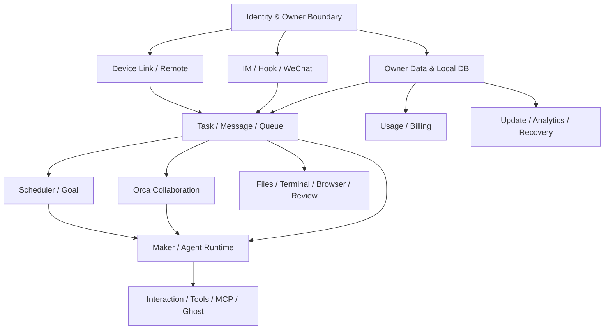

**[现状确认]** Renderer 不是任何领域的最终真值持有者；它通过 preload IPC 请求 main，main 再与 DB/runtime/OS/网络交互。

**[建议规格]** 新功能应归入上述单一主上下文；跨域通信用显式 command/event，不让 Renderer 共享 store 成为隐式总线。

## 3. 实体关系

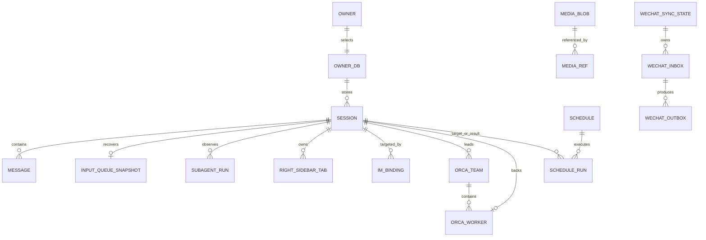

### 实体所有者与标识

| 实体 | 权威 ID | 所有者/真值 | 可安全对外暴露 |
|---|---|---|---|
| Owner | main 选定的 owner scope key | AppSessionState/main | mode + 非机密账号投影，不暴露 token |
| Session | DB `sessions.id` | owner SQLite | ID/标题/状态/工作区投影，受 owner 边界 |
| Runtime Session | opaque `sessionInstanceId` + handle | Maker main | 一般不向 Renderer 作业务标识，用于授权/provenance |
| Vendor Session | SDK/CLI 原生 ID | main + DB CAS | Renderer 可得到必要诊断投影，不得文件引用 |
| Message | `id` + per-session `client_id` | SQLite | 可见内容只返当前 owner/session；tombstone 无正文 |
| Orca Team/Worker | opaque DB IDs | Orca service + SQLite | mutation 用 opaque ID/session，label 只是人类检索备用 |
| Schedule/Run | DB IDs | Scheduler + SQLite | 设置/状态/有界错误，不暴露 secret |
| Ghost | manifest ID | owner ledger + committed package | manifest 非机密字段/运行状态 |
| MCP | validated slug ID | owner DB + safeStorage secret | config/是否有 token，不暴露 token |
| IM Binding | channel+bot+user+scope | SQLite + in-memory map | 有界渠道投影，不暴露凭据 |
| Device owner | random per-start ownerId | SQLite lease | standby/owner 状态，PID 只诊断不授权 |
| Media Blob | host-computed SHA-256 | content-addressed FS + SQLite ledger | 只在 ref/origin 授权时解析 |

## 4. 所有权、真值与投影

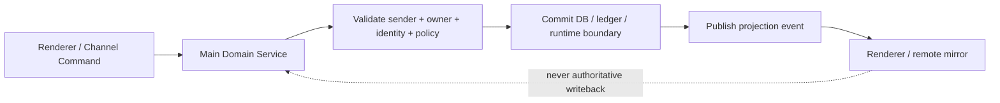

| 域 | 持久化真值 | 可重建投影 | 禁止反向当真值 |
|---|---|---|---|
| 任务 | `sessions/messages` | Maker runtime、Renderer message store | UI `isRunning` 不能替代 main turn tracker |
| Worktree | owner `worktrees.json` | `sessions.worktree_path`、sidebar badge | DB path 不能单独证明 worktree 存在 |
| 输入 | Coordinator + accepted boundary；DB snapshot 用于恢复 | Composer/queue UI | UI 不能自报“已发送” |
| Scheduler | `schedules/schedule_runs` | runtime attempt phase/push | UI queued 标记不能创建 run row |
| Orca | DB team/worker + service locks/reservation | Worker cards/focus UI | label 不能替代 opaque mutation ID |
| Ghost | committed package + owner ledger | process state/panel | process alive 不能替代 installed/enabled |
| Device Link | SQLite owner lease + remote device truth | socket/mirror cache/offline queue | mirror cache 不得覆盖远程真值 |
| Credential | safeStorage/main memory | has-credential/auth-state | Renderer 不能提交“已鉴权”布尔替代校验 |

**[建议规格]** 每个 push 投影应带可比较的 `revision`/generation 时才允许跨窗口/跨设备“last update wins”。现状仅部分域（owner generation、worktree draft revision、binding epoch）有明确 generation，不将该建议当成全局已实现。

## 5. 账号与 Owner 生命周期

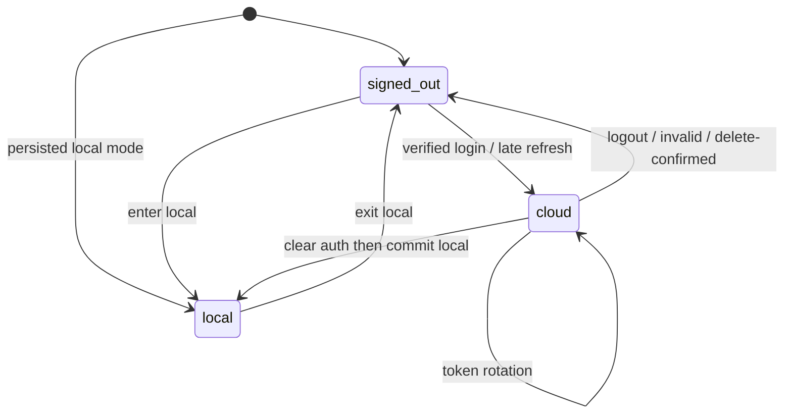

### 不变式

1. cloud 启动前不以“上次登录过”替代 membership 验证。
2. owner/mode 变化必须递增 boundary generation，异步落库/回调必须比 scope key。
3. local 使用保留 owner；无 owner 使用临时命名空间，不共享根。
4. 凭据明确失效才删；短暂失败仅改当次投影。
5. 本地模式对 analytics 是 runtime opt-out，不写持久 consent。

### 一致性与故障

- UI startup timeout 和 refresh request 的生命周期解耦；晚到只在 auth epoch 未变时 commit。
- 进 local 的清理顺序是取消 browser auth→清 provider secret cache/auth→commit local→broadcast，防止 local 带着旧 cloud runtime。
- account integrations 必须等 owner DB ready，启动结果回调再验 owner。

证据：`apps/desktop/src/main/appSessionState.ts`、`authManager.ts`、`authStartupGate.ts`、`accountIntegrationStartup.ts`。

## 6. 任务、Runtime 与 Turn 生命周期

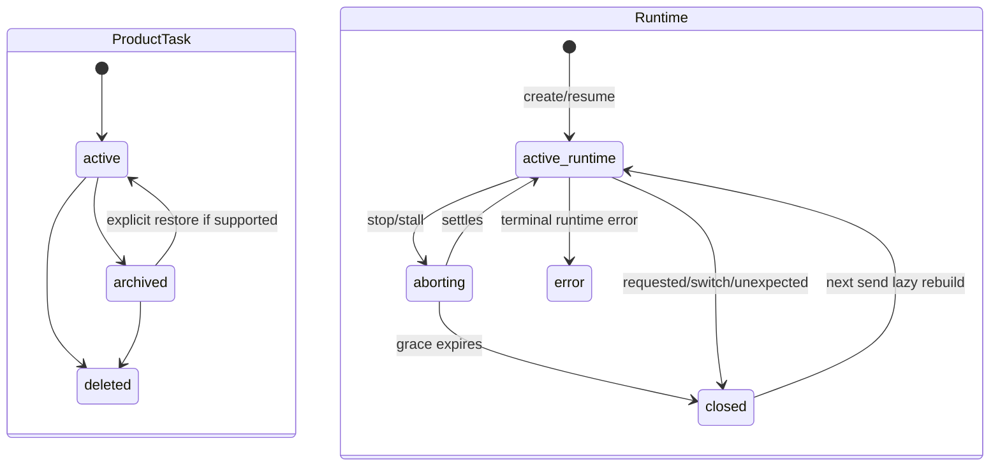

### 不变式

- `sessions.status` 与 runtime status 独立；close runtime 不 archive，archive/delete 可触发 worktree/关联资源回收。
- 同 runtime 只有一个 turn reservation；需要 host lease 且不在未决 interaction 屏障下。
- `done` 和 terminal error 是 turn 终态；error 优先 `isTerminal`，否则 `!willRetry`，旧 unknown 终态。
- 45m stall 只统计真实没有事件的时间，interaction/后台 task/系统休眠 gap 不误计。

### 事件序列

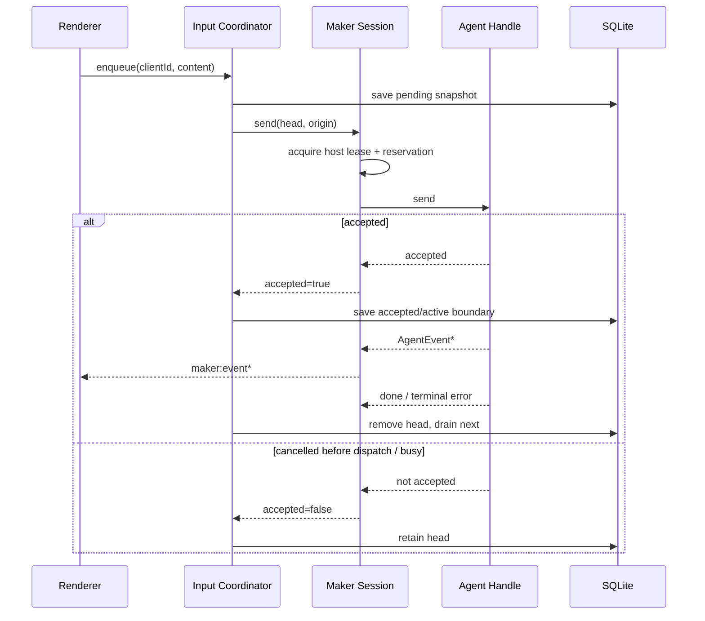

### 故障语义

- accepted 之前 crash：安全保留头部待重试。
- accepted 之后、无输出：只能用结构化 recovery token 决定 clone，不因 UI 看不到文本就盲发。
- accepted 之后、有部分输出：用 continuation prompt，不重放原始副作用。
- abort grace 超时：关闭 runtime，下次 send 重建，任务历史不丢。

证据：`packages/maker-core/src/session.ts`、`maker.ts`、`types/events.ts`，`apps/desktop/src/main/maker-ipc/agent-input-coordinator.ts`。

## 7. 输入队列与幂等策略

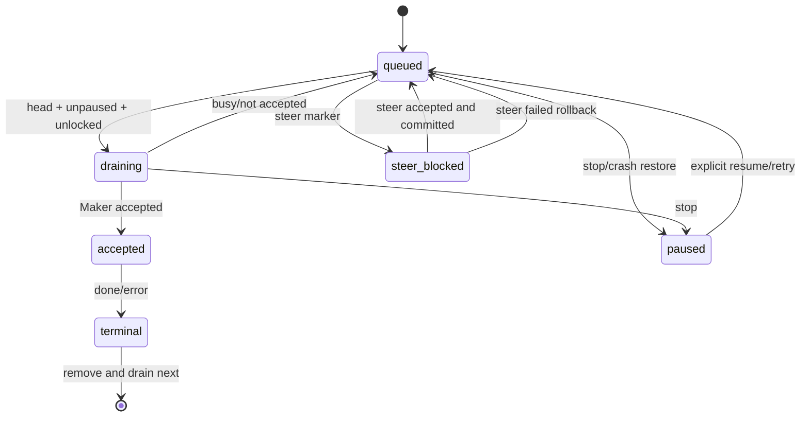

### 队列命令策略

| 命令 | 幂等键/并发 | Commit 点 | 失败后 |
|---|---|---|---|
| enqueue | session + clientId | 加入协调器并写快照 | 返原有投影/显式错误 |
| drain head | 每 session 锁 | Maker accepted | 头部保留，不越过 |
| steer | steer marker + runtime turn | Maker steer accepted | 回滚/保留 marker 的可恢复状态 |
| stop | session | paused 投影与 abort 发出 | 待处理不删 |
| retry | typed recovery state | clone/continuation 入队 | 不盲重发 |
| remove/update/move | queue item ID + revision/lock | 协调器成功后覆盖快照 | 保持旧队列 |

**[现状确认]** 快照是 per-session 单行 JSON，坏 shape 整体丢弃，队列空删行，恢复为 paused。

**[建议规格]** UI 应显式区分“已入队”、“正在派发”、“Agent 已接受”与“已完成”，不用一个 loading 合并四种可恢复性。

## 8. Harness/Route 切换事务

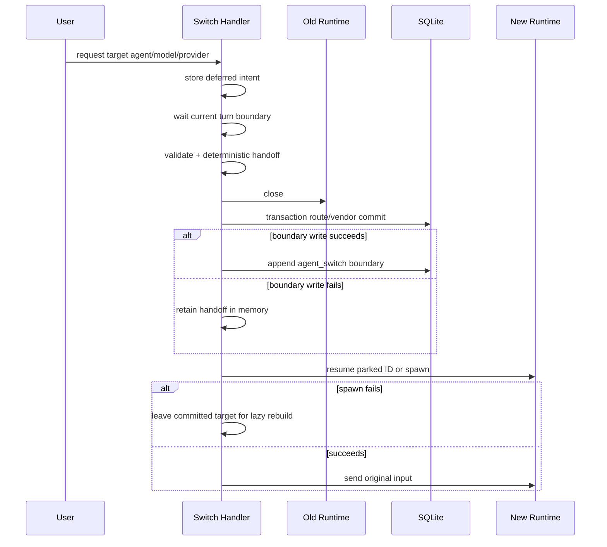

### 不变式

1. 切换不中断当前 turn，下一 send 前一次性应用。
2. DB transaction 是 route 真值 commit point；commit 后 spawn 失败不倒退为旧 Agent。
3. 切回原 Agent 优先 parked vendor ID + latest boundary 增量 handoff；无效 ID 必须原子清除后 full handoff。
4. switch intent 仅内存，app restart 丢失是已接受的当前行为。
5. remote/Orca 不支持跨 harness 切换；Worker 不在 turn 中切 model。
6. setModel route-first，runtime 失败回滚；effort 超时关 runtime 而不伪装已生效。

### 路由权威

`provider_id != null` → 使用明确 route；`provider_id == null` → 仅为 legacy 兼容根据 auth/model 推断。任何计费、凭据注入、错误归因应使用相同权威 route，不重复从 model 名猜。

证据：`apps/desktop/src/main/maker-ipc/sessionAgentSwitchHandler.ts`、`agentHandoff.ts`、`runtimeSetModel.ts`、`runtimeSetEffort.ts`。

## 9. Interaction/权限/计划状态

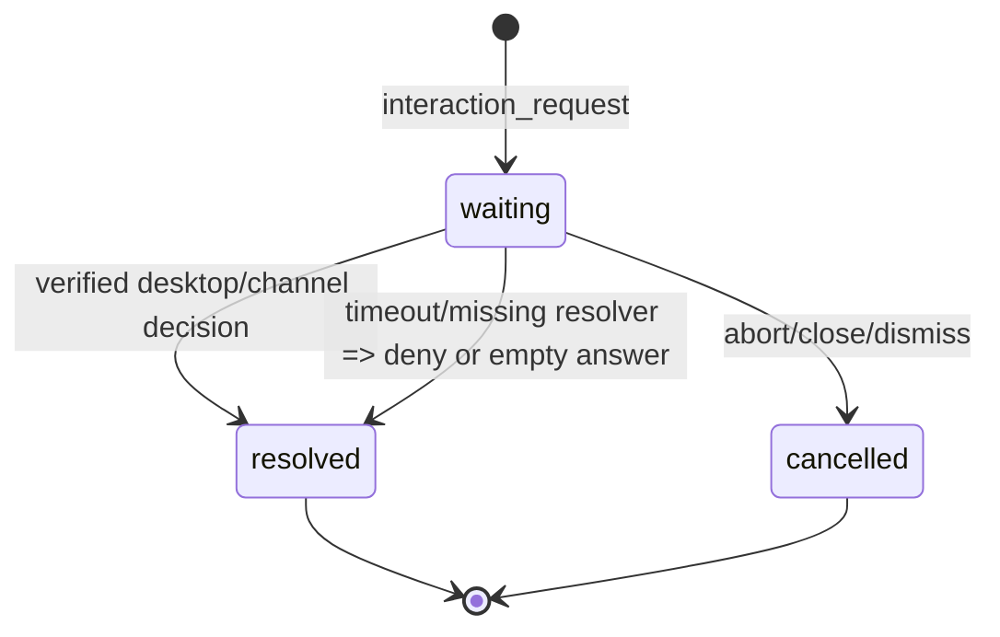

### 权限模式策略

| 模式 | 谁做决定 | 无决策器/错误 | 持久化 | 与 Plan 关系 |
|---|---|---|---|---|
| ask/default | 用户在 desktop/channel | deny | session | 正交 |
| acceptEdits | 策略允许编辑类，其他仍审批 | 超出范围 deny/ask | session | 正交 |
| auto | host reviewer/共享策略 | classifier unavailable 降 Ask，不 bypass | session | 正交 |
| bypass / Full Access | 已验证的 session/runtime 选择 | provenance 不足则 deny | session/Worker pref | 正交，不是 OS sandbox |

### 不变式

- Interaction 决定只对请求时的 live runtime 有效；晚到响应不可跨 turn/session-instance。
- permission/plan 超时均拒绝；ask_user_question 无 resolver 返空，不伪造用户答案。
- `plan_mode_enabled` 是独立字段，Agent 退出 Plan 时以 `plan_mode_changed` 回写。
- 插件 Full Access 豁免是 runtime/session-instance/live-local 级，不按工具参数中业务 ID 授权。

证据：`packages/maker-core/src/session.ts`，`apps/desktop/src/main/maker-ipc/interactionRouter.ts`、`maker-host/auto-permission-reviewer.ts`、`localDb/schema.ts`。

## 10. Orca Team/Worker 状态与不变式

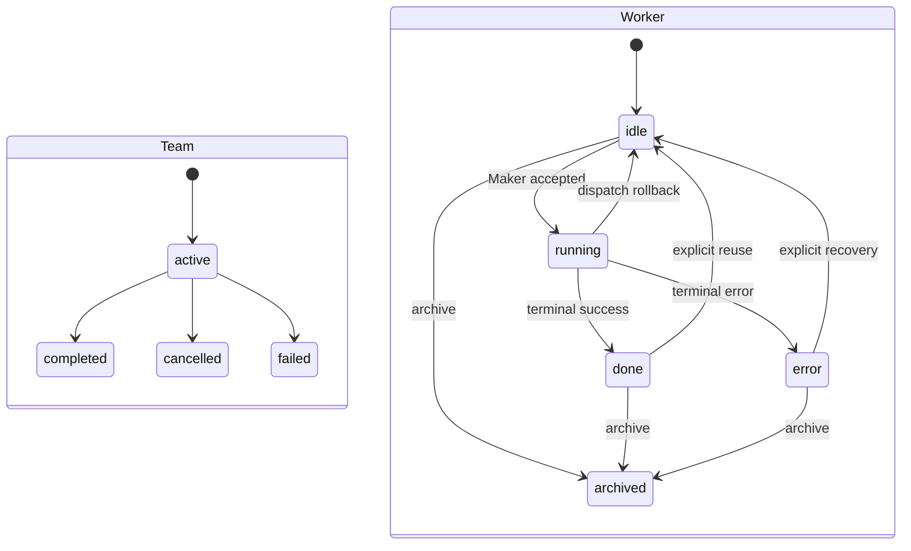

### 结构不变式

1. DB 部分唯一：每 Lead 最多一 active Team；每 Team 最多一 focused Worker。
2. Worker session 全局唯一绑定一 worker；Team 内 `lower(label)` 唯一。
3. 创建前用 reservation 同时占 label 和 slot；成功/失败立即释放，crash 由 expiresAt 回收。
4. Worker 创建后 idle；只有 Maker accepted 转 running，否则回滚 idle。
5. idle watcher 可关 runtime 但 Worker 逻辑实体仍存在；archive 才关闭并移出活跃协作。
6. 本地支持 cc/codex/pi；SSH 只 cc/codex；Pi remote fail closed。

### 控制面授权

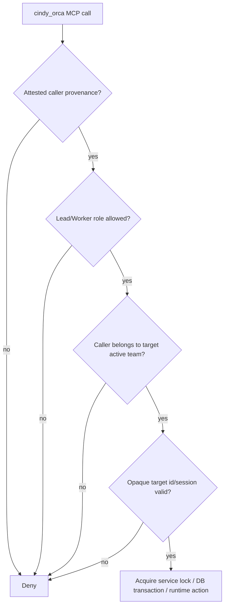

Codex 使用 `_meta.threadId` 建立调用者；unknown/batch 丢 metadata fail closed；`mcp-session-id` 和 tool argument 中的 sessionId 不作身份。

**[动态待验]** 远程批量创建部分成功、Worker terminal bridge 在断网后的重放/去重可观测性。

证据：`apps/desktop/src/main/localDb/schema.ts:247`、`:269`、`:308`，`apps/desktop/src/main/maker-ipc/orca*.ts`，`packages/orca-workflow/src/orca-bridge-mcp.ts`。

## 11. Scheduler 状态、入场与恢复

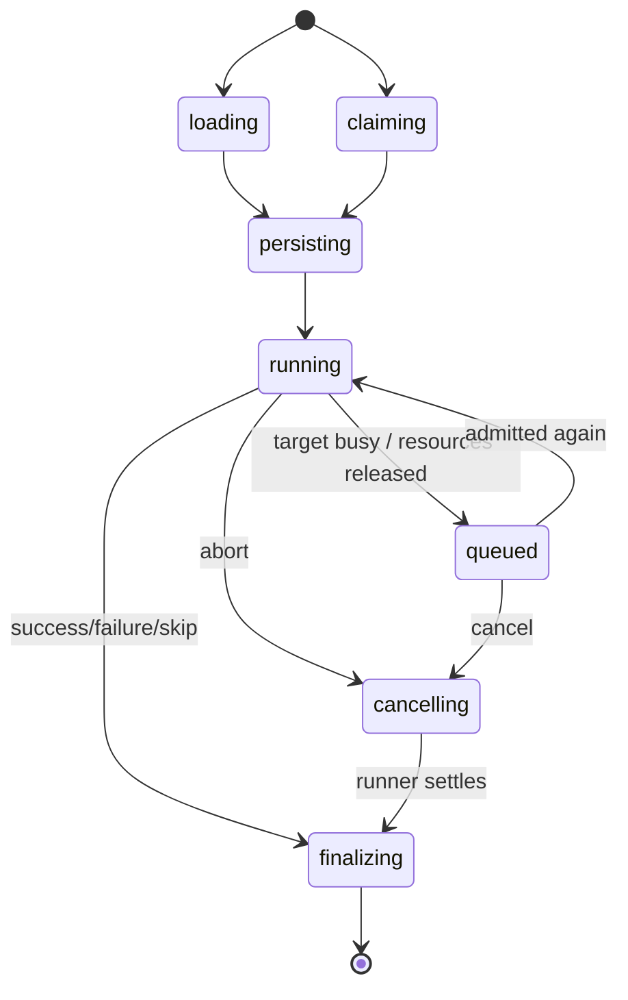

### 三层状态不可混淆

| 层 | 枚举 | 持久化 |
|---|---|---|
| Schedule | active/paused/expired | 是 |
| Run | running/success/failed/aborted/interrupted/skipped | 是 |
| Attempt phase | loading/claiming/persisting/running/queued/cancelling/finalizing | 否 |

### 不变式与事务策略

- `attemptLifecycle.ts` 是 phase 唯一转移口，非法转移抛错。
- due 使用 `nextFireAt` CAS claim，同 schedule 串行，防重复 fire。
- queued 不持有 Agent/MCP/token，不占并发槽；再入场重做预检。
- target busy 可在创建 run row 之前 defer；这与已有 attempt 的 queued 不同。
- run heartbeat 为 crash recovery 信号；startup sweep 将旧 running 转 interrupted，排除当前活 run。
- pre-run hook exit 0=run、2=skipped 且零 token/读取，其他/超时/丢失=failed。
- silent success 不通知，除非 Agent 显式 `notify_current_run`；失败始终通知。

### 幂等键

| 操作 | 幂等/互斥信号 |
|---|---|
| due fire | schedule ID + expected nextFireAt CAS |
| manual Run now | schedule lock + generated run ID |
| heartbeat/finalize | run ID + current owner/attempt context |
| project automation reconcile | stable project key + definition identity |
| notification | run terminal state + delivery attempt/status |

证据：`packages/maker-scheduler/src/types.ts`、`engine/attemptLifecycle.ts`、`engine/scheduler.ts`，`apps/desktop/src/main/scheduler-host/index.ts`、`storage.ts`。

## 12. Ghost/Skill/MCP 生命周期与策略

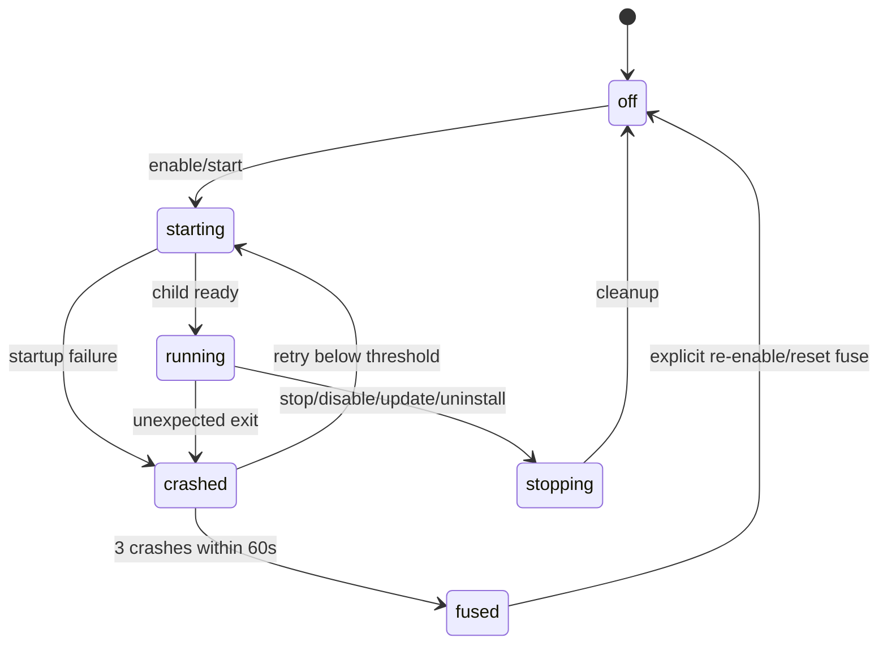

### 安装事务

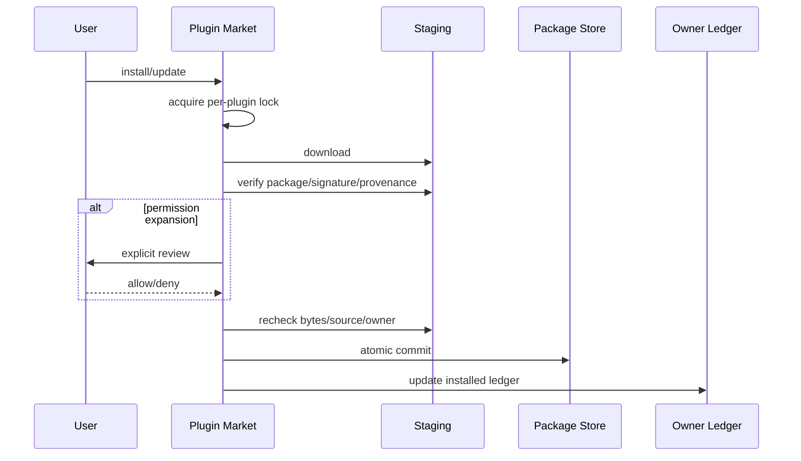

### 不变式

1. `ghost.json` v2 ID/路径必须安全；子进程只能跑包内声明 JS entry，无任意 command/shell/env 入口。
2. Node worker 以用户权限运行，不是 OS 沙箱；安全依赖 manifest slot、broker 限额和 host policy。
3. 权限扩展必须 review；precommit 重验 owner/source/bytes，防 TOCTOU。
4. default install 的显式 opt-out 是持久化意图，不因重启/源刷新重装。
5. Agent tool 是 session-create 快照，不中途注册；Pi/Claude/Codex 刷新时机不同，UI 应表达“下一 session 生效”。
6. SkillHub 自动同步只在 signed-in 且每 owner 一次，只允许服务明示白名单；当前 fallback 为空。
7. Custom MCP 配置入 DB，token 入 safeStorage；远程仅 http/sse + HTTPS/loopback。

### 调用上下文

`McpProviderContext = { business sessionId, opaque sessionInstanceId, attested caller provenance, runtime session context }`。控制工具必须使用 context，不信工具输入中的身份字段。

证据：`packages/plugin-protocol/src/manifest.ts`、`delivery.ts`，`apps/desktop/src/main/cindy-brain/*`、`plugin-market/*`、`skillhub/*`、`maker-host/custom-mcp-store.ts`、`mcp-integrations/*`。

## 13. IM/Hook 任务与交付状态

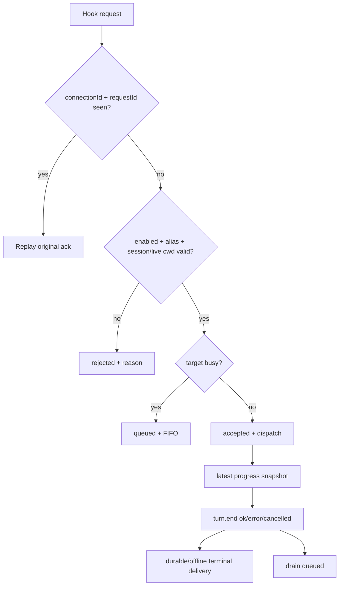

### 连接状态

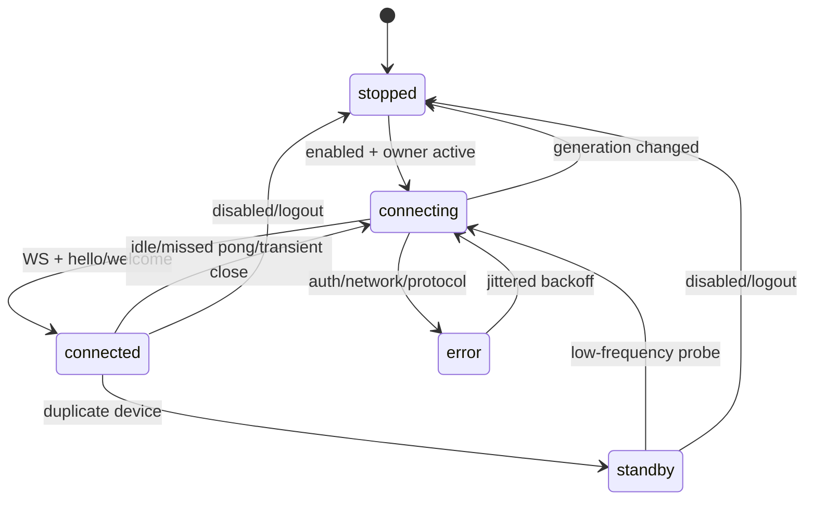

### 不变式

- connection lifecycle 和 work queue 串行；start 失败不污染后续 stop；logout generation 作废未执行 work。
- Binding 身份是 `(channel, bot, user, scope)`；持久化成功后才更内存 map；preload 确定性修复旧重复绑定。
- path aliases 是唯一工作目录白名单；复用 session 每消息重验 live cwd，不信旧 binding。
- ack 只有 accepted/queued/rejected；rejected reason 只用已定义枚举。
- progress 是 best-effort latest snapshot，不重放全历史；terminal turn.end 才离线持久/重放，重开 turn 例外。
- new session permission override 需校验，默认 bypass；reused session 以 DB meta 为准；non-bypass interaction 没有渠道卡或超时则 deny。

证据：`apps/desktop/src/main/im/connectionLifecycle.ts`、`binding.ts`，`hook-control/transport.ts`、`dispatcher.ts`、`requestLedger.ts`、`outbound.ts`，`packages/slack-hook-protocol/src/*`。

## 14. 个人微信可靠 Inbox/Outbox

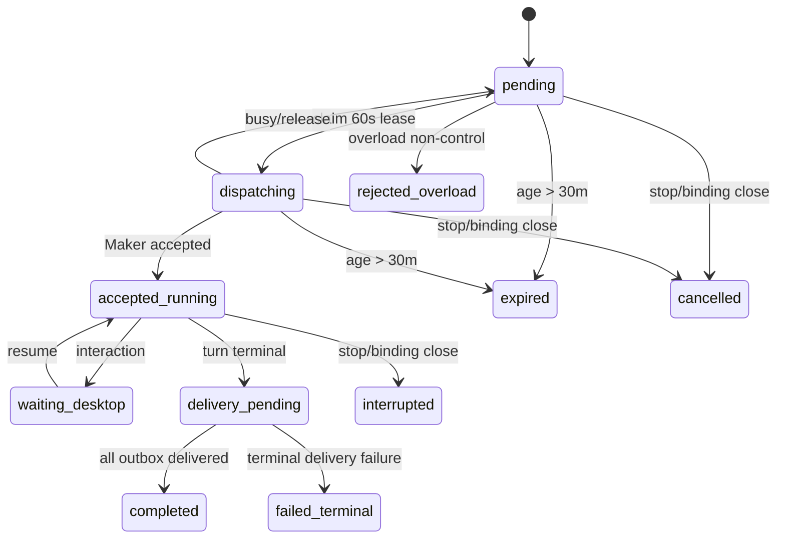

### Outbox 状态

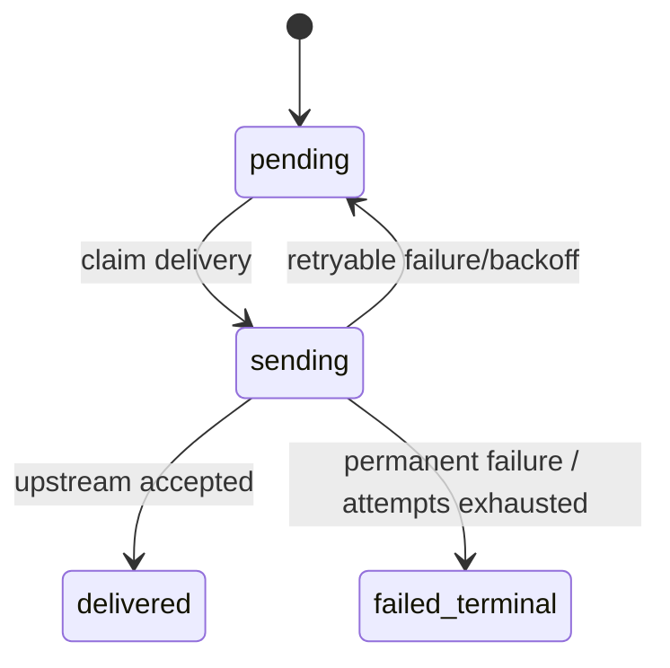

### 不变式

1. `binding_epoch` 是连接 generation；关绑定/重绑后晚到 poll/pump 不得写新 epoch。
2. credential 不进 SQLite；上下文在本地加密。
3. inbox lease 60s，task TTL 30m；忙时从 dispatching 释放回 pending，不伪 accepted。
4. turn 终态先产生 outbox/delivery_pending，全部 delivered 才 task completed。
5. `/stop` 和 `/stop all` 是控制命令，不走 overload 拒绝；关绑定取消未接受，中断已 accepted。

**[动态待验]** 上游平台对消息去重、媒体重试和长时断网的实际协议语义。

证据：`apps/desktop/src/main/im/wechat/WechatIM.ts`、`taskStore.ts`、`contextCrypto.ts`，`apps/desktop/src/main/localDb/worker/opHandlers/wechatTx.ts`、`schema.ts`。

## 15. Device Link 单主与可靠传输

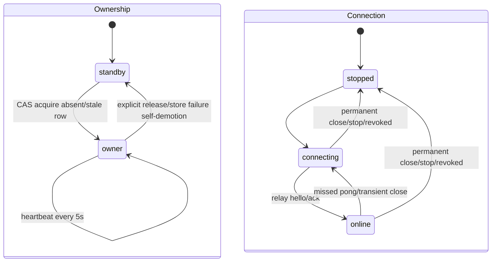

### 不变式

- 只有 SQLite owner 允许连 relay；ownerId 每启动随机，PID 只诊断，不用作身份。
- heartbeat 5s，stale 15s；store 不可用时 owner 先自降级，不一边保持 socket 一边猜 lease。
- 网络断不让 owner，防止弱网时本机实例抖动互踢。
- relay connect→hello/ack 才 online；20s ping，丢 pong 退回 connecting；可靠 per-peer stream 有 ack/replay/backpressure。
- offline push 仅内存，128 items/512KiB/5m；state channel 可 coalesce，event 保序，不是持久化真值。
- remote invoke/push 仅 allowlist；被控 main 仍对业务参数、owner、session、路径二次校验。

### Close/超时策略

| 类型 | 例子 | 自动恢复 |
|---|---|---|
| permanent | user, toggle-off, shutdown, revoked | 否，取消 reopen |
| capability-gated transient | transport-timeout | 仅 online owner + control enabled + outbound intent，最多 5 次 |
| network transient | missed pong/socket close | 1–30s 指数抖动重连 |
| invoke timeout | 请求无响应 | 标记 inFlight 不确定；有副作用命令不盲重试 |

证据：`packages/device-link/src/client.ts`、`allowlist.ts`，`apps/desktop/src/main/device-link/ownership.ts`、其他 `device-link/*`。

## 16. 文件、终端、浏览器与 Review 策略

### Terminal

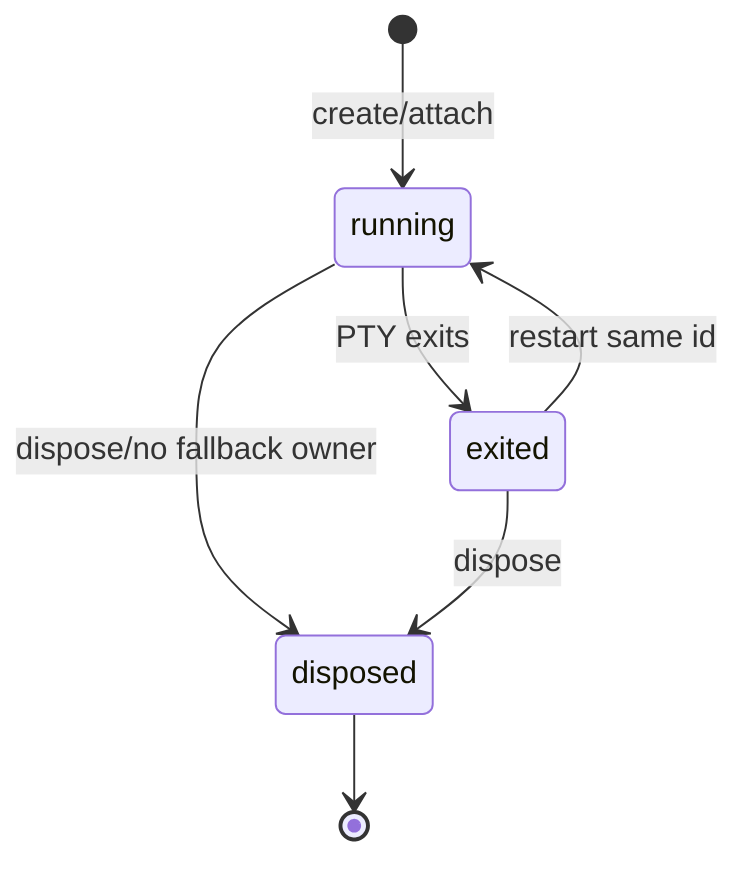

- create/attach 幂等；exit 留 record/overlay，dispose 才 kill/remove。
- write 使用 microtask batching；window owner 销毁优先转 fallback，无 fallback dispose。
- PTY env 剥离 terminal integration 和 secret-like 变量。

### File

- local/SSH/device 共享 file-browser-core 路径规则；traversal/symlink 逸出拒绝。
- read 常规上限 2MiB；大文件走 remote chunk/device export 与 cache，不绕过范围校验。
- search 只 fixed-string + 文本白名单，hidden 但尊重 `.gitignore`，有界匹配，取消 TERM→200ms→KILL。
- SSH chat file 超 cwd 拒绝；device 超 cwd 通过授权 media fetch，exact stat 区分 file/directory/nonfile/unknown。

### Browser

- Main TabRegistry 是真值，Renderer 持有 DOM/LRU；dom-ready 后注册，crash 自清，stale release 比 webContentsId。
- capture/force-kill 只允许 sender-owned guest；pin lease 使自动化 tab 免资源回收。
- 30s watchdog：后台内存≥1GiB 回收；后台 CPU≥50% 连续 4 次回收（audible 例外）；前台内存≥2GiB kill+通知；前台 CPU≥90% 连续 4 次告警/cooldown。
- shared PID 聚合 foreground/pin，不可以单 tab 视图对整 PID 做错误回收。

### Review

- `turn_diff`/change-set 是一次 turn 的改动投影；apply/reject 必须作用于确切 change-set/revision，不根据当前 UI 列表位置。
- PR ref 只存确定性提取的 owner/repo/number/URL，易变状态按需查，不落长期真值。

证据：`apps/desktop/src/main/terminal/ptyManager.ts`、`file-browser/*`、`rsb-browser-bridge/*`、`git-review/*`，`packages/file-browser-core/src/*`。

## 17. Usage/计费与归因策略

```mermaid
flowchart LR
  EVENT[Agent usage event] --> DELTA[Cumulative to turn delta]
  DELTA --> ROUTE[Resolve authoritative route]
  ROUTE --> PRICE{Pricing source}
  PRICE -->|gateway quote| ACTUAL[Actual money]
  PRICE -->|provider API/reference| APPROX[Approximate money]
  PRICE -->|subscription| VALUE[Value estimate, not actual]
  PRICE -->|missing| UNKNOWN[Unavailable/unknown]
  ACTUAL & APPROX & VALUE & UNKNOWN --> ATTR[Session/run/day/model attribution]
```

### 不变式

1. cumulative counter 回退是 reset，当 turn delta=当前值；任何负 delta clamp 0。
2. Vertex 已知 output 晚一 turn 只影响 timing，不丢会计量。
3. route 来自实际 provider 路由，不只从 model ID 猜。
4. subscription 不计 actual money；可展示 value estimate，但类型必须保留。
5. `daily_model_usage` 以 day+agent+model+currency 联合键，换账本币种不覆盖旧金额。
6. attribution 显式 exact/direct/mixed/zero/unavailable/legacy，不将 mixed/unavailable 假装 exact。

**[建议规格]** 用量 UI 应同时显示金额类型、币种、路由与归因信心，不只显示单一数字。

证据：`apps/desktop/src/main/usage/modelUsageDelta.ts`、`turnCostCalculator.ts`，`apps/desktop/src/main/localDb/schema.ts:1172`、`:1211`。

## 18. Updater 与 Analytics 策略

```mermaid
stateDiagram-v2
  [*] --> idle
  idle --> checking
  checking --> downloading: newer version
  checking --> idle: current
  checking --> error: check failure
  downloading --> ready: verified patch
  ready --> superseding: newer patch download
  superseding --> ready: success replaces old
  superseding --> ready: failure keeps old
  ready --> idle: relaunch now matches version
  ready --> error: apply attempts >= 3
  error --> checking: later/manual retry
```

### Updater 不变式

- superseding 期间旧 ready patch 仍是可用回退；新版成功后原子替换，失败不清旧版。
- patch-info 保存 version/file/hash/relogin/applyAttempts；匹配当前版清理，attempts≥3 有界放弃。
- normal auto relaunch 需 enabled+packaged+ready+无 busy+quiet/resume 窗口+locked/idle≥10m；DB/Scheduler 忙查询错误 fail closed。
- startup apply 不用普通 idle/busy gate，但在最终 apply boundary 重验状态。
- relaunch 前停 ADB/iOS/Ghost node，写 expected-exit，不让 crash recovery 误解为崩溃。

### Analytics 不变式

`canReport = packaged_or_strict_dev_opt_in && privacyConsentAccepted && analyticsEnabled && mode != local`。

- privacy consent 和 analytics opt-out 是两个持久化真值。
- local 只对运行期增加 deny，不写回两个用户选项。
- legacy consent migration 只在冷启确定存在认证时执行；确定 local/无 auth 封闭迁移，短暂/含糊认证保留窗口。
- settings 读取损坏不得回退为“已同意”。

**[动态待验]** 真实 patch 签名/替换、macOS translocation/Windows 锁文件、休眠后时钟补偿。

证据：`apps/desktop/src/main/updateService.ts`、`analytics-settings-store.ts`、`analyticsSettingsService.ts`。

## 19. Local DB 打开、迁移与恢复

```mermaid
flowchart TD
  SELECT[Select owner DB] --> LEASE[Acquire reader/writer lease]
  LEASE -->|incompatible/downgrade/damaged| FAIL[Fail closed]
  LEASE --> BACKUP[Disk budget + online backup 0600]
  BACKUP --> MIGRATE[Schema migrations 0000-0089]
  MIGRATE --> VEC[Vector capability/migrations]
  VEC --> DRIFT[Schema drift detection]
  DRIFT -->|dev repair allowed| REPAIR[Backup then repair]
  DRIFT -->|release drift| WARN[Warn/toast; no silent repair]
  DRIFT --> STARTUP[Dialogue/Orca repair + optimize]
  STARTUP --> SMOKE[DB worker smoke]
  SMOKE -->|pass| WORKER[Worker takeover]
  SMOKE -->|fail| LOCAL[In-process fallback]
```

### 不变式

1. owner 切换关旧 DB 再开新 DB，不在同一 DAO 上换表语义。
2. WAL 做常规 crash recovery，退出不全量备份；迁移前单独 online backup。
3. 备份前查磁盘预算，备份文件 0600；不在无备份保障时改 schema。
4. passive reader 不写；packaged 只在 schema 精确兼容时只读打开；禁止 downgrade write。
5. stale lock 只在 PID/租约可证明时清；damaged lock fail closed，不删锁猜测。
6. worker 仅 smoke 成功后 takeover；runtime boundary 自动重启一次，然后明确失败/回退，不无限循环。

### Corruption 恢复顺序

```mermaid
flowchart LR
  CORRUPT[SQLITE_CORRUPT] --> CLEAN{.bak.clean valid?}
  CLEAN -- yes --> RESTORE1[Restore + notify]
  CLEAN -- no --> MIG{latest .bak.ISO valid?}
  MIG -- yes --> RESTORE2[Restore + notify]
  MIG -- no --> FATAL[Fatal; preserve original evidence]
```

**[动态待验]** 断电、磁盘满、多版本并发、备份/迁移中断的真实文件系统结果。

证据：`apps/desktop/src/main/localDb/index.ts`、`schemaMigrationLease.ts`、`schemaDrift*.ts`、`migrations/*`。

## 20. 权限矩阵

| 调用者 | 任务/消息 | 副作用工具 | 配置/secret | 文件/PTY/浏览器 | Orca/Scheduler 控制 | 远程转发 |
|---|---|---|---|---|---|---|
| 主 Renderer | 通过 preload + owner/session 校验 | 受 permission/interaction | 可改设置，secret 只送 main、不回读明文 | sender/workspace 校验 | 可，经 main service/DB 事务 | 不直接，走 Device Link |
| 右侧栏子窗口 | 只子集 | 无主界面全权 | 只非机密投影 | file/terminal/media/browser 子集，有 owner context | 有限 | 只经 main |
| Ghost panel/runtime | 仅 manifest slot 声明 | pipe broker + method/secret binding | 不获主 preload，不得枚举 secret | fs/workspace/browser 仅声明能力 | Agent/errand/schedule 仅声明能力 | 无通用转发 |
| Agent tool/MCP | 仅 live session context | permission mode + host policy | token 由 host 注入 | workspace grants/工具规则 | Orca control 需 provenance/role/team | 取决于 host 工具，不自报 |
| IM/Hook user | 只绑定 identity/scope/session | non-bypass 用 channel card，超时 deny | 不可修改 desktop secret | cwd 只在 path alias 范围 | 只有明确渠道能力 | 不是 Device Link |
| Device Link peer | 仅 remote allowlist + topic | 仍由被控 main 校验 | secret/settings 默认不在 allowlist | 仅 allowlisted 子集 + 路径校验 | 仅 allowlisted command | `REMOTE_INVOKE_ALLOWLIST`/`PUSH_FORWARD_ALLOWLIST` |
| DB worker | 仅内部类型化 operation | 不直接做用户授权 | 不接触 safeStorage secret | 无通用 OS 能力 | 只事务 operation | 无 |

### 权限决策顺序

1. 验证窗口/进程/caller provenance。
2. 验证 owner generation 与 live session/runtime instance。
3. 验证 capability/allowlist/manifest slot。
4. 验证路径、Team/role、target 实体和业务状态。
5. 应用 permission mode/interaction 决策。
6. 仅在前述全通过后执行副作用并提交真值。

## 21. IPC / Event / API 契约

### 边界形态

| 边界 | 请求 | 响应/事件 | 权威约束 |
|---|---|---|---|
| Renderer → Main | `ipcRenderer.invoke`/send/sendSync via preload | structured result/error | preload 不是授权，main 验 sender/owner/input |
| Main → Renderer | `webContents.send` + fan-out | Maker/Auth/Terminal/域 push | 按窗口、session/topic 过滤；订阅需 unsubscribe |
| Agent → Host | `AgentEvent` | persist/project to UI | terminal 语义统一，vendor 细节转换 |
| Ghost → Host | `ghost-pipe:send` JSON-RPC/MCP | method result/error | manifest slot + broker limit + secret binding |
| MCP → Host | tool call + provider context | tool result/error | attested runtime provenance，不信 tool ID arg |
| Hook/IM → Host | framed request/event | ack/progress/turn.end | identity/scope/path alias/dedupe |
| Device Link peer → Host | reliable envelope/invoke/topic | ack/result/push | remote allowlists + per-call main validation |

### AgentEvent 契约

| 类别 | 事件 | 必须保留的语义 |
|---|---|---|
| 内容 | text/thinking/image | 顺序、turn 归属、有界呈现 |
| 工具 | tool_use/tool_result/tool_result_full | toolUseId 配对，full 不必等于可见细节 |
| 任务 | agent_task_update/turn_diff | child/change-set identity，运行与终态 |
| 交互 | interaction_request/interaction_dismissed | request ID/live runtime，解决一次 |
| 模式 | plan_mode_changed/status/compact_boundary/session_id | 宿主持久化或 runtime 投影边界 |
| 用量 | account_usage | 快照 freshness/来源 |
| 终态 | done/error | 每 turn 只有一个最终终态，error 有 terminal/retry 语义 |

### 版本与兼容策略

- **[现状确认]** 部分事件对旧错误缺 `isTerminal/willRetry` 采保守终态；部分 DB JSON 列在读侧做 shape 校验/安全回退。
- **[建议规格]** 新跨进程/跨设备 envelope 显式带 `schemaVersion`、`requestId`、`ownerGeneration`、`sessionInstanceId?`、`sentAt`；老读侧对未知字段容忍，对未知副作用类型 fail closed。
- **[建议规格]** 不把 Electron 频道名当作权限；每个 handler 在单点完成输入 shape + sender + domain authorization。

证据：`apps/desktop/src/preload/preload.ts`、`main/maker-ipc/channels.ts`、`shared/authIpc.ts`，`packages/device-link/src/allowlist.ts`、`packages/maker-core/src/types/events.ts`。

## 22. 幂等、一致性与故障语义总表

| 域/操作 | 幂等或互斥键 | Commit 点 | 超时/崩溃后语义 | 重试策略 |
|---|---|---|---|---|
| Auth refresh | auth epoch + stored token identity + de-duplicated cold run | 新 token/verified owner 提交 | UI timeout 不取消，晚到复验 epoch | transient 保 token，definitive 清理 |
| Message append | session + clientId | DB unique/upsert | 重复 importer 被 clientId/tombstone 阻止 | 允许同 clientId 幂等 |
| User input send | session lock + queue item | Maker accepted | accepted 后可能已有副作用 | typed clone/continuation，不盲重发 |
| Harness switch | per-session deferred intent | DB route transaction | commit 后 spawn 失败留目标 route | 下次 send lazy rebuild |
| Interaction resolve | request ID + runtime instance | resolver one-shot | 晚到丢弃 | 不重复决定，timeout deny |
| Orca worker create | team+lower(label)+slot reservation | worker/session DB creation | reservation expires，孤儿 startup repair | 显式重试，批量按顺序报部分结果 |
| Orca dispatch | worker/session queue lock | Maker accepted 后 running | 未 accepted 回 idle | 保留/编辑排队消息 |
| Schedule fire | schedule+expected nextFireAt CAS | claim/replan transaction | crash running 由 heartbeat sweep→interrupted | 依 recurrence/replan，不重放同 claim |
| Plugin install | per-plugin lock + verified package identity | atomic package commit + ledger | staging 可清，旧包保持 | 重新下载/验证，不复用过时 review |
| Ghost runtime | plugin/entry process registry | child ready | 3/60s fused | 阈值内重试，fused 需人工 reset |
| Hook request | connectionId+requestId | ack ledger/dispatch accepted | 重放 ack 不重跑 | terminal delivery 可重试，progress 不全重放 |
| WeChat inbox | bindingEpoch+platform message identity+lease | status transaction/outbox creation | lease 过期释放，TTL 过期 | pending/outbox 按类型重试 |
| Device owner | singleton row + random ownerId CAS | owner row/heartbeat | store failure self-demote，网断不释 owner | stale 后 takeover |
| Device invoke | link/request ID + reliable stream | remote result（副作用可早于 result） | timeout 可 inFlight unknown | 只对可幂等/明确未执行操作自动重试 |
| PTY create | terminal ID/session/tab | process + registry record | exit 留 record，owner 转移 | restart same ID；dispose 不复活 |
| Updater patch | version/hash/file | verified ready patch | superseding 失败保旧，apply attempts 有界 | check/download 可重试，apply ≥3 停 |
| DB migration | writer lease + schema version | 每 migration transaction/history | online backup 恢复，corrupt 两级 backup | 不 downgrade，损坏 lock fail closed |

### 通用故障分类

1. **Precondition failure**：未越 commit，保留原真值，可修正后重试。
2. **Rejected/not accepted**：明确无副作用，输入可保留。
3. **Accepted/in-flight unknown**：可能已有外部副作用，不自动盲重试。
4. **Retryable transient**：保留身份/凭据/原真值，有界退避。
5. **Definitive invalid**：清理无效凭据/绑定，转明确状态。
6. **Stalled**：先中断，grace 后强制释放，保留持久化任务真值。
7. **Corrupt/incompatible**：备份/恢复或 fail closed，不用空数据覆盖证据。

## 23. 隐私与安全边界

### 不得进入 Renderer/普通 DB/日志/遥测的数据

- refresh/access token、provider API key、OAuth token、MCP bearer token、IM/bot credential。
- 钥匙串/认证存储内容、`.env`、shell inherited secret-like env。
- 用户 prompt/消息/文件正文、IM 正文、完整本地路径（除本地功能必需且不外发）。
- MCP/Ghost tool 私密输入与完整 stderr/stdout；诊断只保存消毒/有界摘要。

### 必须存在的防线

| 风险 | 现状防线 | 建议补强 |
|---|---|---|
| 跨 owner 穿透 | owner DB/root/ledger/credential + generation fence | **[建议规格]** 对每个异步组件建 owner-switch chaos test |
| Renderer 窃取 secret | main safeStorage，只回 has/auth state | 对 preload 返回 shape 做自动 secret-key denylist |
| 伪造业务 ID 授权 | runtime/session-instance/thread provenance | 把 provenance 缺失作为可观测安全计数，不记 payload |
| 路径逸出 | authorized roots + traversal/symlink checks + aliases | 跨 local/SSH/device 共享相同负例契约测试 |
| 远程过权 | invoke/push allowlist + 被控 main 二次校验 | allowlist diff 作为安全 review 必审项 |
| 插件扩权/TOCTOU | manifest slot + permission review + precommit recheck | 每次更新向用户显示权限 diff |
| 遥测过量 | consent + enabled + packaged + non-local | 指标 schema 上线前做 privacy budget/保留期审查 |
| 媒体越权 | host-computed hash + media refs/origin | 定期对账 orphan refs/blobs，不记媒体内容 |

### 安全事件响应原则

- 缺 provenance/不在 allowlist/越路径：拒绝并记录有界错误类型，不回显 secret/path 细节。
- 连续崩溃：熔断，不用无限重启放大攻击/资源消耗。
- 凭据明确失效：清理对应 owner secret 并关闭依赖连接；短暂故障不销毁凭据。
- 库/锁损坏：保留原证据、恢复备份或 fail closed，不“修复”为空状态。

## 24. 动态验证矩阵

| 域 | 必须故障注入的边 | 不可只用静态审计下结论 |
|---|---|---|
| Auth | splash timeout 后 logout/local switch + late success，realm/SSO/delete | 服务端状态码/账号最终状态 |
| Agent | accepted 前/后 crash，partial output，abort grace，vendor resume | 三 CLI/API 事件顺序和副作用边界 |
| Switch | validate/close/DB commit/boundary/spawn 每 await 失败 | handoff 完整性/真 vendor 恢复 |
| Orca | reservation expiry，batch partial，remote disconnect，bridge loss | 真多 Agent 终态去重 |
| Scheduler | claim/heartbeat/finalize/stall/replan crash | 跨休眠/时区/弱网的实际触发 |
| Plugin/MCP | CDN/package swap，child crash flood，MCP body stall | 签名链/远程服务兼容 |
| IM/WeChat | accepted-running/outbox-sending/binding-close crash | 上游重放/媒体限制 |
| Device Link | two instances + DB outage + relay outage + invoke timeout | relay 协议、in-flight 副作用是否已执行 |
| OS surfaces | PTY signal, SSH disconnect, Chromium shared PID pressure | macOS/Windows/Linux 差异 |
| Usage | cumulative reset, late usage, quote/rate unavailable | 真实账务对账 |
| Update | superseding failure, apply=3, translocation/locked file | 签名与替换器结果 |
| DB | power loss, disk full, corrupt backup, mixed-version lock | WAL/备份/租约的 OS 真实性 |

## 25. 实施决策清单

任何新领域变更在开发前必须回答：

1. 持久化真值是什么，谁是单一写入者？
2. Renderer/远程/子进程拿到的是真值还是投影？
3. 业务 ID 与授权 provenance 是否分开？
4. accepted/commit 边界在哪个 await 前后？
5. 幂等键、互斥锁和部分唯一约束是什么？
6. 超时是“未执行”、“可重试”还是“执行状态不确定”？
7. app crash/owner switch/断网后从什么恢复，是否默认 paused？
8. 缺少 listener/provenance/allowlist/path grant 时是否 fail closed？
9. 通知是 best-effort progress 还是可重放终态？
10. 哪些字段永远不可进 DB/Renderer/日志/遥测？
11. 新状态如何与老版本兼容，未知副作用是否拒绝？
12. 哪些边必须用真 API/CLI/OS 故障注入才能发布？

## 26. 追溯文档

- `/Users/smallraw/.cache/cindy-deep-dive/source-analysis/business-logic.md`
- `/Users/smallraw/.cache/cindy-deep-dive/source-analysis/state-machines.md`
- `/Users/smallraw/.cache/cindy-deep-dive/source-analysis/data-model.md`
- `/Users/smallraw/.cache/cindy-deep-dive/source-analysis/ipc-api-events.md`
- `/Users/smallraw/.cache/cindy-deep-dive/source-analysis/evidence-index-logic.md`
