# 06｜Cindy 系统与集成蓝图

> 评审用途：系统架构、平台边界、PRD 可行性、集成设计、安全与可靠性评审。
> 源码基线：`makecindy/cindy@240247e52e938710f409c921a7a393097dcef52b`。
> 所有“目标”均为建议，不代表已排期；所有“缺口”均要求动态验证或产品/架构决策。

## 0. 阅读说明与证据

### 0.1 状态标记

| 标记 | 定义 |
|---|---|
| **【已实现】** | 源码、schema、测试或只读 UI 证据可直接证明 |
| **【目标建议】** | 建议作为未来系统/产品目标；当前不可按事实对外承诺 |
| **【缺口】** | 真实服务、OS、故障注入或版本组合尚未验证，或源码明确未实现 |

### 0.2 证据入口

- [UI/窗口/路由审计](/Users/smallraw/.cache/cindy-deep-dive/source-analysis/ui-source-inventory.md)（UI-SRC）
- [桌面架构](/Users/smallraw/.cache/cindy-deep-dive/source-analysis/architecture.md)（ARCH）
- [业务逻辑](/Users/smallraw/.cache/cindy-deep-dive/source-analysis/business-logic.md)（BIZ）
- [数据模型](/Users/smallraw/.cache/cindy-deep-dive/source-analysis/data-model.md)（DATA）
- [IPC/API/Event](/Users/smallraw/.cache/cindy-deep-dive/source-analysis/ipc-api-events.md)（IPC）
- [状态机](/Users/smallraw/.cache/cindy-deep-dive/source-analysis/state-machines.md)（STATE）
- [业务证据索引](/Users/smallraw/.cache/cindy-deep-dive/source-analysis/evidence-index-logic.md)（EVIDENCE）
- [GitHub 蓝图](/Users/smallraw/docs/github-article/makecindy-cindy-blueprint.md)（GH-BP）
- [只读 UI coverage](/Users/smallraw/.cache/cindy-deep-dive/ui/coverage.md)（UI-LIVE）

## 1. 系统上下文

### 蓝图 1：产品与外部系统上下文

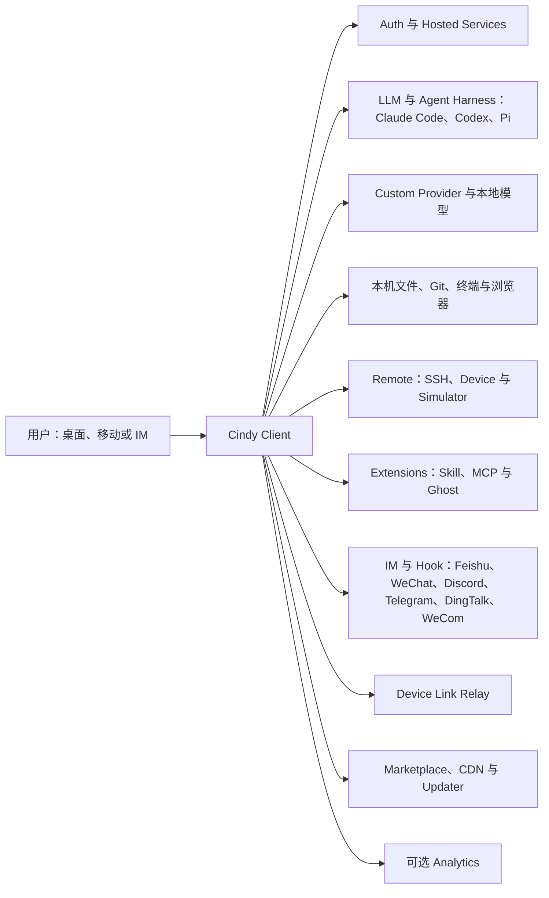

**【已实现】** Cindy 是客户端宿主：运行与高权限能力在 Electron main；外部服务/CLI/设备作为受控依赖；官方云不是本仓全部源码的一部分。[README](/Users/smallraw/.cache/cindy-deep-dive/source/cindy/README.zh-CN.md)、[BIZ §1](/Users/smallraw/.cache/cindy-deep-dive/source-analysis/business-logic.md)。

**【目标建议】** 所有外部集成统一声明：身份、数据方向、secret 所在、超时、重试、幂等、离线、可撤销与可观测性。

**【缺口】** Auth/realm、LLM CLI/API、IM、Device Relay、Marketplace/CDN、Updater 文件替换均依赖真实外部系统；静态审计只能证明客户端策略，不能证明端到端 SLA。[EVIDENCE D 级条目](/Users/smallraw/.cache/cindy-deep-dive/source-analysis/evidence-index-logic.md)。

## 2. 进程与信任边界

### 蓝图 2：桌面进程与权限分层

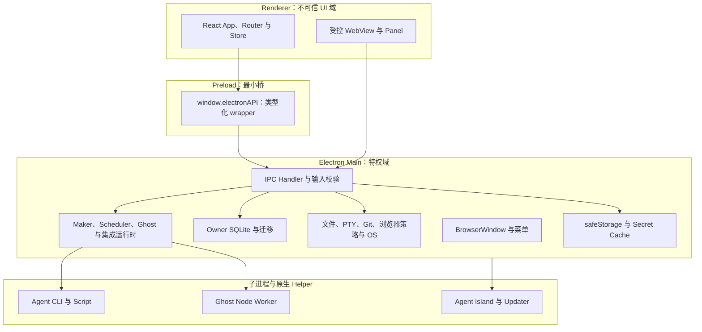

关键约束：

1. **【已实现】** Renderer 无 Node/Electron 对象，只经 contextBridge wrapper；主窗口 sandbox/contextIsolation 开启。[electron security rules](/Users/smallraw/.cache/cindy-deep-dive/source/cindy/docs/dev-rules/electron-security-and-process-boundaries.md)、[preload.ts](/Users/smallraw/.cache/cindy-deep-dive/source/cindy/apps/desktop/src/preload/preload.ts)。
2. **【已实现】** IPC 频道名不是授权；main 继续校验 sender、owner/generation、session/runtime identity、路径、权限和 shape。[IPC §1](/Users/smallraw/.cache/cindy-deep-dive/source-analysis/ipc-api-events.md)。
3. **【已实现】** Ghost/Device Link 再叠 capability/provenance/allowlist gate；不相信业务 ID 自报。[BIZ §10/§12](/Users/smallraw/.cache/cindy-deep-dive/source-analysis/business-logic.md)。
4. **【已实现】** Secret 保存在 main safeStorage/内存，不把明文放 SQLite 或回传 Renderer。[DATA §1/§7](/Users/smallraw/.cache/cindy-deep-dive/source-analysis/data-model.md)。
5. **【缺口】** 主 preload 静态检出约 797 个 invoke wrapper，能力面很大；需要持续自动化审计每个 handler 的 sender/shape/owner gate，而不能把“类型化”当安全证明。[IPC §2](/Users/smallraw/.cache/cindy-deep-dive/source-analysis/ipc-api-events.md)。

## 3. 模块分层与依赖方向

### 蓝图 3：Monorepo 分层

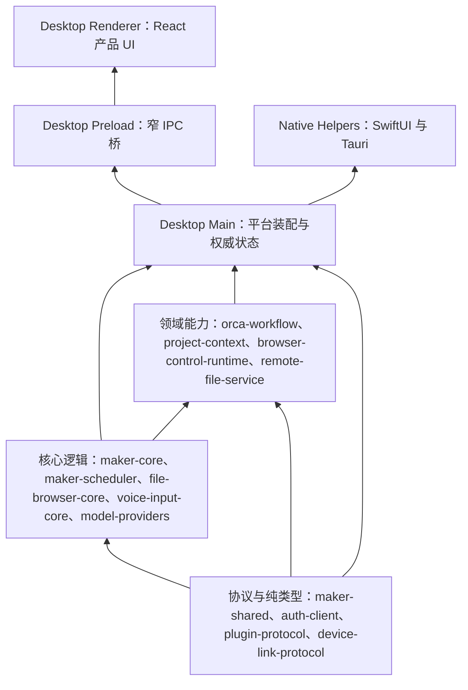

**【已实现】** packages 不应依赖 desktop main/renderer；main 使用静态 imports；shared schema/contract 供多进程共同使用。[repo-map](/Users/smallraw/.cache/cindy-deep-dive/source/cindy/docs/dev-rules/repo-map.md)、[architecture invariants](/Users/smallraw/.cache/cindy-deep-dive/source/cindy/docs/dev-rules/architecture-invariants.md)。

**【目标建议】** 保持三种权威分离：

- 纯 package：业务算法/协议，不拥有 Electron 生命周期；
- main domain host：拥有 IO、secret、runtime 与持久化；
- renderer：拥有交互状态和只读/有界 projection，不成为业务真值。

**【缺口】** `bootstrap-electron.ts` 与主 preload 面积仍大，是变更热点；需要以 domain registration/manifest 自动生成能力索引和边界测试，逐步降低人工 wiring 漂移。

## 4. Renderer Entry 与窗口拓扑

### 蓝图 4：模块图分发和窗口

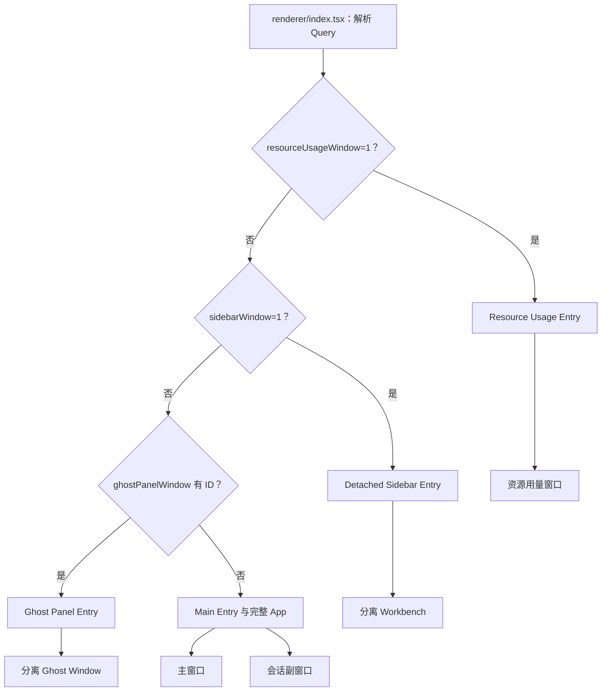

**【已实现】** 分发发生在任何主 App 静态依赖前，防止辅助窗口初始化语音、诊断、设置等副作用。[renderer/index.tsx](/Users/smallraw/.cache/cindy-deep-dive/source/cindy/apps/desktop/src/renderer/index.tsx)。

**【已实现】** detached RSB/Ghost 使用专用最小 preload；窗口均显式设置 sandbox/contextIsolation/nodeIntegration=false。[right-sidebar window](/Users/smallraw/.cache/cindy-deep-dive/source/cindy/apps/desktop/src/main/right-sidebar-window/window.ts)、[ghost window](/Users/smallraw/.cache/cindy-deep-dive/source/cindy/apps/desktop/src/main/ghost-panel-window/window.ts)。

**【目标建议】** 新增任何窗口必须有：独立 entry 选择理由、最小 preload、生命周期 owner、窗口状态持久化策略、外链/导航/selection menu 策略和 error boundary。

## 5. 路由与认证/数据库 Gate

### 蓝图 5：路由树

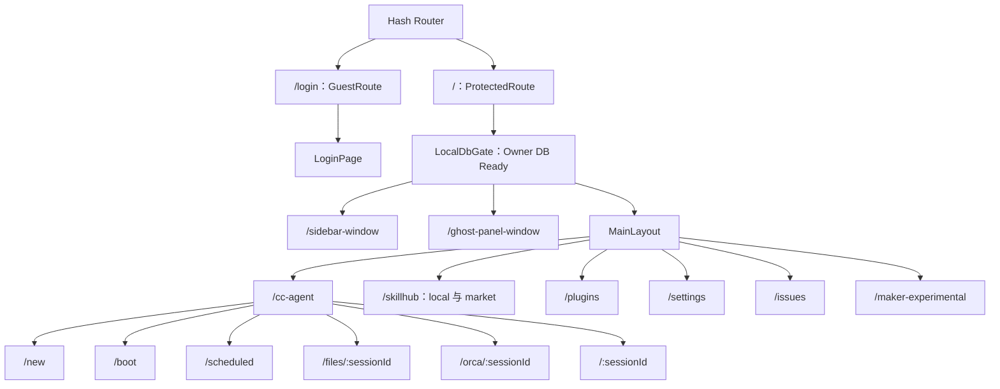

约束：

- **【已实现】** Guest/Protected 先判应用进入资格，LocalDbGate 再等待 owner DB。[router.tsx](/Users/smallraw/.cache/cindy-deep-dive/source/cindy/apps/desktop/src/renderer/router.tsx)。
- **【已实现】** `boot/new/scheduled/files/orca` 静态段必须在 `:sessionId` 前，避免被解析为 ID。
- **【已实现】** 根 error boundary 是全屏；MainLayout 内 section boundary 保留 chrome；辅助窗也用 section fallback。
- **【已实现】** Router 以 `dataOwnerId:dataOwnerRecoveryEpoch` key 重建，避免跨 owner 组件状态复用。[App.tsx](/Users/smallraw/.cache/cindy-deep-dive/source/cindy/apps/desktop/src/renderer/App.tsx)。
- **【缺口】** 安装版 0.1.45 观察到 `#/automations`，源码快照为 `/cc-agent/scheduled`；需要建立 release→commit→route migration 的可追溯表。[UI-LIVE](/Users/smallraw/.cache/cindy-deep-dive/ui/coverage.md)。

## 6. 递归布局与 Workbench

### 蓝图 6：布局树

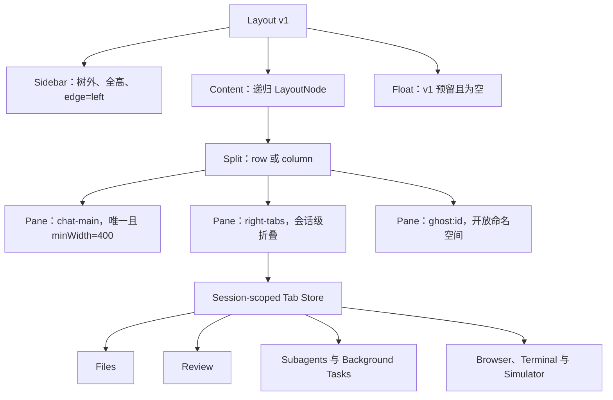

**【已实现】** 最大树深 8、子 fraction 下限 0.05；`chat-main` 恰好一个且不可折叠/关闭；未知 panelKind 合法并保留，reset 保留 Ghost slots。[layoutTree.ts](/Users/smallraw/.cache/cindy-deep-dive/source/cindy/apps/desktop/src/shared/layoutTree.ts)。

**【已实现】** 内置 collapse memory：session-list=global、chat-main=none、right-tabs=per-session。[builtinPanels.tsx](/Users/smallraw/.cache/cindy-deep-dive/source/cindy/apps/desktop/src/renderer/panels/builtinPanels.tsx)。

**【已实现】** RSB state 每 session 持久化，kind 为开放字符串；IPC state 上限 16KiB，应用层最多 20 tabs/一个 active；`subagents` 有 DB 部分唯一。[DATA §8](/Users/smallraw/.cache/cindy-deep-dive/source-analysis/data-model.md)。

**【目标建议】** Panel（主布局叶）与 Tab（Workbench 工具）保持概念/生命周期分离；不要把每个新工具都升级成 panelKind。

**【缺口】** float schema 已存在但 v1 恒空；没有产品承诺，不应把自由浮窗列为已实现能力。

## 7. Agent、Harness、Model 与 Provider

### 蓝图 7：执行装配

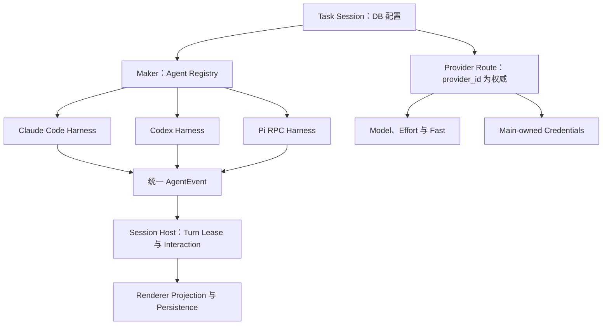

**【已实现】** `Maker` 按 AgentKind 创建/恢复 Claude Code、Codex、Pi；vendor session ID 用 CAS 持久化；runtime close 只删内存 handle，不改变产品任务状态。[maker.ts](/Users/smallraw/.cache/cindy-deep-dive/source/cindy/packages/maker-core/src/maker.ts)、[BIZ §4](/Users/smallraw/.cache/cindy-deep-dive/source-analysis/business-logic.md)。

**【已实现】** `provider_id` 非 null 是权威 route；null 才做 legacy inference，避免仅凭模型名猜 Provider。[runtimeSetModel.ts](/Users/smallraw/.cache/cindy-deep-dive/source/cindy/apps/desktop/src/main/maker-ipc/runtimeSetModel.ts)。

**【已实现】** 统一 AgentEvent 包含 text/thinking/tool use/result/subagent/image/usage/diff/interaction/plan/status/compact/session id/done/error。[events.ts](/Users/smallraw/.cache/cindy-deep-dive/source/cindy/packages/maker-core/src/types/events.ts)。

### 蓝图 8：跨 Harness 切换

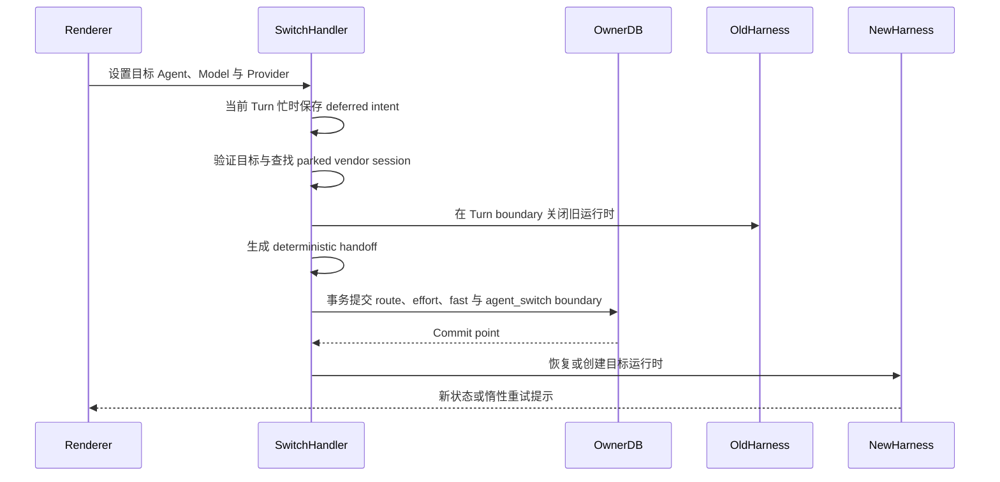

切换约束：

- **【已实现】** 当前 turn 不被打断；intent 在下一次 send 前应用；DB transaction 是 commit point。[sessionAgentSwitchHandler.ts](/Users/smallraw/.cache/cindy-deep-dive/source/cindy/apps/desktop/src/main/maker-ipc/sessionAgentSwitchHandler.ts)。
- **【已实现】** boundary 写失败保留内存 handoff；目标创建失败下次惰性重试；切回原引擎优先增量 handoff。[agentHandoff.ts](/Users/smallraw/.cache/cindy-deep-dive/source/cindy/apps/desktop/src/main/maker-ipc/agentHandoff.ts)。
- **【已实现】** Remote 和 Orca 不支持跨 Harness 流程；deferred intent 仅内存，重启后丢失是当前接受的行为。[BIZ §5](/Users/smallraw/.cache/cindy-deep-dive/source-analysis/business-logic.md)。
- **【已实现】** runtime model set 失败回滚；busy credential-family 切换延迟；effort 3.5s 超时并在 1s 内终止 runtime，下一 send 重建。
- **【目标建议】** UI 在 intent deferred、commit succeeded/spawn failed、unsupported remote/Orca 和 restart-loss 四类状态上提供明确可解释反馈。

### Pi 特例

**【已实现】** Pi 用 `pi --mode rpc` 子进程与 stdio JSONL；每 session 独立 `models.json`，key 经 env 注入；`cindy-bridge` 拦截工具，权限 JSON 动态读取；内置 MCP localhost，自定义 MCP 仅 HTTPS/loopback；工具在 session create 时快照。[Pi harness](/Users/smallraw/.cache/cindy-deep-dive/source/cindy/packages/maker-core/src/agents/pi/index.ts)、[BIZ §6](/Users/smallraw/.cache/cindy-deep-dive/source-analysis/business-logic.md)。

**【缺口】** 真 Pi/Claude/Codex 版本、外部 CLI 事件完整性、配额和异常终态需要兼容矩阵与真实故障测试。

## 8. Turn、输入队列与恢复

### 蓝图 9：输入到执行的接受与幂等边界

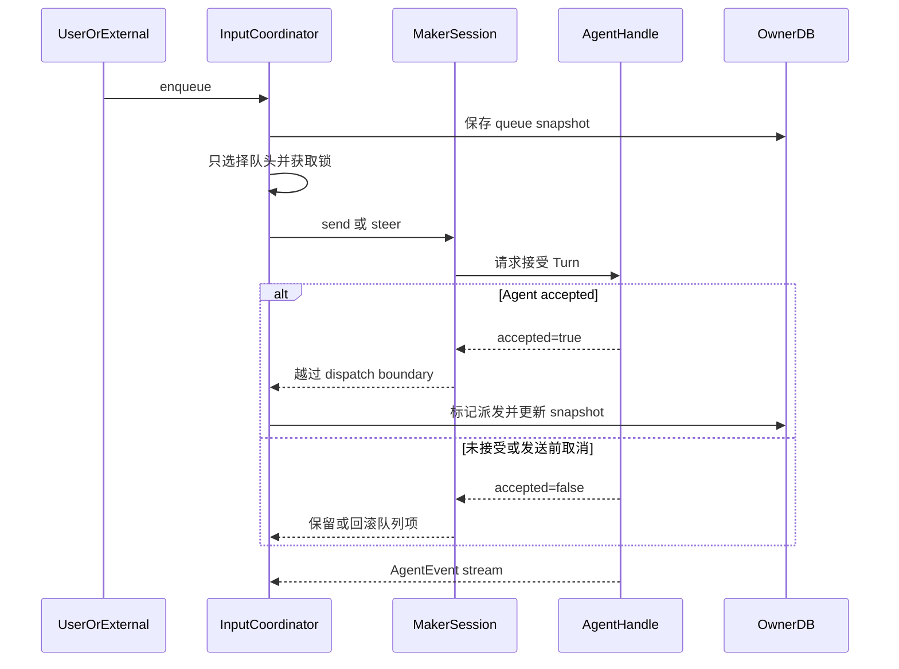

**【已实现】** 先入队、只排头、接受后持久化；只有 `handle.send` 返回 accepted 才认为已派发。steer marker 在 Maker 接受前阻塞 drain，失败保留/回滚。[agent-input-coordinator.ts](/Users/smallraw/.cache/cindy-deep-dive/source/cindy/apps/desktop/src/main/maker-ipc/agent-input-coordinator.ts)。

**【已实现】** Stop 保留队列并暂停；crash snapshot 惰性恢复为 paused，必须显式继续；坏快照整体丢弃；大快照剥离 inline base64。[BIZ §4.2](/Users/smallraw/.cache/cindy-deep-dive/source-analysis/business-logic.md)。

**【已实现】** Retry 区分“无输出克隆已接受 turn”和“已有部分输出 continuation prompt”，避免盲重发。

### 蓝图 10：Maker Session 状态

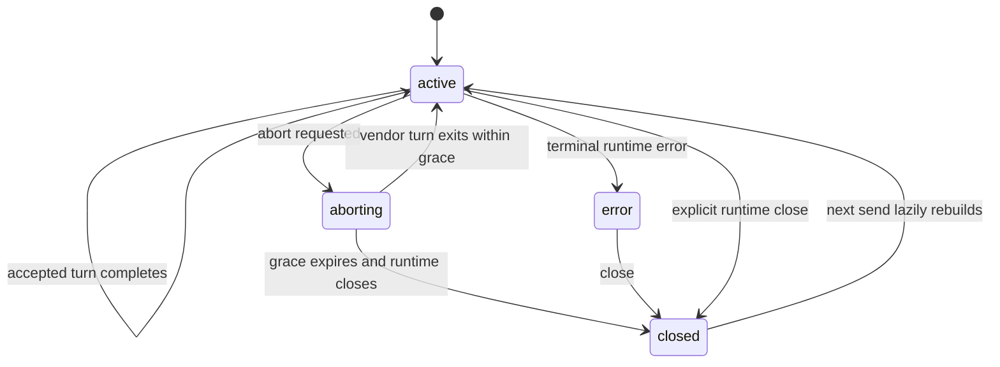

**【已实现】** 每 session 只有一个 turn reservation；忙时 send 拒绝；无事件 45 分钟 watchdog，但等待 interaction/后台 task 时暂停；provider 调用 watchdog 30 分钟；abort grace 超时则 close，下次惰性重建。[session.ts](/Users/smallraw/.cache/cindy-deep-dive/source/cindy/packages/maker-core/src/session.ts)。

**【目标建议】** UI 任务状态不得直接复用 runtime 状态；`closed` 可能只是资源释放，任务仍 active。

**【缺口】** accepted 前/后 crash 的端到端不重复执行，需要故障注入验证；现有静态测试不能证明 OS crash 全链路。

## 9. 权限、问题与计划交互

### 蓝图 11：统一 Interaction Router

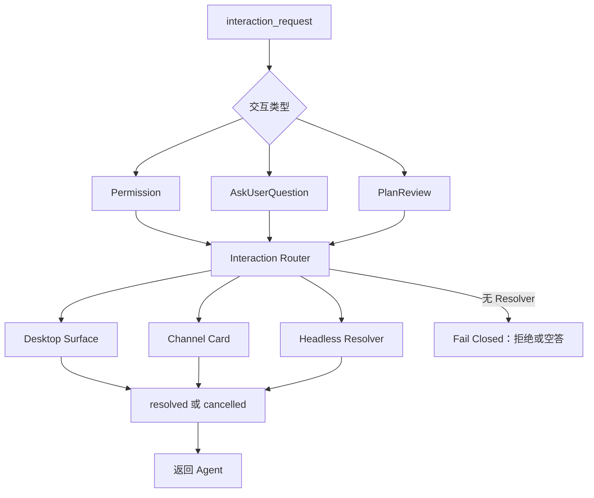

**【已实现】** Router 状态 waiting/resolved/cancelled，surface 可 desktop/channel-card/headless；无 listener/resolver 时权限拒绝、问题返空、计划拒绝。[interactionRouter.ts](/Users/smallraw/.cache/cindy-deep-dive/source/cindy/apps/desktop/src/main/maker-ipc/interactionRouter.ts)。

**【已实现】** permission mode 与 plan mode 正交；`plan_mode_changed` 回写 DB；auto reviewer 异常 fail closed。[BIZ §7](/Users/smallraw/.cache/cindy-deep-dive/source-analysis/business-logic.md)。

**【已实现】** Plugin Full Access 豁免绑定 runtime/session-instance/live-local provenance，不信业务 sessionId。

**【缺口】** 只读 UI traversal 没有真实触发 Permission、AskUserQuestion 或完整 Plan Review；需要模拟 AgentEvent fixture 验证所有 surface 的一致性。[UI-LIVE gaps](/Users/smallraw/.cache/cindy-deep-dive/ui/coverage.md)。

## 10. Orca 多 Agent

### 蓝图 12：Lead/Worker 架构

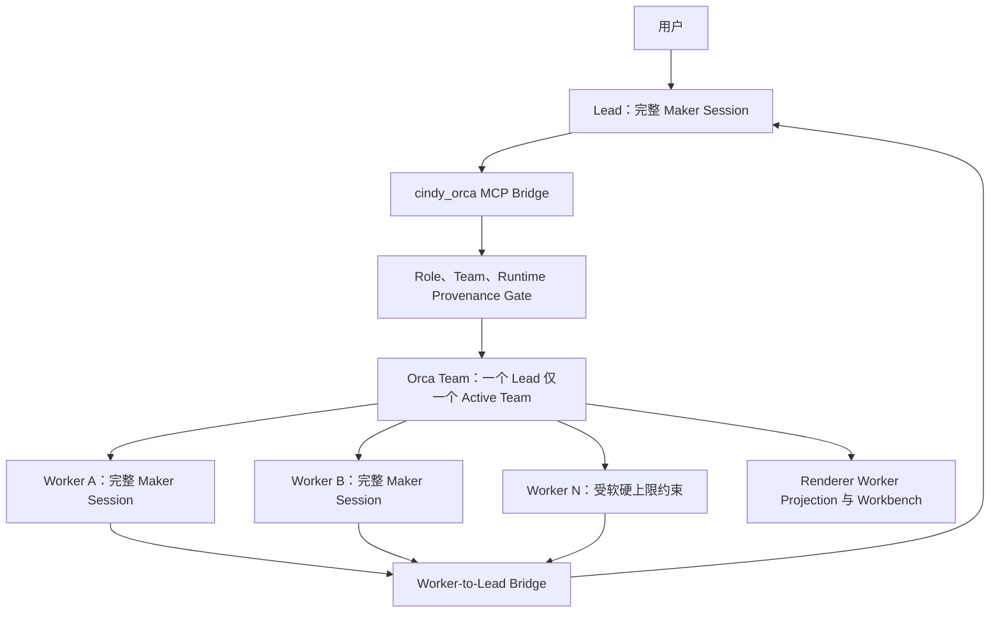

### 蓝图 13：Worker 生命周期

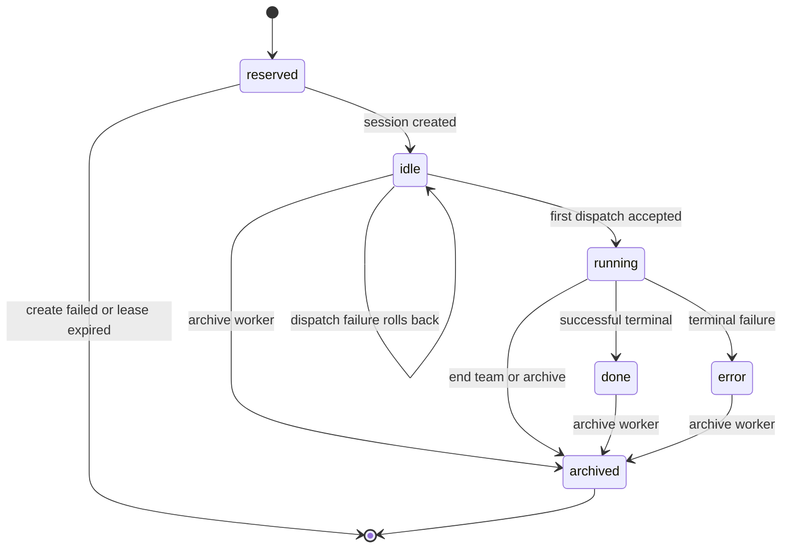

约束：

- **【已实现】** Lead/Worker 均为完整 session；local 支持 Claude/Codex/Pi，SSH 仅 Claude/Codex，Pi remote 明确不支持；device 真值在被控端。[BIZ §8](/Users/smallraw/.cache/cindy-deep-dive/source-analysis/business-logic.md)。
- **【已实现】** DB 部分唯一索引：每 Lead 一个 active team、每 Team 一个 focused worker；team 内 label case-insensitive unique；创建用短租约 reservation。[DATA §3](/Users/smallraw/.cache/cindy-deep-dive/source-analysis/data-model.md)。
- **【已实现】** `cindy_orca` 工具可全局声明，但 handler 二次校验角色/team/provenance；Codex 用可证明 `_meta.threadId`，未知/batch metadata 丢失时 fail closed；`mcp-session-id` 不作身份。
- **【已实现】** Worker 不继承 Lead permission 默认；初始 Full Access，auto→bypass 需要用户确认；idle 可释放 runtime 而保留逻辑 Worker，archive 才关闭 session。
- **【已实现】** 当前 Worker turn 中不能切模型，effort 可调；“side activity”未实现，side-chat 只是普通 fork。
- **【目标建议】** 把 team/worker quota、route compatibility、partial batch create 和 bridge delivery 显示为统一协作控制台。
- **【缺口】** populated Orca UI、批量真实运行、bridge 断线/重放、reservation crash 尚需动态验证。

## 11. Scheduler 与 Script Runner

### 蓝图 14：Schedule 到 Run

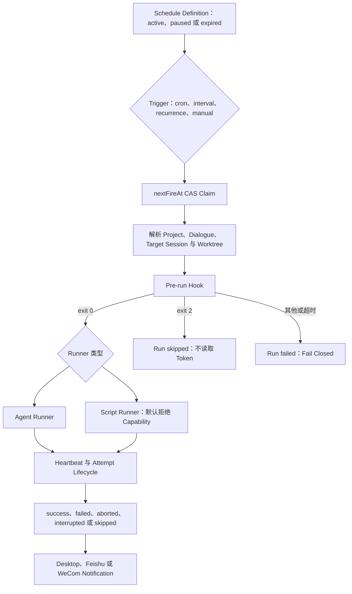

### 蓝图 15：运行时 Attempt 状态

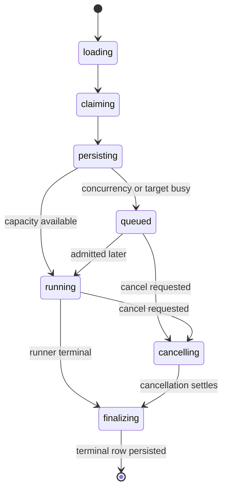

**【已实现】** Schedule 状态 active/paused/expired；Run 状态 running/success/failed/aborted/interrupted/skipped；runtime phase 由 `attemptLifecycle.ts` 单一权威，非法转移抛错。[scheduler types](/Users/smallraw/.cache/cindy-deep-dive/source/cindy/packages/maker-scheduler/src/types.ts)、[attemptLifecycle.ts](/Users/smallraw/.cache/cindy-deep-dive/source/cindy/packages/maker-scheduler/src/engine/attemptLifecycle.ts)。

**【已实现】** queued 尚未持有 Agent/MCP/token，不占并发；同 schedule 锁串行；due CAS claim + heartbeat；启动把 stale running 收敛为 interrupted。[BIZ §9](/Users/smallraw/.cache/cindy-deep-dive/source-analysis/business-logic.md)。

**【已实现】** Script stdout 专用于 `cindy-script/1` JSONL；单帧≤256KiB、并发 call≤16；能力默认拒绝，显式能力含 jira.read/jira.comment/sessions.dispatch/feishu.read。[Python client README](/Users/smallraw/.cache/cindy-deep-dive/source/cindy/apps/desktop/src/main/scheduler-host/python-client/README.md)。

**【已实现】** target busy 可 defer 且不创建 run row；持久 target archived 时清绑重建，非持久 target 暂停；review session 不能做 target。

**【目标建议】** 运行历史应显示 claim/defer/pre-hook/runner/notify 的分阶段原因，而不只显示最终 failed。

**【缺口】** 真 cron 跨睡眠/时区、IM notification、各 await 点 crash 与 stale sweep 需时钟/故障注入测试。

## 12. Plugin、Skill 与 MCP

### 蓝图 16：扩展能力三轨

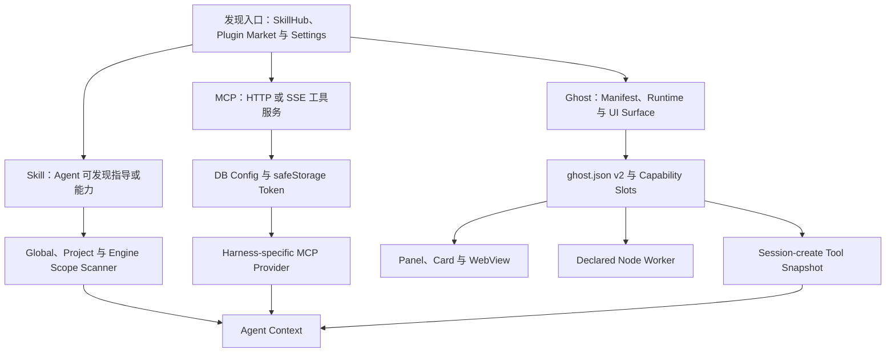

### 三类能力不可混淆

| 维度 | Skill | Custom MCP | Ghost Plugin |
|---|---|---|---|
| 真值 | 文件/链接与扫描结果 | DB 配置 + safeStorage token | owner install ledger + package + runtime state |
| 作用时机 | global/project/engine 扫描与注入 | Harness provider；生效时机依 Agent | Tool snapshot、panel/card、resident/on-demand runtime |
| UI | SkillHub local/market | Settings Tools/MCP | Plugins/market + panel/window/card |
| Secret | 通常无；不应内嵌 secret | bearer token 在 safeStorage | method-declared secret binding，由 host 注入 |
| 执行 | Agent 消费内容/能力 | 远端/loopback tool server | webview/Node worker/host capability |
| 撤销 | disable/uninstall 移除 link | 删除配置即停用 | disable/stop/uninstall/fuse reset |

关键约束：

- **【已实现】** Ghost manifest v2 有严格 ID/路径和 subscribe/tool/card/panel/cindy/agent/node/network/notify/badge/confirm/fs/session-context/pick/preview/skill/workspace/ios-simulator slots。[manifest.ts](/Users/smallraw/.cache/cindy-deep-dive/source/cindy/packages/plugin-protocol/src/manifest.ts)。
- **【已实现】** Node worker 只能启动 package 声明的 JS entry，无 command/shell/env 注入；但以当前用户权限运行，**不是 OS sandbox**。[nodeRuntimeBroker.ts](/Users/smallraw/.cache/cindy-deep-dive/source/cindy/apps/desktop/src/main/cindy-brain/nodeRuntimeBroker.ts)。
- **【已实现】** Ghost runtime off/starting/running/stopping/crashed/fused；60s 内 3 次 crash fused，重新启用显式 reset；stop 幂等。[GhostRuntime.ts](/Users/smallraw/.cache/cindy-deep-dive/source/cindy/apps/desktop/src/main/cindy-brain/runtime/GhostRuntime.ts)。
- **【已实现】** 安装同插件串行；下载、包、provenance、owner、权限增量 commit 前重验；市场源删除不删本地包。
- **【已实现】** Skill 扫 global/project 及 cc/codex/pi，realpath 去重；自动同步登录后每 owner 一次且仅白名单，当前默认白名单为空。[BIZ §10.2](/Users/smallraw/.cache/cindy-deep-dive/source-analysis/business-logic.md)。
- **【已实现】** Custom MCP 仅 HTTP/SSE，remote URL 必须 HTTPS 或 loopback；ID/path/header shape 校验；token 在 safeStorage；Claude 下一 session、Pi session-create snapshot、Codex cache/app-server 尽力失效。
- **【已实现】** MCP context 区分业务 `sessionId`、不透明 `sessionInstanceId` 与 caller provenance。
- **【目标建议】** 建立统一扩展信任卡：来源、签名/provenance、运行域、secret、网络/文件权限、何时生效、怎样撤销。
- **【缺口】** 真市场/CDN/签名链、第三方 MCP 超时/重连和恶意插件运行需动态安全评估。

## 13. IM、Hook 与外部任务

### 蓝图 17：IM Binding 与 Hook 派发

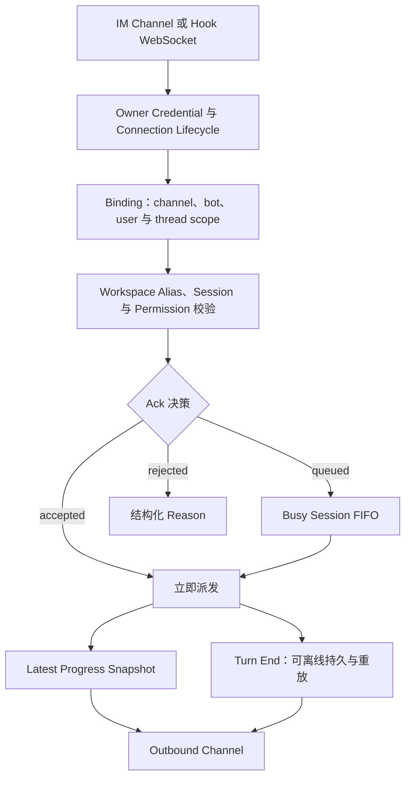

### 蓝图 18：Hook Transport

```mermaid
stateDiagram-v2
  [*] --> stopped
  stopped --> connecting: enable
  connecting --> connected: hello then welcome
  connecting --> error: handshake or auth failure
  connected --> connected: ping and pong
  connected --> connecting: idle watchdog or recoverable close
  connected --> standby: duplicate device
  standby --> connecting: low-frequency probe
  error --> connecting: backoff retry
  connected --> stopped: disable or shutdown
  standby --> stopped: disable or shutdown
```

**【已实现】** IM host 接 Feishu、Discord、个人微信、Telegram、DingTalk、WeCom；credential owner-scoped；媒体内容寻址并 owner pinning。[im/host.ts](/Users/smallraw/.cache/cindy-deep-dive/source/cindy/apps/desktop/src/main/im/host.ts)。

**【已实现】** Connection start/stop/work queue 串行，generation 使登出前任务失效；binding DB-first，再更新 O(1) 内存索引；启动修复旧多重 binding。

**【已实现】** Hook 必须 hello→welcome 才 connected；ping/pong + 65s idle watchdog；1–30s 指数抖动重连；401 只强制 refresh 一次；duplicate device 进 standby。[hook transport](/Users/smallraw/.cache/cindy-deep-dive/source/cindy/apps/desktop/src/main/hook-control/transport.ts)。

**【已实现】** ack accepted/queued/rejected；`connectionId+requestId` 去重重放 ack 不重跑；workspace alias 是唯一路径白名单；复用任务每条消息重验 live workingDir；progress 只保最新，turn.end 可离线持久/重放。[BIZ §11](/Users/smallraw/.cache/cindy-deep-dive/source-analysis/business-logic.md)。

### 蓝图 19：个人微信可靠 Inbox/Outbox

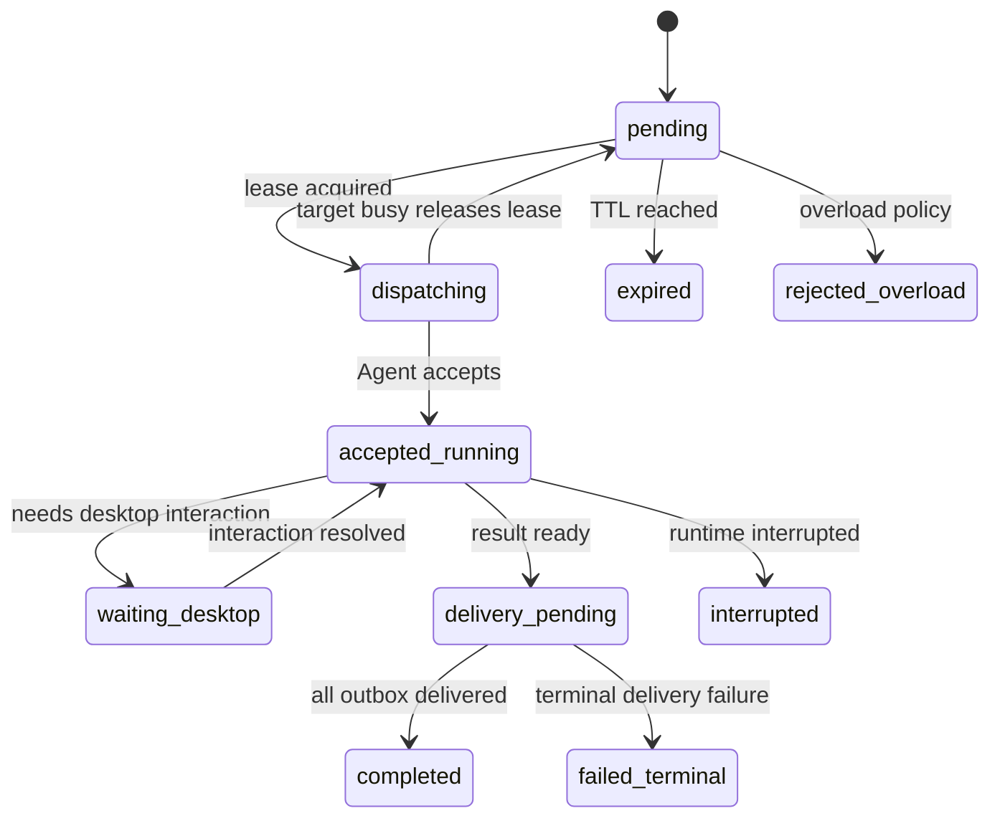

**【已实现】** 个人微信任务 TTL 30min、lease 60s；outbox pending→sending→delivered，可回 pending 或 failed_terminal；全部送达后 inbox completed。[wechatTx.ts](/Users/smallraw/.cache/cindy-deep-dive/source/cindy/apps/desktop/src/main/localDb/worker/opHandlers/wechatTx.ts)。

**【目标建议】** 所有 channel 使用统一交付 timeline 和 reason taxonomy，保留协议差异但统一用户解释。

**【缺口】** 真实 IM 上游认证、媒体限制、断网/服务端重放和 accepted_running/outbox sending 瞬间 crash 尚需动态验证。

## 14. Device Link

### 蓝图 20：设备可靠传输

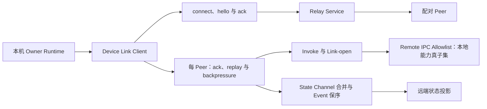

### 蓝图 21：本机单 Owner Lease

```mermaid
stateDiagram-v2
  [*] --> standby
  standby --> owner: CAS acquire absent or stale row
  owner --> owner: heartbeat every 5 seconds
  standby --> standby: live owner heartbeat under 15 seconds
  owner --> standby: store unavailable self-demotion
  owner --> standby: explicit release
```

**【已实现】** Client stopped/connecting/online；20s ping，丢 pong 重连，1–30s 退避；错误保留 invoke/link-open 的 `inFlight` 不确定性。[device client](/Users/smallraw/.cache/cindy-deep-dive/source/cindy/packages/device-link/src/client.ts)。

**【已实现】** 单 owner DB CAS + 5s heartbeat/15s stale；store 不可用当前 owner 先自降级；纯网络断开不让出 owner。[ownership.ts](/Users/smallraw/.cache/cindy-deep-dive/source/cindy/apps/desktop/src/main/device-link/ownership.ts)。

**【已实现】** 离线 push 仅内存，最多 128 项/512KiB/5min；state channel 合并、event 保序；transport-timeout 仅在 online owner/控制启用/有 outbound intent 时最多 5 次重开。

**【已实现】** Remote allowlist 是 preload 真子集，本地设置与 secret 修改不透传。[allowlist.ts](/Users/smallraw/.cache/cindy-deep-dive/source/cindy/packages/device-link/src/allowlist.ts)。

**【目标建议】** 用户可见状态至少区分 relay online、owner ready、peer paired、invoke ack、Agent accepted、turn terminal 和 unknown in-flight。

**【缺口】** 真 relay、多 peer、两进程竞争与 DB 短暂不可用的长期单主保证需 soak/fault tests。

## 15. 数据与持久化

### 蓝图 22：Owner 存储拓扑

```mermaid
flowchart TD
  O["App Session Owner Boundary"] --> DB["Owner-scoped SQLite：Task、Message、Run 与 Projection"]
  O --> ES["Owner Electron Stores 与 Ledgers"]
  O --> SS["safeStorage：Auth、Provider 与 MCP Secrets"]
  O --> FS["Owner Data Root"]
  ES --> WT["worktrees.json：Worktree Truth"]
  ES --> PL["Plugin Install Ledger 与 Settings"]
  FS --> DIA["Dialogue Workdirs"]
  FS --> MEDIA["Content-addressed Media Blobs"]
  SS -. "Secret 不复制进 SQLite" .-> DB
```

**【已实现】** DB 按 `<prefix>-<user>.db` 隔离；local 使用保留 owner；无 owner 用临时命名空间，不写共享根；owner change 关闭/重开 DB 并递增 generation。[appSessionState.ts](/Users/smallraw/.cache/cindy-deep-dive/source/cindy/apps/desktop/src/main/appSessionState.ts)、[DATA §1](/Users/smallraw/.cache/cindy-deep-dive/source-analysis/data-model.md)。

**【已实现】** Worktree 真值为 `worktrees.json`，`sessions.worktree_path` 是反规范化快照；凭据不进 SQLite。

### 蓝图 23：核心关系

```mermaid
erDiagram
  sessions ||--o{ messages : contains
  sessions ||--o{ subagent_runs : observes
  sessions ||--o{ right_sidebar_tabs : owns
  sessions ||--o| agent_input_queue_snapshots : recovers
  sessions ||--o{ session_pr_refs : mentions
  sessions ||--o| session_goals : owns
  sessions ||--o{ im_bindings : targeted_by
  sessions ||--o{ orca_teams : leads
  orca_teams ||--o{ orca_workers : contains
  schedules ||--o{ schedule_runs : attempts
  media_blobs ||--o{ media_refs : referenced_by
```

**【已实现】** `sessions` 是产品任务；`messages` 支持 user/assistant/tool/interaction/thinking/error/agent_switch/context_rebuild/tombstone；queue、RSB、Goal、PR、Subagent、Orca、IM 均围绕 Task 关联。[DATA §2–§10](/Users/smallraw/.cache/cindy-deep-dive/source-analysis/data-model.md)。

**【已实现】** `message_tombstone` 保留 ID 防 importer 复活被删消息；`agent_switch` 是 handoff boundary，不当可见正文；`context_rebuild` 是隐藏重建标记。

**【已实现】** Usage 区分 actual/estimated/unavailable 与归因质量；subscription 不计 actual money，BYOK/gateway 等 route 分别结算。[BIZ §14](/Users/smallraw/.cache/cindy-deep-dive/source-analysis/business-logic.md)。

### 蓝图 24：数据库打开、迁移与恢复

```mermaid
flowchart TD
  SEL["选择 Owner DB"] --> LEASE["Reader 或 Writer Lease"]
  LEASE -->|不兼容、降级或 Lock 损坏| CLOSED["Fail Closed"]
  LEASE --> BACK["迁移前 Online Backup 与磁盘预算"]
  BACK --> MIG["Schema Migrations：0000 到 0089"]
  MIG --> VEC["Vector Capability 与 Migration"]
  VEC --> DRIFT["Schema Drift Detection"]
  DRIFT -->|Dev 可修复| REPAIR["备份后 Repair"]
  DRIFT -->|Release| WARN["只记录与提示"]
  DRIFT --> START["Startup Repairs 与 Optimize"]
  START --> SMOKE["DB Worker Smoke Test"]
  SMOKE -->|通过| TAKE["Worker Takeover"]
  SMOKE -->|失败| FALL["In-process Fallback"]
```

**【已实现】** SQLite WAL 做常规 crash recovery；迁移前 online backup 0600 且检查磁盘；schema 后再 vec；worker smoke 成功才 takeover，worker error 自动重启一次。[localDb/index.ts](/Users/smallraw/.cache/cindy-deep-dive/source/cindy/apps/desktop/src/main/localDb/index.ts)。

**【已实现】** `SQLITE_CORRUPT` 恢复顺序 `.bak.clean` → 最新 `.bak.<ISO>` → 无备份致命；release schema drift 不自动修。[DATA §11](/Users/smallraw/.cache/cindy-deep-dive/source-analysis/data-model.md)。

**【缺口】** 断电、磁盘满、权限损坏、多版本并行和 worker takeover 的真实 OS 故障需要注入验证。

## 16. 文件、终端与浏览器资源

### 蓝图 25：工作区 IO 路由

```mermaid
flowchart TD
  UI["File Browser 与 Agent Tool"] --> HOST["Main File Service"]
  HOST --> KIND{"Workspace Kind"}
  KIND --> LOCAL["Local FS：Path 与 Symlink Guard"]
  KIND --> SSH["SSH：Remote Ops 与 Chunk Cache"]
  KIND --> DEVICE["Device：Export、OSS 与 Download"]
  HOST --> SEARCH["ripgrep Fixed-string Search"]
  HOST --> MEDIA["Media Ledger 与 Cache"]
  LOCAL --> WATCH["Watch、Read、Write、Create、Rename、Delete 与 Stat"]
  SSH --> WATCH
  DEVICE --> WATCH
```

**【已实现】** local/SSH/device 共用 list/read/write/create/rename/delete/stat/watch；read≤2MiB；scanner 拒绝 traversal/symlink 逸出；文本搜索 fixed-string、文本白名单、遵守 `.gitignore`、结果有界，取消后 SIGTERM→200ms→SIGKILL。[BIZ §13](/Users/smallraw/.cache/cindy-deep-dive/source-analysis/business-logic.md)。

**【已实现】** PTY create/attach 幂等；exit 保留记录可 same-id restart；dispose 才 kill；owner window 销毁先转 fallback；env 剥离 secret-like 与 terminal integration。[ptyManager.ts](/Users/smallraw/.cache/cindy-deep-dive/source/cindy/apps/desktop/src/main/terminal/ptyManager.ts)。

**【已实现】** Browser TabRegistry 在 main 为真值，renderer 持 DOM/LRU；dom-ready 后 report；webContentsId 防 stale release；pin lease 保护自动化 tab。[BIZ §13](/Users/smallraw/.cache/cindy-deep-dive/source-analysis/business-logic.md)。

**【已实现】** 浏览器 watchdog 每 30s：后台内存≥1GiB 回收；后台 CPU≥50% 连续 4 次回收（audible 例外）；前台内存≥2GiB kill+通知；前台 CPU≥90% 连续 4 次告警且 cooldown；pinned 免除。

**【目标建议】** 所有 kill/recycle 事件写入用户可见诊断，并区分“页面被资源策略回收”和“网站自身崩溃”。

## 17. 更新系统

### 蓝图 26：Patch 状态与 Supersede

```mermaid
stateDiagram-v2
  [*] --> idle
  idle --> checking: timer or manual
  checking --> downloading: newer manifest
  checking --> idle: no update
  checking --> error: check failure
  downloading --> ready: verified patch saved
  ready --> superseding: newer version download starts
  superseding --> ready: newer succeeds and replaces old
  superseding --> ready: newer fails and old ready remains
  ready --> idle: relaunch matches current version
  ready --> error: invalid patch or apply attempts reach three
  error --> checking: retry or manual check
```

### 蓝图 27：自动重启 Gate

```mermaid
flowchart TD
  READY["Verified Patch Ready"] --> PACK["Packaged App 且 Auto Update Enabled"]
  PACK --> BUSY["查询 Active Task、DB 与 Scheduler Busy"]
  BUSY -->|任一忙或查询失败| WAIT["不自动重启"]
  BUSY --> QUIET["60 秒 Quiet Window"]
  QUIET --> RESUME["Resume 后至少 60 秒"]
  RESUME --> IDLE["锁屏或系统 Idle 至少 10 分钟"]
  IDLE --> STOP["停止 ADB、iOS、Ghost Node 等子系统"]
  STOP --> MARK["写 Expected-exit Marker"]
  MARK --> APPLY["Relaunch 与 Apply"]
```

**【已实现】** 首检约 10s、之后 30min；manifest timeout 8s；Linux 只手动；0.0.0 禁用；macOS translocation 拒绝；patch-info 记录 version/file/hash/relogin/applyAttempts；失败≥3 放弃。[updateService.ts](/Users/smallraw/.cache/cindy-deep-dive/source/cindy/apps/desktop/src/main/updateService.ts)。

**【已实现】** Superseding 下载失败保留旧 ready patch；进度单调归一；自动重启任何 busy 查询失败都 fail closed。

**【已实现】** Windows 使用独立 Tauri updater，包含 requesting elevation、backup、extract、replace、launch、rollback、done/failed UI；日志 capped 5MiB。[Updater README](/Users/smallraw/.cache/cindy-deep-dive/source/cindy/apps/desktop/cindy-updater/README.md)。

**【缺口】** 真 patch 签名、文件锁/elevation、rollback、macOS/Windows/Linux relaunch 需平台矩阵动态验证。

## 18. 遥测、隐私与用量

### 蓝图 28：遥测资格判定

```mermaid
flowchart TD
  EVT["Analytics Event Candidate"] --> PKG{"Packaged 或严格 Dev Opt-in？"}
  PKG -->|否| DROP["丢弃"]
  PKG -->|是| CONS{"Privacy Consent Accepted？"}
  CONS -->|否| DROP
  CONS -->|是| EN{"Analytics Enabled？"}
  EN -->|否| DROP
  EN -->|是| LOCAL{"当前为 Local Mode？"}
  LOCAL -->|是| DROP
  LOCAL -->|否| SEND["发送去标识事件"]
```

**【已实现】** `privacyConsentAccepted` 与 `analyticsEnabled` 是两个持久真值；local 不改变持久 consent，只在运行期 opt-out；legacy consent 迁移只在冷启确定认证时进行，设置损坏 fail closed。[analytics-settings-store.ts](/Users/smallraw/.cache/cindy-deep-dive/source/cindy/apps/desktop/src/main/analytics-settings-store.ts)、[BIZ §15](/Users/smallraw/.cache/cindy-deep-dive/source-analysis/business-logic.md)。

**【已实现】** 用量模型按 route 区分 gateway/provider API/subscription/unknown；token 累计按 turn delta，reset/负数安全处理；daily spend/model usage 区分币种、actual/estimated 与归因质量。[DATA §6](/Users/smallraw/.cache/cindy-deep-dive/source-analysis/data-model.md)。

**【目标建议】** 产品指标只在上述 gate 后采集；local 用户不应因无法上报被视为“无使用”。关键可靠性指标应优先本地诊断/用户可导出，再考虑远程聚合。

**【缺口】** 真实 gateway quote、discount、provider usage 延迟和币种结算需服务侧契约验证。

## 19. 外部集成清单

| 集成 | 数据方向 | 身份/Secret | 客户端已实现约束 | 动态缺口 |
|---|---|---|---|---|
| Auth/Hosted | 双向 | main token/safeStorage、membership | epoch、冷启去重、短暂错误不清 token、owner generation | realm/SSO/删号最终态、服务 SLA |
| Claude Code | 子进程/协议 | host credential route | Maker session、vendor ID CAS、events/watchdogs | CLI 版本/事件兼容、真实配额 |
| Codex | 子进程/协议 | host credential route | Maker session、provenance thread、route defer | app-server/cache 失效、CLI 版本 |
| Pi | stdio JSONL RPC | key env 注入 | session config、bridge、MCP URL gate、resume/compact | Pi 二进制版本/真实 provider |
| Custom Provider | HTTP/API | safeStorage key/OAuth | provider_id authoritative、base URL/models/headers validation | 各兼容协议差异、错误文案 |
| MCP | HTTP/SSE | safeStorage bearer | HTTPS/loopback、ID/header validation、session provenance | server timeout/reconnect、恶意响应 |
| Plugin Market/CDN | download/install | owner ledger/provenance | staging、字节/来源/权限 review、串行 commit | 真签名链、CDN rollback |
| Feishu/Lark | IM/API | owner credential | binding、notification、script read | 上游限流、thread/media |
| WeChat | IM/web auth | owner credential | inbox/outbox、TTL/lease、overload | 授权/断网/媒体重放 |
| Discord/Telegram | IM | owner credential | host adapter 与 binding | 上游协议/速率限制 |
| DingTalk/WeCom | IM/API | owner credential | host adapter、Scheduler notification | 真通知与回执 |
| Hook Service | WebSocket | auth refresh | hello/welcome、watchdog、dedupe、offline terminal replay | server replay/duplicate device |
| Device Relay | reliable stream | paired peer/owner | ack/replay/backpressure、allowlist、single owner | 长时网络、unknown in-flight |
| SSH | OS key/agent | key/agent，不回 renderer secret | stable project key、path gate、cache | 各 server/断网/权限 |
| Git | local/remote repo | OS/user config | worktree serial、dirty stash、Review/Undo | 巨型 repo、冲突/失败恢复 |
| Browser WebView | Chromium partition | partition cookies | main registry、security hardening、resource watchdog | 复杂站点/popups/SSO |
| iOS Simulator/ADB | native sidecar | OS tools | main actor、release gate、update 前 stop | 平台工具版本与权限 |
| Updater CDN/Helper | manifest/patch | 签名/包 provenance | verified ready、supersede、attempt gate | 真实替换/rollback/elevation |

**【目标建议】** 每个集成维护 machine-readable contract：owner scope、secret store、transport、timeout、retry/backoff、idempotency key、capacity、error taxonomy、observability、kill switch、data retention 与 test fixture。

## 20. 非功能需求（NFR）

### 20.1 安全

| 约束 | 当前事实 | 目标/验收 |
|---|---|---|
| Renderer least privilege | sandbox/contextIsolation、窄 preload、main validation | 每个 IPC handler 自动审计 sender/shape/owner；新增窗口不得复用过宽 preload |
| Secret isolation | Auth/provider/MCP token 在 safeStorage/main | 日志、events、DB、remote allowlist 中不得出现明文；建立 secret-flow test |
| Provenance | Orca/Ghost/remote 不信业务 ID 自报 | 控制能力必须绑定 runtime/sessionInstance/caller proof |
| Path safety | local/SSH/device scanner 与 project alias gate | traversal/symlink/UNC/case-fold/remote path 统一 fuzz |
| Fail closed | 无 resolver、auto reviewer 异常、lock 损坏、busy query failure 均拒绝 | 所有拒绝必须可解释且有安全恢复动作 |
| Supply chain | plugin package/provenance/review、updater verify | 真签名链、撤销、rollback、离线验证需动态安全评审 |

### 20.2 可靠性与一致性

- **【已实现】** accepted 是派发 commit boundary；输入队列 crash snapshot 恢复 paused；Scheduler CAS/heartbeat/stale sweep；Device Link ack/replay；IM request ledger 去重；DB WAL/backup/recovery。
- **【目标建议】** 所有外部副作用使用幂等 key 或显式不确定状态，不用“网络超时=未执行”。
- **【目标建议】** 关键状态机必须有单一转移权威、非法转移失败、terminal 幂等、crash point tests。
- **【缺口】** accepted、Scheduler finalizing、WeChat outbox sending、Device in-flight、Updater apply 等边界需 process-kill/断网/磁盘满测试。

### 20.3 性能与容量

| 域 | 当前限额/策略 | 评审要求 |
|---|---|---|
| Layout | max depth 8；fraction≥0.05；chat minWidth 400 | 坏存档不可爆栈；拖动边界稳定 |
| RSB | state IPC≤16KiB；≤20 tabs；一个 active | hydrate/serialize 有界；未知 kind 保留 |
| Device offline push | ≤128 项、≤512KiB、≤5min | 超限可观测；state 合并/event 保序 |
| Script protocol | frame≤256KiB；in-flight≤16 | stdout 污染 fail；超限结构化错误 |
| File read/search | read≤2MiB；search 匹配有上限；cancel 200ms 后强杀 | 大文件走 cache/preview，UI 不假死 |
| Browser watchdog | 30s；前后台 CPU/内存分级；pinned/audible 例外 | 回收/kill 可诊断，不误杀 automation |
| Ghost runtime | 60s 内 3 crashes fused | fuse 可见并需显式 reset |
| WeChat | TTL 30min；lease 60s | 过载/过期/terminal delivery 可追踪 |
| Update | 首检约10s、30min轮询、manifest 8s、apply≤3 | 网络/磁盘/替换失败不破坏旧 ready |

### 20.4 可用性与恢复目标

**【目标建议】** 按域定义而不是给一个虚假全局 SLA：

- 本地任务/DB：应用重启后历史可读，active runtime 可惰性重建；
- Queue：恢复为 paused，用户确认后再继续，优先避免重复副作用；
- Scheduler：stale running 收敛为 interrupted，不默认为成功；
- IM/Device：允许重连/重放，但显式标记 unknown in-flight；
- Update：旧 ready patch 保留直到新 patch 验证完成；
- Plugin：crash fuse 隔离单插件，不拖垮主应用。

### 20.5 隐私与数据治理

- owner-scoped DB/root/ledger/credential；local runtime analytics opt-out；media 内容寻址并通过 ref 归属验证。
- **【目标建议】** PRD 必须写明数据驻留、跨端复制、缓存 TTL、删除/导出、第三方处理者和 local/cloud 差异。
- **【缺口】** Hosted sync、服务端 retention、市场/relay/IM 端数据策略不在本仓静态证明范围。

### 20.6 可观察性

**【已实现】** AgentEvent、Schedule Run/history、usage/cost、resource window、structured Hook/WeChat state、update log、DB recovery toast 提供基础。

**【目标建议】** 统一关联 ID：owner scope、product task、runtime instance、turn、tool call、schedule/run、worker/team、connection/request、device peer；日志/事件必须脱敏并可按用户任务导出诊断包。

**【缺口】** 当前多域日志与状态 reason 仍分散，缺统一用户级 activity timeline。

### 20.7 可维护性与兼容

- packages → app 单向依赖；shared contract 避免 main/renderer schema 漂移；路由 legacy redirects；unknown panel/tab state 防御 hydrate；DB migrations 0000–0089。
- **【目标建议】** route、IPC、DB、AgentEvent、plugin manifest、Device allowlist 和 UI state fixture 都应版本化并有 compatibility matrix。
- **【缺口】** 高速发布导致源码 commit、安装版 route 与 UI coverage 可能错位；交付文档必须绑定 version+commit。

### 20.8 可访问性与平台一致性

**【已实现】** semantic CSS token、light/dark、reduced-motion、keyboard registry、route error boundary、最小窗口；mac/win/linux 有显式差异。[DESIGN](/Users/smallraw/.cache/cindy-deep-dive/source/cindy/docs/design-rules/DESIGN.md)、[UI-SRC §11–§13](/Users/smallraw/.cache/cindy-deep-dive/source-analysis/ui-source-inventory.md)。

**【目标建议】** 每个新 surface 验收 keyboard/focus/screen-reader/contrast/reduced-motion/800×600/detached 360×480；移动端不实现 hover；平台无能力时隐藏控制并给替代路径。

**【缺口】** 本轮 UI coverage 主要是 macOS 视觉只读遍历，不等于 Windows/Linux 辅助技术和键盘可达性验证。

## 21. 端到端关键路径

### 蓝图 29：从新建到可审查交付

```mermaid
sequenceDiagram
  participant U as User
  participant UI as NewMakerDraft
  participant M as MainHost
  participant A as Agent
  participant DB as OwnerDB
  participant W as Workbench
  U->>UI: 选择项目、Agent、Model、权限与 Worktree
  Note over UI: 未发送前不创建真实 Task
  U->>UI: 发送首条消息
  UI->>M: create session and send
  M->>DB: 创建 Task、Workspace 与 Route
  M->>A: 派发 Turn
  A-->>M: accepted=true
  A-->>M: text、tool、diff、interaction 与 done
  M->>DB: 持久消息、usage、queue 与 projections
  M-->>UI: AgentEvent
  UI-->>U: Timeline、Plan、Permission 与 Status
  M-->>W: Review、Files、Tasks 与 Resources
  U->>W: Review 或 Undo
```

### 蓝图 30：外部通道触发任务

```mermaid
sequenceDiagram
  participant X as IMOrDevice
  participant G as ConnectionGate
  participant H as HostDispatcher
  participant Q as TaskQueue
  participant A as Agent
  participant O as Outbound
  X->>G: request with identity and workspace intent
  G->>G: 验证 owner、binding、allowlist 与 dedupe
  G->>H: accepted or queued request
  H->>Q: enqueue against live Task
  Q->>A: head-only send
  A-->>Q: accepted boundary
  A-->>H: progress and terminal events
  H->>O: latest progress and durable terminal delivery
  O-->>X: ack or result
```

这两条路径共同要求：入口可以不同，但 owner、workspace、permission、accepted、projection、terminal 与 delivery 的语义必须一致。

## 22. 建议的架构决策门

任何新增能力进入实现前，必须回答：

1. 它是 Task、Turn、Run、Tool、Extension、Connection 还是纯 UI？
2. 权威状态在哪：SQLite、owner store、safeStorage、runtime、远端还是 renderer projection？
3. owner/mode/region/platform 变化时如何隔离与销毁？
4. 入口在哪个 surface：page、panel、tab、window、dialog、card、native helper？
5. 能否产生外部副作用；accepted/idempotency/in-flight 怎样定义？
6. secret 在哪里创建、存储、注入、撤销；是否可能通过 IPC/event/log 泄露？
7. 调用者身份来自可证明 provenance 还是业务参数自报？
8. timeout/cancel/retry/crash/duplicate/offline 的状态机是什么？
9. 容量上限、背压、GC 与资源 watchdog 是什么？
10. 哪些能力在 remote/device/channel 是本地能力子集？
11. 需要怎样的 fixture、fault injection、平台矩阵与 migration test？
12. 用户看到的下一步、恢复动作和诊断证据是什么？

## 23. 关键缺口汇总

| 优先级 | 缺口 | 风险 | 建议验证 |
|---|---|---|---|
| P0 | accepted 边界前后进程 crash | 重复副作用或任务丢失 | kill-point E2E + idempotency ledger |
| P0 | Interaction 三类真实 UI 未覆盖 | 高风险动作错误放行/无恢复 | mock AgentEvent lab + desktop/channel/headless matrix |
| P0 | Owner 切换与晚到异步结果 | 跨账号数据污染 | auth/local/logout race + generation assertions |
| P0 | DB 断电/磁盘满/多版本 lease | 数据不可用/错误修复 | filesystem fault injection |
| P1 | Scheduler 各 await 点 crash | run 重复/悬挂 | fake clock + process kill + stale sweep |
| P1 | Orca 批量部分成功/bridge 丢线 | worker 泄漏/结果丢失 | multi-harness fixture + replay |
| P1 | Device 两实例/relay 长时故障 | split-brain/unknown result | soak + DB outage + network partition |
| P1 | IM accepted/outbox crash | 重复回复/未送达 | transactional/replay integration suite |
| P1 | Plugin/Updater 签名与 rollback | 供应链/升级损坏 | signed fixture + tamper + rollback matrix |
| P2 | Route/版本/legacy surface 漂移 | deep link/文档/遥测不一致 | release manifest + route compatibility tests |
| P2 | Windows/Linux UI/a11y 覆盖不足 | 平台回归 | OS matrix + keyboard/screen-reader tests |

## 24. 结论

Cindy 的系统主线不是“Renderer 调很多 IPC”，而是四组可验证边界：

1. **Owner 与信任边界**：Renderer/remote/plugin 不可信，main 和可证明 provenance 承担授权；
2. **持久真值与运行投影**：Task、Run、Queue、Worktree、Device owner 各有明确真值，不把瞬时 runtime 状态伪装成持久结果；
3. **Accepted 与可靠交付边界**：Agent、Scheduler、Hook、IM、Device 都在回答“是否已经发生副作用、如何去重和恢复”；
4. **可组合能力边界**：Agent/Harness、Skill/MCP/Ghost、IM/Device 保持不同生命周期，又通过统一 Task/Event/Permission/Owner 语义协作。

未来扩展应优先复用这四组边界，而不是新增旁路。任何绕过 owner generation、main validation、accepted、provenance、safeStorage 或单一状态转移权威的“快捷实现”，都会直接破坏 Cindy 当前最有价值的可靠性与安全基座。
