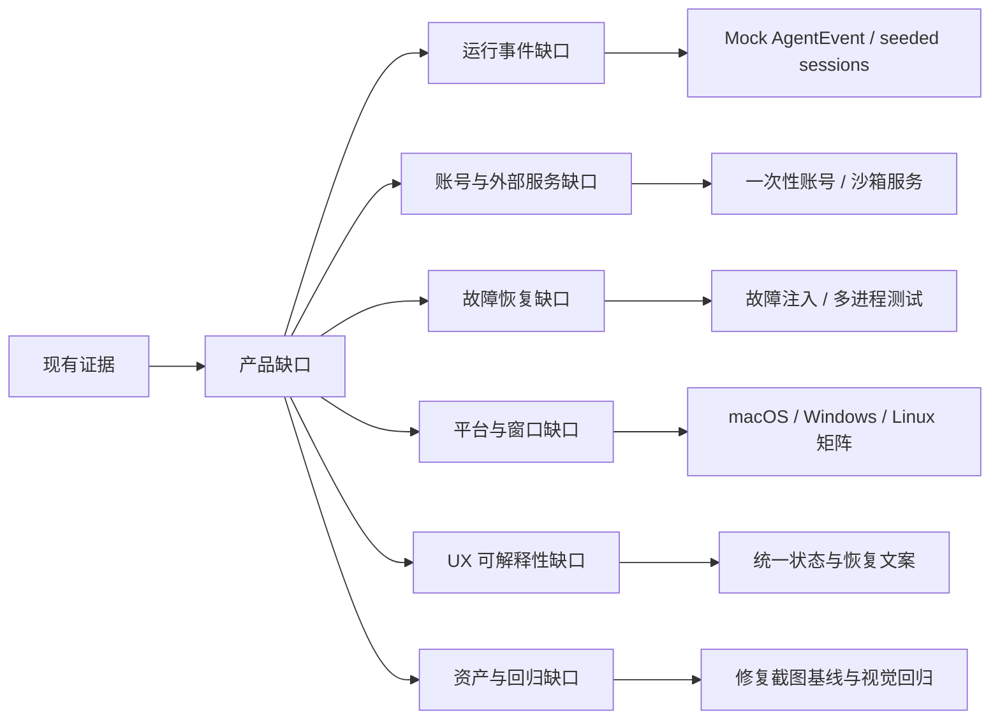
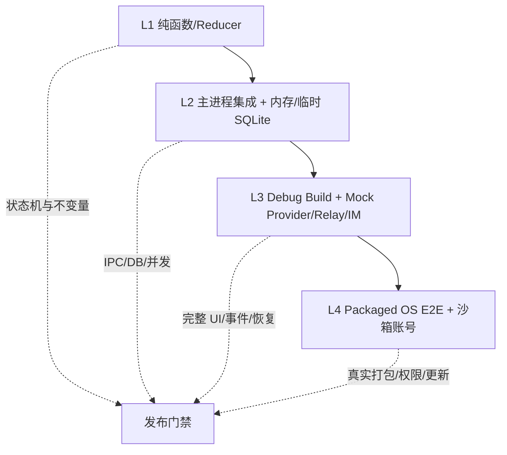
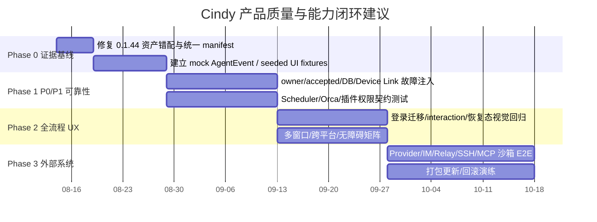

# Cindy 产品缺口、路线图与验收体系

> 基线：Cindy Desktop `0.1.45`，源码 `makecindy/cindy@240247e52e938710f409c921a7a393097dcef52b`。  
> 文档用途：产品排期、设计评审、研发拆解、QA 计划、发布门禁。  
> 证据来源：[UI 覆盖报告](/Users/smallraw/.cache/cindy-deep-dive/ui/coverage.md)、[业务逻辑审计](/Users/smallraw/.cache/cindy-deep-dive/source-analysis/business-logic.md)、[状态机](/Users/smallraw/.cache/cindy-deep-dive/source-analysis/state-machines.md)、[数据模型](/Users/smallraw/.cache/cindy-deep-dive/source-analysis/data-model.md)、[IPC/Event](/Users/smallraw/.cache/cindy-deep-dive/source-analysis/ipc-api-events.md)、[UI 架构](/Users/smallraw/.cache/cindy-deep-dive/source-analysis/architecture.md)。

## 1. 证据与裁决口径

### 1.1 证据等级

| 等级 | 含义 | 可用于什么决策 | 不可用于什么决策 |
|---|---|---|---|
| LIVE | 在 0.1.45 实机观察并保存截图、AX 树和触发路径 | 当前用户可见行为、布局、文案、可达性 | 动效时序、未执行动作的副作用 |
| BASELINE | 0.1.44 既有截图/线稿 | 结构演进、历史对照 | 直接证明 0.1.45 当前行为 |
| SOURCE | 当前源码、测试、schema 或版本差异直接证明 | 业务规则、状态机、协议、门控、目标 UI | 外部服务、OS 或真实 provider 的运行正确性 |
| GATED | 实现存在，但需要账号、凭据、运行事件、危险动作或故障注入 | 测试计划和 fixture 设计 | 宣称已经实机验收 |
| INFERENCE | 多处证据一致支持的推断 | 风险识别、待验证假设 | 发布门禁的通过证据 |

### 1.2 产品文档中的强制标签

- **现状确认**：LIVE 或 SOURCE 已直接证明。
- **建议规格**：为补齐体验、可靠性或一致性提出的目标，不代表当前已实现。
- **动态待验**：需要真实服务、OS、多进程、网络或故障注入验证。
- **非目标**：明确不进入当前产品范围，防止需求蔓延。

### 1.3 缺口优先级

| 优先级 | 定义 | 典型条件 |
|---|---|---|
| P0 | 可能造成凭据/用户数据越界、不可恢复丢失、重复副作用、权限绕过 | owner 泄漏、队列重复执行、DB 错误恢复损坏、插件权限失守 |
| P1 | 核心任务无法完成或用户无法理解/恢复，且无可接受替代路径 | 登录失败无恢复、Agent turn 卡死、Scheduler 重复触发、工作区误回收 |
| P2 | 主流程可完成，但可见一致性、效率或覆盖不足 | 状态缺少截图、跨平台差异、设置门控不透明、动画不可测 |
| P3 | 增强、债务清理或低频边角 | 实验页 token 债、文档历史噪音、非关键微交互 |

## 2. 缺口全景

### 2.1 已确认的覆盖缺口

1. 登录、跳过登录、realm/SSO、账号选择/绑定、删号结果追踪没有本轮实机证据。
2. 旧数据迁移 gate、SQLite fatal、备份恢复和 schema lease 冲突不能在真实用户库上制造。
3. 流式逐词淡入、切任务不重播、计划呼吸点、失败对账等 motion/时序无法由静态截图证明。
4. AskUserQuestion、permission confirmation、plan review、输入 queue、stop/retry/continue 需要可控 AgentEvent。
5. Orca Workers、iOS Simulator、填充 Subagent、媒体/Mermaid/model lightbox 依赖当前任务上下文或插件能力。
6. Provider/MCP/SSH/IM 的错误、凭据失效、连接中断和恢复没有真实外部系统验收。
7. Device Link 的“请求可能已经执行但 ack 丢失”需要副作用感知的 UX 和故障测试。
8. 多窗口在 owner 切换、窗口销毁和分离/合并时的订阅清理需要多 webContents 测试。
9. 三种 Agent 的真实事件顺序、重试、终态和 token/usage 映射需要契约测试。
10. 自动更新的下载、签名、备份、替换、回滚和 relaunch 需要打包产物与 OS 级演练。

### 2.2 已确认的资产缺口

- 0.1.44 原图 `31/32` 字节完全相同。
- 0.1.44 `cropped/15/31/32` 和 `linework/15/31/32` 被错误映射为同一画面。
- 旧基线不能再用“67/67”作为唯一状态覆盖率；应改为“67 个记录、65 个唯一裁剪哈希、已知 3 个映射异常”。
- 0.1.45 新集已满足 `43 manifest = 43 PNG = 43 JPEG = 43 lineart`，应作为后续资产管线模板。

## 3. P0/P1 风险登记

| ID | 优先级 | 风险 | 触发条件 | 期望防线 | 当前证据 | 验收要求 |
|---|---|---|---|---|---|---|
| R-001 | P0 | owner 切换后旧异步结果写入新账号 | 登录/退出/切账号与后台写并发 | owner scope key + generation + DB 重开 | SOURCE/待验 | 注入延迟回调，确认旧代写全部拒绝 |
| R-002 | P0 | durable queue、Agent dispatch accepted 与副作用边界不清导致输入重复执行 | 断网、进程崩溃、timeout | 先持久化 queue snapshot；Agent accepted 后持久化 active turn；副作用按工具 ledger 对账；恢复 paused | SOURCE | 在 queue persist、dispatch accepted、tool commit 前后逐点 crash；不得盲重放，并能对账为 0、1 或 unknown |
| R-003 | P0 | Device Link timeout 后用户重试造成重复副作用 | 请求已到被控端但 ack 丢失 | inFlight 不确定性 + 幂等键 + 明确 UX | SOURCE/待验 | 模拟丢 ack，UI 禁止无提示重复提交 |
| R-004 | P0 | 插件升级扩大权限但无复审 | manifest/来源/字节变化 | owner ledger、provenance、权限 delta review、commit 前复验 | SOURCE | 权限扩展必须阻断安装；拒绝后旧版仍可运行 |
| R-005 | P0 | worktree 误回收或丢未提交变更 | session 生命周期、共享 ref、dirty tree | live ref 校验、自动 stash、安全根 | SOURCE | archive 不回收；delete 才回收；dirty 必须可恢复 |
| R-006 | P0 | SQLite migration/repair 导致不可恢复损坏 | 磁盘满、并行版本、锁损坏 | online backup、lease、release fail closed | SOURCE/待验 | 故障注入后原库或备份至少一份可打开，禁止静默 downgrade |
| R-007 | P1 | Agent turn 永久卡住 | provider 无事件或子进程不退出 | 45m stall watchdog、provider 30m、abort grace | SOURCE | mock 时钟验证 waiting interaction 不计时，普通 stall 可恢复 |
| R-008 | P1 | Scheduler 重复触发/重复通知 | 多实例、崩溃恢复、CAS 竞态 | nextFireAt CAS、lock、heartbeat、stale sweep | SOURCE/待验 | 两实例竞争只生成一个 run；崩溃 run 收敛 interrupted |
| R-009 | P1 | Orca 工具伪造 session 身份执行控制动作 | MCP 参数自报 caller | runtime/thread provenance + handler 二次授权 | SOURCE | 缺 provenance、batch 丢 meta、错误角色全部 fail closed |
| R-010 | P1 | 多窗口收到错误 owner 的 push | owner 切换时窗口仍存活 | owner-scoped subscription + unsubscribe | 待验 | 三窗口并发切账号，旧 owner push 到达数为 0 |
| R-011 | P1 | 更新时插件/子进程未停造成版本混跑 | auto restart/apply patch | busy gate、stop helper、expected-exit marker | SOURCE/待验 | 打包演练验证所有受管进程退出后才替换 |
| R-012 | P1 | 无 interaction surface 时危险工具继续执行 | 远程/headless/窗口关闭 | resolver 缺失即 deny/empty/reject | SOURCE | 所有 permission/plan/question 无 resolver 均 fail closed |

## 4. 目标测试环境

### 4.1 四层环境

| 环境 | 用途 | 必备 fixture |
|---|---|---|
| L1 | 状态转移、序列化、权限决策、幂等 | fake clock、property-based transitions |
| L2 | IPC、owner 隔离、DB、队列、scheduler、多窗口 registry | 临时 owner DB、fake webContents、进程替身 |
| L3 | 所有 GATED UI、动态事件、视觉回归 | mock Claude/Codex/Pi、mock MCP/IM/Relay、seeded sessions |
| L4 | safeStorage、原生窗口、PTY、权限、更新、锁、崩溃 | 一次性 OS user、签名测试包、网络代理、磁盘/进程故障工具 |

### 4.2 测试数据包

建议维护版本化 `product-fixtures`，至少包括：

- signed-out、local、cloud、SSO、多账号、待删除账号；
- 新用户、迁移前 schema、迁移中断、损坏 WAL、只读 DB、磁盘不足；
- 空任务、长任务、媒体任务、Mermaid/model 文件、生成文件、含 50+ messages 的分享任务；
- running/queued/aborting/error/interaction/compact/plan/subagent 各类 AgentEvent；
- Orca lead + 0/1/N workers、worker error、provenance 缺失；
- Scheduler active/paused/expired、queued、stale heartbeat、script capability deny；
- Ghost 正常/权限扩展/crash/fused/升级回滚；
- Device Link online/offline/ack lost/replay/backpressure；
- SSH、MCP、Provider、IM 的成功/认证失败/timeout/断线恢复；
- update idle/downloading/ready/superseding/failed/rollback/done。

所有 fixture 必须是匿名、合成、可销毁数据；不得复制真实聊天、项目路径、API Key 或联系人。

## 5. 全流程验收矩阵

### 5.1 启动、认证和数据边界

| 场景 | 前置 | 操作 | 预期 | 恢复/观测 |
|---|---|---|---|---|
| 首次启动登录 | 无缓存 | 输入 identifier → 选择方式 → 验证 | 状态按 reducer 前进；错误可 recoverTo | 不在 renderer 暴露 token |
| 跳过登录 | signed-out Desktop | 选择本地模式 | 进入 local owner，云能力明确不可用 | 退出 local 回 signed-out，本地数据保留 |
| 冷启 refresh 超时 | 有可刷新 token、慢网络 | 启动等待 splash | UI 可先 signed-out，后台不取消 | 晚到成功广播并安全进 cloud |
| 账号切换 | A 账号运行中任务 | 切换到 B | A 在飞任务不得伪装正常完成 | 所有 owner-scoped UI/DB/secret 切换 |
| 删除账号 | cloud + challenge | 确认删除 | 本地立即退出，receipt 继续跟踪 | 状态可恢复查询，不留 token |

### 5.2 新任务、任务运行和恢复

| 场景 | 验收点 |
|---|---|
| 新任务草稿 | 未发送前不创建后端 session；切 Agent/model/permission/workdir 不产生空记录 |
| 首次发送 | 只创建一次；session、workspace、route 和首条消息原子可追溯 |
| 排队发送 | 只派发队头；busy/steer/stop 时顺序稳定；`durableQueued` 与 Agent `dispatchAccepted` 分开投影，后者之后才标记 active turn |
| Stop | 当前 turn 进入 aborting；待处理队列保留并 paused；UI 清楚区分停止与删除 |
| Retry | 无输出 clone，有部分输出 continuation；历史 usage 不得重复归账，新 continuation/retry 的新增 token/cost 单独归因；不得重复副作用 |
| 崩溃恢复 | 队列恢复 paused；用户明确继续；损坏快照安全丢弃且有日志/提示 |
| Agent 切换 | 当前 turn 不被打断；下一 send 前切换；handoff 可解释、可恢复 |
| 模型/effort 切换 | busy 和 credential family 不兼容时延迟；失败回滚，不出现 UI/运行时分裂 |

### 5.3 权限与人机协作

| 场景 | 验收点 |
|---|---|
| Ask 模式 | 每个高风险工具有清晰对象、动作、范围；允许/拒绝可审计 |
| Auto 模式 | reviewer 异常 fail closed；用户可看见自动决策和接管入口 |
| Full Access | 明确说明不等于 OS 沙箱绕过；切入需要确认；范围与 session instance 绑定 |
| Plan review | 批准/拒绝/修改路径明确；与 permission mode 正交 |
| 无界面/headless | 无 resolver 时拒绝，不允许静默通过 |
| 中断 | interaction 卡与 turn 一起取消；迟到结果不能复活已关闭 turn |

### 5.4 多 Agent、自动化与外部入口

| 域 | 核心验收 |
|---|---|
| Orca | 一个 Lead 一个 active team；label 唯一；worker 权限不继承；创建/dispatch/bridge/archive 全链可追踪 |
| Scheduler | CAS 防重复；queued 不占资源；hook exit 2=skipped；silent success 不通知、失败必通知 |
| Hook | hello/welcome、ping/pong、去重 ack、busy FIFO、offline final replay、路径 alias 每次重验 |
| IM/微信 | owner-scoped credential；binding 唯一；lease/TTL/outbox 重试；控制消息不被 overload 丢弃 |
| Device Link | 单主 lease；断线重连；不确定 inFlight 明示；远程 IPC 是本地能力真子集 |

### 5.5 工具、插件与本地系统

| 域 | 核心验收 |
|---|---|
| Terminal | create/attach/restart/dispose 区分；owner window 销毁可转移；secret-like env 被剥离 |
| File | traversal/symlink 逸出拒绝；2MiB 边界；local/SSH/device 行为有明确差异和错误 |
| Browser | tab main 真值、DOM LRU、pin lease、watchdog 回收、foreground 告警、crash 自清理 |
| Review | 无改动、Git 不可用、大文件、图片/Markdown、branch base、按 turn 的空错态完整 |
| Ghost | 安装来源与权限复验；runtime 3/60s fuse；停用/更新/卸载先收资源；旧安装兼容 |
| Skill/MCP | scope/realpath 去重；ignore 尊重；secret 进 safeStorage；远程 URL 限 HTTPS/loopback |

## 6. UI/UX 验收门禁

### 6.1 Surface 状态要求

每个页面、对话框、菜单、右栏 tab 和辅助窗口至少要覆盖：

1. 初始/默认；
2. loading/skeleton 或连接中；
3. 空态；
4. 有数据；
5. 局部错误与重试；
6. 权限/能力不可用；
7. 离线/断线（适用时）；
8. 危险动作确认；
9. 成功反馈；
10. 恢复后的状态一致性。

### 6.2 视觉回归矩阵

| 维度 | 最小集合 |
|---|---|
| 主题 | Cindy Light、Cindy Dark、Default Light、Default Dark |
| 窗口 | 1280×800、最小 800×600、分离右栏 520×860、最小 360×480 |
| 平台 | macOS、Windows；Linux 对通用 renderer + 已声明缺失能力 |
| 字体 | 默认 UI/代码字体、用户自定义字体、125%/150% 缩放 |
| 内容 | 中/英/日/韩/繁中、长标题、长路径、无头像、超长模型名 |
| 动效 | 正常 motion、`prefers-reduced-motion` |

所有视觉资产必须进入类似 0.1.45 的 manifest：状态 ID、入口、前置、动作、可见控件、AX 摘要、原图/线稿路径、尺寸、SHA-256。禁止只统计文件数量。

### 6.3 无障碍验收

- 所有 icon-only button 有可读名称与 tooltip；
- 菜单、tab、dialog、listbox、tree、slider、switch 使用正确 role/state；
- 焦点进入/返回对话框可预测，Esc 只关闭最上层 surface；
- 键盘能完成新建、选择 Agent/model/permission、发送、停止、切 tab 和关闭；
- 动态事件通过合适的 live region，不重复朗读流式 token；
- 状态不只靠颜色表达；运行中/失败/等待有图标、文字或形状；
- 最低对比度和 zoom/reflow 以 WCAG 2.2 AA 为目标。

## 7. 可观测性与产品指标

### 7.1 北极星与护栏

**建议北极星**：用户创建任务后，在不需要离开 Cindy 重新搭环境的情况下，获得一个可使用成果的比例。

| 指标 | 定义 | 护栏 |
|---|---|---|
| Task Completion Rate | 有明确终态和成果引用的任务 / 已开始任务 | 不用“模型 done”替代用户成果 |
| Time to First Useful Action | 首次输入到首个有效工具/成果事件 | 排除登录、下载 runtime 等冷启噪音单独统计 |
| Recovery Success | 中断/崩溃/断线后恢复并继续的任务比例 | 不允许自动重复副作用提高成功率 |
| Human Intervention Rate | 因权限/歧义/错误需用户介入的 turn 比例 | 介入不是负面，需区分必要审批与系统失败 |
| Cross-Harness Continuity | 切换后无需重述上下文并继续的比例 | handoff 丢关键文件/计划视为失败 |
| Automation Reliability | 到期 schedule 最终进入明确终态比例 | 重复 run、漏 run、静默失败单列 P0/P1 |

### 7.2 事件最小集

建议仅记录非内容型产品事件：启动 gate、owner/mode 转移、session/turn 状态、interaction 类型和结果、route 切换、queue 深度、recovery 原因、schedule run 终态、plugin runtime 状态、Device Link 连接态、update phase。不得记录聊天正文、文件内容、工作目录、凭据或任意 tool payload。

## 8. 分阶段路线图

### Phase 0：证据与测试基座

- 修正或淘汰旧基线错误映射，生成机器可读 manifest；
- 建立 mock provider/AgentEvent、临时 owner DB、seeded UI 任务；
- 对所有产品文档中的 SOURCE/GATED 项建立 testcase ID；
- 输出截图、AX、事件日志和状态快照的统一测试工件。

**退出条件**：所有 GATED UI 都能在不接真实账号/不执行危险动作的情况下由 fixture 打开。

### Phase 1：P0/P1 不变量

- owner generation、durable queue/dispatch accepted/副作用 ledger 分层边界、DB lease/backup、worktree recycle；
- Device Link 不确定执行、Scheduler CAS/heartbeat、Orca provenance；
- interaction fail closed、插件权限 delta、更新前进程清理。

**退出条件**：R-001—R-012 全部有自动测试，P0 失败为 release blocker。

### Phase 2：全流程 UX 与跨平台

- 登录/迁移/删除/错误/恢复全链；
- queue/stop/retry/plan/permission/AskUserQuestion；
- 多窗口分离/合并、窗口恢复、Light/Dark、reduced motion、i18n、无障碍；
- 右栏 9 类 tab 和设置 14 页签全状态回归。

**退出条件**：每个 Surface 状态矩阵都有截图/AX/测试证据；无 P1 可用性缺口。

### Phase 3：真实外部系统与发布

- 三 Agent、Provider、MCP、SSH、IM、Hook、Device Link relay；
- 打包版 safeStorage、PTY、权限、签名更新、备份替换与回滚；
- 弱网、离线、限流、上游 schema 漂移和长时间运行。

**退出条件**：支持平台的 packaged E2E 通过；外部依赖失败均有明确可恢复 UX。

## 9. 发布门禁

### 9.1 必须阻断发布

- 任一 owner/凭据/用户数据跨界；
- durable queue、dispatch accepted、副作用 ledger 或 Scheduler/Device Link 导致重复副作用；
- worktree/数据库不可恢复丢失；
- 插件权限扩展未复审或 provenance 可绕过；
- interaction 无界面时错误放行；
- 账号切换把在飞任务伪装成成功；
- 更新替换后出现新旧进程混跑或无法回滚。

### 9.2 可带已知限制发布

仅当同时满足：

1. P0 无例外阻断；P1 默认阻断，只有书面风险接受、指定批准人、Owner、期限、缓解措施和回归用例全部齐全才可例外；
2. UI 明确说明能力/平台/账号限制；
3. 有可行替代路径；
4. 不破坏已有数据或协议兼容；
5. 缺口在 release notes 和 backlog 有 owner、优先级、复现与退出条件。

## 10. Definition of Done

每个产品功能只有满足以下条件才算完成：

- 产品目标、用户故事、非目标、入口和前置明确；
- 正常、空、加载、错误、无权限、离线、恢复状态齐全；
- 数据真值、owner、持久/临时状态和清理时机明确；
- IPC/API/Event 契约有类型、错误、幂等与取消语义；
- 危险动作有匹配风险的确认、停止和恢复；
- macOS/Windows/Linux 差异已裁决，不以“理论复用组件”代替验证；
- Light/Dark、键盘、屏幕阅读器、reduced motion 和 i18n 验证；
- 单元、集成、fixture UI、packaged E2E 按风险通过；
- 文档、截图 manifest、状态机、埋点与 release note 同步；
- 所有动态待验项要么完成验证，要么明确列为非阻断限制并获得产品裁决。
