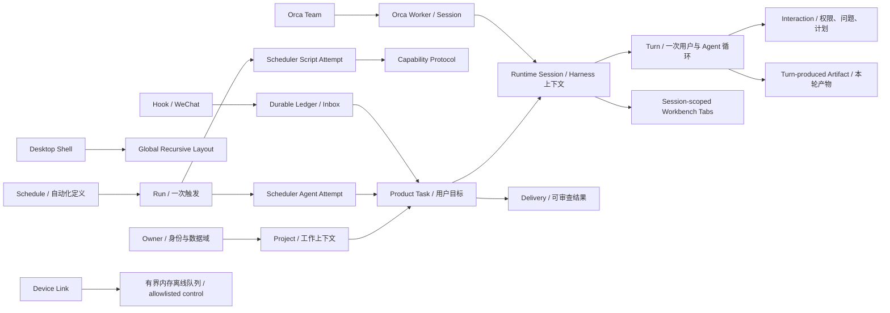
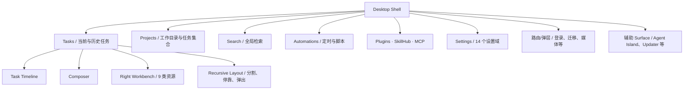
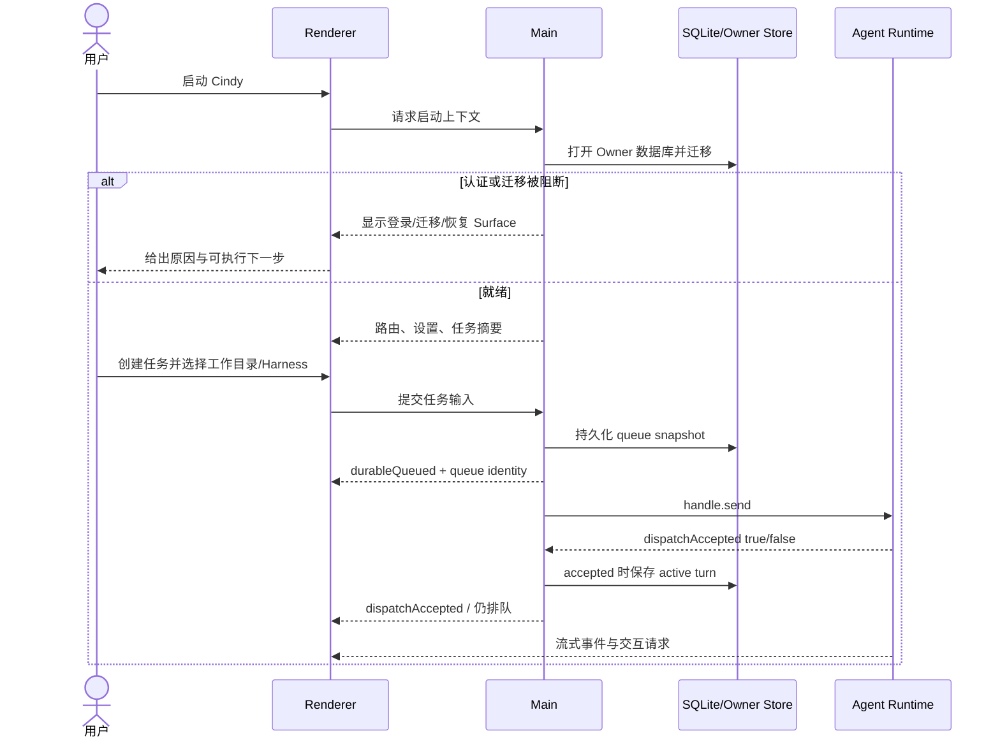
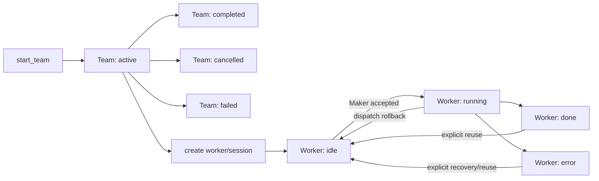
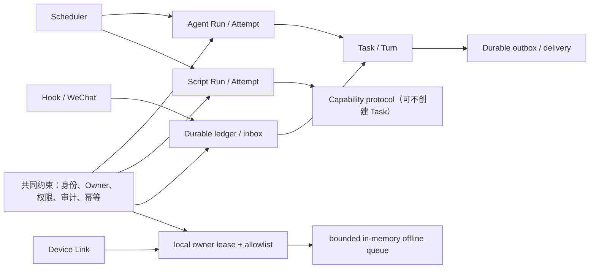
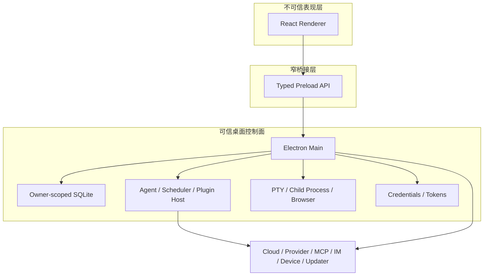
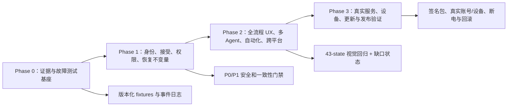

# Cindy 全量产品参考与任务蓝图

> 双证据基线：Cindy Desktop 安装版 `0.1.45`；开源仓库提交 `240247e52e938710f409c921a7a393097dcef52b`；安装包 build 与该提交的精确映射仍属动态待验  
> 文档性质：产品定义、UX/UI 规范、业务需求、领域状态、系统蓝图、缺口、路线图和验收基线  
> 生成日期：2026-08-13  
> 适用对象：产品、设计、桌面端、前端、Agent Runtime、平台、QA、安全、数据与发布负责人

## 1. 这套文档解决什么问题

本参考把 Cindy 从“能看见的桌面应用”拆成一套可规划、可实现、可测试、可追责的产品系统。它回答以下问题：

1. Cindy 为谁解决什么问题，什么属于产品边界，什么明确不做。
2. 用户从启动、认证、新建任务、执行、介入、审查到交付的每一步是什么。
3. 每个页面、窗口、弹层、侧栏、状态、错误和跨平台差异应该如何表现。
4. Product Task、Runtime Session、Turn、Worker、Schedule Run/Attempt 等对象如何区分。
5. 主进程、Renderer、Preload、Agent、数据库、终端、浏览器、更新器与外部服务如何协作。
6. 权限、人机交互、持久队列、多 Agent、自动化和跨设备的失败边界是什么。
7. 哪些结论已经由运行界面或源码证明，哪些仍需要真实环境验证。
8. 如何把产品目标切成任务，并用可重复的验收条件判断是否完成。

这不是单纯的源码说明，也不是视觉临摹手册。它以产品行为为中心，把界面、状态、数据、信任边界和恢复语义合在同一套语言里。

## 2. 文档包地图

| 文档 | 回答的问题 | 主要使用者 |
|---|---|---|
| [01 产品战略与信息架构](/Users/smallraw/.cache/cindy-deep-dive/product-docs/01-product-strategy-and-ia.md) | 为谁做、为什么做、产品边界、能力地图、对象和一级 IA | 产品负责人、架构负责人 |
| [02 UX/UI 产品规格](/Users/smallraw/.cache/cindy-deep-dive/product-docs/02-ux-and-ui-spec.md) | 所有 Surface 如何布局、交互、反馈、降级和适配 | 产品设计、前端、QA |
| [03 用户流程与状态矩阵](/Users/smallraw/.cache/cindy-deep-dive/product-docs/03-user-flows-and-state-matrix.md) | 各入口、分支、异常、恢复路径以及页面状态如何串联 | 产品、设计、QA |
| [04 功能需求规格](/Users/smallraw/.cache/cindy-deep-dive/product-docs/04-feature-requirements.md) | 各业务域的用户故事、前置条件、业务规则、失败与验收 | 产品、研发、QA |
| [05 领域状态与策略](/Users/smallraw/.cache/cindy-deep-dive/product-docs/05-domain-state-and-policy.md) | 实体、不变量、状态机、权限、IPC/Event/API 和幂等边界 | 架构、后端、Runtime、安全 |
| [06 系统与集成蓝图](/Users/smallraw/.cache/cindy-deep-dive/product-docs/06-system-and-integration-blueprints.md) | 进程、模块、Agent、数据、外部集成、更新与 NFR 如何协作 | 架构、平台、桌面端 |
| [07 缺口、路线图与验收](/Users/smallraw/.cache/cindy-deep-dive/product-docs/07-gap-roadmap-and-acceptance.md) | 先修什么、为什么、如何测试、什么阻断发布 | 产品负责人、研发负责人、QA |

建议阅读顺序：产品和设计从 `01 → 02 → 03 → 07`；研发从 `01 → 04 → 05 → 06 → 07`；QA 从 `03 → 04 → 05 → 07`。

## 3. 证据和裁决规则

文档中的陈述必须属于以下一种，不允许把设计意图伪装成当前事实：

| 标签 | 含义 | 可用来做什么 |
|---|---|---|
| `LIVE` | 在已安装的 0.1.45 应用中实际操作并截图确认 | 证明当前可见 UI 和交互结果 |
| `BASELINE` | 来自 0.1.44 旧基线资产 | 说明历史形态，不证明现版本仍存在 |
| `SOURCE` | 由固定提交的源码静态确认 | 证明代码路径、状态、接口或分支存在 |
| `GATED` | 入口存在，但受账号、地区、服务或真实设备阻断 | 记录可达前置条件和待验证内容 |
| `INFERENCE` | 基于多份证据的产品推断 | 提供讨论方向，不能直接当验收事实 |

需求口径再分三类：

- `【当前】`：复述当前实现，改变它需要兼容或迁移判断。
- `【建议】`：目标产品规范，进入版本前必须由负责人接受。
- `【动态待验】`：依赖真实认证、服务端、外部进程、设备或故障注入。

冲突裁决优先级为：同版本实时行为 > 同版本源码 > 同版本静态资源 > 历史基线 > 推断。源码和安装包表现不一致时必须保留“双版本事实”，不得擅自合并。

## 4. 产品定义

### 4.1 一句话定义

Cindy 是一个桌面优先的 AI 任务工作台：用户把目标、工作目录、模型/Agent Harness、技能、外部连接和自动化组合成可持续运行、可介入、可审查、可恢复的工作任务。

### 4.2 核心承诺

1. **目标可执行**：任务不是一次性聊天，而是能调用文件、终端、浏览器、技能和外部通道的执行单元。
2. **过程可介入**：用户可追踪进度、回答问题、授权操作、追加输入、停止或恢复。
3. **上下文可持续**：任务、运行会话、布局、资源和输出可跨窗口、重启与入口延续。
4. **边界可解释**：本地、云端、Owner、权限、插件、外部消息和设备之间的信任边界必须可见。
5. **结果可审查**：执行记录、资源、文件、终端和交付物应能回到同一任务上下文。

### 4.3 非目标

- 不是无限制的通用系统控制器；高风险动作必须受明确授权和根目录约束。
- 不是把 Product Task、Agent Session 和一次 LLM Turn 混成一个对象的聊天壳。
- 不是用“任务已发送”冒充“任务已接受、已持久化、可恢复”。
- 不是让 Renderer 直接持有密钥、数据库句柄、子进程或系统级能力。
- 不是承诺所有 Agent、IM、设备、补丁服务在离线或无账号条件下都可工作。

## 5. 目标用户与主要工作

| 用户 | 主要目标 | 成功信号 | 首要风险 |
|---|---|---|---|
| 独立开发者 | 在本地仓库完成分析、修改、测试和交付 | 任务上下文不丢、变更可审查 | 越权文件/命令、错误恢复 |
| 产品/设计人员 | 把目标转成材料、方案、图稿和任务 | 产出链条清晰、可迭代 | Agent 行为不可解释 |
| 技术负责人 | 同时推进多个任务或 Worker | 状态、责任、产出和阻塞可见 | 多 Agent 来源混淆 |
| 自动化运营者 | 定时或外部触发重复工作 | 每次运行可追踪且不重复副作用 | 重复调度、失联重跑 |
| 插件/技能作者 | 接入 Tool、Skill、MCP 或消息入口 | 能力、权限、故障边界清楚 | 供应链和权限扩张 |
| 多设备用户 | 从另一设备继续查看或触发任务 | 单 Owner、有确认、可断线恢复 | 消息重复、确认丢失 |

核心 JTBD：

- 当我要完成一个跨文件、终端、浏览器和多轮推理的目标时，我希望它成为可持续的任务，而不是一段易丢失的聊天。
- 当 Agent 请求权限或信息时，我希望知道请求来自哪个任务、哪一步、将影响什么，并能安全回答或拒绝。
- 当任务由自动化、消息或另一设备触发时，我希望它仍遵守同样的身份、权限、幂等和审计规则。
- 当应用、进程、网络或设备中断时，我希望知道哪些动作已被系统接受，哪些必须恢复或人工处理。

## 6. 产品对象蓝图



关键不变量：

1. Task 是用户长期对象；Session 是某个 Harness 的运行上下文；Turn 是一次执行边界；三者不得用同一个状态字段替代。
2. Harness 切换不应在 Turn 中途改写执行语义；应排队到安全边界，并保留旧 Session 和切换原因。
3. Hook/WeChat 等持久入口在进入任务前必须经过身份、Owner、去重、持久化和权限检查；Device Link 当前只有有界内存离线队列，不能被文档升级为 durable inbox。
4. Worker 输出必须带 Orca Team、Worker、父任务和来源证明，Lead 不得把它伪装为自身产出。
5. 全局递归布局属于 Desktop Shell；Workbench tab 按 Session 分桶；Turn 只拥有本轮产生的 Artifact 引用。三种归属都可恢复，但不能合并成“任务拥有全部布局和资源”。

## 7. 一级信息架构

### 7.1 用户可见层



### 7.2 主任务工作台

主界面不是固定三栏，而是：位于会话布局树之外的 Session Sidebar，加上一棵全局递归布局树；布局树中只能有一个 `chat-main`。会话级 Workbench tab 按 session 分桶，而文件、终端、浏览器和产物的生命周期不必等同于单个 Turn。

源码注册的 9 个 `TabKindPlugin` 是：`file-browser`、`review`、`subagents`、`background-tasks`、`orca-workers`、`resource-usage`、`web-browser`、`ios-simulator`、`terminal`。其中 `orca-workers` 由上下文程序创建，`resource-usage` 是隐藏 legacy 兼容项，`ios-simulator` 受平台/能力门控制；Goal/Plan 属于聊天/Composer 状态，不是右栏 kind。具体当前表现、空态和操作见 [02 UX/UI 产品规格](/Users/smallraw/.cache/cindy-deep-dive/product-docs/02-ux-and-ui-spec.md)。

源码可识别的 12 类窗口/Surface 为：主窗口、会话副窗、分离右栏、分离 Ghost、资源用量、Voice overlay、Voice dictionary toast、电脑权限引导、会话拖动预览、Agent Island、Windows updater、隐藏插件逻辑沙箱。登录、迁移、媒体预览等可以是主窗口内路由或弹层，不能一概称为独立辅助窗口。

设置以 14 个页签组成：每个页签都必须有加载、保存、失败、无权限、危险操作和重启/迁移要求的明确定义，不能只描述表单字段。

## 8. 端到端核心旅程

### 8.1 启动到首个任务



验收重点：应用不能在数据库未就绪时进入“看似可运行”的主 UI；Composer 可以在获得 `durableQueued` 后切换为明确的排队投影，但不得把它显示成 Agent 已接受或外部副作用已发生。

### 8.2 Turn 执行与用户介入

1. 用户提交目标或追问；系统校验 Task、Owner、目录和 Harness。
2. Main 将 queue snapshot 持久化并返回 `durableQueued` 与稳定队列 ID。
3. 若 Session 空闲，队首送入 `handle.send`；只有返回 `accepted=true` 才成为 `dispatchAccepted` 的 active Turn。若拒绝或正在执行，输入保持排队并显示位置。
4. Agent 流式产生文本、工具调用、资源和状态事件。
5. 权限、问题和计划确认统一进入 Interaction Router；必须关联 Task/Session/Turn/Tool。
6. 用户允许、拒绝、回答或取消；响应以幂等 ID 写回。
7. 每个 Tool/外部集成独立记录副作用已提交或未知；`dispatchAccepted` 本身不证明副作用发生。
8. Turn 完成、失败、取消或看门狗超时；系统提交最终状态并决定是否消费下一条输入。
9. 时间线展示可审查结果；资源仍能在工作台打开。

### 8.3 多 Agent 协作



产品要求：Worker 是完整 Session，而不是一段匿名后台调用；创建 reservation 是短租约，不是 Worker 持久状态。当前源码没有通用 Orca `Attempt` 实体；若产品未来增加 Proposed/Waiting/Reviewed 等 UX 衍生状态，必须显式映射到 Team 的 `active/completed/cancelled/failed` 和 Worker 的 `idle/running/done/error`。

### 8.4 自动化与外部入口



四条路径共享身份、Owner、权限、审计与幂等要求，但不共享同一种持久化对象。Scheduler Agent 可落到 Task/Turn；Scheduler Script 可直接执行 capability 协议；Hook/WeChat 有明确 durable ledger/inbox/outbox；Device Link 的离线 push 当前只是有界内存队列，不是业务真值。网络回执不等于业务完成。

## 9. 业务域总表

| 业务域 | 用户价值 | 核心状态/规则 | 主要规格 |
|---|---|---|---|
| 启动与数据库 | 稳定进入正确 Owner 数据域 | open、migrate、recover、ready；失败关闭 | 04、05、06、07 |
| 认证与账号 | 决定云能力、Owner 和地区能力 | local/cloud、signed-out/in、switching | 03、04、05 |
| 项目与任务 | 组织长期目标和目录 | Task 与 Session 分离；软删除/恢复须定义 | 02、03、04 |
| Agent/Harness | 选择不同执行内核 | Turn 边界切换；旧 Session 可追溯 | 04、05、06 |
| 输入队列 | 忙碌时不丢追问 | durableQueued、dispatchAccepted、queued、consumed | 03、04、05 |
| Interaction | 安全地询问、授权和确认 | fail-closed、过期、幂等响应 | 03、04、05 |
| 本地 Tool | 文件、Shell、终端、浏览器 | 根目录、敏感路径、资源生命周期 | 02、04、05 |
| Goal/Plan | 将意图转为可见进度 | 版本化、确认、完成标准 | 02、03、04 |
| Orca Team | 多 Agent 并行推进 | Worker provenance、取消、重试、汇总 | 03、04、05、06 |
| Scheduler | 可重复自动运行 | CAS claim、heartbeat、stale sweep | 03、04、05、06 |
| Plugin/Skill/MCP | 扩展能力 | 安装来源、权限清单、启停与熔断 | 02、04、05、06 |
| Hook/IM/WeChat | 从外部创建或推动任务 | binding、inbox/outbox、去重与回执 | 04、05、06 |
| Device Link | 跨设备延续工作 | 单 Owner lease、序列号、确认重发 | 03、04、05、06 |
| 更新系统 | 安全升级桌面和补丁 | stage、supersede、restart gate、rollback | 03、04、05、06 |
| 遥测与用量 | 解释成本并改善质量 | packaged/dev opt-in → consent → analyticsEnabled → 非 local；最小事件 | 02、05、06、07 |

## 10. 信任边界与责任分配



责任原则：

- Renderer 负责表达意图和展示状态，不直接拥有凭据、数据库、子进程、终端和系统 API。
- Preload 只暴露按领域命名、输入可验证、返回可追踪的窄接口。
- Main 对 Owner、授权根、进程、持久化、调度、窗口和广播负责；generation/owner-scope 机制已有实现，但“所有窗口与异步回调均无遗漏”仍需多窗口故障注入证明。
- Runtime 对 Turn、Tool、Interaction、取消、看门狗和执行事件负责。
- 外部系统响应必须转换为本地可恢复状态，不能把远端临时连接当唯一真相。

## 11. UI/UX 完整性规则

每一个可交互 Surface 都必须定义：

1. `loading`：加载什么、是否可取消、何时判断卡死。
2. `empty`：为什么为空、用户下一步是什么。
3. `ready`：主操作、次操作、危险操作和键盘路径。
4. `busy`：哪些控件禁用，哪些输入允许排队。
5. `success`：成功证据落在哪里，是否需要自动关闭。
6. `error`：错误归属、可恢复性、重试是否产生新执行记录；Scheduler 域中的新执行记录是 Attempt。
7. `offline`：只读、缓存、排队或明确阻断。
8. `permission-blocked`：谁请求、将影响什么、允许范围和持续时间。
9. `stale`：当前 UI 是否可能落后于 Main/DB，如何重新同步。
10. `deleted/unavailable`：资源被删除、窗口断开或能力卸载后的退路。

所有危险操作都必须说明影响对象、不可逆部分和恢复方式。所有后台运行都必须让用户找到状态、停止方式与历史结果。所有弹出窗口都必须处理父窗口关闭、Owner 切换和数据广播失效。

## 12. 关键业务不变量

1. **Owner 隔离**：数据库、任务、凭据、外部绑定等关键模块已有 owner scope/generation 机制；目标是不允许旧异步结果污染新 Owner，但窗口推送和所有回调的覆盖完整性仍属动态待验。
2. **分层接受边界**：`durableQueued` 只表示 queue snapshot 已持久化；`dispatchAccepted` 只表示 Agent handle 接受 Turn；外部副作用必须由具体 Tool/集成的 ledger 判定为 committed 或 unknown；终态/交付另行记录。
3. **幂等优先**：所有可能重发的请求都有稳定幂等键；重试保留独立执行历史（Scheduler 创建新 Attempt），但不能重复副作用。
4. **Turn 原子语义**：Harness、模型、关键权限策略不在一个 Turn 中途静默切换。
5. **Interaction fail-closed**：请求过期、来源不明、窗口断联或路由失败时不得默认允许。
6. **来源可追踪**：Worker、Plugin、Skill、MCP、Hook、IM 和 Device 产生的行为带来源链。
7. **取消可终止**：取消不是隐藏 UI；必须向 Runtime/Process 传播并形成最终状态。
8. **历史不可覆写**：失败、取消、切换和重试保留为历史事件；各领域使用其真实执行记录，Scheduler 的新执行使用新 Attempt。
9. **数据库可恢复**：迁移、WAL、备份、锁和恢复必须有单写者与明确提交点。
10. **更新可回退**：下载、暂存、替换、重启和健康检查分离；运行中不能强制破坏任务。

## 13. 当前高风险缺口

以下事项进入产品化前优先解决，完整登记和验收见 [07 缺口、路线图与验收](/Users/smallraw/.cache/cindy-deep-dive/product-docs/07-gap-roadmap-and-acceptance.md)：

| 风险 ID | 优先级 | 缺口 | 为什么重要 |
|---|---|---|---|
| R-001 | P0 | Owner 切换期间旧异步结果污染；机制已实现，覆盖完整性待验 | 可能跨账号或本地/云数据泄露 |
| R-002 | P0 | durable queue、dispatch accepted 与副作用 ledger 未做逐点 crash 注入 | 可能盲重放或无法对账 |
| R-003 | P0 | Device Link 确认丢失与重发 | 可能重复执行真实副作用 |
| R-004 | P0 | Plugin/Skill/MCP 的统一信任展示，以及彼此独立的安装、secret、授权和生命周期 | 扩展能力可能绕过用户预期 |
| R-005 | P0 | Worktree 回收、共享引用和 dirty 变更保护 | 可能不可恢复地丢失工作 |
| R-006 | P0 | SQLite 迁移、WAL、备份恢复 | 数据损坏会影响全部任务历史 |
| R-007 | P1 | Turn 取消、stall watchdog 与最终状态 | 僵尸执行可能继续调用工具 |
| R-008 | P1 | Scheduler 抢占、心跳和 stale sweep | 多实例可能重复运行 |
| R-009 | P1 | Orca Worker provenance 与控制授权 | 结果来源和责任不清 |
| R-010 | P1 | 多窗口 Owner push 的订阅清理 | 旧 Owner 数据可能投影到残留窗口 |
| R-011 | P1 | 更新器替换、重启和回滚链 | 更新可能破坏正在运行的任务 |
| R-012 | P1 | Headless Interaction 路由 | 无可见窗口时权限请求可能悬挂 |

## 14. 目标路线图



### Phase 0：基线

- 固定源码提交、安装包版本、Owner/Region/Platform 测试矩阵。
- 把 43 个 0.1.45 实机状态和 43 张线稿接入视觉回归。
- 建立 Task/Session/Turn/Interaction/Orca Team/Worker/Scheduler Run/Attempt 的版本化 fixtures。
- 为 Main/DB/Runtime 事件建立可关联 ID 和隐私过滤。

### Phase 1：核心不变量

- Owner generation 与窗口/异步广播隔离。
- 输入 queue snapshot 的 `durableQueued`、Agent 的 `dispatchAccepted` 与具体副作用 ledger 分层边界。
- 统一 Interaction Router 与过期/无窗口 fail-closed。
- SQLite 迁移、备份、恢复、单写者和故障注入。
- 取消、看门狗、进程清理和最终状态收敛。

### Phase 2：完整体验

- 补齐所有 Gate、空态、错误、离线、恢复和跨窗口状态。
- 收敛 Goal/Plan/Task、扩展、连接、自动化的用户心智。
- 完成 Orca Worker 可见性、来源、取消、重试和交付审查。
- 做齐 macOS/Windows/Linux 及 Light/Dark/键盘/辅助技术矩阵。

### Phase 3：发布证明

- 在真实 SSO、Agent Provider、MCP、IM、WeChat、Device Link 和补丁服务上跑全链路。
- 做断网、确认丢失、多进程、进程杀死、断电、磁盘满、数据库损坏测试。
- 对签名/公证安装包完成更新、回滚与运行中重启门禁。
- P0 无例外阻断；P1 默认阻断，只有书面风险接受、指定批准人、Owner、期限、缓解措施和回归用例齐全时才可例外进入发布候选。

## 15. 任务拆解模板

每个实现任务必须包含以下字段：

```text
目标：用户最终能完成什么
证据：LIVE / SOURCE / GATED / INFERENCE
当前行为：版本、入口、前置条件、已知差异
目标行为：主路径、分支、错误与恢复
领域对象：涉及的 Task / Session / Turn / Orca Team/Worker / Scheduler Run/Attempt 等；不得把 Attempt 泛化到无此实体的域
状态机：初态、终态、超时、取消、重试、幂等
权限：Actor、Owner、能力、授权范围、有效期、审计
数据：写入点、提交点、索引、迁移、删除和恢复
IPC/Event/API：请求 ID、幂等键、错误码、版本和广播范围
UI：Surface、loading/empty/busy/error/offline/stale 状态
可观测性：关联 ID、最小事件、日志隐私和指标
验收：正常、异常、重启、跨窗口、跨平台、辅助技术
回滚：如何关闭能力、恢复数据和兼容旧版本
```

建议以“一个领域不变量或一条端到端可验收旅程”为任务边界，避免按前端页面、IPC、数据库表分别立项而失去闭环。

## 16. 发布级 Definition of Done

一个产品能力只有同时满足以下条件才算完成：

- 产品定义、用户入口和非目标已接受。
- 主路径、所有业务分支、取消、超时、错误和恢复均有状态定义。
- queue 持久化、Agent dispatch accepted、具体副作用 commit/unknown 与终态边界都有自动化测试。
- IPC/Event/API 输入可验证、错误可分类、请求可关联、重放安全。
- 权限默认关闭，Owner、来源、能力和授权期限可见。
- UI 包含 loading、empty、busy、error、offline、stale 和不可用状态。
- 跨窗口、Owner 切换、应用重启和进程中断不破坏不变量。
- Light/Dark、键盘、屏幕阅读器、减弱动效和目标平台通过验收。
- 监控能回答“谁、在哪个任务、哪个 Turn/运行/Scheduler Attempt、为何失败、能否恢复”。
- 文档、测试 fixtures、截图/线稿基线和变更记录同步更新。

## 17. 证据与资产索引

### 17.1 实机 UI

- [UI 清单](/Users/smallraw/.cache/cindy-deep-dive/ui/ui-inventory.md)
- [UI 流程地图](/Users/smallraw/.cache/cindy-deep-dive/ui/flow-map.md)
- [UI 覆盖与限制](/Users/smallraw/.cache/cindy-deep-dive/ui/coverage.md)
- [43 张状态 manifest](/Users/smallraw/.cache/cindy-deep-dive/ui/manifest.jsonl)
- [逐图资产校验](/Users/smallraw/.cache/cindy-deep-dive/ui/asset-validation.json)
- [原始 PNG/JPEG](/Users/smallraw/.cache/cindy-deep-dive/screenshots/original)
- [43 张同尺寸线稿](/Users/smallraw/.cache/cindy-deep-dive/screenshots/lineart)

### 17.2 源码分析

- [架构分析](/Users/smallraw/.cache/cindy-deep-dive/source-analysis/architecture.md)
- [UI 源码盘点](/Users/smallraw/.cache/cindy-deep-dive/source-analysis/ui-source-inventory.md)
- [路由与组件矩阵](/Users/smallraw/.cache/cindy-deep-dive/source-analysis/routes-components.csv)
- [业务逻辑](/Users/smallraw/.cache/cindy-deep-dive/source-analysis/business-logic.md)
- [状态机](/Users/smallraw/.cache/cindy-deep-dive/source-analysis/state-machines.md)
- [数据模型](/Users/smallraw/.cache/cindy-deep-dive/source-analysis/data-model.md)
- [IPC、API 与事件](/Users/smallraw/.cache/cindy-deep-dive/source-analysis/ipc-api-events.md)
- [UI 证据索引](/Users/smallraw/.cache/cindy-deep-dive/source-analysis/evidence-index.md)
- [逻辑证据索引](/Users/smallraw/.cache/cindy-deep-dive/source-analysis/evidence-index-logic.md)

### 17.3 参考蓝图

- [GitHub 源码蓝图](/Users/smallraw/docs/github-article/makecindy-cindy-blueprint.md)
- [0.1.44 → 0.1.45 版本差异](/Users/smallraw/docs/github-article/makecindy-cindy-version-diff-v0.1.44-v0.1.45.md)
- [审计总入口](/Users/smallraw/.cache/cindy-deep-dive/README.md)

## 18. 维护规则

1. 每个版本更新文档头部的安装包版本、源码提交和验证日期。
2. UI 改动同时更新截图、线稿、manifest、状态矩阵和视觉验收。
3. 领域状态或 IPC 改动同时更新 04、05、06 和相关 fixtures。
4. 新外部集成必须先定义身份、Owner、权限、幂等、持久化、回执和故障恢复。
5. 真实环境验证后，把 `GATED`/`动态待验`升级为 `LIVE`，并保留验证条件和日期。
6. 需求被接受后再从`【建议】`转为目标基线；历史事实不能被目标方案覆盖。
7. 每个发布候选从 07 的阻断清单出发，形成版本级已知限制和签字记录。

---

这套文档的核心判断是：Cindy 的产品价值不在于“一个会调用工具的聊天窗口”，而在于把长期任务、可恢复执行、用户介入、多资源工作台、扩展生态、自动化和跨端入口统一到同一组身份、状态、权限、幂等和审计语义中。后续任务应以这些跨层不变量为主线，而不是逐页面或逐模块孤立推进。
