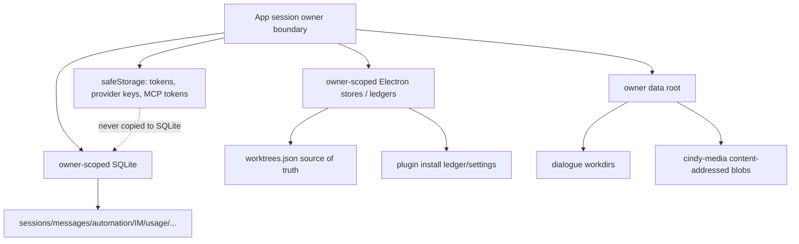
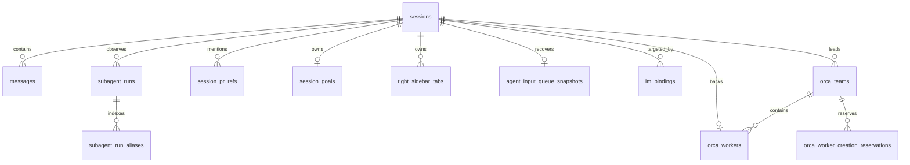
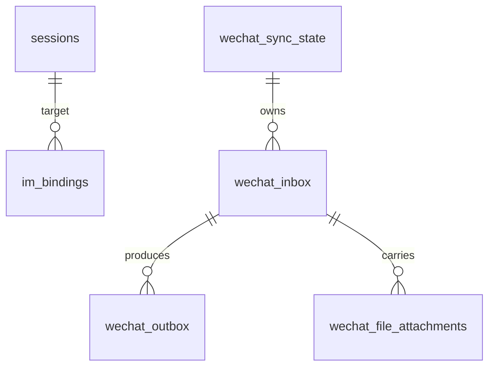
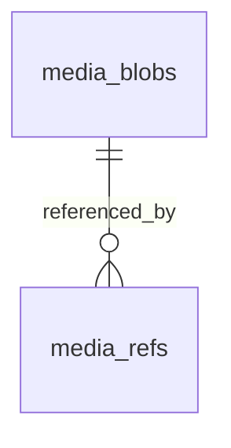

# Cindy 数据模型与持久化边界

> 源码基线 `240247e52e938710f409c921a7a393097dcef52b`。主证据是 `apps/desktop/src/main/localDb/schema.ts` 与 `localDb/migrations/*`。本文只描述结构，未打开任何用户 DB/消息正文/凭据存储。

## 1. 存储拓扑

- **[静态确认]** 账号 DB 按 `<prefix>-<user>.db` 分片，换 owner 时关闭/重开。`sessions` 因 DB 本身已隔离而不再存 userId。证据：`localDb/index.ts`、`schema.ts`。
- **[静态确认]** 认证 token、custom provider key/OAuth secret、custom MCP bearer token 不在 SQLite，由 main 的 safeStorage 持有，不回传 renderer 明文。证据：`authManager.ts`、`maker-host/custom-mcp-store.ts`、`schema.ts:1334,1373` 注释与实现。
- **[静态确认]** Worktree 真值在 owner-scoped `worktrees.json`，DB 中 `sessions.worktree_path` 是反规范化快照。证据：`worktreeStore.ts`、`schema.ts`。

## 2. 核心任务图

### `sessions`

数据库语义的产品任务，不是临时 Agent handle。关键字段：

| 字段组 | 字段 | 语义/不变式 |
|---|---|---|
| 身份 | `id`, `title`, `source`, `created_at`, `updated_at`, `user_send_at` | `user_send_at=NULL` 表示草稿；用户发送时间不被设置更改污染 |
| 工作区 | `working_dir`, `workspace_kind`, `worktree_path`, `remote_host_id`, device/remote fields | project/dialogue 产品归属与 cwd 解耦；worktree path 仅快照 |
| Agent route | `agent_kind`, `model`, `provider_id`, `effort`, `fast_mode` | `provider_id` 非 null 是权威路由，null 为 legacy inference |
| 权限 | `permission_mode`, `plan_mode_enabled` | permission 和 plan 正交；历史 `permission_mode=plan` 迁移为 ask + plan=true |
| 生命周期 | `status=active|archived|deleted`, `cleared_at`, `pinned_at` | 与 Maker runtime active/closed 独立 |
| Vendor | `sdk_session_id`, active turn/recovery metadata | vendor 恢复 ID 用 CAS/转移事务维护 |
| 用量 | total token/cost/context fields, currency, approximate | 保留历史 USD 与新账本币种，区分 approximate |
| 派生 | `parent_session_id`, `forked_at_message_id`, Orca role/team links | fork 源删除时 parent `SET NULL`，不删 fork |
| 外部通道 | Feishu/IM identity，project automation/context fields | 与通用 `im_bindings` 共存，保持 legacy 兼容 |

证据：`schema.ts:40`起。

### `messages`

| 列 | 语义 |
|---|---|
| `id`, `client_id`, `session_id` | session FK cascade；每 session/client 唯一，实现幂等落库 |
| `role` | user, assistant, tool_use, tool_result, ask_user, plan_review, thinking, error, agent_switch, context_rebuild, message_tombstone |
| `content` | JSON 文本/块结构；本审计未读取真实值 |
| agent/meta/kind 字段 | Agent 原生元数据的有界投影 |
| `rewind_at` / delete markers | 软删/回退代际；普通历史查询排除 |

`agent_switch` 行存交接边界和 handoff，不当作可见聊天正文。`context_rebuild` 是被隐藏的重建标记。`message_tombstone` 清空正文/元数据，只留 ID 防原生 transcript importer 把已删消息重新导入。证据：`schema.ts:328`。

### Subagent/PR/队列投影

- `subagent_runs`：用户可见逻辑 child，provider 为 claude-code/codex/pi，状态 running/completed/failed/stopped；vendor run/thread IDs 仅 opaque JSON，renderer 不得到文件系统原生引用。activity 和文本有界。
- `subagent_run_aliases`：将 task/tool/native aliases 映射到可见 generation 内最新 run；clear/rewind 后 alias 允许重用。
- `session_pr_refs`：只保存从消息确定性提取的 owner/repo/number/URL 与最近时间，不缓存易变 PR 状态；状态走短 TTL 实时 IPC。
- `agent_input_queue_snapshots`：每 session 单行 JSON 快照，队列空则删行；读时逐项校验，坏行整体丢弃，重启惰性恢复为 paused。

证据：`schema.ts:411,477,509,1455`，以及 `maker-ipc/agent-input-coordinator.ts`。

## 3. Orca

| 表 | 主键/关联 | 状态/不变式 |
|---|---|---|
| `orca_teams` | `id`; `lead_session_id` FK cascade | active/completed/cancelled/failed；部分唯一索引保证每 lead 一个 active team |
| `orca_workers` | `id`; team/session 两 FK cascade | idle/running/done/error；session 唯一、team 内 label 忽略大小写唯一、team 内 focused 部分唯一 |
| `orca_worker_creation_reservations` | team + lowercase(label) 唯一 | 并发创建短租约，`expires_at` 回收崩溃残留 |

证据：`schema.ts:247,269,308`。

## 4. 自动化/项目允许

| 表 | 用途 | 关键语义 |
|---|---|---|
| `schedules` | 定时/手动自动化定义 | active/paused/expired，cron/interval/recurrence，Agent route/model/effort/Fast，workspace/worktree/target session，runner/hook/notify/expiry |
| `schedule_runs` | 一次尝试 | running/success/failed/aborted/interrupted/skipped，heartbeat，cost/token/归因/通知结果 |
| `project_automation_consents` | 项目自动化授权 | 按稳定 project key 隔离，项目内自动化不因路径展示名混淆 |
| `session_goals` | 任务目标状态 | session cascade，用于目标/后台运行产品投影 |

运行时 attempt phase 不入库，只在 `maker-scheduler/engine/attemptLifecycle.ts` 内存维护。证据：`schema.ts:783,930,995,1007`。

## 5. IM/Hook/个人微信

| 表 | 关键结构 |
|---|---|
| `im_bindings` | PK `(channel, bot_context_id, user_id, scope_key)`；target session FK cascade；thread-capable 渠道用 scope key 并行接管 |
| `wechat_sync_state` | `binding_epoch` 主键；只允许一个 active epoch；sync cursor/error 只是同步投影，credential 不入库 |
| `wechat_inbox` | 平台消息去重、TTL/租约、target/session/turn 关联；状态 pending/dispatching/accepted_running/waiting_desktop/delivery_pending/completed/interrupted/cancelled/expired/failed_terminal/rejected_overload |
| `wechat_outbox` | 返复交付 pending/sending/delivered/failed_terminal，记录尝试/下次时间/平台消息 ID |
| `wechat_file_attachments` | inbox 附件元数据/本地 staging 引用，跟 inbox 生命周期走 |
| `hook_group_messages` | provider/chat/thread/message 唯一；个人设备是群上下文内容的唯一驻留方；每命名空间有界 GC |
| `hook_group_message_stats` | 触发器增量维护的 provider 行数/字节派生计数 |
| `hook_group_context_cursors` | provider + cursor key PK，用于已提交上下文窗口游标 |

证据：`schema.ts:595,631,648,709,741,1602,1635,1645`，`localDb/worker/opHandlers/wechatTx.ts`。

## 6. Usage/嵌入/Skill 分析

| 表 | 用途/边界 |
|---|---|
| `account_usage_snapshots` | 每 agent kind 一份帐号配额快照，有 updated time |
| `daily_spend` | 按本地日/账本币种聚合真实/估算支出 |
| `daily_model_usage` | PK `(day, agent_kind, model, currency)`；保存 token/cache/cost/approximate，避免换币种覆盖旧累计 |
| `embedding_jobs`, `vec_table_meta`, `embedding_meta` | 嵌入工作队列、vec 表版本/能力、模型元数据；vec 迁移在 schema 后 |
| `skill_usage_sources` | 只存 transcript 路径/stat/解析器版本/结果，不把原文复制进表 |
| `skill_usage_exposures` | 模型看到 skill 的结构化曝光，保存文档/内容 hash 和可追溯行号 |

证据：`schema.ts:571,1084,1126,1147,1172,1211,1242,1267`。

## 7. 自定义 Provider/MCP

| 表 | 存什么 | 明确不存什么 |
|---|---|---|
| `custom_providers` | provider ID/name，每 Agent runtime 的 base URL/models/headers JSON，OAuth 公开配置，排序 | API key/OAuth token；safeStorage |
| `custom_mcp_servers` | ID/name，http/sse transport，URL，非鉴权 headers，排序 | bearer token；safeStorage |

ID 在写入层校验 slug 并避免内置冲突。配了 MCP 即生效，删除即停用，无单服务 toggle。反序列化 JSON 失败安全回退空对象。证据：`schema.ts:1334,1373`、`maker-host/custom-mcp-store.ts`。

## 8. UI/运行时投影

| 表 | 语义 |
|---|---|
| `right_sidebar_tabs` | 每 session 多 tab，kind 不用 DB enum 以便插件扩展，state JSON 在 IPC 限 16KiB，应用层限 20 tab/单 active；`subagents` kind 有 DB 部分唯一 |
| `ghost_cards` | `call_id` upsert 一次 Ghost 工具卡片最新版，HTML 已由 host sanitizer，height clamp，有界 GC |

证据：`schema.ts:1413,1569`。

## 9. Device Link 单主

`device_link_ownership` 是固定 `id=1` 的单行表，存 owner 启动随机 ID、PID（仅诊断）、label 和 heartbeat。存活进程用 CAS 抢占超过 stale 的行；不依赖 PID 作身份，防 PID 复用。证据：`schema.ts:1475`、`main/device-link/ownership.ts`。

## 10. 媒体总仓

- `media_blobs`：SHA-256 内容寻址主键，ext/mime/bytes/cache flag/access time。cache 可在仍有 ref 时被容量 LRU 清理；非 cache 用引用计数。
- `media_refs`：多态 `ref_kind/ref_id`，不做业务 FK；记录 origin session/kind/id 以做 Ghost/工具/用户/集成归属校验。blob FK cascade，业务删除负责清自己 ref，回收器对账。

证据：`schema.ts:1501,1530`。

## 11. 迁移和恢复模型

Migrations 从 0000 到 0089 按序执行，主要里程碑：

| 版本段 | 结构能力 |
|---|---|
| 0017 / slim 0066 | FTS5 搜索/索引精简 |
| 0022, 0040 | Orca team/worker 及后续约束 |
| 0023–0025 | workspaceKind/dialogue 工作区语义 |
| 0034 | vec/嵌入数据 |
| 0038 | remote session/workspace |
| 0067 | agent input queue snapshot |
| 0068 | custom MCP |
| 0070 | media ledger |
| 0072 | Ghost cards |
| 0082 | personal WeChat reliable inbox/outbox |
| 0083, 0086–0088 | hook group local context/stats/cursors |
| 0089 | subagent run projection |

打开时序：迁移前 online backup（文件模式 0600，磁盘预算）→ schema migration → vec 能力→ drift 检查→ startup repairs/optimize → DB worker smoke/takeover。

`SQLITE_CORRUPT` 恢复顺序为旧 `.bak.clean` 再最新 migration `.bak.<ISO>`，无备份致命。WAL 负责常规 crash recovery，退出时不做整库备份。证据：`localDb/index.ts`、`schemaMigrationLease.ts`、`migrations/*`。

## 12. 真值、快照与非持久化状态

| 域 | 持久化真值 | 内存/投影 |
|---|---|---|
| 产品任务 | `sessions.status` | Maker Session active/aborting/closed/error |
| Worktree | `worktrees.json` | `sessions.worktree_path` 反规范化快照 |
| Agent 输入 | `agent_input_queue_snapshots` 恢复信号 | AgentInputCoordinator 活队列/锁/steer marker |
| Scheduler | `schedules`, `schedule_runs` | loading/claiming/persisting/running/queued/cancelling/finalizing phase |
| Device Link | `device_link_ownership` 本机 owner lease | socket 状态与内存离线 push queue |
| Plugin | owner install ledger + 已提交 package | Ghost runtime off…fused/node child |
| Credential | safeStorage/main memory | Renderer 只获得可用性/状态投影 |
| Hook progress | 终态/delivery ledger（按流程） | latest progress snapshot，不完整重放 |

## 13. 结构级缺口

- **[静态确认]** 一部分 JSON 列（message content、runtime config、queue payload、activity）的完整数据完整性在应用层验证，SQLite 不能用 CHECK 证明内部 shape。
- **[动态待验]** WAL/备份/跨进程 lease 在断电、磁盘满、权限损坏和不同版本并行时需故障注入。
- **[推断]** 不把临时运行态硬塞进持久化枚举，是系统能在 crash 后通过快照/heartbeat/repair 保守恢复的主要设计原则。
