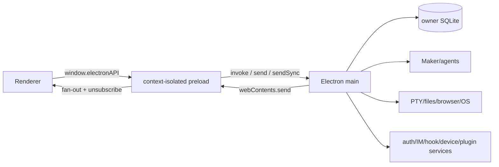

# Cindy IPC / API / Event 考古

> 源码基线 `240247e52e938710f409c921a7a393097dcef52b`。主 preload 是 `apps/desktop/src/preload/preload.ts`，Maker 合约是 `apps/desktop/src/main/maker-ipc/channels.ts`。本文按业务能力组织，不把近 800 个 wrapper 当作无语义字符串清单复制。

## 1. 跨进程边界

- **[静态确认]** Renderer 不直接持有 Node/Electron 对象，只通过 contextBridge 暴露的类型化 wrapper。证据：`apps/desktop/src/preload/preload.ts:839`。
- **[静态确认]** 主 preload 的机械扫描结果：797 个 `ipcRenderer.invoke(...)` 调用，其中 750 个首参为字面频道；29 个 `send(...)`，其中 28 个字面频道；11 个 `on(...)`；29 个 `sendSync(...)`。常量引用和 fan-out 使“字面频道数”不等于全部逻辑 API 数。
- **[静态确认]** 频道名不是授权；main handler 仍校验 sender 窗口、owner/generation、session/runtime identity、路径、权限和输入 shape。Ghost/device-link 还有二次 capability/provenance 门。

## 2. 主 Preload 能力面

字面 invoke 按 namespace 的前缀计数（用于感知面积，不是安全权限数）：

| 前缀 | 字面 invoke 数 | 能力概要 |
|---|---:|---|
| `maker:*` | 340 | 任务/turn/队列、Agent/route/权限、Orca、Scheduler、project/worktree、MCP/provider、usage 等 |
| `local-db:*` | 47 | session/message/goal/tabs/usage/alias 等数据访问 |
| `voice-input:*` | 39 | 语音引擎/录音/配置/转录状态 |
| `skillhub:*` | 39 | 扫描/安装/更新/发布/使用分析/同步 |
| `ghosts:*` | 26 | 列表/启停/面板/能力/运行时/媒体 |
| `git-review:*` | 20 | review 会话、diff/评论/应用/状态 |
| `device-link:*` | 20 | 设备状态/列表/invoke/subscribe/镜像缓存/连接 |
| `plugin-market:*` | 14 | source/catalog/install/update/uninstall/review |
| `auth:*` | 13 | 启动/登录 action/登出/local/刷新/删号 |
| IM namespaces | 39+ | telegram/Feishu/Discord/WeChat/DingTalk/WeCom/binding |
| `worktree:*` | 10 | 创建/删除/列表/恢复/分支偏好 |
| `rsb-browser-bridge:*` | 9 | tab/guest 注册、capture、kill、pin/状态 |
| `terminal:*` | 8 | create/write/resize/dispose/restart/shell prefs |
| `file/media/fs/shell/browser-backend:*` | 40+ | 文件、搜索、附件、媒体、系统打开、浏览器后端 |
| update/analytics/settings | 20+ | 更新检查/重启/自动策略，隐私同意/遥测开关 |

证据：`apps/desktop/src/preload/preload.ts`。表中“+”是多 namespace 合并，不表示单一 API 对象。

## 3. Auth API/事件

### Renderer → Main（invoke）

| API | 语义 |
|---|---|
| `auth:initialize` | 执行启动恢复/冷启 refresh |
| `auth:get-login-state` | 读取安全的界面投影 |
| `auth:dispatch-login-action` | reducer 事件驱动登录，输入走 runtime validator |
| `auth:logout` | 清理云认证并切 signed-out |
| `auth:enter-local` / `auth:exit-local` | 进/出本地 owner 边界 |
| `auth:refresh` | 显式 refresh，不暴露 token |
| `auth:account-deletion:get-availability` | 查删号能力/限制 |
| `...:request-challenge` | 创建确认 challenge |
| `...:confirm` | 提交确认，本地立即登出 |
| `...:get-status` | 用 main-owned receipt 跟踪 |
| `...:clear-receipt` | 清本地回执 |
| `...:consume-restored-notice` | 消费恢复后一次性通知 |

### Main → Renderer

- `auth:state-change`：账号/local/cloud 投影变化。
- `auth:session-expired`：会话确定过期。

证据：`apps/desktop/src/shared/authIpc.ts`、`preload/preload.ts:1644`、`main/authManager.ts`。

## 4. Maker Invoke API 主类群

Maker 所有权威频道收口于 `MAKER_INVOKE`（`main/maker-ipc/channels.ts:10`）。主要业务类群：

| 类群 | 典型 API | 边界语义 |
|---|---|---|
| Session/turn | create/close/delete-message/abort/send/steer/list-active/in-turn/context/capabilities | send 只有 accepted 才越派发边界；close 不等于 archive |
| Input queue | get-projection/enqueue/compact/steer/stop/resume/retry/clear/remove/update/move/locks/clear-session | main 是队列真值，每变更 push 投影，crash 快照恢复 paused |
| Background | list/stop all/stop one/get workflow progress/background activity | 背景 Agent 可在 turn done 后继续，可单 task 或整 runtime 止损 |
| Harness/model | set agent/model/effort/Fast/provider route/auth/OAuth | 忙时 deferred，provider_id 权威，运行时切换有回滚/重建 |
| Permission/interaction | resolve/dismiss interaction，set permission/plan | 超时/缺 resolver fail closed，plan 与 permission 正交 |
| Orca | enable/disable team，worker create/list/focus/message/idle/archive/preferences | main/MCP 都会二次校验 role/team/runtime provenance |
| Schedule | list/create/update/delete/run-now/pause/resume/history/read-state | scheduler host 串行且用 CAS/heartbeat 处理 crash |
| Project/worktree/review | project context/automation，change sets，worktree branch/recovery | 项目 key/cwd/remote/device 在 main 校验 |
| Provider/MCP | provider catalog/custom CRUD/OAuth，custom MCP CRUD/test | token/key 不回传；CRUD 触发 provider/MCP push |
| Usage | context/account/session/daily usage/cost | 投影标注 actual/estimated/unavailable |
| RSB/iOS/Ghost | 右侧栏窗口、iOS 帧/路由、Ghost panel | sender-owned window/context 校验 |

`SESSION_ENABLE_ORCA`/`SESSION_DISABLE_ORCA` 是既有 session 中途开关 workflow；创建时已带 collaboration 配置则不需再调。`STOP_SESSION_BACKGROUND_TASKS` 关整个常驻 Agent；`STOP_AGENT_TASK` 只停指定 task，二者不可混用。

## 5. Agent 事件数据面

`maker:event` 载荷是 `packages/maker-core/src/types/events.ts` 的 `AgentEvent`。

| 事件 | 业务意义 |
|---|---|
| `text` / `thinking` | 可见回答/思考投影 |
| `tool_use` | 工具调用开始，包 toolUseId/name/input |
| `tool_result` / `tool_result_full` | 可见结果/完整结果信号；UI 可作有界呈现 |
| `agent_task_update` | 后台 task/subagent 状态更新 |
| `image` | 媒体投影，实体归宿为 media ledger/cache |
| `account_usage` | 配额/用量快照 |
| `turn_diff` | turn 文件改动集，支持 review/apply |
| `interaction_request` | permission / ask_user_question / plan_review |
| `interaction_dismissed` | 还未决定的交互已被模式变化/取消解决 |
| `plan_mode_changed` | Agent 原生计划模式变化，main 回写 session |
| `status` | 运行时生成/忙状态投影 |
| `compact_boundary` | 历史 compact/恢复代际 |
| `session_id` | vendor session ID 建立/更新信号，宿主 CAS 持久化 |
| `done` | turn 正常终态 |
| `error` | `isTerminal` 优先，否则 `!willRetry`；旧 unknown 按终态 |

Send 还有 `origin=user|scheduler|goal`，使费、自动恢复和通知可区分产生者。

## 6. Maker Push 事件

`MAKER_PUSH` 位于 `main/maker-ipc/channels.ts:759`。

| 域 | Push |
|---|---|
| Agent | `EVENT`, `STATUS_CHANGED`, `TURN_CHANGE_SET_UPDATED`, `SESSION_BACKGROUND_ACTIVITY_CHANGED` |
| Input/interaction | `INPUT_PROJECTION`, `INTERACTION_REQUEST`, `INTERACTION_DISMISSED`, `AUTO_PERMISSION_FALLBACK` |
| Auth/provider | `AUTH_STATE_CHANGED`, `AUTH_LOGIN_PROGRESS`, `PROVIDER_CHANGED`, `PROVIDER_OAUTH_PROGRESS`, `PROVIDER_UPSTREAM_ERROR`, `MCP_CHANGED` |
| Runtime route | `CODEX_RUNTIME_ROUTE_CHANGED`, `SESSION_CREDENTIAL_SWITCH_APPLIED`, `CLAUDE_SESSION_ROUTE_CHANGED`, `SESSION_MODEL_PREF_CHANGED` |
| Automation/project | `SCHEDULE_EVENT`, `PROJECT_AUTOMATION_EVENT`, `GOAL_STATUS_CHANGED`, `DESKTOP_COMMAND_TRIGGERED` |
| Orca | `ORCA_WORKER_CHANGED`, `WORKER_CREATION_PREFS_APPLY` |
| 远程草稿/偏好 | `NEW_MAKER_DRAFT_CHANGED`, `NEW_MAKER_WORKTREE_BRANCH_CHANGED`, `DRAFT_PREF_APPLY`, `WORKTREE_PREF_APPLY`, `SESSION_PREF_APPLY` |
| Window/UI bridge | `RSB_WINDOW_STATE_CHANGED`, `RSB_WINDOW_CONTEXT_CHANGED`, `RSB_WINDOW_COMMAND`, `GHOST_PANEL_WINDOW_STATE_CHANGED` |
| Native/iOS | `COMPUTER_PERMISSION_GUIDE_CANCELLED`, `COMPUTER_PERMISSION_GUIDE_STATUS_CHANGED`, `IOS_SIMULATOR_H264_FRAME`, `IOS_SIMULATOR_ROUTE_STATUS` |
| Plugin setup | `PLUGIN_SETUP_NAVIGATE` |

重要转发边界：`DRAFT_PREF_APPLY` / `WORKTREE_PREF_APPLY` / `SESSION_PREF_APPLY` / `WORKER_CREATION_PREFS_APPLY` 是“被控 main → 自身 renderer”的落地命令，明确不进 Device Link push-forward allowlist，否则会反射回控制端形成环路/错写。

## 7. Local DB API

`local-db:*` preload wrapper 主要有：

- session：create/get/list/update/archive/delete/clear/touch-send/pin/title/summary/route/workspace。
- messages：append/upsert/list/page/delete/rewind/tombstone/恢复边界。
- goals/PR refs/subagent runs/aliases/right-sidebar tabs。
- recent workdirs/project aliases/automation consent。
- daily usage/spend/account snapshots。

所有访问面实际还受当前 owner DB 边界限制；账号切换后旧 callback 应由 generation/scope fence 丢弃。证据：`preload/preload.ts:4517`、`main/localDb/ipc/*`。

## 8. Terminal API/事件

### Invoke

`terminal:create|write|resize|dispose|restart|list-available-shells|get-default-shell-pref|set-default-shell-pref`。

### Push

- `terminal:data` payload `{ id, chunk }`。
- `terminal:exit` payload `{ id, exit: { code, signal } }`。

Exit 不自动删 PTY record，restart 复用 ID；dispose 才移除。证据：`main/maker-ipc/channels.ts:909,921`、`main/terminal/ptyManager.ts`。

## 9. File/Browser/Media API

| 面 | 典型操作 | Main 侧安全/生命周期 |
|---|---|---|
| `fileBrowser` | list/list-all/read/write/create/delete/rename/stat/watch/fetch/cache/chat-file | 本地/SSH/device 路由，路径/symlink 边界，read 大小限制 |
| `search` | start/cancel/status | fixed-string ripgrep，文本白名单，最大匹配，TERM→KILL |
| `rsbBrowserBridge` | register/release/state/capture/force-kill/pin | sender/webContents/tab ownership，stale release 防护 |
| `browserBackend` | backend health/session/control | 真浏览器 runtime 留在 main/独立进程 |
| `media` / `cindyMediaStorage` | clipboard/open/save/cache/read/resolve | 内容寻址 ledger + ref ownership，Ghost 权限按 origin/ref 校验 |
| `shell` | open external/path/show item | URL/路径在 main 校验，Renderer 不直接调 OS shell |

证据：`preload/preload.ts:2245,2438,3474,3577,4762,4849`，`main/file-browser/*`，`main/rsb-browser-bridge/*`。

## 10. Plugin/Ghost/Skill/MCP API

- `ghosts:*`：列表、启用/禁用、reload，panel/media/state，开发运行时调用。Main 中 Runtime 保持 off…fused，不由 Renderer 自报状态。
- `plugin-market:*`：来源/catalog/detail/install/update/uninstall/permission-review。安装实际发生在 staging/验证/提交链，IPC 成功不是单纯下载完即成功。
- `skillhub:*`：扫描、本地导入、安装/取消/重试清理、mine registry 对齐、发布、使用分析。同名 skill 安装与 learn apply 共用进程锁。
- Maker provider/MCP API：custom provider/MCP CRUD 和 test；只回传非机密配置/“是否有凭据”投影。

Ghost 子窗口不复用全量 `electronAPI`。`apps/desktop/src/preload/ghostPreload.ts` 仅暴露 `cindy` pipe，所有 host/fetch/fs/agent/errand/schedule/node/pick/preview/workspace/iOS/confirm 请求都包装为 `ghost-pipe:send`，main 按 manifest slot/secret binding/运行时身份二次授权。

证据：`preload/preload.ts:982,1230,2575,4874`，`preload/ghostPreload.ts`，`main/cindy-brain/*`，`main/plugin-market/*`，`main/skillhub/*`。

## 11. IM/Hook API/事件

- 每渠道（Feishu/Discord/Telegram/DingTalk/WeCom/WeChat）都有 owner-scoped 设置/启停/状态/测试面，领域 API 不直接暴露 secret。
- `binding` API 管理 IM identity ↔ desktop session，DB 成功后再更内存 map。
- `hookControl` 管理连接/绑定/路径 aliases/状态与任务接管。远程 request 的 ack 是 accepted/queued/rejected，rejected reason 是 unknown_workspace/workspace_not_allowed/session_not_found/disabled/invalid。
- Hook progress 只发 latest snapshot；终态 turn.end 可离线持久/重放；`connectionId+requestId` 重放原 ack 不重跑。
- WeChat 可见状态来自 `WechatBotPhase`；inbox/outbox 事务在 DB worker 中收口，避免 Renderer 跳状态。

证据：`preload/preload.ts:1744–2142,4192`，`main/im/*`，`main/hook-control/*`，`packages/slack-hook-protocol/*`。

## 12. Device Link API/转发

Local preload 的 device-link API 包含 get-state/list-devices/invoke/subscribe/unsubscribe/link-open 和镜像缓存读写/清理。但被控端实际可执行的 IPC 不是这个面的等价镜像：

- `packages/device-link/src/allowlist.ts` 定义 `REMOTE_INVOKE_ALLOWLIST`、`PUSH_FORWARD_ALLOWLIST` 和单频道 timeout override。
- 本地设置、safeStorage 写入、插件 secret、窗口所有权相关动作不因有 IPC 名字就可远程调用。
- Push 仅列入 forward allowlist 才可按 topic 转发；本机 apply 指令特意排除。
- invoke 失败可标记 in-flight 不确定，调用方不应无条件重试有副作用动作。

证据：`preload/preload.ts:3737`，`packages/device-link/src/allowlist.ts`、`client.ts`。

## 13. Scheduler 事件

`maker:schedule:event` 是统一频道，payload.type 包含实现中的 fired/completed/failed/silenced/notified/deferred/skipped/session-bound/changed/runtime-state/read/all-read/ready 等状态/用户事件。

需区分：

- 持久 run 状态：running/success/failed/aborted/interrupted/skipped。
- 运行时 phase：loading/claiming/persisting/running/queued/cancelling/finalizing，不持久化。
- UI push type：可比 DB 状态更丰富，包含通知/已读/延迟/绑定等产品事件；不可直接当 run enum 入库。

证据：`packages/maker-scheduler/src/types.ts`、`main/maker-ipc/channels.ts`、`main/scheduler-host/*`。

## 14. Update/遥测 API

Updater invoke 包括 get-status/check-now/check-startup/relaunch/move-to-applications 和 auto-settings get/set/reset。状态/progress 由 main 单向通知 Renderer；Renderer 不直接操作 patch 文件。Auto relaunch 在最后 boundary 重查忙/空闲/安静期。

Analytics invoke 主要是 get settings/set enabled/reset/accept privacy consent。持久同意与运行期可否上报分开；local mode 只 runtime opt-out，不写回用户同意。

证据：`preload/preload.ts`的 update/analytics wrapper，`main/updateService.ts`，`analytics-settings-store.ts`，`analyticsSettingsService.ts`。

## 15. 多窗口 Preload 不同权限面

| Preload | 暴露面 |
|---|---|
| `preload/preload.ts` | 主窗口全量 `electronAPI`，仍受 main handler 授权 |
| `preload/sidebarWindowPreload.ts` | 右侧栏所需子集：auth 投影、device link、file browser、terminal、media、Ghost、popup 等 |
| `preload/ghostPreload.ts` | 只有 `cindy` pipe，按 manifest slot 二次授权 |
| `preload/ghostPanelWindowPreload.ts` | Ghost panel 独立窗口所需小面 |
| `preload/resourceUsagePreload.ts` | process monitor subscribe/unsubscribe/terminate 和窗口 ready/close |
| `preload/browserCommentPreload.ts` | 浏览器评论/选择最小桥接 |

这种“按窗口分 preload”是 UI 权限缩减的静态证据，但最终安全性仍由 main sender/session/provenance 校验决定。

## 16. 错误语义

- **可重试/终态必须显式**：Agent error 用 `isTerminal`/`willRetry`；provider upstream push 含 retryable/status/code。
- **超时不一定是取消**：auth startup gate 超时不取消 refresh；Device Link invoke timeout 可能 in-flight；Scheduler 某些 await 由 heartbeat/stall sweep 最终收敛。
- **不支持与不存在幂等性区分**：停已结束 task 可返成功，老 runtime 无单 task stop 返 `UNSUPPORTED_CAPABILITY`。
- **输入校验 fail closed**：MCP caller provenance 缺失、Hook unknown workspace、远程 allowlist 未命中、Ghost 未声明 slot 均拒绝。

## 17. 动态待验与缺口

1. **[动态待验]** 三 Agent 的真实事件顺序、分片、重试错误是否都被翻译为相同 AgentEvent 终态语义。
2. **[动态待验]** Device Link 断网时 invoke 可能已执行的 UX 是否阻止用户无意重复副作用。
3. **[动态待验]** 多窗口在 owner 切换/窗口销毁时订阅是否全部 unsubscribe，是否存在旧 webContents 收到 owner-scoped push。
4. **[静态限制]** 简单字面扫描不能把常量/动态 fan-out 自动映射成完整 API 语义；因此本文以 preload 对象 + channel constants + main handler 三方交叉，不声称“750 字面 invoke = 750 个独立业务能力”。
