# Cindy 状态机与端到端时序

> 基线：`240247e52e938710f409c921a7a393097dcef52b`。表中除“待验”外均为源码静态确认。“任务”是产品 session；“运行时会话”是 Maker/Agent handle。

## 1. 应用账号边界

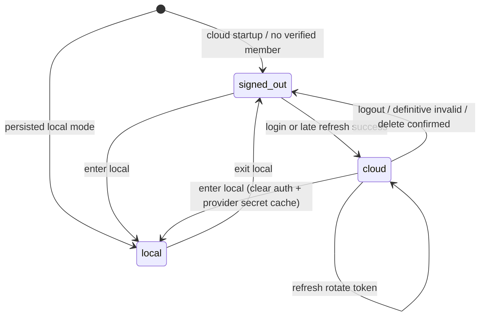

| 转移 | 前置/副作用 | 失败语义 | 证据 |
|---|---|---|---|
| signed-out → cloud | membership 已验证 | 短暂错误保留 token 但不进 app | `authManager.ts`, `authStartupGate.ts` |
| any → local | 取消 browser auth，清 provider secret cache/auth，再 commit boundary | 旧异步结果由 auth epoch/owner generation 丢弃 | `authManager.ts`, `appSessionState.ts` |
| local → signed-out | 保留 local owner 数据 | 不隐式转 cloud | 同上 |
| cloud → signed-out | logout/凭据确定失效/删号确认 | 网络/429 不清 token | `authManager.ts` |

冷启认证有两个时钟：UI splash 可超时返回 signed-out，但后台 refresh 不取消；晚到成功后广播 cloud。这是显式“界面 gate 超时 ≠ 认证请求取消”。

## 2. 登录流 reducer

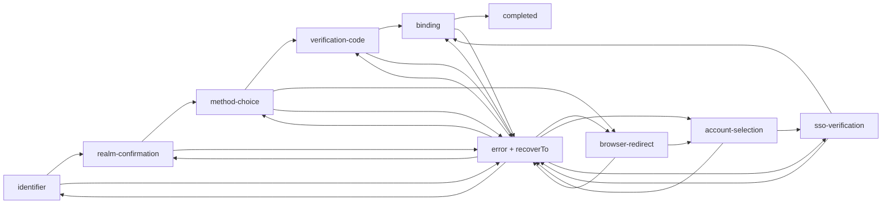

证据：`packages/auth-client/src/types.ts` 的 `AuthFlowState` 与 reducer。具体 realm/SSO 网络回包需真服务动态待验。

## 3. Maker Session / Turn

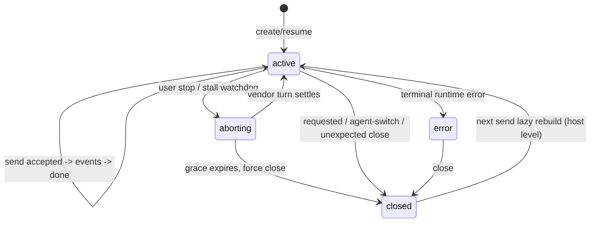

| 阶段 | 不变式 |
|---|---|
| reserve | host turn lease + 单 reservation；busy 拒绝 |
| pre-dispatch | 取消返回 `accepted:false`，不计已执行 |
| dispatch | 安装 origin，agent handle 接受后才越边界 |
| running | 事件流持续重置 stall watchdog |
| waiting interaction | 暂停 stall 计时；无 listener 默认拒绝/空答 |
| aborting | 不再计 stall；grace 内不 settle 则 close |
| terminal | `done` 或终态 `error`；旧 unknown error 按终态 |

证据：`packages/maker-core/src/session.ts`、`types/events.ts`、`maker.ts`。

## 4. 持久化输入队列

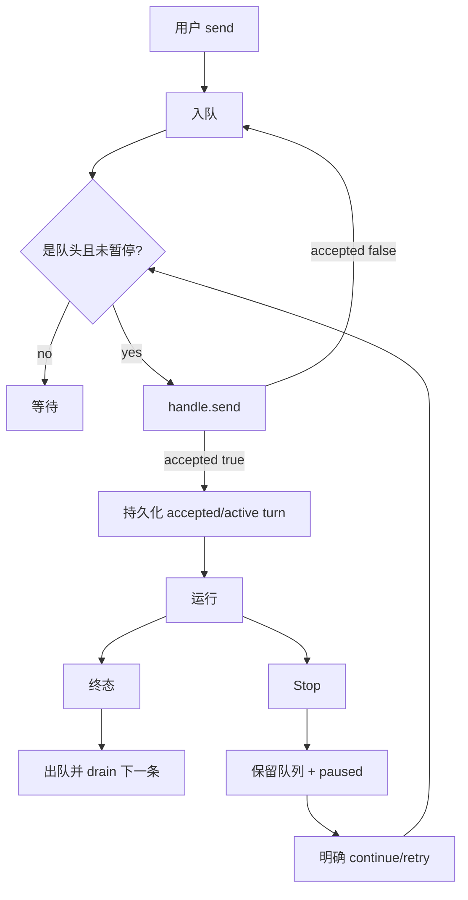

Steer 是一个标记而不是普通 send：它阻塞 drain，仅 Maker 接受后持久化；失败则保留/回滚。崩溃后快照以 paused 恢复，不自动重放不确定输入。Retry 根据是否已有部分输出选择 clone 或 continuation。

证据：`apps/desktop/src/main/maker-ipc/agent-input-coordinator.ts`、`localDb/schema.ts` 的 `agent_input_queue_snapshots`。

## 5. Harness/Agent 切换

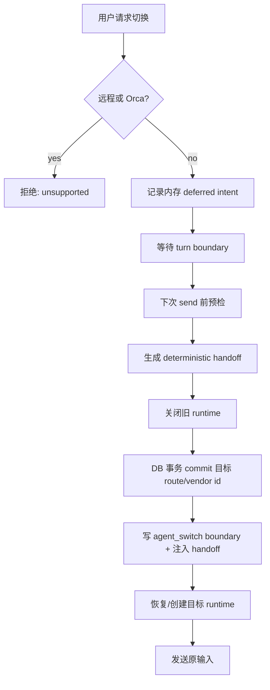

- DB commit 是业务真值切换点。boundary 写失败时用内存 handoff 降级继续；spawn 失败由下次 send 重建。
- 切回原 Agent 优先用最新 boundary + 停放 vendor ID 增量恢复；失败原子清 vendor ID，用 full handoff。
- deferred intent 不持久化，app 重启后丢失。

证据：`sessionAgentSwitchHandler.ts`、`agentHandoff.ts`。

## 6. Runtime 模型/路由切换

| 情形 | 处理 |
|---|---|
| 同 route 且 runtime 支持 | 直接 `setModel` |
| route 先更新后 `setModel` 失败 | 回滚 route |
| turn 忙且 credential family 不兼容 | 延迟到 boundary |
| Codex turn 运行中 route 更换 | 不中途切，边界应用 |
| 运行时 effort 更改超过 3.5s | 终止 runtime，1s 收敛，下次 send 重建 |

证据：`runtimeSetModel.ts`、`runtimeSetEffort.ts`。

## 7. 人机交互

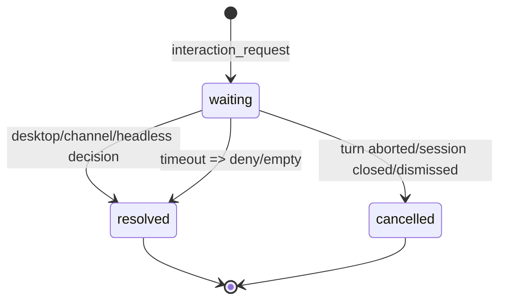

交互类型：permission / ask_user_question / plan_review。无可用界面或 resolver 时 fail closed。plan-mode 与 permission-mode 是正交状态，不可由一个字段替代另一个。

证据：`packages/maker-core/src/session.ts`、`apps/desktop/src/main/maker-ipc/interactionRouter.ts`、`localDb/schema.ts`。

## 8. Orca Team/Worker

### Team

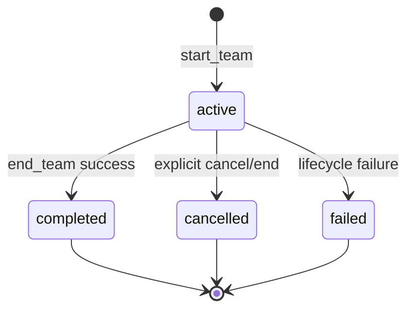

### Worker

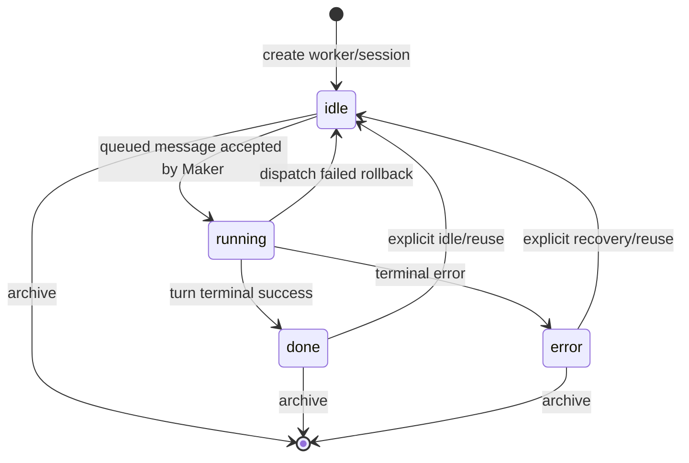

不变式：

- DB 部分唯一：每 lead 最多一个 active team，每 team 最多一个 focused worker。
- 创建 reservation 是短租约；label 唯一；软/硬上限分开。
- Worker 初始不继承 Lead permission。远程继承 remoteHostId，但 Pi remote 拒绝。
- 从 idle 到 running 以 Maker accepted 为边界；拒绝/失败回滚。
- done/error 会向 Lead bridge；idle watcher 可关运行时，但不删逻辑 Worker。
- 只有透明 runtime/thread provenance 能做控制身份，业务 sessionId 和 `mcp-session-id` 不足以授权。

证据：`apps/desktop/src/main/localDb/schema.ts`、`apps/desktop/src/main/orca/*`、`packages/orca-workflow/src/orca-bridge-mcp.ts`。

## 9. Scheduler Attempt

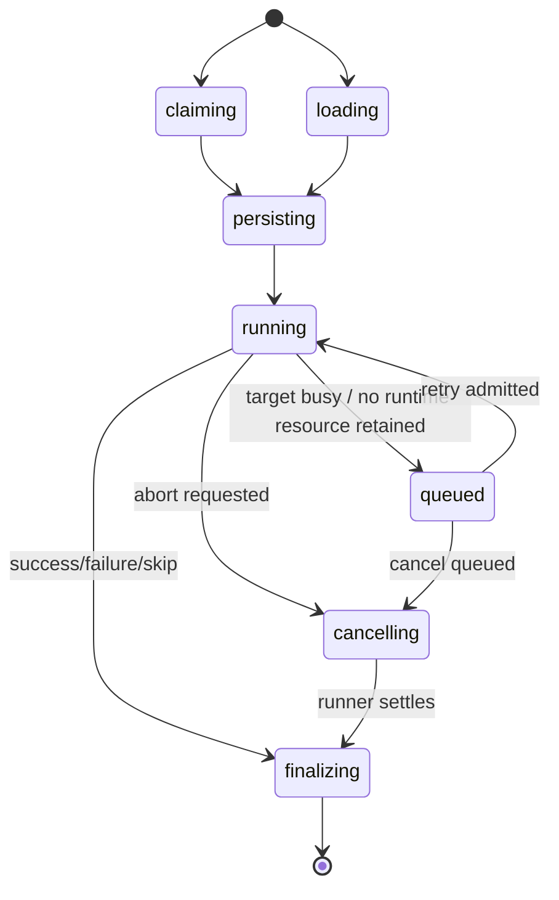

运行时 phase 不落 DB；持久 run 只有 running/success/failed/aborted/interrupted/skipped。`queued` 不持有 Agent/MCP/token，不占并发槽。转移只能由 `attemptLifecycle.ts` 执行，非法边抛错。

其他关键时序：

- due 时以 `nextFireAt` CAS claim，避免重复触发。
- 忙 target 可“无 run row”延迟，与已创建 run 后 queued 不同。
- pre-run hook: 0 运行，2 skipped，其他/超时/不存在 failed。
- 运行中 heartbeat；启动 stale sweep 将崩溃留下 running 转 interrupted。
- silent success 不通知，除非 Agent 显式 notify；失败强制通知。

证据：`packages/maker-scheduler/src/types.ts`、`packages/maker-scheduler/src/engine/attemptLifecycle.ts`、`packages/maker-scheduler/src/engine/scheduler.ts`、`apps/desktop/src/main/scheduler-host/index.ts`、`apps/desktop/src/main/scheduler-host/storage.ts`。

## 10. Ghost Runtime

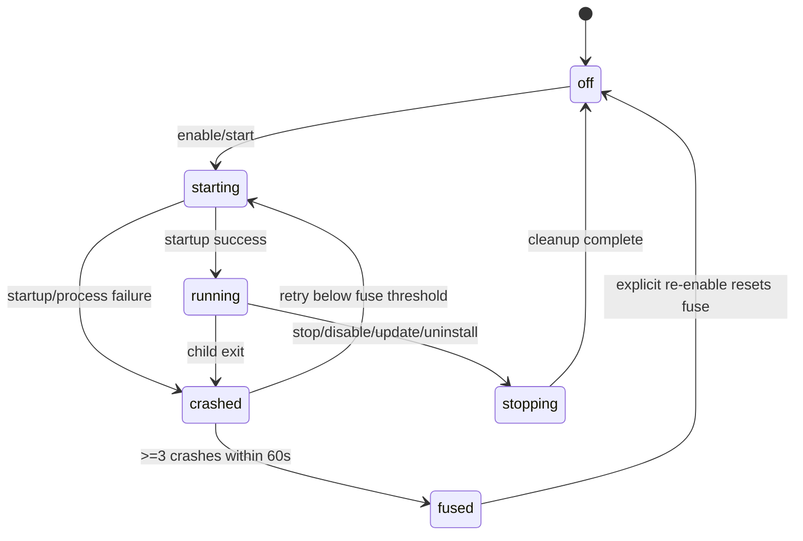

Stop 幂等。Node broker 对每 plugin/entry 管理子进程，有 pending/bytes/timeout 上限、启动重试和空闲超时。

证据：`apps/desktop/src/main/cindy-brain/runtime/GhostRuntime.ts`、`apps/desktop/src/main/cindy-brain/nodeRuntimeBroker.ts`。

## 11. 插件安装/升级

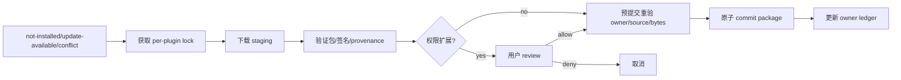

卸载先停/清 runtime，再最佳努力更新 ledger。显式 opt-out 是防默认插件被再安装的持久化意图。

证据：`apps/desktop/src/main/plugin-market/service.ts`、`install.ts`、`packages/plugin-protocol/src/delivery.ts`。

## 12. Hook Transport

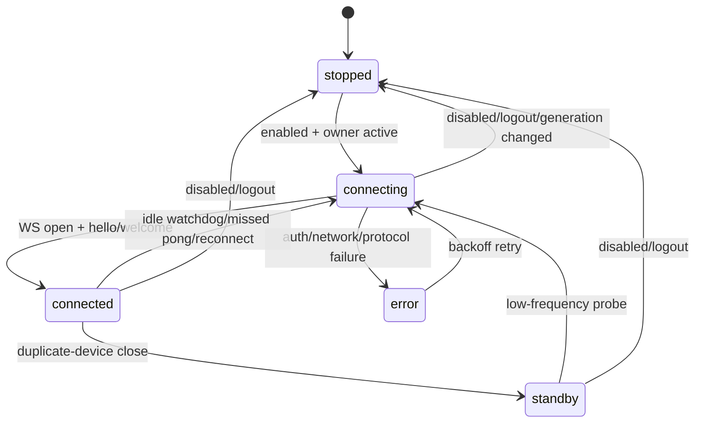

401 只做一次 forced refresh；连接退避 1–30s 带 jitter；65s 无活动 watchdog。

证据：`apps/desktop/src/main/hook-control/transport.ts`。

## 13. Hook Task Dispatch

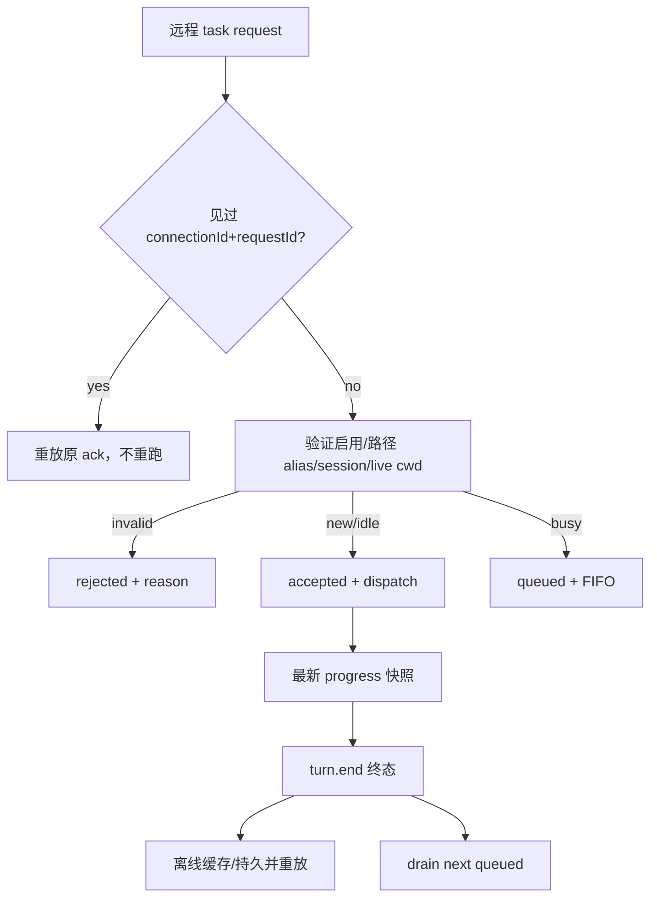

Ack reason 只使用定义枚举：unknown_workspace/workspace_not_allowed/session_not_found/disabled/invalid。复用 session 每条都查 live cwd；路径映射变化必须丢弃旧绑定。

证据：`apps/desktop/src/main/hook-control/dispatcher.ts`、`apps/desktop/src/main/hook-control/requestLedger.ts`、`apps/desktop/src/main/hook-control/session-runner.ts`、`apps/desktop/src/main/hook-control/outbound.ts`。

## 14. 个人微信连接与任务

### 连接

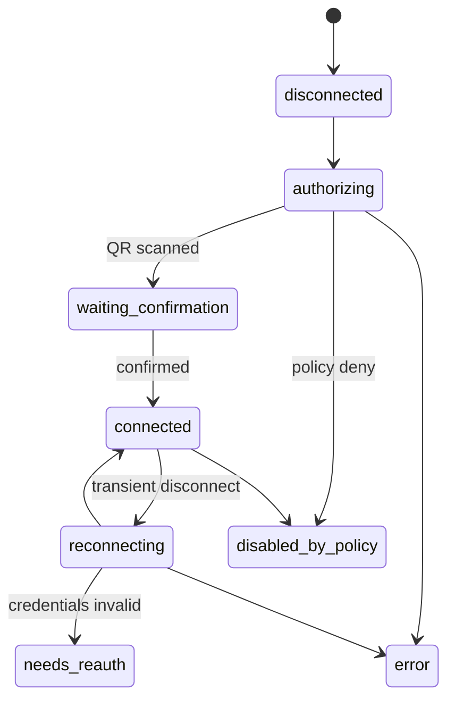

### Inbox task

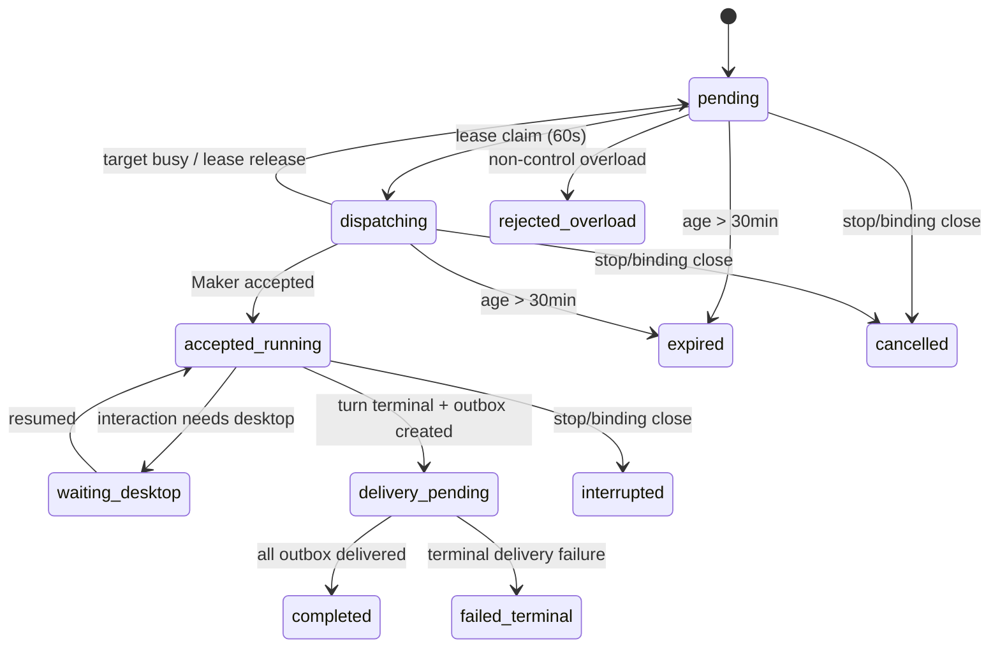

Outbox：`pending → sending → delivered`；可从 sending 回 pending 重试，或进 failed_terminal。`/stop` 与 `/stop all` 是控制消息，不走 overload 拒绝。binding epoch 防止关闭/重绑后旧写入落库。

证据：`apps/desktop/src/main/localDb/worker/opHandlers/wechatTx.ts`、`apps/desktop/src/main/im/wechat/WechatIM.ts`、`apps/desktop/src/main/localDb/schema.ts`。

## 15. Device Link 连接/单主

### Client

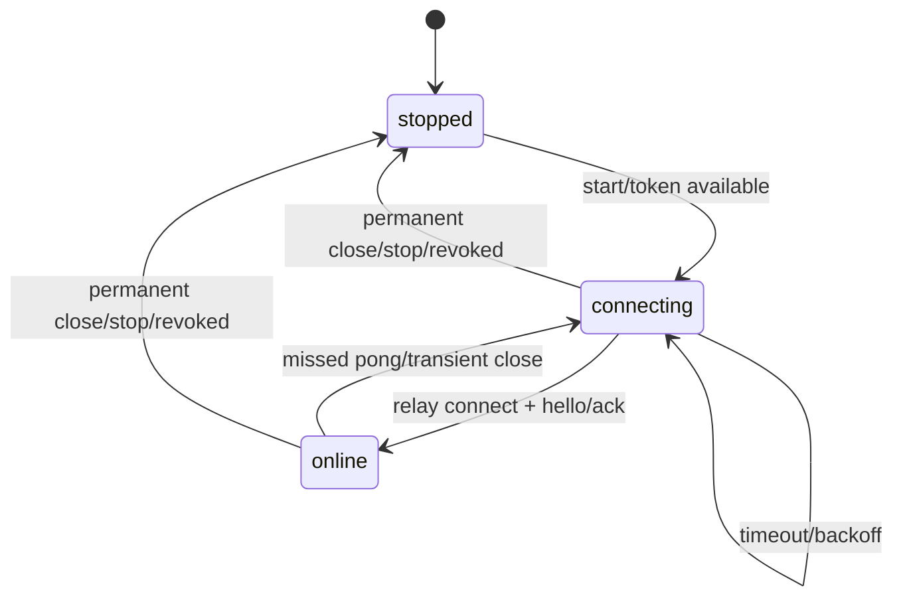

### Local owner lease

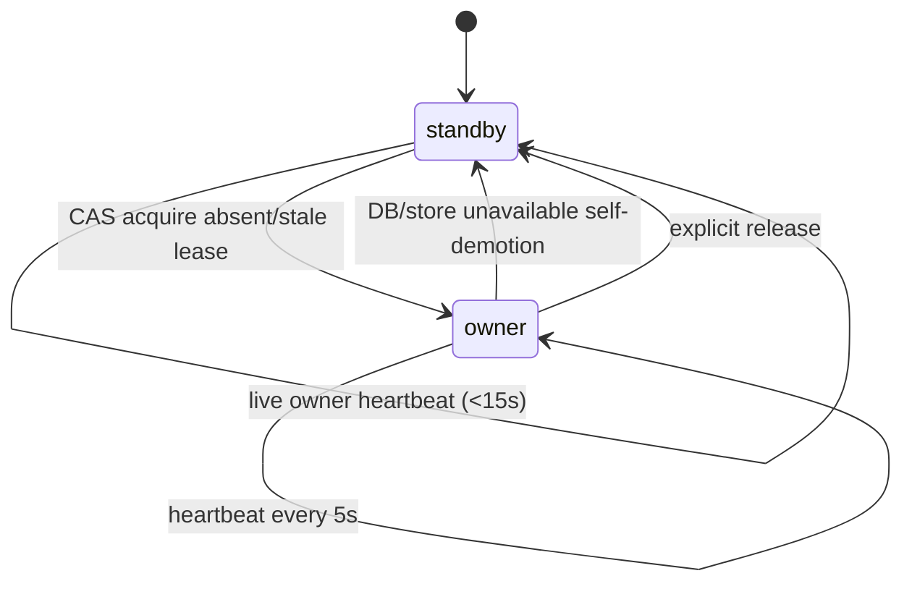

网络断开不等于让 owner。离线 push 仅内存，不是业务真值。`transport-timeout` 是可能恢复 close，永久原因（user/toggle-off/shutdown/revoked）不自动重开。

证据：`packages/device-link/src/client.ts`、`ownership.ts`、protocol types，`apps/desktop/src/main/device-link/*`。

## 16. Terminal

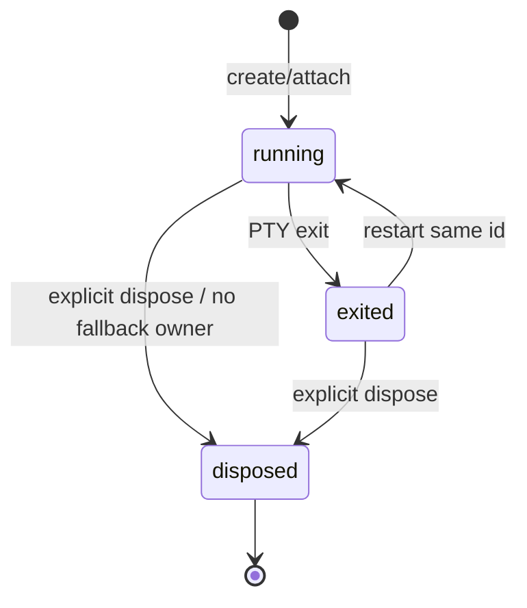

PTY exit 不删记录；dispose 才 kill/移除。窗口销毁时优先转 owner，无 fallback 才 dispose。证据：`apps/desktop/src/main/terminal/ptyManager.ts`。

## 17. 更新

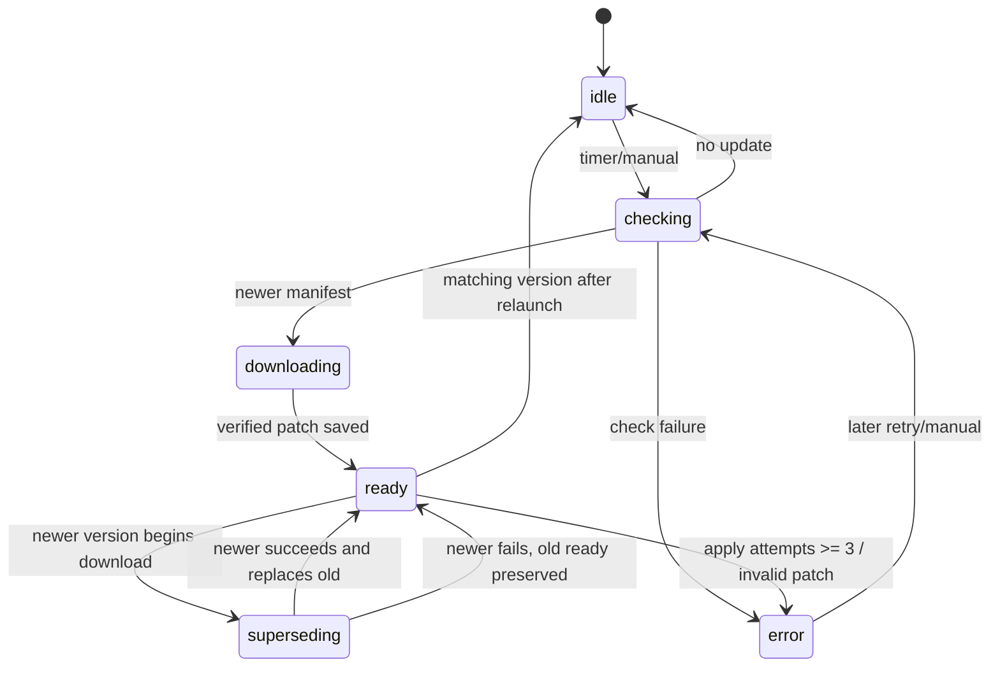

Auto relaunch 是另一个 gate：enabled + packaged + ready + 无活跃任务 + quiet/resume 窗口 + 锁屏/空闲条件。任一忙查询错误均 fail closed，不自动重启。

证据：`apps/desktop/src/main/updateService.ts`。真实 patch 签名与系统替换为动态待验。

## 18. Local DB 打开/恢复

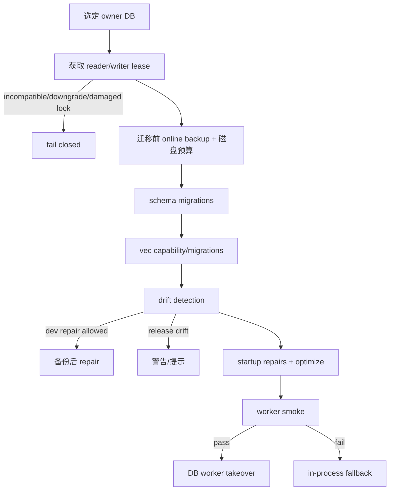

`SQLITE_CORRUPT` 独立恢复链：`.bak.clean` → 最新 `.bak.<ISO>` → 无备份致命。Worker 运行后错误边界自动重启一次。

证据：`apps/desktop/src/main/localDb/index.ts`、`schema.ts`、`migrations/*`。

## 19. 需要动态故障注入验证的边

1. auth splash 超时后 late success 与同时 logout/local switch 的 epoch 竞态。
2. Agent accepted boundary 前/后 crash，输入快照是否严格不重复执行。
3. Harness 切换 DB commit 后 boundary/spawn 失败的恢复文本是否完整。
4. Scheduler claim/heartbeat/finalize 各 await 点 crash，stale sweep 是否都收敛为单一终态。
5. Orca reservation 过期、批量部分成功、Worker bridge 丢线重放的可观测性。
6. Hook/WeChat 在 accepted-running 、outbox sending 和 binding close 瞬间崩溃的去重。
7. Device Link 两个本地进程与 DB 短暂不可用时的单主保证。
8. Updater ready→superseding→回退旧 patch 及 apply-attempt=3 的真实文件系统结果。
